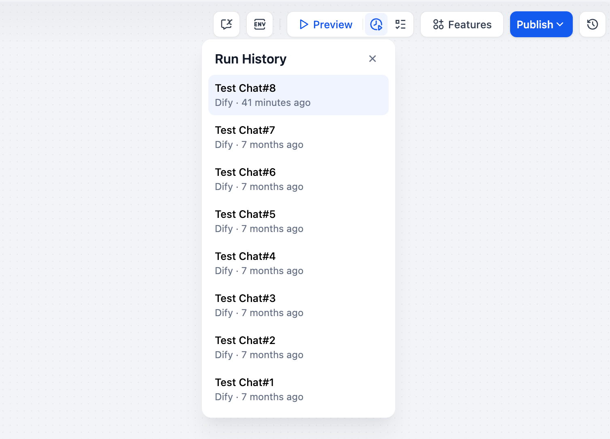
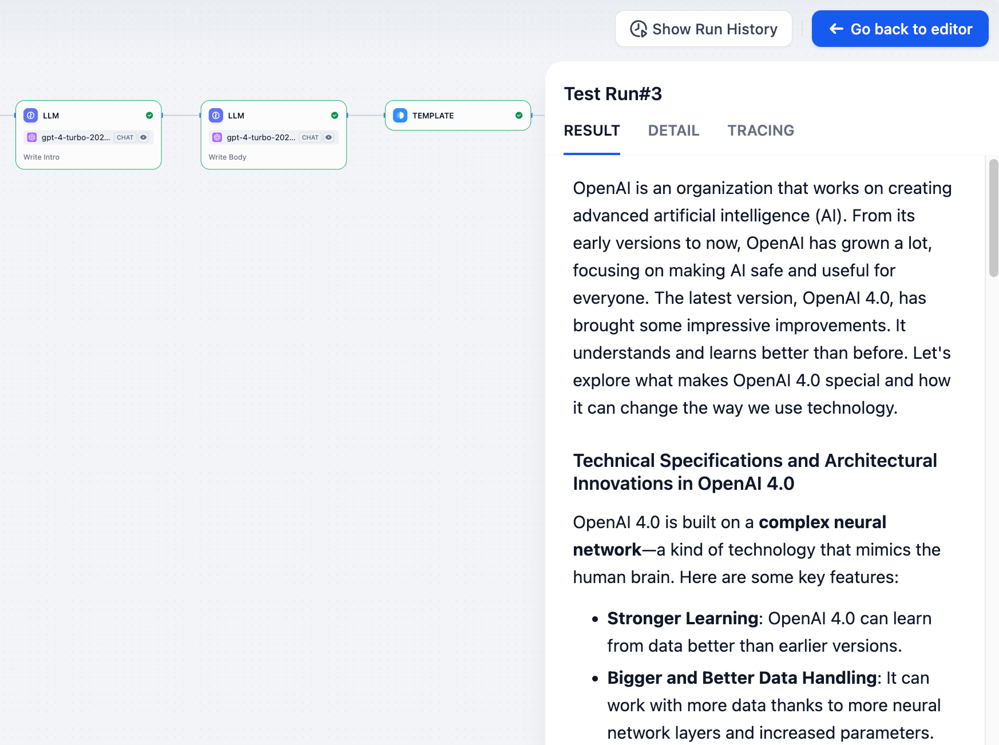
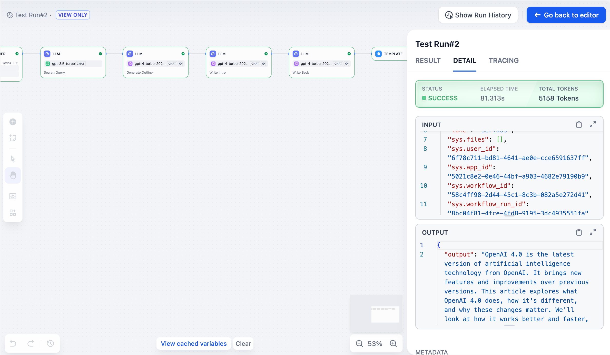
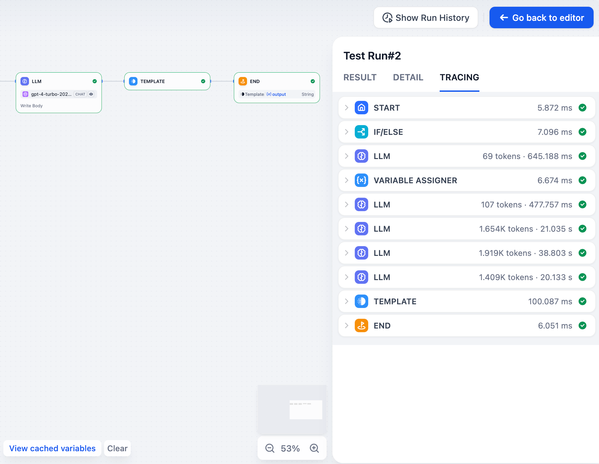
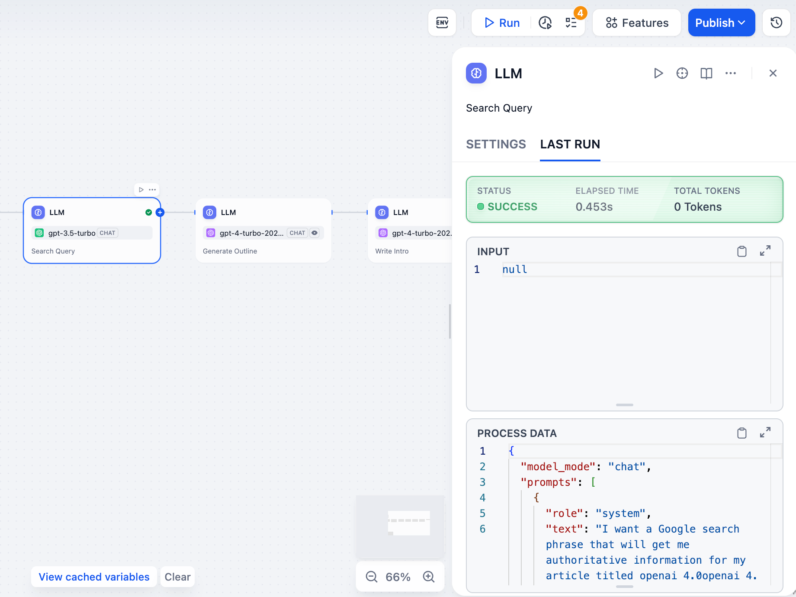

# 运行历史

> 本文档由 AI 自动翻译。如有任何不准确之处，请参考 [英文原版](https://docs.dify.ai/en/cloud/use-dify/debug/history-and-logs.md)。

Dify 会在每次工作流运行时记录详细的运行历史。你可以查看应用级别和各个节点的运行情况。

> [!NOTE]
>
> 对于发布后来自真实用户的运行历史，请参阅 [运行历史和标注](../../../%E7%9B%91%E6%8E%A7/%E6%97%A5%E5%BF%97.md)。

## 应用运行历史

每次工作流运行都会创建一个完整的日志条目。点击任何条目可以查看三个部分：

### 结果

显示用户看到的最终输出。如果工作流失败，你将在这里看到错误消息。

> [!WARNING]
>
> 仅适用于 Workflow 应用。

### 详情

显示原始输入、最终输出和执行过程中的系统元数据。

### 追踪

准确显示工作流的执行过程，包括哪些节点按什么顺序运行、每个节点耗时多长，以及数据在节点间如何流动。这对于找出瓶颈和理解具有分支或循环的复杂工作流很有用。

由工具节点调用的工作流工具，在追踪中只显示为该工具节点。要查看工具内部的节点，点击该节点上的 **追踪**。

## 节点运行历史

你也可以检查任何单个节点的最后一次执行。在节点配置面板中点击"最后运行"，查看其最近的输入、输出和时间详情。

