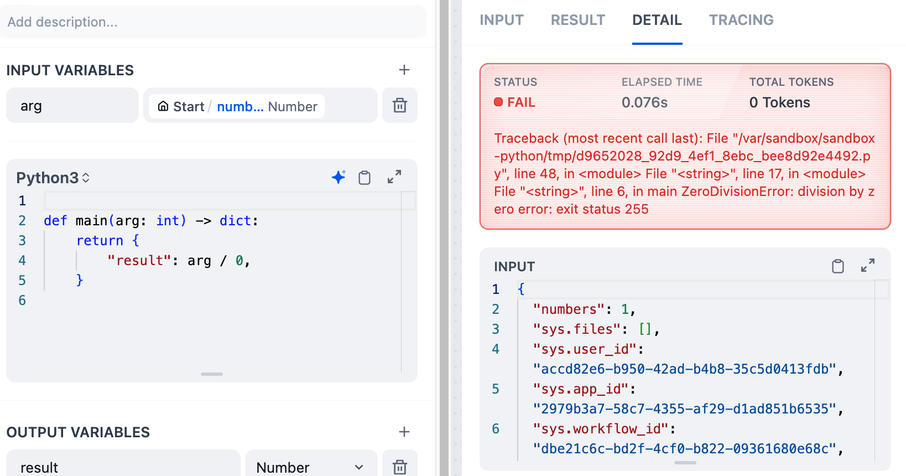
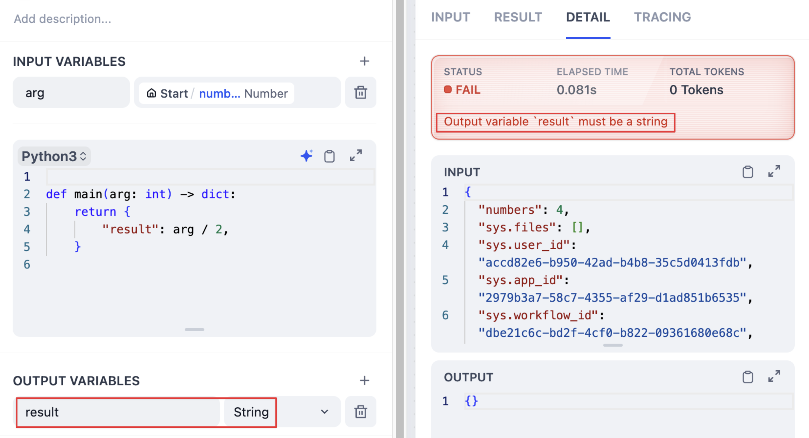
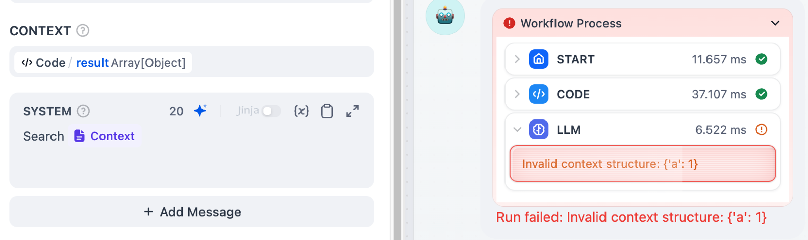
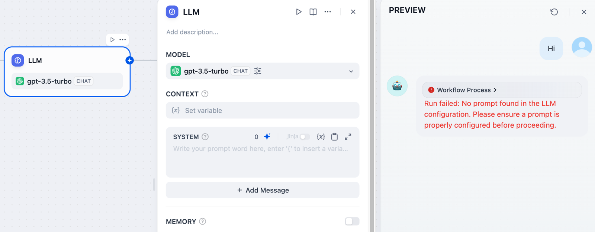
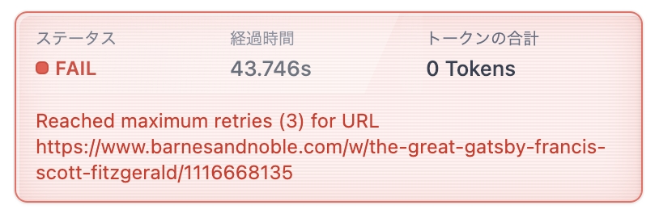

# 错误类型

> 本文档由 AI 自动翻译。如有任何不准确之处，请参考 [英文原版](https://docs.dify.ai/en/cloud/use-dify/debug/error-type.md)。

每个节点类型都会抛出特定的错误类别，帮助你了解出错的原因以及如何修复。

## 节点特定错误

> [tab] Code
>
> `CodeNodeError`
> \[!NOTE] 你的 Python 或 JavaScript 代码在执行过程中抛出了异常
>
> 
>
> `OutputValidationError`
> \[!NOTE] 你的代码返回的数据类型与你配置的输出变量类型不匹配
>
> `DepthLimitError`
> \[!NOTE] 你的代码创建的嵌套数据结构深度超过了 5 层
>
> `CodeExecutionError`
> \[!NOTE] 沙箱服务无法执行你的代码 - 通常意味着服务已停止
>
> 

> [tab] LLM
>
> `VariableNotFoundError`
> \[!NOTE] 你的提示词模板引用了一个在工作流上下文中不存在的变量
>
> 
>
> `InvalidContextStructureError`
> \[!NOTE] 你向上下文字段传递了数组或对象，该字段仅接受字符串
>
> `NoPromptFoundError`
> \[!NOTE] 提示词字段完全为空
>
> `ModelNotExistError`
> \[!NOTE] 在大型语言模型节点配置中未选择模型
>
> `LLMModeRequiredError`
> \[!NOTE] 所选模型未配置有效的 API 凭据
>
> `InvalidVariableTypeError`
> \[!NOTE] 你的提示词模板不是有效的 Jinja2 语法或纯文本格式
>
> 

> [tab] HTTP Request
>
> `AuthorizationConfigError`
> \[!NOTE] API 端点缺失或身份验证配置无效
>
> `InvalidHttpMethodError`
> \[!NOTE] HTTP 方法必须是 GET、HEAD、POST、PUT、PATCH 或 DELETE
>
> `ResponseSizeError`
> \[!NOTE] API 响应超过了 10MB 大小限制
>
> `FileFetchError`
> \[!NOTE] 无法检索请求中引用的文件变量
>
> `InvalidURLError`
> \[!NOTE] URL 格式错误或无法访问

> [tab] Tool
>
> `ToolParameterError`
> \[!NOTE] 传递给工具的参数与其预期的架构不匹配
>
> `ToolFileError`
> \[!NOTE] 工具无法访问所需的文件
>
> `ToolInvokeError`
> \[!NOTE] 外部工具 API 在执行过程中返回了错误
>
> 
>
> `ToolProviderNotFoundError`
> \[!NOTE] 工具提供商未正确安装或配置

## 系统级错误

`InvokeConnectionError`
\[!NOTE] 与外部服务的网络连接失败

`InvokeServerUnavailableError`
\[!NOTE] 外部服务返回 503 状态或暂时停机

`InvokeRateLimitError`
\[!NOTE] 你已达到 API 或模型供应商的速率限制

`QuotaExceededError`
\[!NOTE] 你对此服务的使用配额已超限
