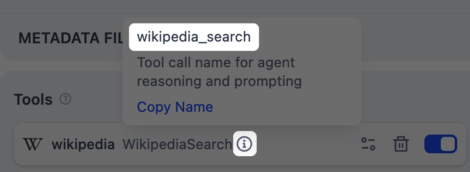
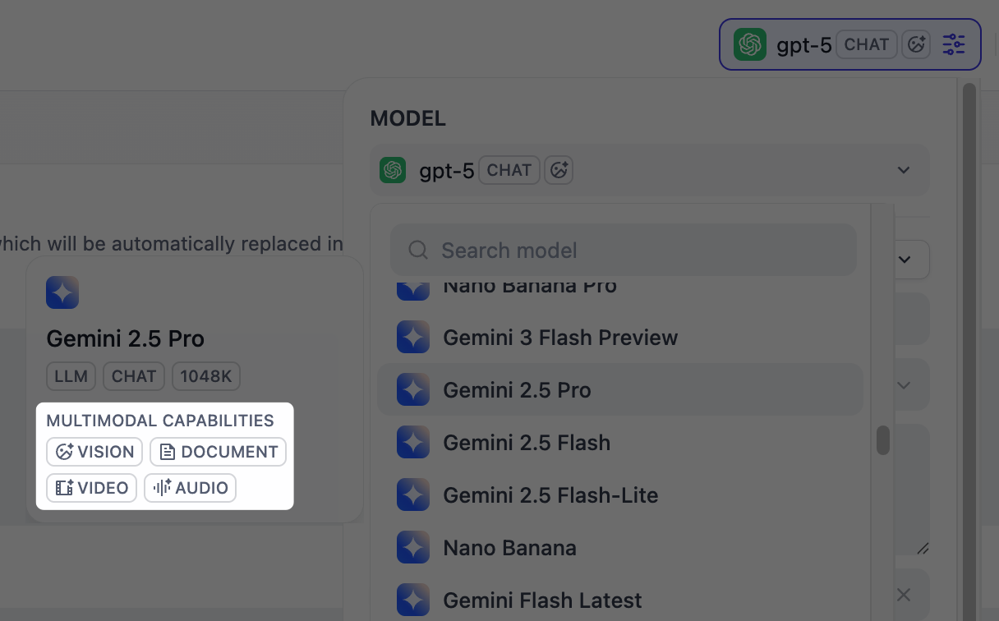
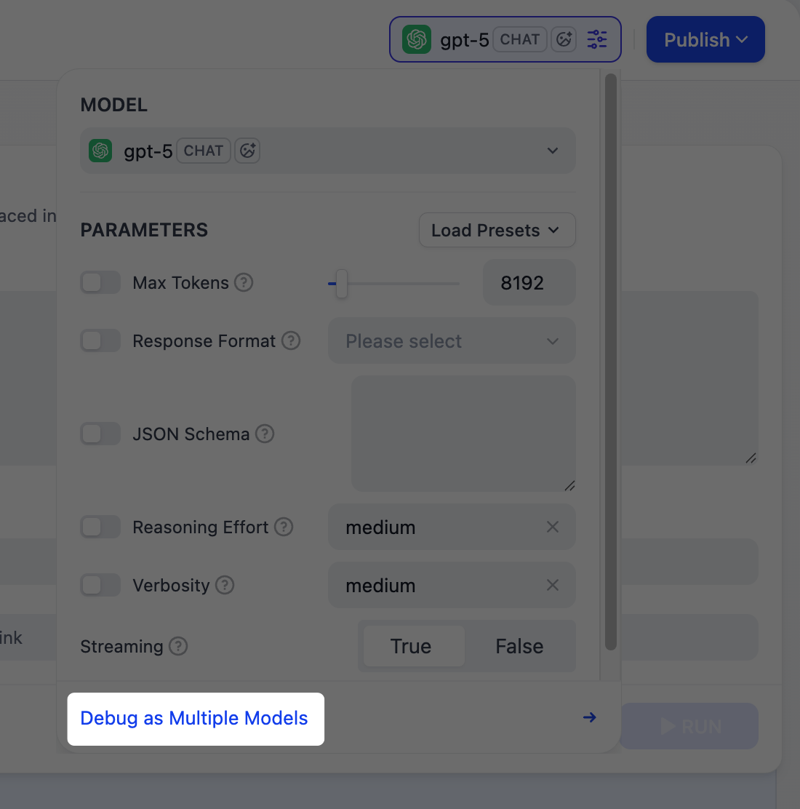

# Agent

> 模型能够自主推理、决策并使用工具的对话式应用

> 本文档由 AI 自动翻译。如有任何不准确之处，请参考 [英文原版](https://docs.dify.ai/en/cloud/use-dify/build/agent.md)。

> [!TIP]
>
> [新版 Agent](../Agent/Agent.md) 目前处于 Beta 阶段：它在自己的沙箱中工作，构建一次，既可作为聊天应用使用，也可用于工作流。

Agent 是一种对话式应用，模型可以在需要时使用工具来完成用户的请求。

当你希望模型利用可用工具自主决定如何处理任务，但无需设计多步工作流时，可以使用 Agent。例如，构建一个数据分析助手，能够自动获取实时数据、生成图表并总结发现。

> [!NOTE]
>
> Agent 每次对话最多保留 500 条消息或 2,000 token 的历史记录。超出任一限制后，最早的消息将被移除以为新消息腾出空间。

> [!TIP]
>
> Agent 支持对话开场白、后续建议等可选功能。详见 [应用工具箱](../%E5%BA%94%E7%94%A8%E5%B7%A5%E5%85%B7%E7%AE%B1.md)。

## 配置

### 编写提示词

提示词告诉模型该做什么、如何回应以及需要遵循的约束条件。对于 Agent，提示词还应该指导模型如何推理任务以及何时使用工具，因此需要明确描述你期望的工作流程。

以下是编写有效提示词的一些技巧：

* **定义角色**：描述模型应扮演的角色及其应运用的专业知识。

* **指定输出格式**：描述你期望的结构、长度或风格。

* **设定约束**：告诉模型应避免什么或遵循什么规则。

* **引导工具使用**：提及具体工具名称，并描述何时应使用它们。

  

  工具名称

* **概述工作流程**：将复杂任务拆分为模型应遵循的逻辑步骤。

#### 使用变量创建动态提示词

为了让 Agent 适应不同用户或场景而无需每次重写提示词，可以添加变量来预先收集必要的信息。

变量是提示词中的占位符。每个变量都会显示为一个输入字段，用户在对话开始前填写，其值在运行时注入提示词。用户也可以在对话过程中更新变量值，提示词会随之调整。

例如，数据分析 Agent 可以使用 `domain` 变量，让用户指定关注的领域：

```text wrap theme={null}
你是一名专注于 {{domain}} 领域的数据分析师。帮助用户探索和理解他们的数据。

收到问题后，使用可用的数据工具获取相关信息。如果结果适合可视化展示，请生成图表。用通俗易懂的语言解释你的发现。

回答要简洁。如果问题模糊，请在获取数据前先确认。
```

> [!TIP]
>
> 编写提示词时，输入 `/` > **添加新变量** 即可快速插入命名占位符。你可以稍后在 **变量** 部分配置其详细信息。

选择与预期输入匹配的变量类型：

> [tab] 文本
>
> 接受最多 256 个字符。适用于姓名、电子邮件地址、标题或任何适合单行显示的简短文本输入。

> [tab] 段落
>
> 允许无长度限制的长文本输入，为用户提供多行文本区域以输入详细描述。

> [tab] 下拉选项
>
> 显示带有预定义选项的下拉菜单。

> [tab] 数字
>
> 仅接受数字输入，适用于数量、评分、ID 或任何需要数学处理的数据。

> [tab] 复选框
>
> 提供简单的是/否选项。用户勾选时输出为 `true`，否则为 `false`。适用于确认或任何需要二选一的场景。

> [tab] 基于 API 的变量
>
> 在运行时从外部 API 获取变量值，而非由用户输入。
>
> 当提示词需要来自外部来源的动态数据（如实时天气状况或数据库记录）时使用。详见 [自定义端点](../../%E9%9B%86%E6%88%90/%E8%87%AA%E5%AE%9A%E4%B9%89%E7%AB%AF%E7%82%B9/%E8%87%AA%E5%AE%9A%E4%B9%89%E7%AB%AF%E7%82%B9.md)。

> [!NOTE]
>
> **显示名称** 是终端用户看到的每个输入字段的名称。

#### 使用 AI 生成或改进提示词

如果不确定从何开始或想优化现有提示词，点击 **生成** 让 LLM 帮助你起草。

从零开始描述你的需求，或引用 `current_prompt` 并指定需要改进的内容。要获得更精准的结果，可以在 **理想输出** 中添加示例。

每次生成都会保存为一个版本，因此你可以自由尝试和回滚。

### 使用 Dify 工具扩展 Agent

添加 [Dify 工具](../../%E9%9B%86%E6%88%90/Dify%20%E5%B7%A5%E5%85%B7.md)，使模型能够与外部服务和 API 交互，执行文本生成之外的任务，如获取实时数据、搜索网页或查询数据库。

模型会根据每个查询决定何时使用以及使用哪些工具。要更精确地引导工具使用，可在提示词中提及具体工具名称，并描述何时应使用它们。


工具名称

你可以禁用或移除已添加的工具，也可以修改其配置。如果工具需要认证，选择已有凭证或创建新凭证。

> [!NOTE]
>
> 要更改默认凭证，前往 **集成** > **工具** > **工具插件**。

#### 最大迭代次数

**Agent 设置** 中的 **最大迭代次数** 限制了模型在单次请求中可以重复推理 - 行动循环（思考、调用工具、处理结果）的次数。

对于需要多次工具调用的复杂多步任务，可以增大此值。较高的值会增加延迟和 token 消耗。

### 基于你的数据生成回复

要让模型的回复基于你自己的数据而非通用知识，可添加 [经典知识库](../../%E7%9F%A5%E8%AF%86%E5%BA%93/%E7%BB%8F%E5%85%B8%E7%9F%A5%E8%AF%86%E5%BA%93/%E7%BB%8F%E5%85%B8%E7%9F%A5%E8%AF%86%E5%BA%93.md)。

模型会评估每条用户查询与知识库描述的相关性，并决定是否需要检索。你无需在提示词中提及知识库。

**知识库描述越详细，模型判断相关性就越准确**，从而实现更精准的检索。

> [!NOTE]
>
> Agent 应用没有应用级检索设置。每个知识库都使用各自配置的设置独立检索。添加多个知识库时，由 Agent 决定查询哪些，也不会跨知识库对结果重排序。

#### 在特定文档中搜索

默认情况下，检索会在整个知识库中进行。要将检索限制在特定文档中，可启用手动或自动元数据过滤。

这可以提高检索精度，特别是当知识库较大或包含不同场景的内容时。

关于创建和管理文档元数据，详见 [元数据](../../%E7%9F%A5%E8%AF%86%E5%BA%93/%E7%BB%8F%E5%85%B8%E7%9F%A5%E8%AF%86%E5%BA%93/%E7%AE%A1%E7%90%86/%E7%AE%A1%E7%90%86%E6%96%87%E6%A1%A3%E5%85%83%E6%95%B0%E6%8D%AE.md)。

### 处理多模态输入

要允许终端用户上传文件，需选择具有相应多模态能力的模型。相关文件类型开关（**视觉**、**音频** 或 **文档**）会在模型支持时显示，你可以根据需要启用。

> [!TIP]
>
> 你可以通过模型的标签快速识别其支持的模态。
>
> 

点击 **视觉** 的 **设置** 配置文件的接受和处理方式。上传设置适用于所有已启用的文件类型。

* **分辨率**：仅控制 **图片** 处理的细节级别。

  * **高**：对复杂图片有更高的准确性，但消耗更多 token

  * **低**：对简单图片处理更快，消耗更少 token

* **上传方式**：选择用户是通过设备上传、粘贴 URL 还是两者兼可。

* **上传数量限制**：用户每条消息可上传的最大文件数量。

## 调试与预览

在右侧的预览面板中，实时测试你的 Agent。选择一个模型，输入消息并发送，查看 Agent 的响应。

你可以调整模型参数来控制生成方式。可用参数和预设因模型而异。

> [!TIP]
>
> 要比较不同模型的输出，点击 **多个模型进行调试** 同时运行最多 4 个模型。
>
> 

我们建议选择 **推理能力强** 且 **原生支持工具调用** 的模型。

> [accordion] 为什么这很重要
>
> Agent 需要判断何时使用工具、哪个工具适合当前任务，以及如何解读结果，这取决于模型的推理能力。具有内置工具调用支持的模型在执行这些决策时也更加可靠。

你可以在 **Agent 设置** 中确认模型的工具调用支持，系统会自动显示其 Agent 模式：

* **Function Calling** 适用于原生支持的模型，意味着它们可以直接调用工具。

* **ReAct** 适用于其他模型，Dify 通过提示词策略引导它们使用工具。

## 发布

对结果满意后，点击 **发布** 使应用可用。详见 [发布](../../%E5%8F%91%E5%B8%83/%E5%88%86%E4%BA%AB%E4%BD%A0%E7%9A%84%20AI%20%E5%BA%94%E7%94%A8.md) 了解完整的发布选项。
