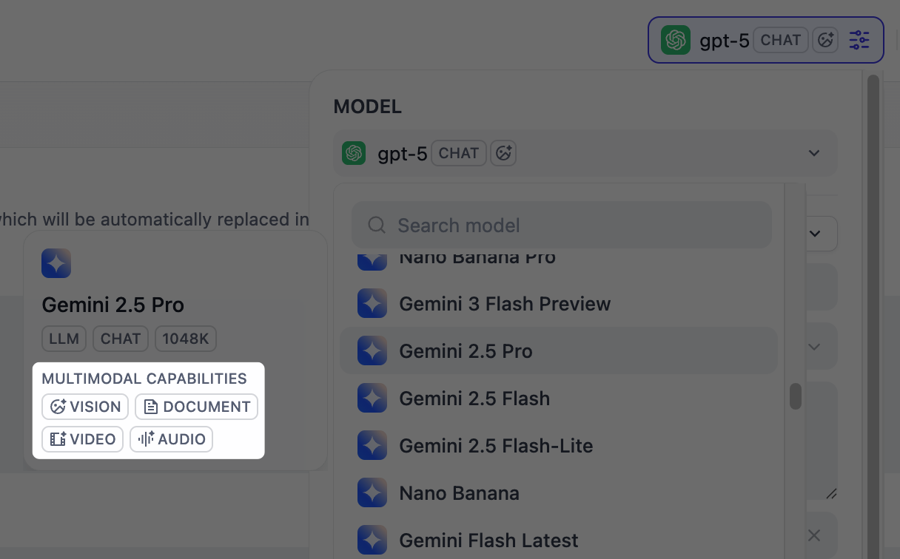
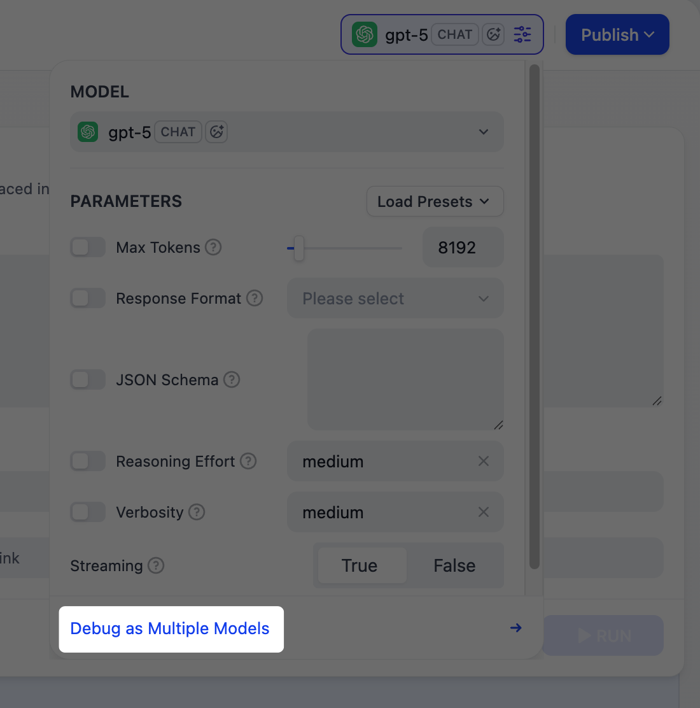

# 文本生成应用

> 通过提示词和用户输入生成文本的简单单轮应用

> 本文档由 AI 自动翻译。如有任何不准确之处，请参考 [英文原版](https://docs.dify.ai/en/cloud/use-dify/build/text-generator.md)。

文本生成应用是简单的单轮应用：你编写提示词、提供输入，模型生成回复。

适用于不需要多轮对话、工具调用或多步工作流的任务。只需清晰的输入、一次模型调用，即可获得可直接使用的输出。

> [!TIP]
>
> 文本生成应用支持一次生成多个输出、文字转语音和内容审核等可选功能。详见 [应用工具箱](../%E5%BA%94%E7%94%A8%E5%B7%A5%E5%85%B7%E7%AE%B1.md)。

## 配置

### 编写提示词

提示词告诉模型该做什么、如何回应以及需要遵循的约束条件。

由于文本生成应用以单轮方式运行，没有对话历史，提示词是模型唯一的上下文来源，因此需要包含模型在一次运行中生成正确输出所需的所有信息。

以下是编写有效提示词的一些技巧：

* **明确定义任务**：说明模型应生成什么（例如翻译、摘要、SQL 语句）。

* **指定输出格式**：描述你期望的结构、长度或风格。

* **设定约束**：告诉模型应避免什么或遵循什么规则。

由于文本生成应用始终需要用户输入才能运行，创建新应用时会自动在提示词中插入一个段落类型的 `query` 变量。你可以重命名 `query` 或更改其类型。

变量是占位符。每个变量在运行应用前变为用户填写的输入字段，其值在运行时替换到提示词中。例如：

```text wrap theme={null}
你是一名专业编辑。请将以下文本总结为 3 个简洁的要点。使用中立语气，不要添加原文中没有的信息。

{{query}}
```

> [!TIP]
>
> 编写提示词时，输入 `/` > **添加新变量** 即可快速插入命名占位符。你可以稍后在 **变量** 部分配置其详细信息。

选择与预期输入匹配的变量类型：

> [tab] 文本
>
> 接受最多 256 个字符。适用于姓名、电子邮件地址、标题或任何适合单行显示的简短文本输入。

> [tab] 段落
>
> 允许无长度限制的长文本输入，为用户提供多行文本区域以输入详细描述。

> [tab] 下拉选项
>
> 显示带有预定义选项的下拉菜单。

> [tab] 数字
>
> 仅接受数字输入。适用于数量、评分、ID 或任何需要数学处理的数据。

> [tab] 复选框
>
> 提供简单的是/否选项。用户勾选时输出为 `true`，否则为 `false`。适用于确认或任何需要二选一的场景。

> [tab] 基于 API 的变量
>
> 在运行时从外部 API 获取变量值，而非由用户输入。
>
> 当提示词需要来自外部来源的动态数据（如实时天气状况或数据库记录）时使用。详见 [自定义端点](../../%E9%9B%86%E6%88%90/%E8%87%AA%E5%AE%9A%E4%B9%89%E7%AB%AF%E7%82%B9/%E8%87%AA%E5%AE%9A%E4%B9%89%E7%AB%AF%E7%82%B9.md)。

> [!NOTE]
>
> **显示名称** 是终端用户看到的每个输入字段的名称。

#### 使用变量创建动态提示词

为了让应用适应不同用户或场景而无需每次重写提示词，可以添加更多变量。

每个变量预先收集一条特定信息，并在运行时注入提示词。

例如，SQL 生成器可以使用 `database_type` 来适配输出方言，`query` 则捕获用户的自然语言请求：

```text wrap theme={null}
你是一个 SQL 生成器。请将以下自然语言查询转换为 {{database_type}} SQL 语句：{{query}}
```

#### 使用 AI 生成或改进提示词

如果不确定从何开始或想优化现有提示词，点击 **生成** 让 LLM 帮助你起草。

从零开始描述你的需求，或引用 `current_prompt` 并指定需要改进的内容。要获得更精准的结果，可以在 **理想输出** 中添加示例。

每次生成都会保存为一个版本，因此你可以自由尝试和回滚。

### 基于你的数据生成回复

要让模型的回复基于你自己的数据而非通用知识，可添加 [经典知识库](../../%E7%9F%A5%E8%AF%86%E5%BA%93/%E7%BB%8F%E5%85%B8%E7%9F%A5%E8%AF%86%E5%BA%93/%E7%BB%8F%E5%85%B8%E7%9F%A5%E8%AF%86%E5%BA%93.md)，并选择一个已有变量作为 **查询变量**。

当用户运行应用并填写该字段时，其值会作为搜索查询从知识库中检索相关内容。检索到的内容随后作为上下文注入提示词，使模型能够生成更有依据的回复。

> [accordion] 示例：在内容写作应用中使用「内容类型」检索风格指南
>
> 例如，假设你的知识库包含不同内容类型的风格指南，如博客文章、社交媒体文案、产品描述等。
>
> 在内容写作应用中，将 `content_type` 设为 **查询变量**。当用户选择一种内容类型时，应用会检索匹配的风格指南，并生成遵循相应写作标准的文案。
>
> 你的提示词可能如下所示：
>
> ```text wrap theme={null}
> 你是一名品牌内容写手。请根据以下简报撰写一篇 {{content_type}}：{{brief}}
>
> 请遵循上下文中提供的风格和语气指南。
> ```

#### 配置应用级检索设置

要微调检索结果的处理方式，点击 **检索设置**。

> [!NOTE]
>
> 检索设置有两个层级，即知识库级别和应用级别。
>
> 可以将它们理解为两个连续的过滤器：知识库设置决定初始结果池，应用设置进一步重排序结果或缩小结果范围。

* **重排序设置**

  * **权重设置**

    重排序过程中语义相似度与关键词匹配之间的相对权重。较高的语义权重偏向语义相关性，较高的关键词权重偏向精确匹配。

    权重设置仅在所有已添加的知识库均以 **高质量** 模式索引时可用。

  * **重排序模型**

    重排序模型会根据结果与查询的相关性重新打分和排序所有结果。

    > [!NOTE]
    >
    > 如果添加了多模态知识库，还需选择多模态重排序模型（标有 **Vision** 标签）。否则，检索到的图片将被排除在重排序和最终输出之外。

* **Top K**

  重排序后返回的最大结果数量。

  选择重排序模型后，此值将根据模型的最大输入容量（模型一次能处理的文本量）自动调整。

* **分数阈值**

  返回结果的最低相似度分数。低于此阈值的结果将被排除。使用较高阈值获得更严格的相关性，使用较低阈值包含更广泛的匹配。

#### 在特定文档中搜索

默认情况下，检索会在整个知识库中进行。要将检索限制在特定文档中，可启用手动或自动元数据过滤。

这可以提高检索精度，特别是当知识库较大或包含不同场景的内容时。

关于创建和管理文档元数据，详见 [元数据](../../%E7%9F%A5%E8%AF%86%E5%BA%93/%E7%BB%8F%E5%85%B8%E7%9F%A5%E8%AF%86%E5%BA%93/%E7%AE%A1%E7%90%86/%E7%AE%A1%E7%90%86%E6%96%87%E6%A1%A3%E5%85%83%E6%95%B0%E6%8D%AE.md)。

### 处理多模态输入

要允许终端用户上传文件，选择具有相应多模态能力的模型。相关文件类型开关（**视觉**、**音频** 或 **文档**）会在模型支持时显示，你可以根据需要启用。

> [!TIP]
>
> 你可以通过模型的标签快速识别其支持的模态。
>
> 

点击 **视觉** 的 **设置** 配置文件的接受和处理方式。上传设置适用于所有已启用的文件类型。

* **分辨率**：仅控制 **图片** 处理的细节级别。

  * **高**：对复杂图片有更高的准确性，但消耗更多 token

  * **低**：对简单图片处理更快，消耗更少 token

* **上传方式**：选择用户是通过设备上传、粘贴 URL 还是两者兼可。

* **上传数量限制**：用户每次运行可上传的最大文件数量。

## 调试与预览

在右侧的预览面板中，实时测试你的应用。选择一个最适合你任务的模型，填写输入字段，然后点击 **运行** 查看输出。

选择模型后，你可以调整其参数来控制生成方式。可用参数和预设因模型而异。

> [!TIP]
>
> 要比较不同模型的输出，点击 **多个模型进行调试** 同时运行最多 4 个模型。
>
> 

## 发布

对结果满意后，点击 **发布** 使应用可用。详见 [发布](../../%E5%8F%91%E5%B8%83/%E5%88%86%E4%BA%AB%E4%BD%A0%E7%9A%84%20AI%20%E5%BA%94%E7%94%A8.md) 了解完整的发布选项。

运行 Web 应用时，终端用户可以保存单个输出以供日后参考。


