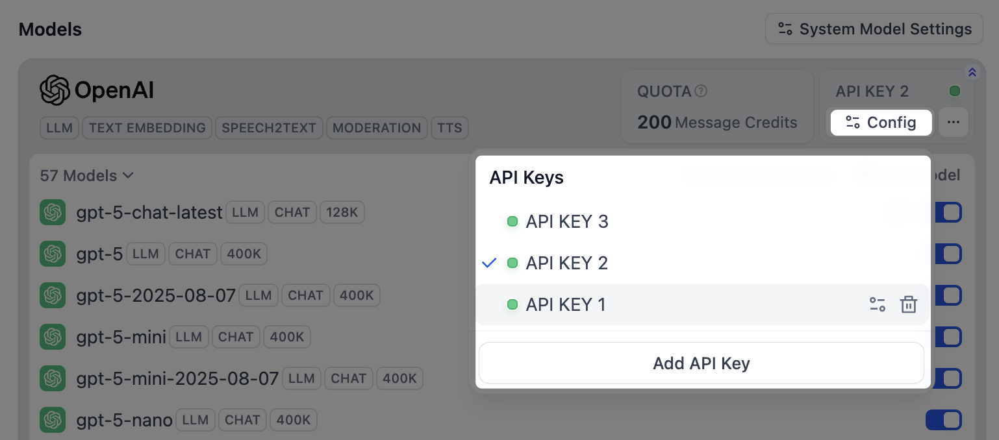
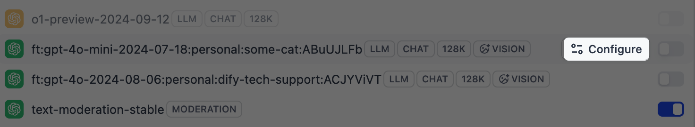
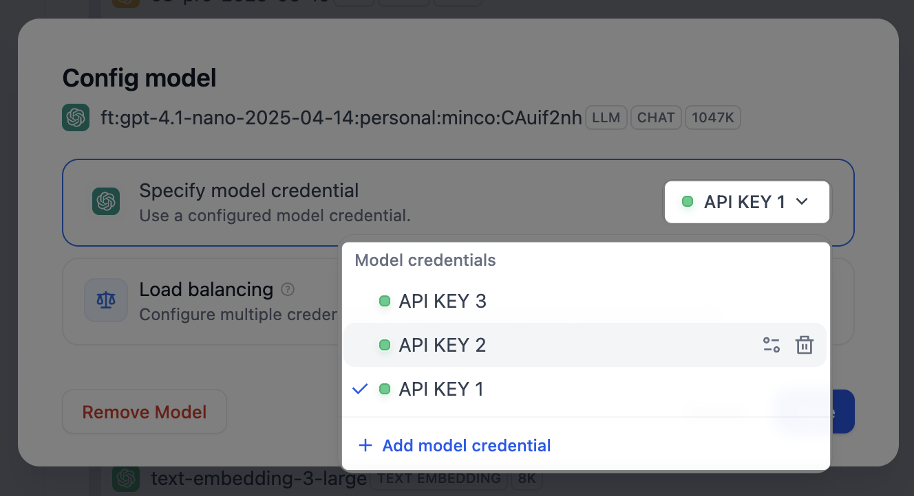
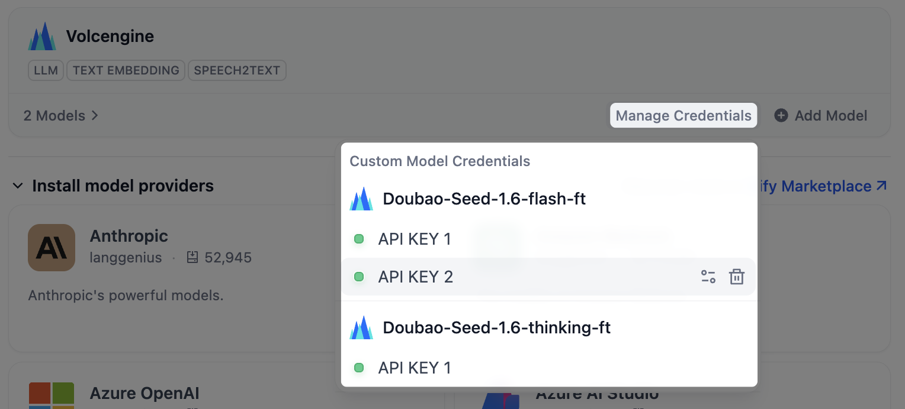
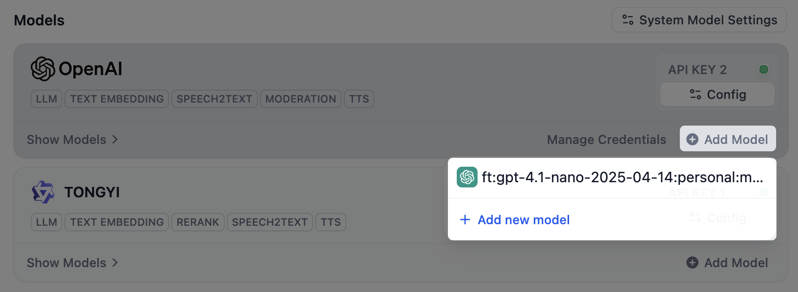
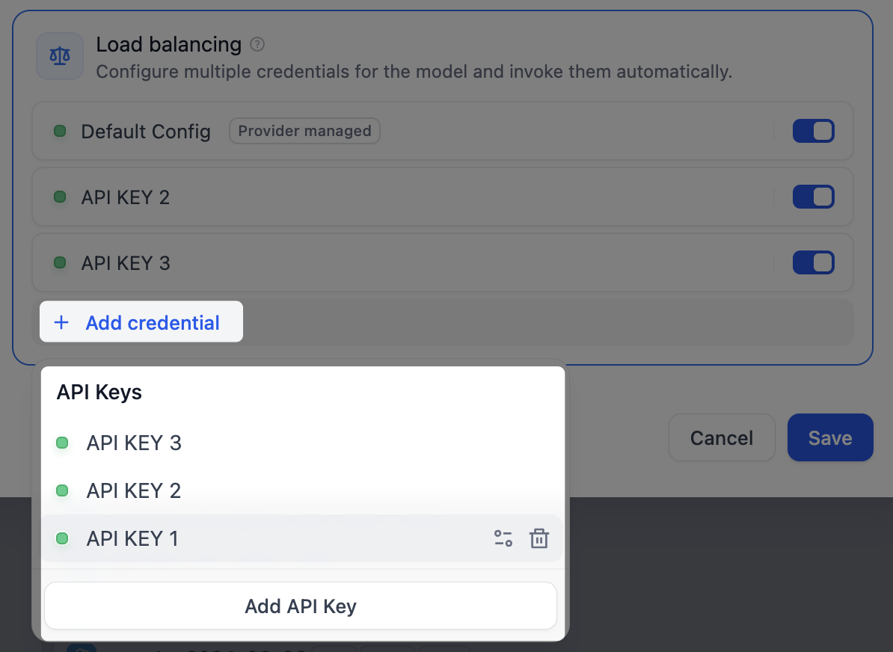

# 模型供应商

> 使用你的 AI 消息额度调用模型，或连接你自己的供应商账户和密钥

> 本文档由 AI 自动翻译。如有任何不准确之处，请参考 [英文原版](https://docs.dify.ai/en/cloud/use-dify/workspace/model-providers.md)。

你构建的每个 AI 应用都运行在模型之上。Dify Cloud 提供了热门模型，当你需要更多时，也可连接自己的供应商账户。

模型在整个工作空间内共享，因此团队所有人使用的都是同一批模型。

> [!WARNING]
>
> 只有工作空间所有者和管理员可以管理供应商。你添加的任何密钥都在整个工作空间内生效，并通过你自己的供应商账户计费。

## 使用 AI 消息额度调用模型

Dify Cloud 为你提供 AI 消息额度，用于调用一组热门供应商的模型，因此无需自己的 API 密钥即可开始。

从 **集成** > **模型供应商**（或 [Marketplace](https://marketplace.dify.ai/)）安装其中一个供应商，其模型即可使用。每次 AI 回复都会消耗你的 AI 消息额度。

一次 AI 回复即一次模型调用（一次输入和一次输出），无论消耗多少 token，都计为一次回复。一次回复消耗的额度取决于模型，模型越大消耗越多。

哪些供应商受 AI 消息额度支持、以及各模型的额度消耗，详见 [Dify 定价页面](https://dify.ai/pricing)。

## 在受支持的供应商上使用你自己的账户

当你需要更高的速率限制，或希望通过自己的供应商账户计费时，可在受支持的供应商上添加自己的 API 密钥。

1. 在 **集成** > **模型供应商** 中安装该供应商（如尚未安装）。

2. 点击其卡片上的 **添加 API 密钥**，然后填入密钥及其他必要信息。Dify 会先验证密钥，验证通过后供应商才可用。

你的密钥和 AI 消息额度可同时存在。如果想先用完额度、用尽后再改用密钥，点击供应商卡片上的 **配置**，将 **使用优先级** 设为 **AI 消息额度**。

## 连接 AI 消息额度不支持的供应商

若要使用 AI 消息额度不支持的供应商，需先安装它并通过你自己的账户运行。AI 消息额度不适用于这类供应商。

1. 在 **集成** > **模型供应商** 中浏览 **安装模型供应商** 区域，或打开 [Marketplace](https://marketplace.dify.ai/) 查看完整列表。

2. 安装该供应商，点击 **添加 API 密钥**，填入密钥及其他必要信息。

## 添加自定义模型

授权供应商后，它的模型即可使用。只有所需模型不在列表中（如新发布的模型或微调模型）时，才需手动添加。

点击供应商卡片上的 **添加模型**，为模型填写名称和凭据。模型列表固定的供应商没有此选项。

> [!NOTE]
>
> 若添加的模型名称和类型与已有模型完全相同，Dify 会将新密钥附加到该模型上，而不会创建重复的模型。

## 管理密钥

想隔离开发与生产环境，或把用量分摊到多个账户，可为同一供应商添加多个密钥。

* 对于供应商自带的模型，点击其卡片上的 **配置**，管理这些模型共享的密钥。

  
* 对于你添加的自定义模型，点击该模型上的 **配置**，单独管理它的密钥。

  

  

  > [!WARNING]
  >
  > 自定义模型只使用自己的密钥。删除它仅有的一个密钥时，模型也会一并删除。

  点击供应商卡片上的 **管理凭据**，可在同一处查看所有自定义模型的密钥。

  

  模型移除后，密钥仍保留在这里，日后重新添加该模型时无需再次录入。

  

## 选择应用默认使用的模型

未选择模型的应用和节点会使用工作空间的默认模型。点击右上角的 **默认模型设置**，为每类任务分别指定模型：

* **系统推理模型**：常规 LLM 任务的默认模型。
* **Embedding 模型**：为知识库内容建立索引并执行检索。
* **Rerank 模型**：按相关性对检索结果重新排序。
* **语音转文本模型**：将音频转换为文本。
* **文本转语音模型**：将文本转换为音频。

默认模型为空时，依赖它的功能就无法使用。例如，未设置文本转语音模型，应用中的 **文字转语音** 便不可用。

## 通过负载均衡将请求分散到多个密钥 Professional Team

当一个密钥同时处理大量请求时，可能触发供应商的速率限制并开始失败。

使用负载均衡，可将同一模型的请求分散到多个密钥，让任何单个密钥都不会成为瓶颈。Dify 会依次轮询这些密钥，并让触发限制的密钥休息一分钟后再重试。

1. 在列表中找到目标模型，点击 **配置**，选择 **负载均衡**。

2. 点击 **添加凭据**，将密钥加入池中。

   > [!TIP]
   >
   > 可将配额更高或速度更快的密钥重复添加，让更多流量流向它。

   

3. 启用至少两个密钥，然后点击 **保存**。使用负载均衡的模型会在列表中显示标识。

> [!NOTE]
>
> 你可随时切换回单个密钥，负载均衡的配置会保留以备后用。
