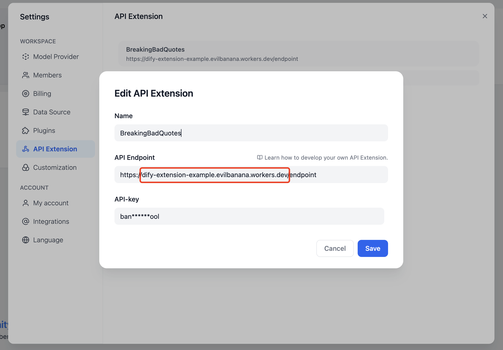

# 使用 Cloudflare Workers 部署自定义端点

> 本文档由 AI 自动翻译。如有任何不准确之处，请参考 [英文原版](https://docs.dify.ai/en/cloud/use-dify/workspace/api-extension/cloudflare-worker.md)。

## 步骤

因为 Dify 自定义端点需要使用可以访问的公网地址作为 API Endpoint，所以需要将自定义端点部署到一个公网地址上。

这里使用 Cloudflare Workers 来部署自定义端点。

Clone [Example GitHub Repository](https://github.com/crazywoola/dify-extension-workers)，这个仓库包含了一个简单的自定义端点，可以在这个基础上进行修改。

```bash theme={null}
git clone https://github.com/crazywoola/dify-extension-workers.git
cp wrangler.toml.example wrangler.toml
```

打开 `wrangler.toml` 文件，修改 `name` 和 `compatibility_date` 为你的应用名称和兼容日期。

这里我们需要注意的配置就是 `vars` 里面的 `TOKEN`，在 Dify 添加自定义端点的时候，我们需要填写这个 Token。出于安全考虑，我们建议你使用一个随机的字符串作为 Token，你不应该在源代码中直接写入 Token，而是使用环境变量的方式来传递 Token。所以请不要把 wrangler.toml 提交到你的代码仓库中。

```toml theme={null}
name = "dify-extension-example"
compatibility_date = "2023-01-01"

[vars]
TOKEN = "bananaiscool"
```

这个自定义端点会返回一个随机的 Breaking Bad 名言。你可以在 `src/index.ts` 中修改这个自定义端点的逻辑。这个例子展示了与第三方 API 进行交互的方式。

```typescript theme={null}
// ⬇️ implement your logic here ⬇️
// point === "app.external_data_tool.query"
// https://api.breakingbadquotes.xyz/v1/quotes
const count = params?.inputs?.count ?? 1;
const url = `https://api.breakingbadquotes.xyz/v1/quotes/${count}`;
const result = await fetch(url).then(res => res.text())
// ⬆️ implement your logic here ⬆️
```

这个仓库简化了除了业务逻辑之外所有的配置，你可以直接使用 `npm` 命令来部署你的自定义端点。

```bash theme={null}
npm install
npm run deploy
```

部署成功之后，你会得到一个公网地址，你可以在 Dify 中添加这个地址作为 API Endpoint。请注意不要遗漏 `endpoint` 这个路径，此路径的具体定义在 `src/index.ts` 中可以查看。



另外，也可以直接使用 `npm run dev` 命令来部署到本地进行测试。

```bash theme={null}
npm install
npm run dev
```

相关输出：

```bash theme={null}
$ npm run dev
> dev
> wrangler dev src/index.ts

 ⛅️ wrangler 3.99.0
-------------------

Your worker has access to the following bindings:
- Vars:
  - TOKEN: "ban****ool"
⎔ Starting local server...
[wrangler:inf] Ready on http://localhost:58445
```

之后就可以使用 Postman 等工具进行本地接口调试。

## 关于 Bearer Auth

```typescript theme={null}
import { bearerAuth } from "hono/bearer-auth";

(c, next) => {
    const auth = bearerAuth({ token: c.env.TOKEN });
    return auth(c, next);
},
```

我们的 Bearer 校验逻辑在如上代码中，我们使用了 `hono/bearer-auth` 这个包来实现 Bearer 校验。你可以在 `src/index.ts` 中使用 `c.env.TOKEN` 来获取 Token。

## 关于参数验证

```typescript theme={null}
import { z } from "zod";
import { zValidator } from "@hono/zod-validator";

const schema = z.object({
  point: z.union([
    z.literal("ping"),
    z.literal("app.external_data_tool.query"),
  ]), // Restricts 'point' to two specific values
  params: z
    .object({
      app_id: z.string().optional(),
      tool_variable: z.string().optional(),
      inputs: z.record(z.any()).optional(),
      query: z.any().optional(),  // string or null
    })
    .optional(),
});

```

我们这里使用了 `zod` 来定义参数的类型，你可以在 `src/index.ts` 中使用 `zValidator` 来校验参数。通过 `const { point, params } = c.req.valid("json");` 来获取校验后的参数。

我们这里的 point 只有两个值，所以我们使用了 `z.union` 来定义。params 是一个可选的参数，所以我们使用了 `z.optional` 来定义。其中会有一个 `inputs` 的参数，这个参数是一个 `Record<string, any>` 类型，这个类型表示一个 key 为 string，value 为 any 的对象。这个类型可以表示任意的对象，你可以在 `src/index.ts` 中使用 `params?.inputs?.count` 来获取 `count` 参数。

## 获取 Cloudflare Workers 的日志

```bash theme={null}
wrangler tail
```

***

**参考内容**：

* [Cloudflare Workers](https://workers.cloudflare.com/)
* [Cloudflare Workers CLI](https://developers.cloudflare.com/workers/cli-wrangler/install-update)
* [Example GitHub Repository](https://github.com/crazywoola/dify-extension-workers)
