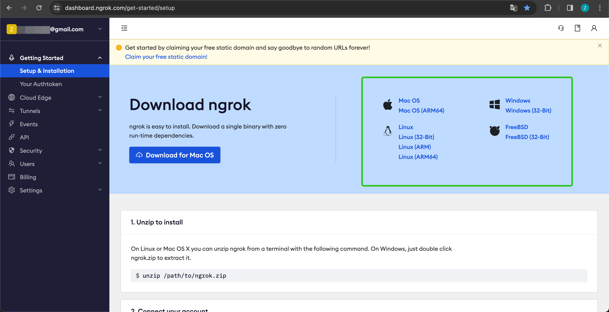
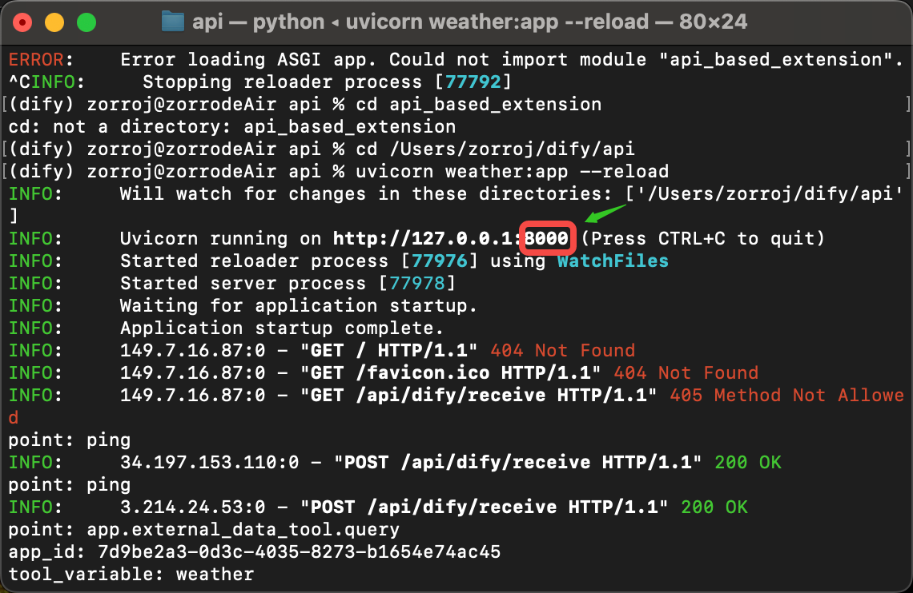
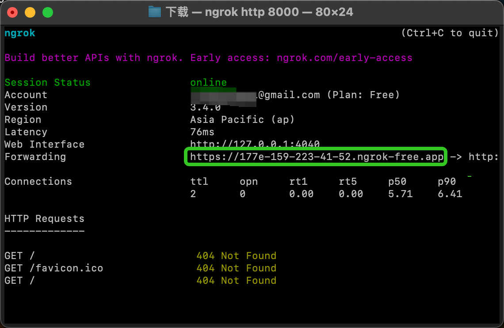

# 自定义端点

> 本文档由 AI 自动翻译。如有任何不准确之处，请参考 [英文原版](https://docs.dify.ai/en/cloud/use-dify/workspace/api-extension/api-extension.md)。

开发者可通过自定义端点扩展模块能力，当前支持以下模块扩展：

* `moderation` 敏感内容审计
* `external_data_tool` 外部数据工具

在扩展模块能力之前，你需要准备一个 API 和用于鉴权的 API Key。

除了需要开发对应的模块能力，还需要遵照以下规范，以便 Dify 正确调用 API。

## API 规范

Dify 将会以以下规范调用你的接口：

```
POST {Your-API-Endpoint}
```

### Header

| Header | Value | Desc |
| - | - | - |
| `Content-Type` | application/json | 请求内容为 JSON 格式。 |
| `Authorization` | Bearer \{api\_key} | API Key 以 Token 令牌的方式传输，你需要解析该 `api_key` 并确认是否和提供的 API Key 一致，保证接口安全。 |

### Request Body

```
{
    "point":  string, //  扩展点，不同模块可能包含多个扩展点
    "params": {
        ...  // 各模块扩展点传入参数
    }
}
```

### API 返回

```
{
    ...  // API 返回的内容，不同扩展点返回见不同模块的规范设计
}
```

## 校验

在 Dify 配置自定义端点时，Dify 将会发送一个请求至 API Endpoint，以检验 API 的可用性。

当 API Endpoint 接收到 `point=ping` 时，接口应返回 `result=pong`，具体如下：

### Header

```
Content-Type: application/json
Authorization: Bearer {api_key}
```

### Request Body

```
{
    "point": "ping"
}
```

### API 期望返回

```
{
    "result": "pong"
}
```

## 范例

此处以外部数据工具为例，场景为根据地区获取外部天气信息作为上下文。

### API 范例

```
POST https://fake-domain.com/api/dify/receive
```

**Header**

```
Content-Type: application/json
Authorization: Bearer 123456
```

**Request Body**

```
{
    "point": "app.external_data_tool.query",
    "params": {
        "app_id": "61248ab4-1125-45be-ae32-0ce91334d021",
        "tool_variable": "weather_retrieve",
        "inputs": {
            "location": "London"
        },
        "query": "How's the weather today?"
    }
}
```

**API 返回**

```
{
    "result": "City: London\nTemperature: 10°C\nRealFeel®: 8°C\nAir Quality: Poor\nWind Direction: ENE\nWind Speed: 8 km/h\nWind Gusts: 14 km/h\nPrecipitation: Light rain"
}
```

### 代码范例

代码基于 Python FastAPI 框架。

1. 安装依赖

   ```
   pip install fastapi[all] uvicorn
   ```

2. 按照接口规范编写代码

   ```
   from fastapi import FastAPI, Body, HTTPException, Header
   from pydantic import BaseModel

   app = FastAPI()


   class InputData(BaseModel):
       point: str
       params: dict = {}


   @app.post("/api/dify/receive")
   async def dify_receive(data: InputData = Body(...), authorization: str = Header(None)):
       """
       Receive API query data from Dify.
       """
       expected_api_key = "123456"  # TODO Your API key of this API
       auth_scheme, _, api_key = authorization.partition(' ')

       if auth_scheme.lower() != "bearer" or api_key != expected_api_key:
           raise HTTPException(status_code=401, detail="Unauthorized")

       point = data.point

       # for debug
       print(f"point: {point}")

       if point == "ping":
           return {
               "result": "pong"
           }
       if point == "app.external_data_tool.query":
           return handle_app_external_data_tool_query(params=data.params)
       # elif point == "{point name}":
           # TODO other point implementation here

       raise HTTPException(status_code=400, detail="Not implemented")


   def handle_app_external_data_tool_query(params: dict):
       app_id = params.get("app_id")
       tool_variable = params.get("tool_variable")
       inputs = params.get("inputs")
       query = params.get("query")

       # for debug
       print(f"app_id: {app_id}")
       print(f"tool_variable: {tool_variable}")
       print(f"inputs: {inputs}")
       print(f"query: {query}")

       # TODO your external data tool query implementation here,
       #  return must be a dict with key "result", and the value is the query result
       if inputs.get("location") == "London":
           return {
               "result": "City: London\nTemperature: 10°C\nRealFeel®: 8°C\nAir Quality: Poor\nWind Direction: ENE\nWind "
                         "Speed: 8 km/h\nWind Gusts: 14 km/h\nPrecipitation: Light rain"
           }
       else:
           return {"result": "Unknown city"}
   ```

3. 启动 API 服务，默认端口为 8000，API 完整地址为：`http://127.0.0.1:8000/api/dify/receive`，配置的 API Key 为 `123456`。

   ```
   uvicorn main:app --reload --host 0.0.0.0
   ```

4. 在 Dify 配置该 API。

5. 在 App 中选择该自定义端点。

App 调试时，Dify 将请求配置的 API，并发送以下内容（范例）：

```
{
    "point": "app.external_data_tool.query",
    "params": {
        "app_id": "61248ab4-1125-45be-ae32-0ce91334d021",
        "tool_variable": "weather_retrieve",
        "inputs": {
            "location": "London"
        },
        "query": "How's the weather today?"
    }
}
```

API 返回为：

```
{
    "result": "City: London\nTemperature: 10°C\nRealFeel®: 8°C\nAir Quality: Poor\nWind Direction: ENE\nWind Speed: 8 km/h\nWind Gusts: 14 km/h\nPrecipitation: Light rain"
}
```

## 本地调试

由于 Dify 无法访问内网 API 服务，为了方便本地调试 API 服务，可以使用 [Ngrok](https://ngrok.com) 将 API 服务的端点暴露到公网，实现云端调试本地代码。操作步骤：

1. 进入 [https://ngrok.com](https://ngrok.com) 官网，注册并下载 Ngrok 文件。

   

2. 下载完成后，进入下载目录，根据下方说明解压压缩包，并执行说明中的初始化脚本。
   ```shell theme={null}
   unzip /path/to/ngrok.zip
   ./ngrok config add-authtoken 你的 Token
   ```

3. 查看本地 API 服务的端口：

   

   并运行以下命令启动：

   ```shell theme={null}
   ./ngrok http 端口号
   ```

   启动成功的样例如下：

   

4. 我们找到 Forwarding 中，如上图：`https://177e-159-223-41-52.ngrok-free.app`（此为示例域名，请替换为自己的）即为公网域名。

按照上述的范例，我们把本地已经启动的服务端点暴露出去，将代码范例接口：`http://127.0.0.1:8000/api/dify/receive` 替换为 `https://177e-159-223-41-52.ngrok-free.app/api/dify/receive`

此 API 端点即可公网访问。至此，我们即可在 Dify 配置该 API 端点进行本地调试代码，配置步骤请参考 [外部数据工具](%E5%A4%96%E9%83%A8%E6%95%B0%E6%8D%AE%E5%B7%A5%E5%85%B7.md)。

## 使用 Cloudflare Workers 部署自定义端点

我们推荐你使用 Cloudflare Workers 来部署你的自定义端点，因为 Cloudflare Workers 可以方便的提供一个公网地址，而且可以免费使用。

详细说明请参考 [使用 Cloudflare Workers 部署自定义端点](%E4%BD%BF%E7%94%A8%20Cloudflare%20Workers%20%E9%83%A8%E7%BD%B2%E8%87%AA%E5%AE%9A%E4%B9%89%E7%AB%AF%E7%82%B9.md)。
