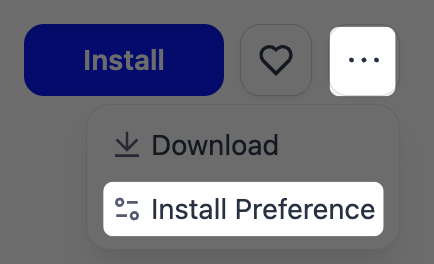

# 集成

> 连接 Dify 与模型供应商、工具、数据来源和外部服务

> 本文档由 AI 自动翻译。如有任何不准确之处，请参考 [英文原版](https://docs.dify.ai/en/cloud/use-dify/workspace/plugins.md)。

集成将你的 Dify 应用连接到外部世界。它们提供驱动应用的模型供应商、Agent 与工作流所调用的工具、知识库背后的数据来源，以及用于扩展应用的各种服务。

集成只需安装一次，工作空间中的每个应用都可使用。在 **集成** 中即可浏览和管理它们。

## 集成类型

* [**模型供应商**](%E6%A8%A1%E5%9E%8B%E4%BE%9B%E5%BA%94%E5%95%86.md)：驱动应用的各类模型，涵盖大语言模型、嵌入模型与重排序模型。

* [**工具**](Dify%20%E5%B7%A5%E5%85%B7.md)：Agent 和工作流可调用的能力，包括工具插件、MCP 服务器、已发布的工作流以及 OpenAPI 服务。

* [**数据来源**](../%E7%9F%A5%E8%AF%86%E5%BA%93/%E7%BB%8F%E5%85%B8%E7%9F%A5%E8%AF%86%E5%BA%93/%E6%9E%84%E5%BB%BA%E8%87%AA%E5%AE%9A%E4%B9%89%E7%9F%A5%E8%AF%86%E5%BA%93/%E6%95%B0%E6%8D%AE%E6%BA%90%E6%8E%88%E6%9D%83.md)：知识库所用的外部内容，如 Google Drive 或 Notion 页面。

* [**触发器**](../%E7%BC%96%E6%8E%92/Workflow%20%E4%B8%8E%20Chatflow/%E8%A7%A6%E5%8F%91%E5%99%A8/%E9%9B%86%E6%88%90%E8%A7%A6%E5%8F%91%E5%99%A8.md)：在外部事件发生时自动启动工作流。

* **Agent 策略**：[Agent 节点](../%E7%BC%96%E6%8E%92/Workflow%20%E4%B8%8E%20Chatflow/%E8%8A%82%E7%82%B9/Agent.md) 所遵循的推理策略，用于做出决策、选择并调用工具，以及根据结果采取行动。

* [**自定义端点**](%E8%87%AA%E5%AE%9A%E4%B9%89%E7%AB%AF%E7%82%B9/%E8%87%AA%E5%AE%9A%E4%B9%89%E7%AB%AF%E7%82%B9.md)：连接你自己的 API，为应用添加内容审核或外部数据工具。

* **扩展**：暴露自定义 HTTP 端点的集成，用其他类别未涵盖的能力扩展 Dify。

## 安装集成

可从三种来源添加集成：

* [**Marketplace**](https://marketplace.dify.ai/)：来自 Dify、合作伙伴和社区开发者的集成。每项集成都在发布前经过审核和测试，之后由发布者维护。

  > [!NOTE]
  >
  > 如果从 Marketplace 安装时打开的是其他 Dify 环境而非你的 Dify Cloud 工作空间，清除 **安装偏好设置** 中保存的 URL 即可重新安装到 Dify Cloud。
  >
  > 
* **GitHub**：通过 URL 和版本从任意公共仓库安装。
* **本地集成包**：用于私有或内部集成的自定义 `.difypkg` 包。

## 权限与更新

工作空间所有者和管理员可在 **集成** 页面底部的 **权限** 中，设置谁能安装和调试集成。每项权限都可以设为所有人可用、仅管理员可用或无人可用：

* **谁可以安装和管理？** 控制安装和升级集成的权限。移除集成仅限工作空间所有者和管理员。

* **谁可以调试？** 控制调试密钥的使用权限。凭这个密钥，成员可把自己正在开发的集成挂载到当前工作空间，进行 [远程调试](../../%E5%BC%80%E5%8F%91%E8%80%85%E8%B5%84%E6%BA%90/%E6%8F%92%E4%BB%B6%E5%BC%80%E5%8F%91/%E7%89%B9%E6%80%A7%E4%B8%8E%E8%A7%84%E8%8C%83/%E6%8F%92%E4%BB%B6%E7%B1%BB%E5%9E%8B/%E6%8F%92%E4%BB%B6%E8%B0%83%E8%AF%95.md)。

集成也可设置为自动更新。每个类别（如工具、模型、数据来源等）都有各自的更新策略（关闭、仅修订版本或始终最新），可应用于该类别下的全部集成或其中选定的部分。

## 自行构建

> [!NOTE]
>
> 需要尚不存在的集成？使用 Dify 的插件 SDK 构建，然后将其私有保留或发布到 Marketplace。参见 [开发插件](../../%E5%BC%80%E5%8F%91%E8%80%85%E8%B5%84%E6%BA%90/%E6%8F%92%E4%BB%B6%E5%BC%80%E5%8F%91/%E5%BF%AB%E9%80%9F%E5%BC%80%E5%A7%8B/Dify%20%E6%8F%92%E4%BB%B6.md)。
