# 30 分钟快速入门

> 通过示例应用深入了解 Dify

> 本文档由 AI 自动翻译。如有任何不准确之处，请参考 [英文原版](https://docs.dify.ai/en/quick-start.md)。

> [!NOTE]
>
> 本快速入门使用 **Dify Cloud**，这是上手最快的方式：免费开始、自带 AI 额度、无需任何安装。想自行部署？你可以[自部署 Dify](https://docs.dify.ai/zh/self-host/deploy/quick-start/docker-compose.md)，然后在自己的实例上按相同步骤操作。

这个分步教程将带你从零开始创建一个多平台内容生成器。

除了基本的 LLM 集成，你还将发现如何使用强大的 Dify 节点来更快、更轻松地编排复杂的 AI 应用。

在本教程结束时，你将拥有一个工作流，它可以接受你提供的任何内容（文本、文档或图像），添加你偏好的语音和语调，并生成针对你选择语言的精美的、特定平台的社交媒体帖子。

完整的工作流如下所示。在构建过程中，可以随时参考它以保持正轨，并了解所有节点如何协同工作。

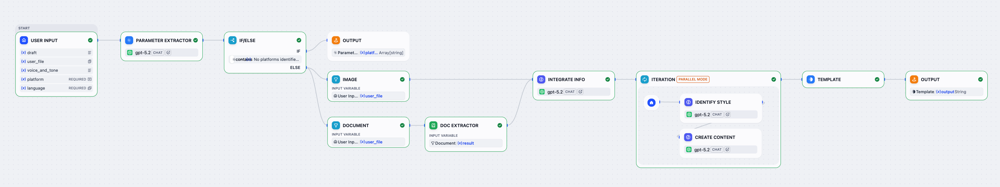

## 开始之前

**1. 注册账号**

前往 [cloud.dify.ai](https://cloud.dify.ai) 免费注册。

新账户默认使用 Sandbox 计划，包含 200 AI 消息额度，可用于调用 OpenAI、Anthropic、Gemini 等供应商的模型。

> [!NOTE]
>
> Sandbox 计划的 AI 消息额度为一次性发放，不会按月续期。

**2. 设置模型供应商**

前往 **集成** > **模型供应商**，安装 OpenAI 模型供应商。本教程使用 `gpt-5.2` 作为示例。

AI 消息额度涵盖的模型无需 API Key，供应商安装后即可使用。你也可以配置自己的 API Key 来调用模型。

**3. 配置默认模型**

1. 在 **模型供应商** 页面右上角，点击 **默认模型**。

2. 将 **系统推理模型** 设为 `gpt-5.2`，它将成为工作流中的默认模型。

## 步骤 1：创建新工作流

1. 前往 **工作室**，然后选择 **从空白创建** > **工作流**。

2. 将工作流命名为 `多平台内容生成器`，然后点击 **创建**。你将自动进入工作流画布开始构建。

3. 选择用户输入节点以开始我们的工作流。

## 步骤 2：编排与配置

> [!NOTE]
>
> 保持未提及的设置为默认值。

> [!TIP]
>
> 为节点和变量提供清晰、描述性的名称，使它们更容易识别和引用。

### 1. 收集用户输入：用户输入节点

> [!NOTE]
>
> 首先，我们需要定义从用户那里收集什么信息来运行我们的内容生成器，例如草稿文本、目标平台、期望的语调以及任何参考材料。
>
> 用户输入节点是我们可以轻松设置这些的地方。我们在这里添加的每个输入字段都会成为所有下游节点可以引用和使用的变量。

点击用户输入节点，打开其配置面板，然后添加以下输入字段。

> [accordion] 参考材料 - 文本
>
> * 字段类型：`段落`
> * 变量名：`draft`
> * 标签名：`草稿`
> * 最大长度：`2048`
> * 必填：`是`

> [accordion] 参考材料 - 文件
>
> * 字段类型：`文件列表`
> * 变量名：`user_file`
> * 标签名：`上传文件 (≤ 10)`
> * 支持文件类型：`文档`、`图片`
> * 上传文件类型：`两者`
> * 最大上传数量：`10`
> * 必填：`否`

> [accordion] 语音和语调
>
> * 字段类型：`段落`
> * 变量名：`voice_and_tone`
> * 标签名：`语音与语调`
> * 最大长度：`2048`
> * 必填：`否`

> [accordion] 目标平台
>
> * 字段类型：`短文本`
> * 变量名：`platform`
> * 标签名：`目标平台 (≤ 10)`
> * 最大长度：`256`
> * 必填：`是`

> [accordion] 语言要求
>
> * 字段类型：`选择`
> * 变量名：`language`
> * 标签名：`语言`
> * 选项：
>   * `English`
>   * `日本語`
>   * `简体中文`
> * 必填：`是`

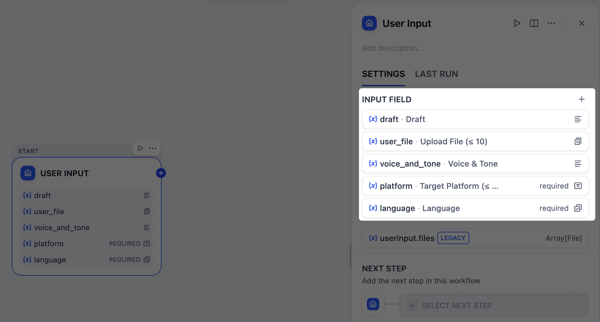

### 2. 识别目标平台：参数提取器节点

> [!NOTE]
>
> 由于我们的平台字段接受自由格式的文本输入，用户可能会以各种方式输入：`x 和 linkedIn`、`在 Twitter 和 LinkedIn 上发布`，甚至 `Twitter + LinkedIn please`。
>
> 然而，我们需要一个干净、结构化的列表，如 `["Twitter", "LinkedIn"]`，下游节点可以可靠地使用。
>
> 这正是参数提取器节点的完美工作。在我们的场景中，它使用 gpt-5.2 模型来分析用户的自然语言，识别所有这些变化，并输出标准化的数组。

在用户输入节点之后，添加一个参数提取器节点并配置它：

1. 在 **输入变量** 字段中，选择 `User Input/platform`。

2. 添加一个提取参数：

   * 名称：`platform`

   * 类型：`Array[String]`

   * 描述：`The platform(s) for which the user wants to create tailored content.`

   * 必填：`是`

3. 在 **指令** 字段中，粘贴以下内容来引导 LLM 进行参数提取：

   ```markdown INSTRUCTION theme={null}
   # TASK DESCRIPTION
   Parse platform names from input and output as a JSON array.

   ## PROCESSING RULES
   - Support multiple delimiters: commas, semicolons, spaces, line breaks, "and", "&", "|", etc.
   - Standardize common platform name variants (twitter/X→Twitter, insta→Instagram, etc.)
   - Remove duplicates and invalid entries
   - Preserve unknown but reasonable platform names
   - Preserve the original language of platform names

   ## OUTPUT REQUIREMENTS
   - Success: ["Platform1", "Platform2"]
   - No platforms found: [No platforms identified. Please enter a valid platform name.]

   ## EXAMPLES
   - Input: "twitter, linkedin" → ["Twitter", "LinkedIn"]
   - Input: "x and insta" → ["Twitter", "Instagram"]
   - Input: "invalid content" → [No platforms identified. Please enter a valid platform name.]
   ```

   > [!TIP]
   >
   > 注意，我们已指示 LLM 为无效输入输出特定的错误消息，这将在下一步中作为我们工作流的结束触发器。

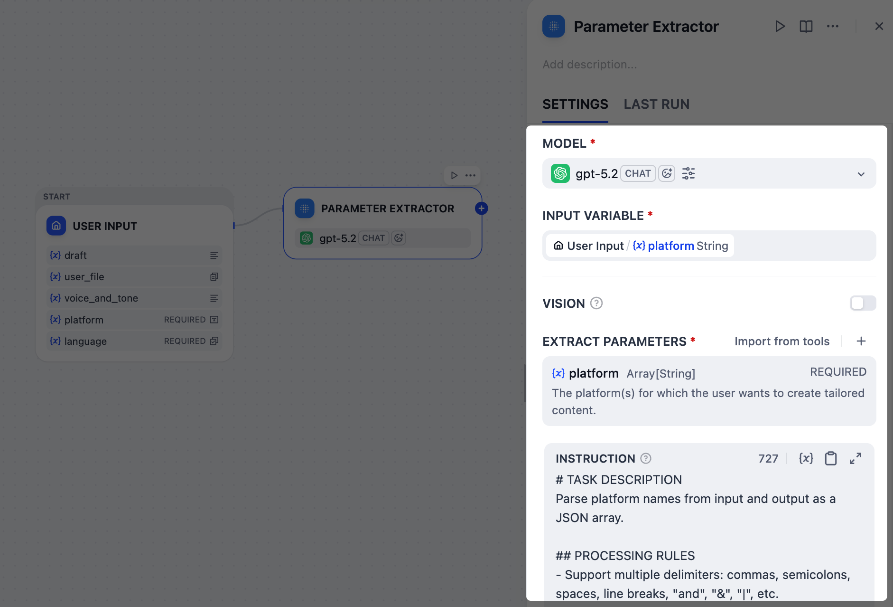

### 3. 验证平台提取结果：IF/ELSE 节点

> [!NOTE]
>
> 如果用户输入了无效的平台名称，比如 `ohhhhhh` 或 `BookFace` 怎么办？我们不想浪费时间和令牌生成无用的内容。
>
> 在这种情况下，我们可以使用 IF/ELSE 节点创建一个分支，提前停止工作流。我们将设置一个条件来检查参数提取器节点的错误消息；如果检测到该消息，工作流将直接路由到输出节点并结束。

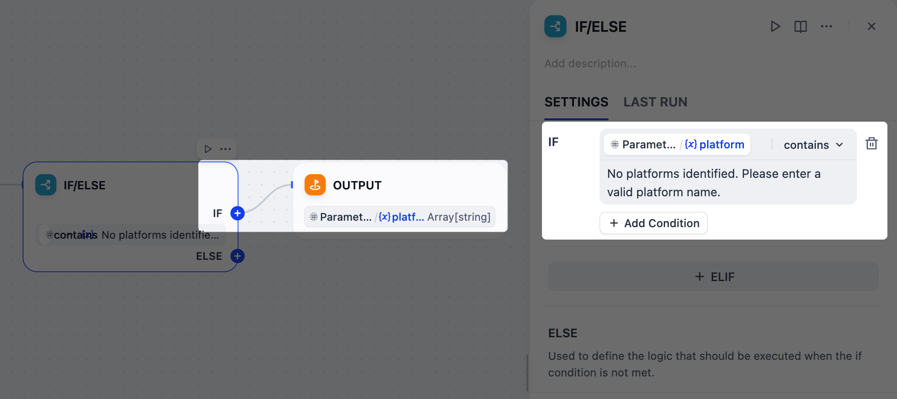

1. 在参数提取器节点之后，添加一个 IF/ELSE 节点。

2. 在 IF/ELSE 节点的面板上，定义 **IF** 条件：

   **IF** `Parameter Extractor/platform` **包含** `No platforms identified. Please enter a valid platform name.`

3. 在 IF/ELSE 节点之后，向 IF 分支添加一个输出节点。

4. 在输出节点的面板上，将 `Parameter Extractor/platform` 设置为输出变量。

### 4. 按类型分离上传的文件：列表操作器节点

> [!NOTE]
>
> 我们的用户可以上传图像和文档作为参考材料，但这两种类型在使用 `gpt-5.2` 时需要不同的处理：图像可以通过其视觉能力直接解释，而文档必须先转换为文本，模型才能处理。
>
> 为了管理这一点，我们将使用两个列表操作器节点来过滤和将上传的文件分成单独的分支：一个用于图像，一个用于文档。

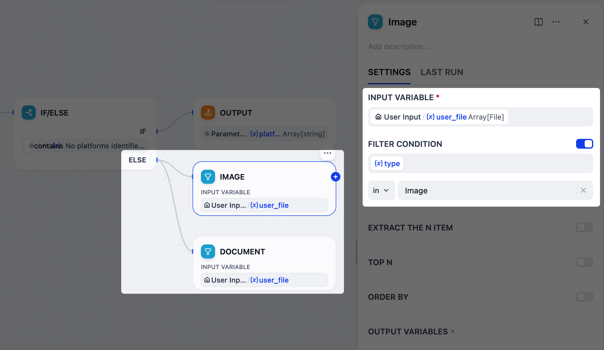

1. 在 IF/ELSE 节点之后，向 ELSE 分支添加 **两个** 并行的列表操作器节点。

2. 将一个节点重命名为 `图像`，另一个重命名为 `文档`。

3. 配置图像节点：
   1. 将 `User Input/user_file` 设置为输入变量。

   2. 启用 **过滤条件**：`{x}type` **在** `Image`。

4. 配置文档节点：
   1. 将 `User Input/user_file` 设置为输入变量。

   2. 启用 **过滤条件**：`{x}type` **在** `Doc`。

### 5. 从文档中提取文本：文档提取器节点

> [!NOTE]
>
> `gpt-5.2` 不能直接读取像 PDF 或 DOCX 这样的上传文档，因此我们必须先将它们转换为纯文本。
>
> 这正是文档提取器节点所做的。它将文档文件作为输入，并为下一步输出干净、可用的文本。

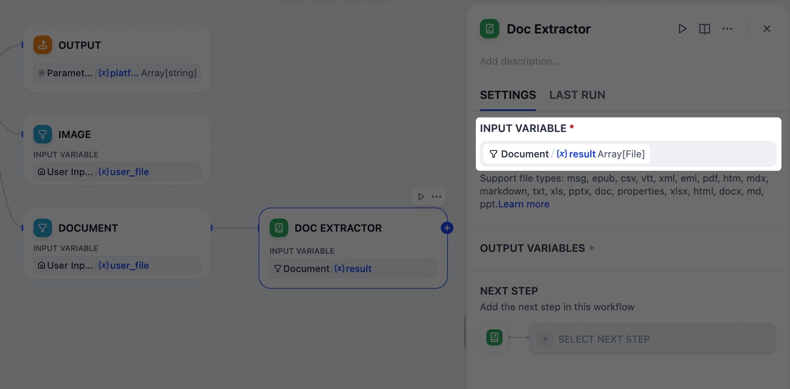

1. 在文档节点之后，添加一个文档提取器节点。

2. 在文档提取器节点的面板上，将 `Document/result` 设置为输入变量。

### 6. 整合所有参考材料：LLM 节点

> [!NOTE]
>
> 当用户同时提供多种参考类型（草稿文本、文档和图像）时，我们需要将它们整合成一个连贯的摘要。
>
> LLM 节点将通过分析所有分散的片段来处理此任务，创建一个指导后续内容生成的综合上下文。

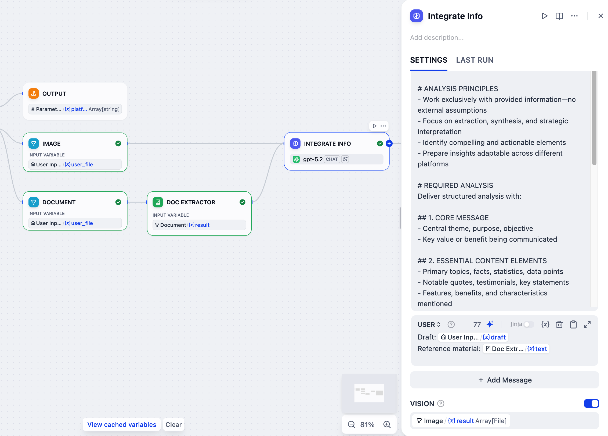

1. 在文档提取器节点之后，添加一个 LLM 节点。

2. 将图像节点也连接到这个 LLM 节点。

3. 点击 LLM 节点进行配置：

   1. 将其重命名为 `整合信息`。

   2. 启用 **VISION** 并将 `Image/result` 设置为视觉变量。

   3. 在系统指令字段中，粘贴以下内容：

      ```markdown wrap theme={null}
      # ROLE & TASK
      You are a content strategist. Analyze the provided draft and reference materials (if any), then create a comprehensive content foundation for multi-platform social media optimization.

      # ANALYSIS PRINCIPLES
      - Work exclusively with provided information—no external assumptions
      - Focus on extraction, synthesis, and strategic interpretation
      - Identify compelling and actionable elements
      - Prepare insights adaptable across different platforms

      # REQUIRED ANALYSIS
      Deliver structured analysis with:

      ## 1. CORE MESSAGE
      - Central theme, purpose, objective
      - Key value or benefit being communicated

      ## 2. ESSENTIAL CONTENT ELEMENTS
      - Primary topics, facts, statistics, data points
      - Notable quotes, testimonials, key statements
      - Features, benefits, characteristics mentioned
      - Dates, locations, contextual details

      ## 3. STRATEGIC INSIGHTS
      - What makes content compelling/unique
      - Emotional/rational appeals present
      - Credibility factors, proof points
      - Competitive advantages highlighted

      ## 4. ENGAGEMENT OPPORTUNITIES
      - Discussion points, questions emerging
      - Calls-to-action, next steps suggested
      - Interactive/participation opportunities
      - Trending themes touched upon

      ## 5. PLATFORM OPTIMIZATION FOUNDATION
      - High-impact: Quick, shareable formats
      - Professional: Business-focused discussions
      - Community: Interaction and sharing
      - Visual: Enhanced with strong visuals

      ## 6. SUPPORTING DETAILS
      - Metrics, numbers, quantifiable results
      - Direct quotes, testimonials
      - Technical details, specifications
      - Background context available
      ```

   4. 点击 **添加消息** 来添加一条用户消息，然后粘贴以下内容。输入 `{` 或 `/` 将 `Doc Extractor/text` 和 `User Input/draft` 替换为列表中对应的变量。

      ```markdown USER theme={null}
      Draft: User Input/draft
      Reference material: Doc Extractor/text
      ```

      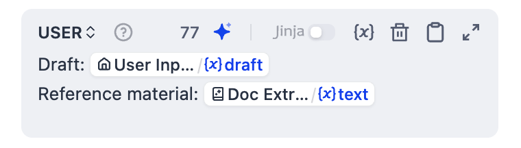

### 7. 为每个平台创建定制内容：迭代节点

> [!NOTE]
>
> 现在整合的参考和目标平台已准备就绪，让我们使用迭代节点为每个平台生成定制的帖子。
>
> 该节点将遍历平台列表并为每个平台运行子工作流：首先分析特定平台的风格指南和最佳实践，然后基于所有可用信息生成优化的内容。

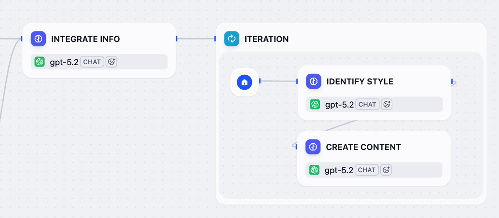

1. 在整合信息节点之后，添加一个迭代节点。

2. 在迭代节点内部，添加一个 LLM 节点并配置它：

   1. 将其重命名为 `识别风格`。

   2. 在系统指令字段中，粘贴以下内容：

      ```markdown wrap theme={null}
      # ROLE & TASK
      You are a social media expert. Analyze the platform and provide content creation guidelines.

      # ANALYSIS REQUIRED
      For the given platform, provide:

      ## 1. PLATFORM PROFILE
      - Platform type and category
      - Target audience characteristics

      ## 2. CONTENT GUIDELINES
      - Optimal content length (characters/words)
      - Recommended tone (professional/casual/conversational)
      - Formatting best practices (line breaks, emojis, etc.)

      ## 3. ENGAGEMENT STRATEGY
      - Hashtag recommendations (quantity and style)
      - Call-to-action best practices
      - Algorithm optimization tips

      ## 4. TECHNICAL SPECS
      - Character/word limits
      - Visual content requirements
      - Special formatting needs

      ## 5. PLATFORM-SPECIFIC NOTES
      - Unique features or recent changes
      - Industry-specific considerations
      - Community engagement approaches

      # OUTPUT REQUIREMENTS
      - For recognized platforms: Provide specific guidelines
      - For unknown platforms: Base recommendations on similar platforms
      - Focus on actionable, practical advice
      - Be concise but comprehensive
      ```

   3. 点击 **添加消息** 来添加一条用户消息，然后粘贴以下内容。输入 `{` 或 `/` 将 `Current Iteration/item` 替换为列表中对应的变量。

      ```markdown USER theme={null}
      Platform: Current Iteration/item
      ```

3. 在识别风格节点之后，添加另一个 LLM 节点并配置它：

   1. 将其重命名为 `创建内容`。

   2. 在系统指令字段中，粘贴以下内容：

      ```markdown wrap theme={null}
      # ROLE & TASK
      You are an expert social media content creator. Generate publication-ready content that matches platform guidelines, incorporates source information, and follows specified voice/tone and language requirements.

      # LANGUAGE REQUIREMENT
      - Generate ALL content exclusively in the target language specified in the user message. You MUST write the entire post in that language, regardless of the language of any source materials.
      - No mixing of languages whatsoever
      - Adapt platform terminology to the target language

      # CONTENT REQUIREMENTS
      - Follow platform guidelines exactly (format, length, tone, hashtags)
      - Integrate source information effectively (key messages, data, value props)
      - Apply voice & tone consistently (if provided)
      - Optimize for platform-specific engagement
      - Ensure cultural appropriateness for the specified language

      # OUTPUT FORMAT
      - Generate ONLY the final social media post content. No explanations or meta-commentary. Content must be immediately copy-paste ready.
      - Maximum heading level: ## (H2) - never use # (H1)
      - No horizontal dividers: avoid ---

      # QUALITY CHECKLIST
      ✅ Platform guidelines followed
      ✅ Source information integrated
      ✅ Voice/tone consistent (when provided)
      ✅ Language consistency maintained
      ✅ Engagement optimized
      ✅ Publication ready
      ```

   3. 点击 **添加消息** 来添加一条用户消息，然后粘贴以下内容。输入 `{` 或 `/` 将所有输入替换为列表中对应的变量。

      ```markdown USER theme={null}
      Platform Name: Current Iteration/item
      Target Language: User Input/language
      Platform Guidelines: Identify Style/text
      Source Information: Integrate Info/text
      Voice & Tone: User Input/voice_and_tone
      ```

   4. 启用结构化输出。

      > [!NOTE]
      >
      > 这使我们能够以更可靠的方式从 LLM 的响应中提取特定信息，这对于下一步格式化最终输出至关重要。

      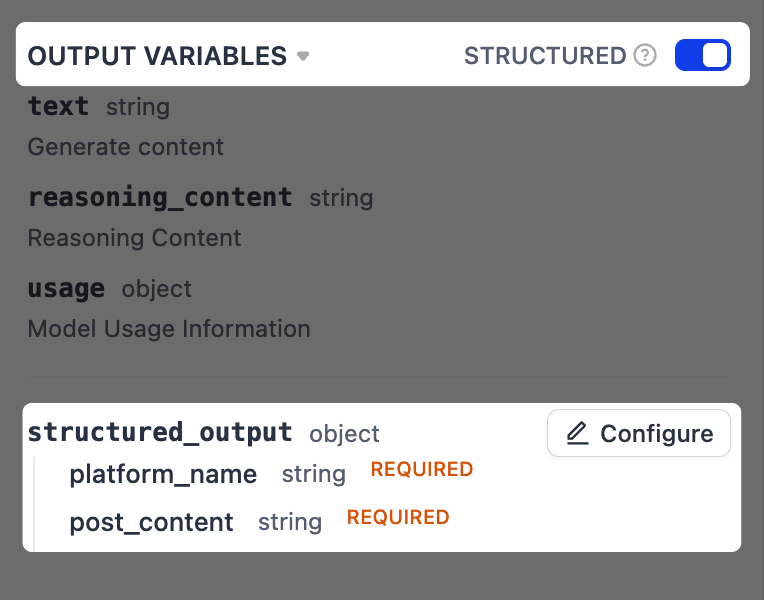

      1. 在 **输出变量** 旁边，将 **结构化** 切换为开启。`structured_output` 变量将出现在下方。点击 **配置**。

      2. 在弹出的架构编辑器中，点击右上角的 **从 JSON 导入**，并粘贴以下内容：

         ```json theme={null}
         {
           "platform_name": "string",
           "post_content": "string"
         }
         ```

         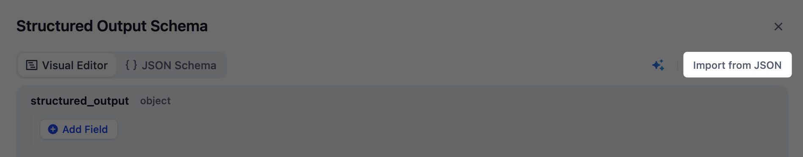

4. 点击迭代节点进行配置：

   1. 将 `Parameter Extractor/platform` 设置为输入变量。

   2. 将 `Create Content/structured_output` 设置为输出变量。

   3. 启用 **并行模式** 并将最大并行度设置为 `10`。

      > [!TIP]
      >
      > 这就是为什么我们在用户输入节点的目标平台字段的标签名称中包含了 `(≤10)`。

   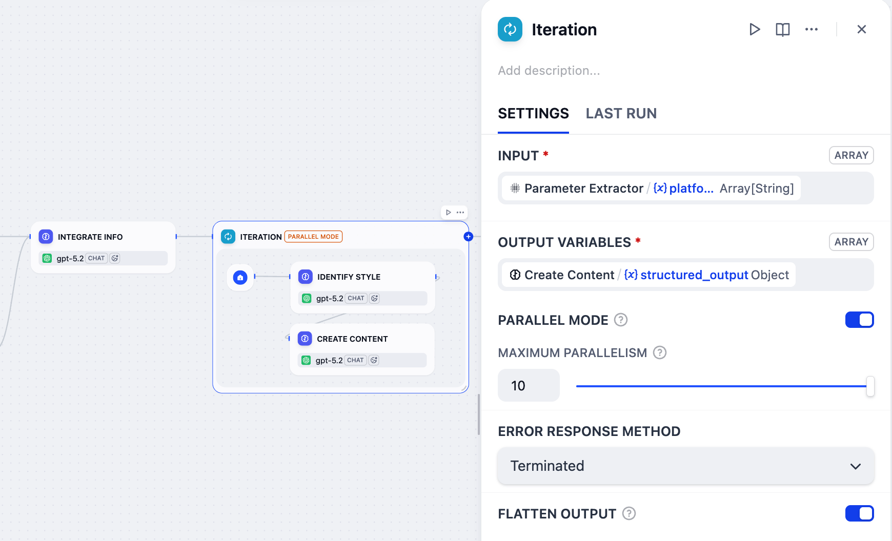

### 8. 格式化最终输出：模板节点

> [!NOTE]
>
> 迭代节点为每个平台生成一个帖子，但其输出是原始数据数组（例如，`[{"platform_name": "Twitter", "post_content": "..."}]`），不太可读。我们需要以更清晰的格式呈现结果。
>
> 这就是模板节点的用武之地，它允许我们使用 [Jinja2](https://jinja.palletsprojects.com/en/stable/) 模板将这些原始数据格式化为组织良好的文本，确保最终输出用户友好且易于阅读。

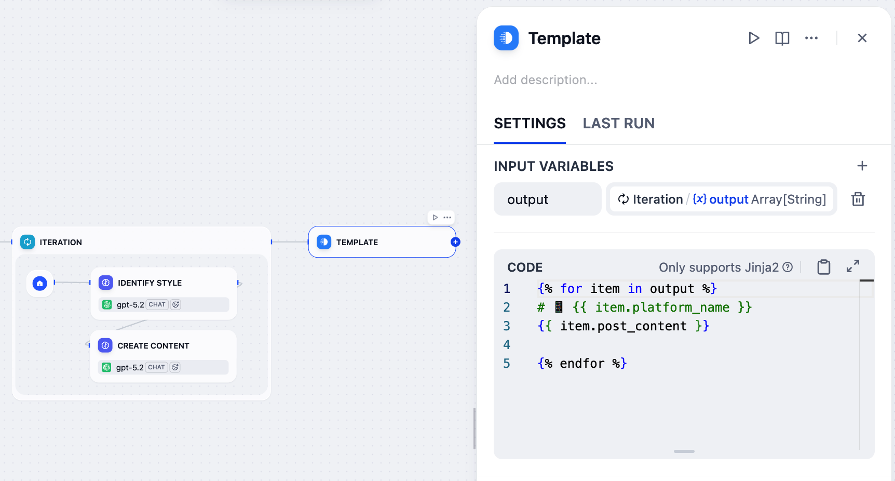

1. 在迭代节点之后，添加一个模板节点。

2. 在模板节点的面板上，将 `Iteration/output` 设置为输入变量并命名为 `output`。

3. 粘贴以下 Jinja2 代码：

   ```
   
   # 📱 {{ item.platform_name }}
   {{ item.post_content }}

   
   ```

   * `` / ``：遍历输入数组中的每个平台 - 内容对。
   * `{{ item.platform_name }}`：显示平台名称作为带有手机表情符号的 H1 标题。
   * `{{ item.post_content }}`：显示为该平台生成的内容。
   * `{{ item.post_content }}` 和 `` 之间的空行在最终输出中为各平台之间添加间距。

> [!TIP]
>
> 虽然 LLM 也可以处理输出格式化，但它们的输出可能不一致且不可预测。对于不需要推理的基于规则的格式化，模板节点以更稳定可靠的方式完成任务，且成本为零令牌。
>
> LLM 非常强大，但知道何时使用正确的工具是构建更可靠和经济高效的 AI 应用的关键。

### 9. 将结果返回给用户：输出节点

1. 在模板节点之后，添加一个输出节点。
2. 在输出节点的面板上，将 `Template/output` 设置为输出变量。

## 步骤 3：测试

你的工作流现在已完成！让我们测试一下。

1. 确保你的检查列表已清除。

   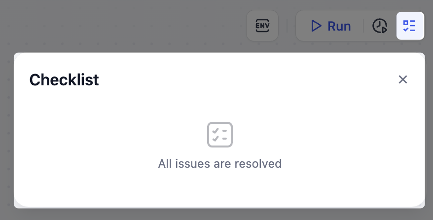

2. 对照开头提供的参考图检查你的工作流，确保所有节点和连接都匹配。

3. 点击右上角的 **运行测试**，填写输入字段，然后点击 **开始运行**。

   如果你不确定要输入什么，可以尝试以下示例输入：

   * **草稿**：`We just launched a new AI writing assistant that helps teams create content 10x faster.`

   * **上传文件**：留空

   * **语音与语调**：`Friendly and enthusiastic, but professional`

   * **目标平台**：`Twitter and LinkedIn`

   * **语言**：`English`

成功运行后会生成格式化的输出，每个平台有一个单独的帖子，如下所示：

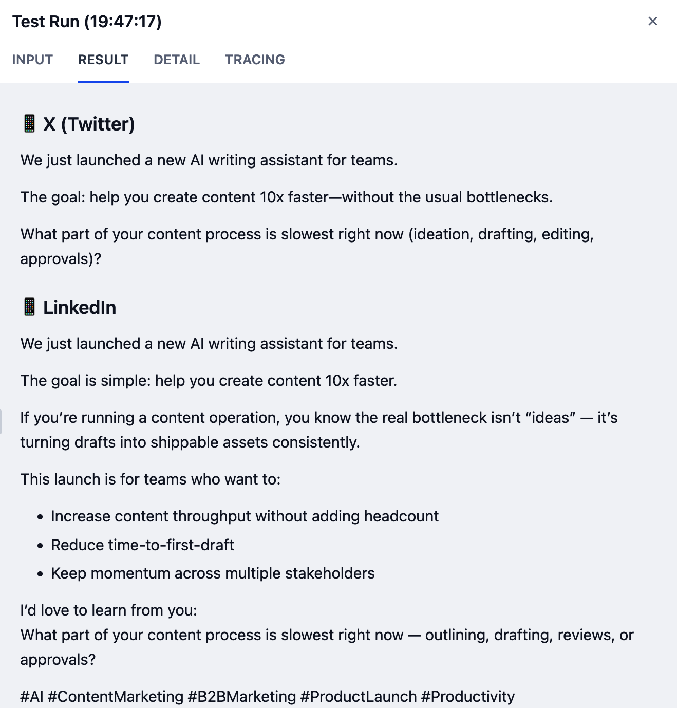

> [!NOTE]
>
> 你的结果可能会因使用的模型不同而有所差异。能力更强的模型通常会产生更高质量的输出。

> [!TIP]
>
> 要测试节点对来自先前节点的不同输入的反应，你不需要重新运行整个工作流。只需点击画布底部的 **查看缓存变量**，从列表中找到要更改的变量，然后编辑其值。

如果遇到任何错误，请检查相应节点的 **最后运行** 日志以确定问题的确切原因。

## 步骤 4：发布和共享

一旦工作流按预期运行并且你对结果感到满意，点击 **发布** > **发布更新**使其生效并可共享。

> [!WARNING]
>
> 如果你稍后进行任何更改，请始终记住再次发布，以便更新生效。
