# ChatFlow 实战：搭建 Twitter 账号分析助手

> 本文档由 AI 自动翻译。如有任何不准确之处，请参考 [英文原版](https://docs.dify.ai/en/learn/tutorials/twitter-chatflow.md)。

## 简介

Dify 内置了一些网络爬虫工具例如 Jina，它可以将网页转换为 LLM 可以读取的 markdown 格式。

然而，X（以前叫 Twitter）自 2023 年 2 月 2 日起停止提供免费 API 访问，并且升级了其反爬虫措施。像 Jina 这样的工具无法直接访问 X 的内容。

> Starting February 9, we will no longer support free access to the Twitter API, both v2 and v1.1. A paid basic tier will be available instead 🧵
>
> — Developers (@XDevelopers) [February 2, 2023](https://twitter.com/XDevelopers/status/1621026986784337922?ref_src=twsrc%5Etfw)

好在 Dify 有 HTTP 工具，我们可以通过发送 HTTP 请求来调用外部爬虫工具。下面让我们开始吧！

## 本实验中你将掌握的知识点

* ChatFlow 的基础知识
* 如何在 Dify 中避免明文密钥
* HTTP 工具的使用

## **前提条件**

### 注册 Crawlbase

Crawlbase 是一个为企业和开发者设计的全方位数据爬取和抓取平台，Crawlbase Scraper 可以从 X、Facebook 和 Instagram 等社交平台抓取数据。

点击注册：[crawlbase.com](https://crawlbase.com)

### 登录 Dify

在浏览器中打开 Dify 并登录。你需要一个正在运行的 Dify 实例才能继续。

本教程需要使用 LLM 处理 Crawlbase 抓取的社交平台数据，因此需自备至少一个模型供应商的凭据，如 OpenAI API Key 或本地的 Ollama。在 **集成** > **模型供应商** 中配置：

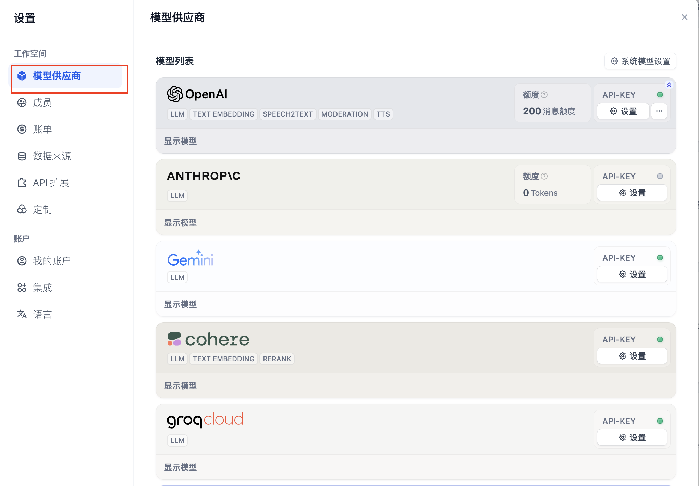

## 创建 ChatFlow 应用

现在，让我们开始创建 ChatFlow。点击`创建空白应用 - 工作流编排`：

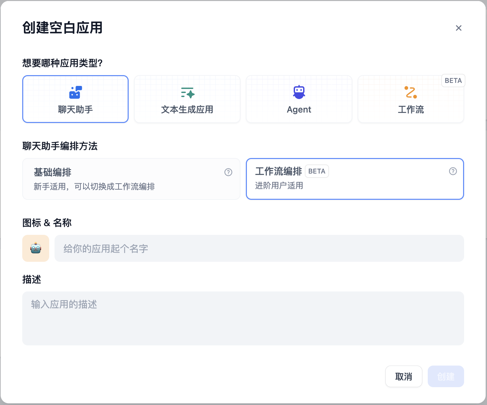

初始化的 Chatflow 应用如下：

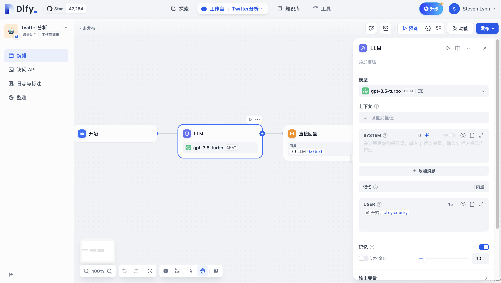

## 添加节点

### 开始节点

在开始节点中，我们可以在聊天开始时添加一些系统变量。在本文中，我们需要一个 Twitter 用户的 ID 作为字符串变量。让我们将其命名为`id`。

点击开始节点并添加一个新变量：

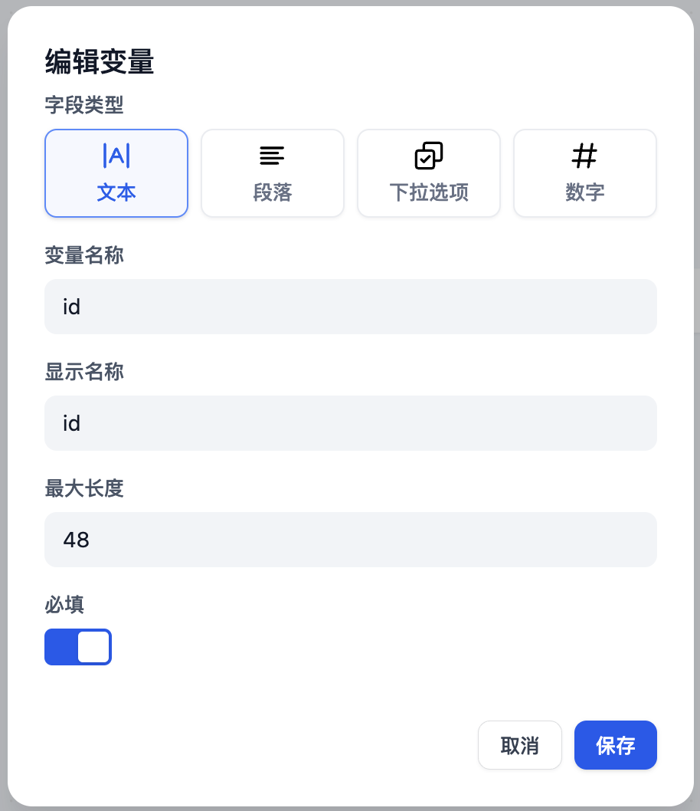

### 代码节点

根据[Crawlbase 文档](https://crawlbase.com/docs/crawling-api/scrapers/#twitter-profile)所述，变量`url`（将在下一个节点中使用）为 `https://twitter.com/` + `user id`，例如 Elon Musk 应当是[`https%3A%2F%2Ftwitter.com%2Felonmusk`](https://twitter.com/elonmusk)。

为了将用户 ID 转换为完整 URL，我们可以使用以下 Python 代码将前缀`https://twitter.com/`与用户 ID 整合：

```python theme={null}
def main(id: str) -> dict:
    return {
        "url": "https%3A%2F%2Ftwitter.com%2F"+id,
    }
```

添加一个代码节点并选择 Python，然后设置输入和输出变量名：

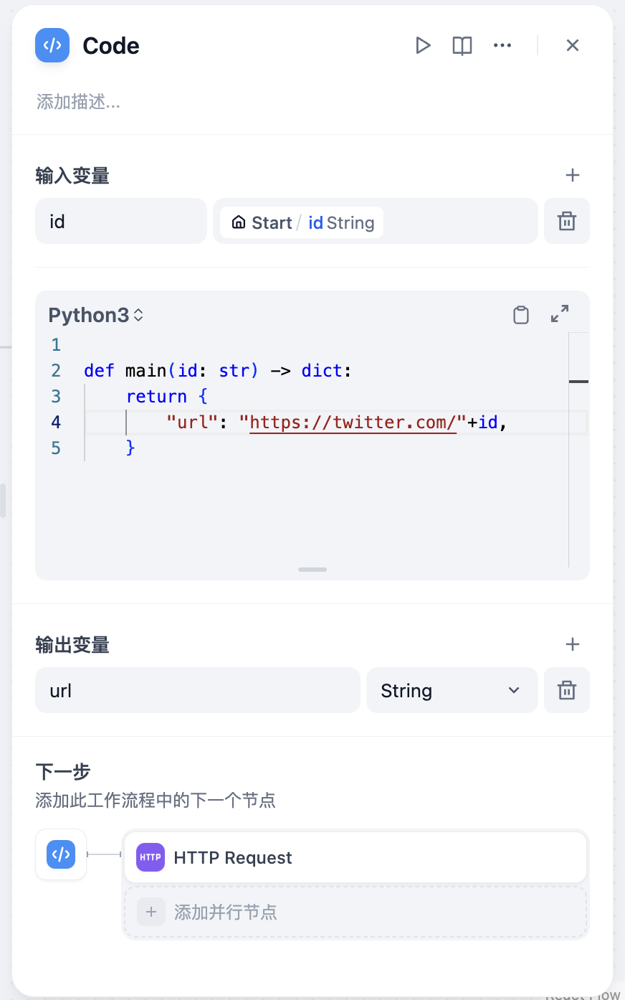

### HTTP 请求节点

根据 [Crawlbase 文档](https://crawlbase.com/docs/crawling-api/scrapers/#twitter-profile)，如果以 HTTP 请求格式抓取 Twitter 用户的个人资料，我们需要按以下格式填写 HTTP 请求节点：

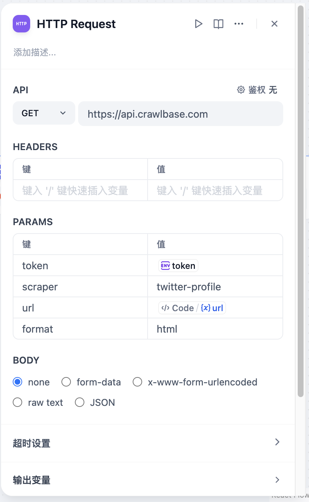

出于安全考虑，最好不要直接将 API Key 作为明文输入。在 Dify 最新版本中，可以在`环境变量`中设置令牌值。点击 `env` - `添加变量`来设置 API Key，这样就不会以明文出现在节点中。

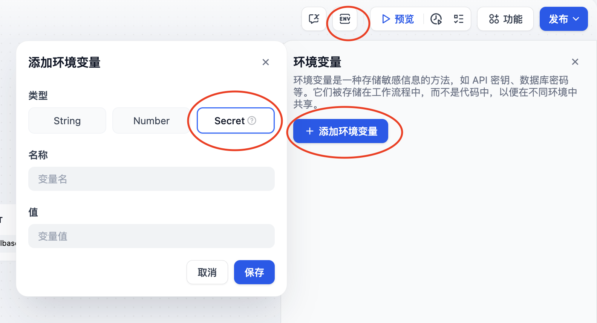

点击[此处](https://crawlbase.com/dashboard/account/docs)获取 Crawlbase API Key。输入 `/`插入为变量。

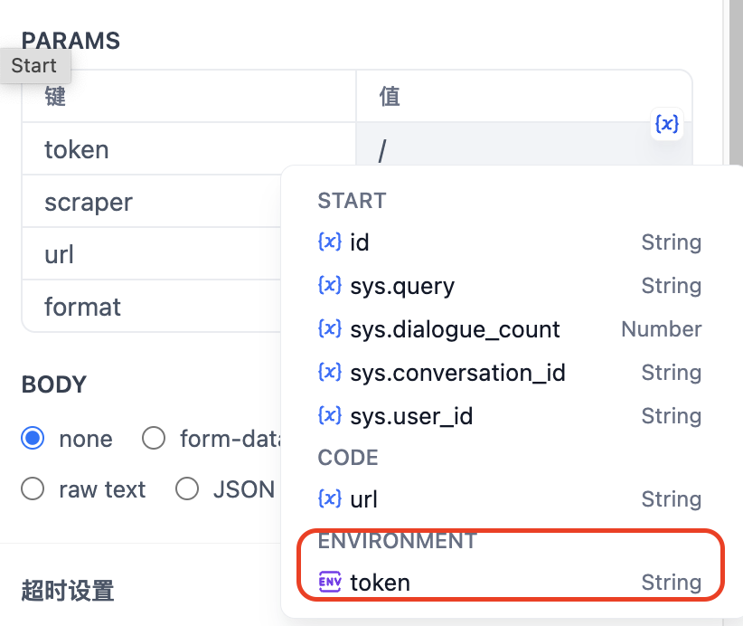

点击此节点的开始按钮，输入 Elon Musk 的 URL 进行测试：

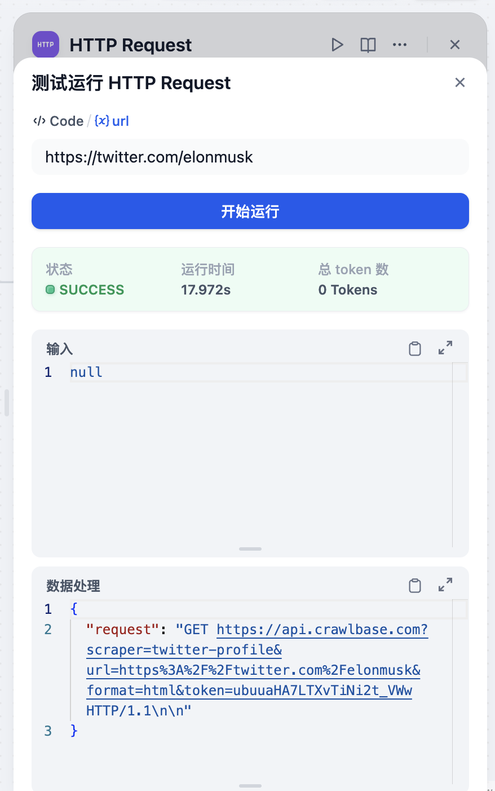

### LLM 节点

现在，我们可以使用 LLM 来分析 Crawlbase 抓取的结果并执行我们的命令。

变量 `context` 的值为 HTTP 请求节点的 `body`。

以下是一个提示词示例。

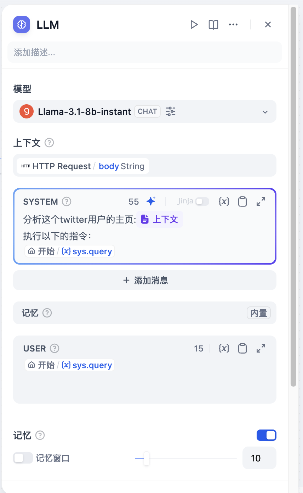

## 测试运行

点击 `预览`开始测试运行，并在`id`中输入 Twitter 用户 ID：

例如，我想分析 Elon Musk 的推文，并以他的语气写一条关于全球变暖的推文。

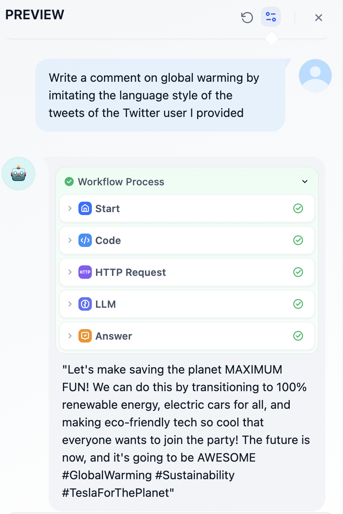

点击右上角的`发布`，并将其添加到你的网站中。

## 写在最后

Crawlbase 应该是目前最便宜的 Twitter 爬虫服务，但有时它可能无法正确抓取用户推文的内容，具体效果请以实际调用为准。

## 链接

* [X@dify\_ai](https://x.com/dify_ai)
* Dify 的 [GitHub 仓库](https://github.com/langgenius/dify)
