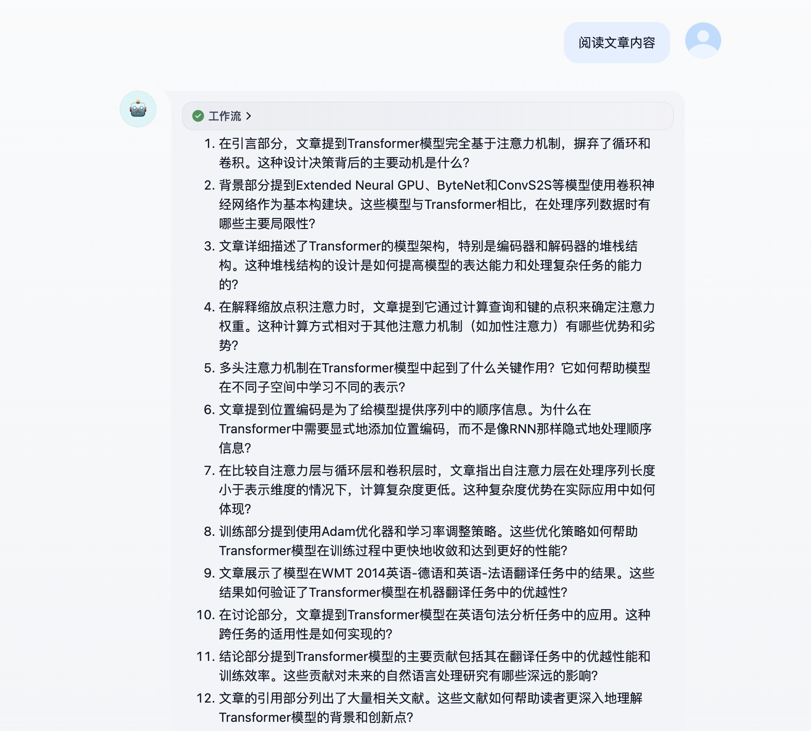
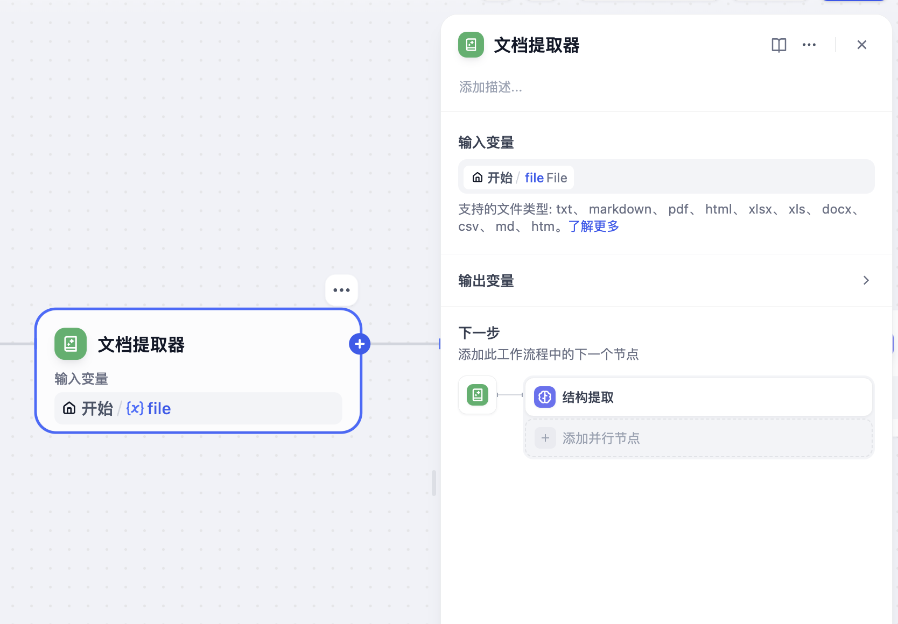
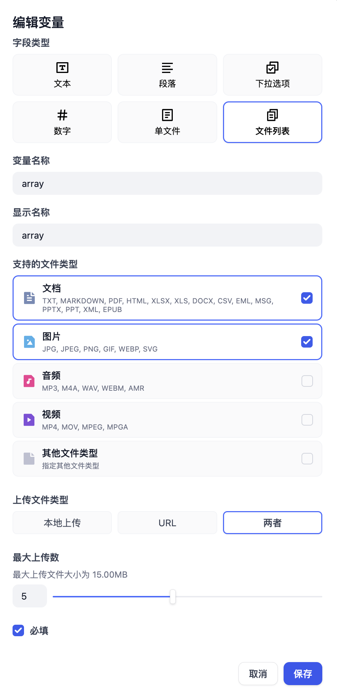
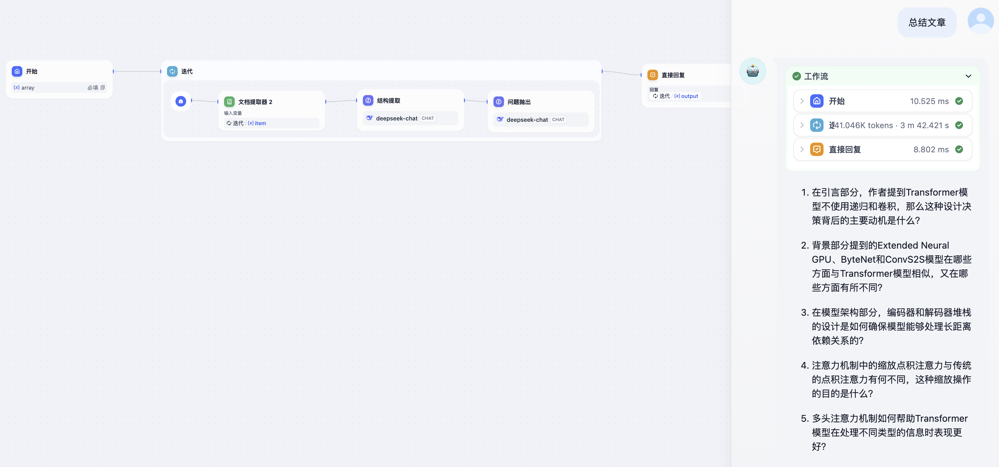
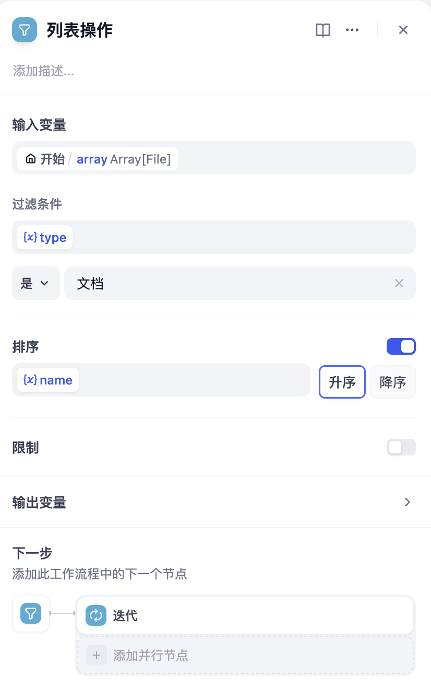

# 使用文件上传搭建文章理解助手

> 本文档由 AI 自动翻译。如有任何不准确之处，请参考 [英文原版](https://docs.dify.ai/en/learn/tutorials/article-reader.md)。

在 Dify，你可以使用知识库工具让 Agent 从大量的文本内容中获取准确的信息。然而，很多情况下需要理解的本地文件并不是很大，不至于用上知识库。这种情况下可以使用文件上传功能直接把本地文件作为上下文给 LLM 理解。

本次实验中，我们将以文章理解助手为案例。这个文章理解助手将会根据上传的文档进行提问，协助用户带着问题去阅读论文等材料。



## 本实验中你将掌握的知识点

* 文件上传功能
* Chatflow 的基本操作
* 提示词撰写
* 迭代的使用
* 文档解析器和列表操作节点

## 前提条件

在 Dify 中创建一个 Chatflow。请确保你已添加模型供应商并有足够额度。

## 添加节点

在本次实验中至少需要涉及四种节点：开始节点、文档提取器节点、LLM 节点、回复节点。

### 开始节点

在开始节点需要添加文件变量。在 0.10.0 版本的 Dify 中支持了文件上传功能，你可以将文件作为变量加入。

在开始节点需要增加一个文件变量，在 **支持的文件类型** 中，需要勾选 **文档。**

一些读者可能会注意到在系统变量中有 `sys.files`，这个变量是用户在对话框中上传的文件或者文件列表。

和自己创建文件变量的区别在于，这个功能需要在 **功能** 中打开 **文件上传** 并且设置上传文件类型，并且在对话中每次上传新的文件都会将这个变量覆写。

请需要根据业务场景选取合适的文件上传方式。

### 文档提取器

**LLM 是无法直接读取文件的。** 这是很多用户在第一次使用文件上传功能的一个误区，会认为直接把文件作为变量在 LLM 节点应用就可以了，实际上 LLM 读到的内容为空。

所以，Dify 引入了 **文档提取器**，这个节点可以从文件变量中提取文本，输出文本格式的变量。

将开始节点的文件变量作为输入变量，文档提取器会将文档格式的文件转为文本变量输出。



### LLM

本次实验中需要设计两个 LLM 节点，分别是结构提取和问题抛出。

#### 结构提取

结构提取节点能够从原文内容中提取文章结构，总结关键内容。

提示词内容如下：

```text theme={null}
阅读以下文章内容并执行任务
{{文档提取器结果的变量}}
# 任务

- **主要目标**：全面解析文章的结构。
- **目标**：详细说明文章每个部分的内容。
- **要求**：尽可能详细地分析。
- **限制**：无特别的格式限制，但需要保持解析的条理性和逻辑性。
- **预期输出**：文章结构的详细解析，包括每个部分的主要内容和作用。

# 推理顺序

- **推理部分**：通过仔细阅读文章，识别和解析其结构。
- **结论部分**：提供每个部分的具体内容和作用。

# 输出格式

- **解析格式**：每个部分应以标题形式列出，后跟对该部分内容的详细说明。
- **结构形式**：Markdown，以增强可读性。
- **具体说明**：每个部分的内容和作用，包括但不限于引言、正文、结论、引用等。

# 示例输出

## 示例文章解析

### 引言
- **内容**：介绍研究的背景、目的和重要性。
- **作用**：吸引读者的注意力，为文章内容提供上下文。

### 方法
- **内容**：描述研究的具体方法和步骤，包括实验设计、数据收集和分析技术。
- **作用**：使读者了解研究的科学性和可重复性。

### 结果
- **内容**：展示研究的主要发现和数据。
- **作用**：提供研究结论的证据基础。

### 讨论
- **内容**：解释结果的意义，对比其他研究，提出可能的改进方向。
- **作用**：帮助读者理解结果的广泛影响和未来研究的潜力。

### 结论
- **内容**：总结研究的主要发现和贡献。
- **作用**：强化文章的核心信息，提供明确的结论。

### 引用
- **内容**：列出文章中引用的所有文献。
- **作用**：提供进一步阅读的资源，确保学术诚信。

# 备注

- **边缘情况**：如果文章结构不典型（例如，缺少某些部分或有额外的部分），应在解析中明确指出这些特殊情况。
- **重要考虑事项**：解析时应关注文章的逻辑性和连贯性，确保每个部分的内容与文章的整体目标一致。
```

#### 问题抛出

问题抛出节点能够从结构提取节点总结的内容中总结文章的问题，协助读者在阅读的过程中带着问题去思考。

提示词如下：

```text theme={null}
阅读以下文章内容并执行任务
{{结构提取的输出}}
# 任务

- **主要目标**：全面阅读上文，针对文章各个部分提出尽可能多的问题。
- **要求**：问题要有意义和价值，值得思考。
- **限制**：无特定限制。
- **预期输出**：一系列针对文章各个部分的问题，每个问题都应有深度和思考价值。

# 推理顺序

- **推理部分**：全面阅读文章，分析文章各个部分的内容，思考每个部分可能引发的深层次问题。
- **结论部分**：提出有意义和有价值的问题，确保问题能够引发深入的思考。

# 输出格式

- **格式**：每个问题单独成行，编号列出。
- **内容**：针对文章的各个部分（如引言、背景、方法、结果、讨论、结论等）提出问题。
- **数量**：尽可能多，但每个问题都应有意义和价值。

# 备注

- **边缘情况**：如果文章的某些部分内容较少，可以适当调整问题的数量和深度，但每个问题都应有思考价值。
- **重要考虑事项**：确保问题能够引导读者深入理解文章内容，而不仅仅是表面的疑问。
```

## 思考题 1 : 处理多个上传文件

为了处理多个上传文件，需要用到 **迭代** 节点。

迭代节点类似于许多编程语言中的 while，区别在于 Dify 中没有条件限制，且 **输入变量只能是 `array` 类型（列表）**。原因是 Dify 会将列表中的全部内容都执行完为止。

因此，你需要把开始节点中的文件变量调整为`array`类型，也就是文件列表。



在开始节点之后需要加入迭代节点，并且设置输入变量和输出变量。在迭代节点内部，设置每次循环执行的内容，这部分和前文内容完全一致。



## 思考题 2 : 针对思考题 1，只处理文件列表的特定文件

在思考题 1 中，有的读者可能会注意到 Dify 会把所有文件处理完才会结束循环，而有些情况下只要操作其中一部分的文件而非全部。对于这个问题，可以对文件列表进行处理，在 Dify 中对列表进行操作的节点叫做 **列表操作**。列表操作可以对所有`array`类型的变量进行操作，不光是文件列表。

例如，限定只对文档类型的文件进行分析，并且把要处理的文件顺序按文件名称排序。

在迭代节点前加入列表操作，调整 **过滤条件**、**排序**，然后将迭代节点的输入改为列表操作节点的输出。


