# 使用知识库搭建智能客服机器人

> 本文档由 AI 自动翻译。如有任何不准确之处，请参考 [英文原版](https://docs.dify.ai/en/learn/tutorials/customer-service-bot.md)。

上一个实验中，我们学习了文件上传的基本用法。然而，当我们需要读取的文本超出 LLM 的上下文窗口时，就需要用到知识库了。

> **什么是上下文？**
>
> 上下文窗口是指 LLM 在处理文本时能够“看到”和“记住”的文字范围。它决定了模型在生成回答或继续文本时，能够参考多少之前的文字信息。窗口越大，模型能利用的上下文信息越多，生成的内容通常更准确和连贯。

在之前，我们了解到 LLM 的幻觉的概念，很多情况下 LLM 知识库可以让 Agent 从中定位到准确的信息，从而准确地回答问题。在一些特定领域，比如客服、检索工具等有应用。

传统的客服机器人往往是基于关键词检索的，当用户输入了关键词以外的问题，机器人就无法解决。知识库正是为了解决这样一个问题，能够做到语义级别上的检索，降低人工的负担。

在实验开始之前，请记住知识库的核心是检索而非 LLM，是 LLM 增强了输出的过程，但真正的需求仍然是生成答案。

## 本实验中你将掌握的知识点

* Chatflow 的基础使用
* 知识库、外部知识库的使用
* embedding 的概念

## 前提条件

### 创建应用

在 Dify 中选择 **创建空白应用 - 工作流编排。**

### 添加模型供应商

本次实验中需要涉及使用 embedding 模型，目前支持 embedding 的模型供应商中有 OpenAI、Cohere 等，在 Dify 的模型供应商中有标注 `TEXT EMBEDDING` ，请确保至少添加了一个并且有充足余额。

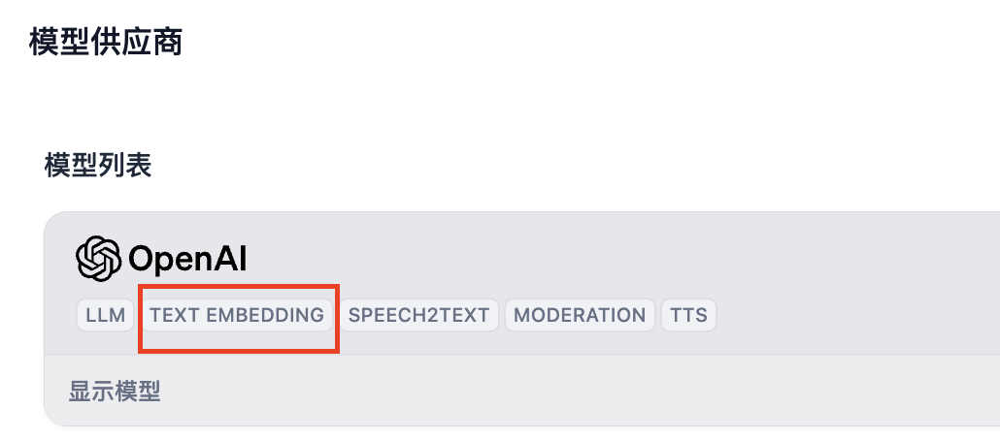

> **什么是 embedding？**
>
> " Embedding "是一种将离散型变量（如单词、句子或者整个文档）转化为连续的向量表示的技术。
>
> 直白地说，在我们将自然语言处理为数据时会将文本转为向量，这个过程被称作 embedding。语义相似的文本的向量会位置相近，语义相反的文本的向量位置相反。LLM 使用这样的数据做训练，预测出后续的向量，从而生成文本。

## 创建知识库

登录 Dify -> 知识库 -> 选择数据源

Dify 支持三种数据源：上传文本文件、Notion、网页。

其中，本地文本文件需要注意文件类型的限制以及文件大小的限制；同步 Notion 内容需要绑定 Notion 账号；同步 Web 站点需要使用 Jina 或者 Firecrawl 的 API。

下面将先以本地文件为例。

### 分段设置

上传文档后，会进入以下页面：

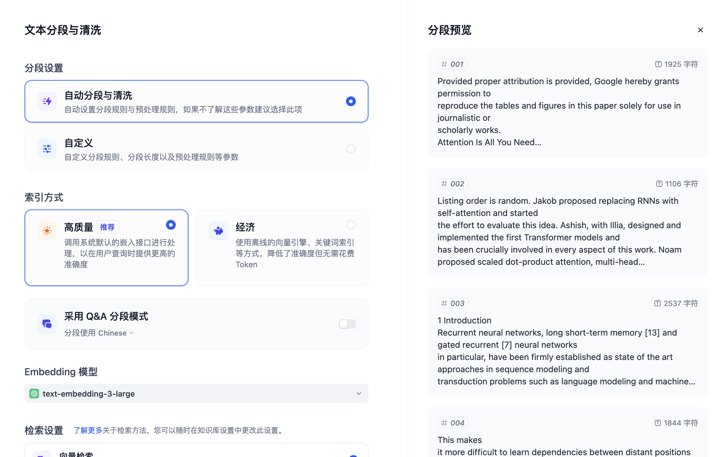

可以看到右侧有分段预览。当前默认选择的是自动分段与清洗，Dify 会根据文本内容的不同自动将文章切分为许多个段落。你也可以在自定义中设置其他的切分规则。

### 索引方式

通常情况下选择 **高质量**，但是需要额外消耗 token。选择 **经济** 无需消耗 token。

### Embedding 模型

请在使用前查阅模型供应商的使用文档、模型定价等信息。

不同的 embedding 模型适用场景不同。例如 Cohere 的 `embed-english` 适用于英语文档，`embed-multilingual` 适用于多语言文档。

### 检索设置

Dify 提供了向量检索、全文检索、混合检索三种检索功能，其中常用的检索是混合检索。

混合检索中可以设置权重或者使用重新排序（Rerank）模型。使用权重设置时，可以设置检索更侧重语义还是关键词，例如下图中语义占 70% 的权重，关键词占 30% 的权重。

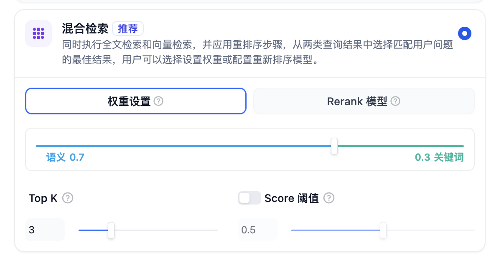

点击 **保存并处理** 将会处理文档，完成处理后文档就可以在应用中使用了。

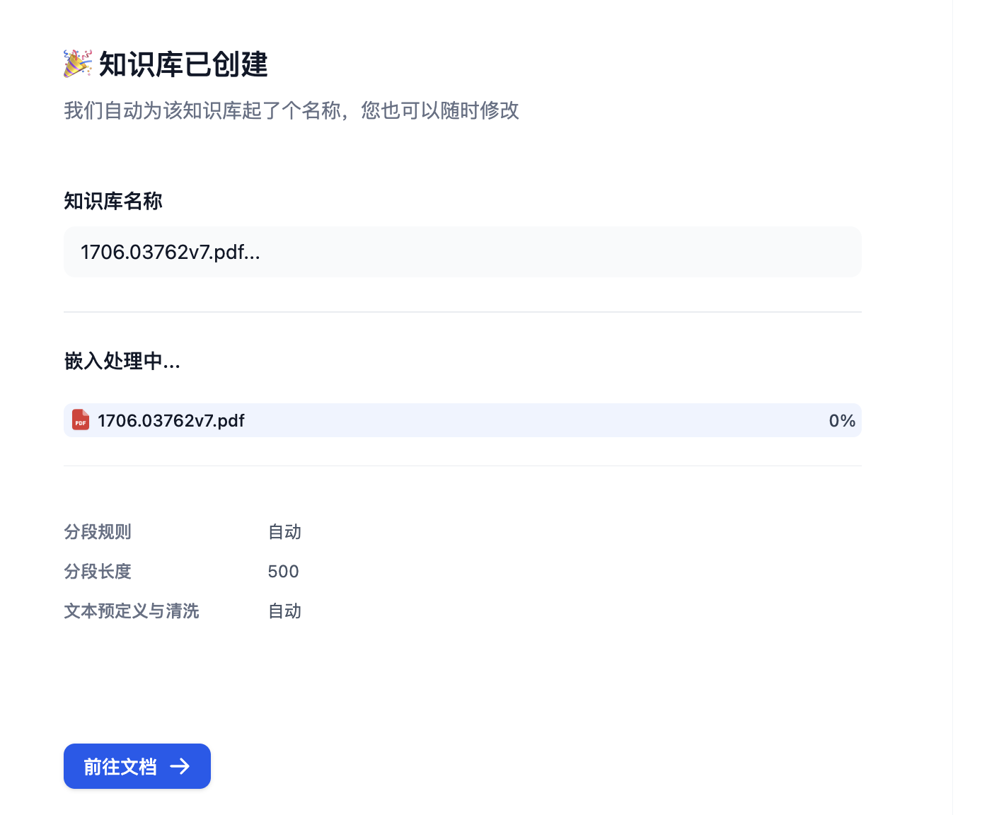

### 同步自 Web 站点

很多情况下，我们需要根据帮助文档构建智能客服，以 Dify 为例，我们可以将 [Dify 的帮助文档](https://docs.dify.ai/index.md)转为知识库。

目前 Dify 支持最多 50 个页面的处理，请注意限制数量的设置。如果超出，可以再创建新的知识库。

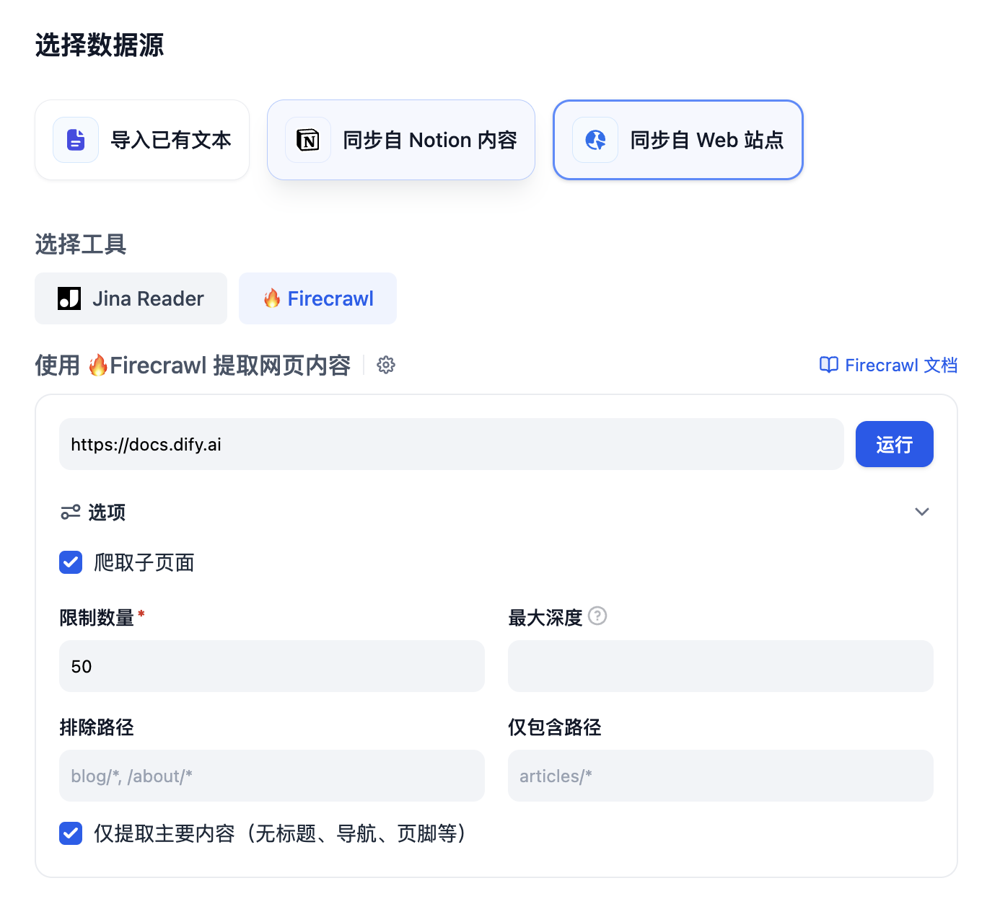

### 调整知识库内容

在知识库处理完所有文档后，最好前往知识库确认分段的连贯性。如果不连贯将会影响检索的效果，需要手动调整。

点击文档内容，对分段内容进行浏览，如果有无关的内容可以禁用或删除。

如果有内容被分段到了另外一个段落，也需要调整回来。

### 召回测试

在知识库的文档页，左侧边栏中点击召回测试，可以输入关键词来测试检索结果的准确性。

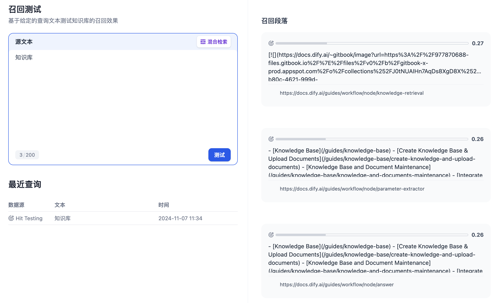

## 添加节点

进入创建好的 APP，下面开始构建智能客服机器人。

### 问题分类节点

你需要使用问题分类节点将用户的不同需求分离开。有的情况下用户甚至会聊无关的话题，对此也需要设置一个分类。

为了让分类更准确，你需要选择更优秀的 LLM，分类需要写的足够具体、区分度足够大。

以下是一个参考分类：

* 用户询问无关问题
* 用户询问和 Dify 相关问题
* 用户请求对技术名词的解释
* 用户询问社群加入方式

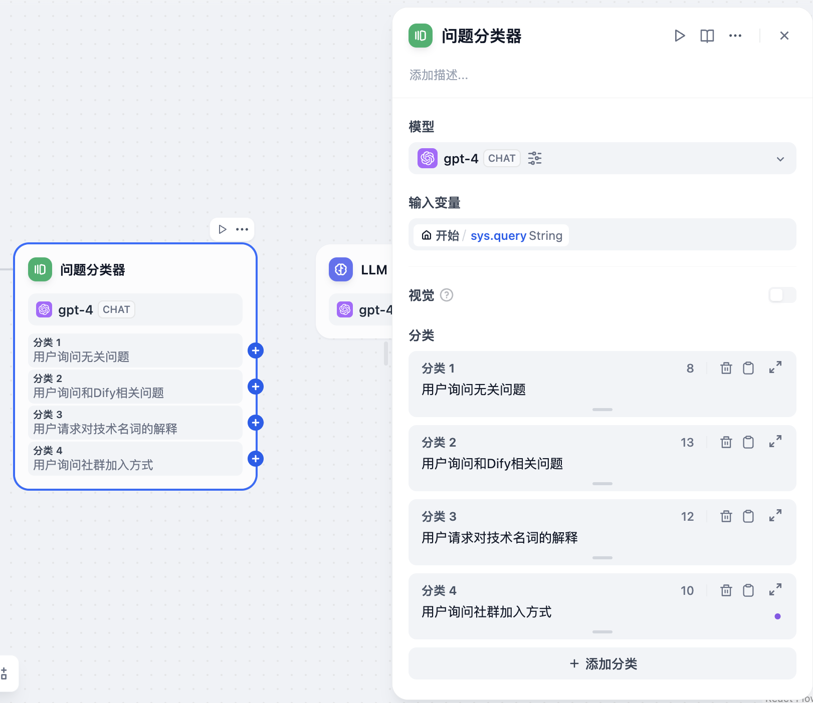

### 直接回复节点

问题分类中，“用户询问无关问题”和“用户询问社群加入方式”这两个问题是不需要经过 LLM 的处理就能回复的。因此你可以直接在这两个问题后面连接直接回复节点。

“用户询问无关问题”：

可以将用户引导到帮助文档，让用户先尝试自己解决，例如：

```text theme={null}
很抱歉，我不能回答你的问题。如果你需要更多帮助，请查看[帮助文档](https://docs.dify.ai)。
```

Dify 支持 Markdown 格式的文本的输出。你可以在输出中用 Markdown 来丰富文本的格式。甚至可以用 Markdown 格式在文中插入图片，效果如下：

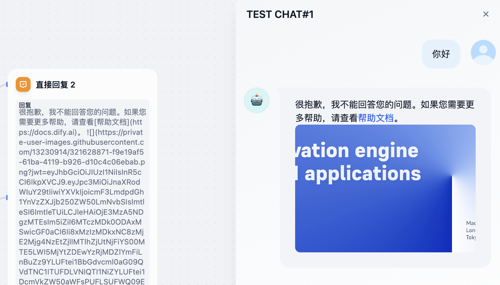

### 知识检索节点

在“用户询问和 Dify 相关问题”后增加知识检索节点，勾选需要使用的知识库。

### LLM 节点

在知识检索节点的下一个节点，你需要选择 LLM 节点来整理知识库召回的内容。

LLM 需要根据用户的提问，调整回复，使得回复内容更加得体。

上下文：需要将知识检索节点的输出作为 LLM 节点的上下文。

你可以在提示词书写区域输入 `/` 或者 `{` 来引用变量。在变量中，`sys.` 开头的变量是系统变量。

此外，你可以打开 LLM 记忆让用户的对话体验更加连贯。

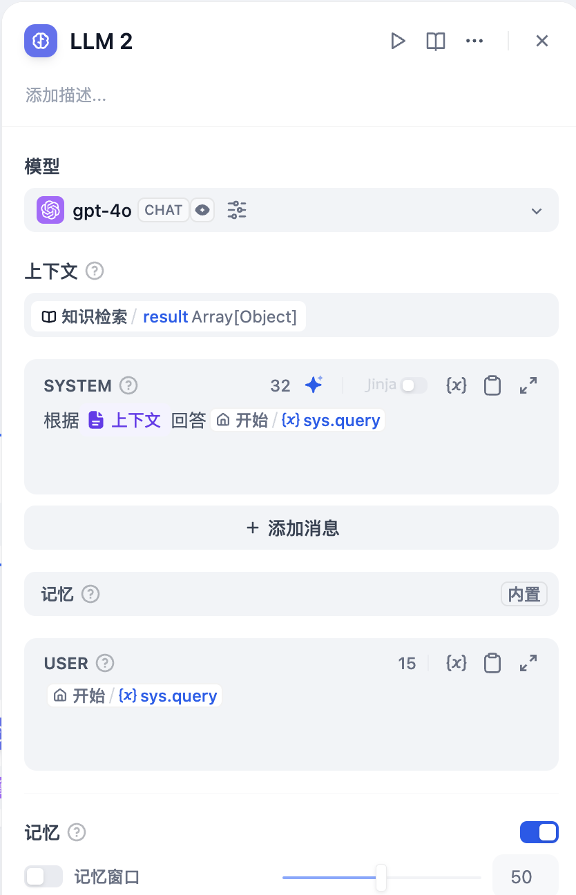

## 思考题 1: 如何连接外部知识库

在知识库功能中，你可以通过外部知识库 API 来连接外部知识库，例如 AWS Bedrock 知识库。

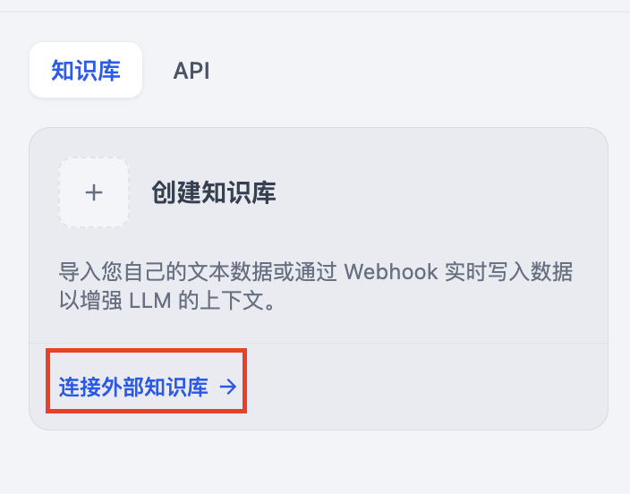

## 思考题 2: 如何通过 API 管理知识库

你可以通过知识库 API 新增、删除知识库，并查询其状态。

在 **知识库** 中，点击右上角的 **服务 API**，再点击 **API 密钥** 创建 API 密钥。请妥善保管 API 密钥。

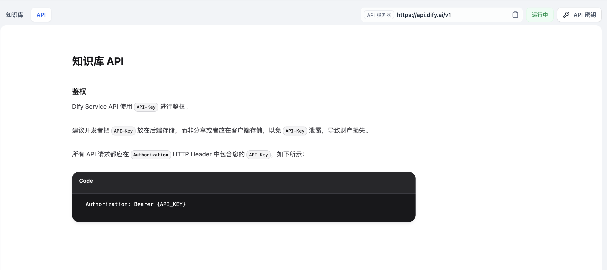

## 思考题 3: 如何将客服机器人嵌入网页

应用发布后，打开应用的 **访问入口** 标签页，在 **Web 应用** 卡片上选择 **嵌入网站**，再挑选一种合适的嵌入形式，将代码粘贴到网页的合适位置即可。
