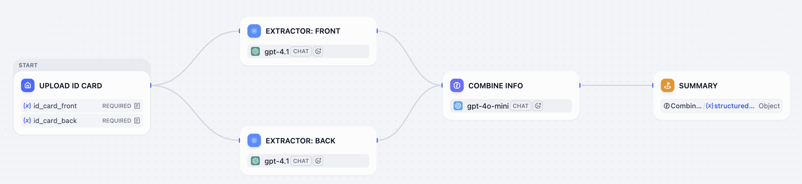
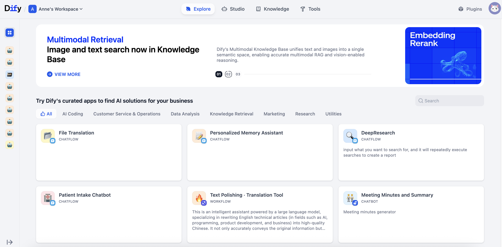

# 第 1 课：什么是工作流

> 本文档由 AI 自动翻译。如有任何不准确之处，请参考 [英文原版](https://docs.dify.ai/en/learn/tutorials/workflow-101/lesson-01.md)。

你有没有发现，我们每天其实都在遵守着各种“流程”？比如“早上起床的流程”：

1. 闹钟响 -> 2. 关闹钟 -> 3. 穿衣服 -> 4. 洗漱 -> 5. 吃早餐

一步接着一步，我们最终完成一个任务的流程，这就叫做：工作流 (Workflow)。但要搭建一个给 AI 使用的工作流，我们还需要另外两个要素：开始需要什么（输入），以及最后能得到什么（输出）。

你可以把工作流理解成 **做菜的菜谱**。一份菜谱通常包含：

1. 材料（输入）：需要准备什么？
2. 步骤（过程）：每一步需要做什么？
3. 成品（输出）：最后做出什么菜？

## 认识工作流

Dify 的工作流，就是一份我们写给给 AI 看的“菜谱”。你需要提供：

1. 材料（输入）：就是你提供给 AI 的信息，比如一个问题、一篇文章。
2. 步骤（过程）：就是你让 AI 按照顺序依次完成的任务，比如“先总结一下”、“再把它翻译成英文”、“最后生成一条发布在社交媒体帖子”。
3. 成品（输出）：AI 按照上面的步骤，最终生成的结果。

所以，工作流就是你指挥 AI 按照步骤完成任务的流程图。

下图是一个在 Dify 里构建的身份证信息提取的工作流：

### 节点

让我们再来看下上面的身份证信息提取流程，整个流程其实就是由 **上传图片、提取信息、整合信息** 这几个环节串联起来的。

每一个环节，就是一个节点。它们各司其职，就像完成接力赛一样，完成任务后，接力棒就会交给下一个节点。

Dify 为你准备了不同的节点，比如：LLM（大模型节点）、知识检索节点（Knowledge Retrieval）、条件分支节点、工具节点等，它们能够满足你的不同需求。

你只需要通过选择和拖拽，将不同节点连接起来，像搭积木一样，轻松构建出自动化工作流。在构建的过程中，你只需要思考做什么并专注于按什么顺序即可。

## 动手实践

1. 前往[ Dify 官网](https://dify.ai/zh)，点击右上角的立即开始，注册 Dify 账号。
2. 前往探索页面，查看标题下方标记为工作流的应用模板。

   
3. 打开并运行一个你感兴趣的工作流模板，根据每一个节点，大致了解每一步是做什么的
