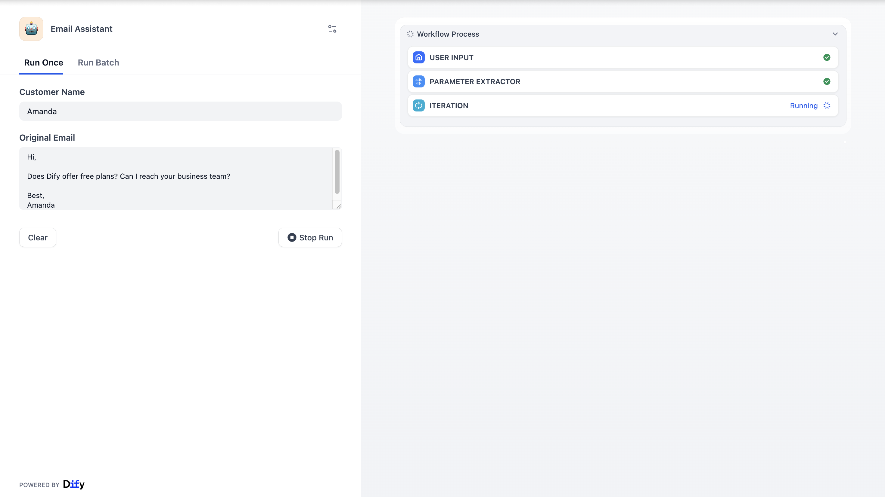
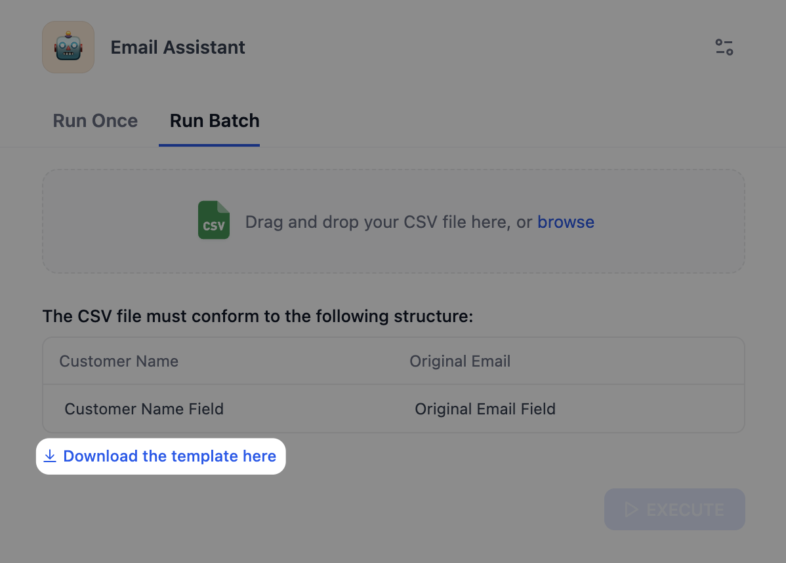

# 第 10 课：发布和监控你的 AI 应用

> 本文档由 AI 自动翻译。如有任何不准确之处，请参考 [英文原版](https://docs.dify.ai/en/learn/tutorials/workflow-101/lesson-10.md)。

经过前九课的学习和搭建，我们的邮件助理已经具备了连接知识库、使用搜索工具、并产出格式化的回复能力。但它现在还是躺在 Dify 的工作室里，只有你能够看到和使用它。

我们如何能够将它分享给其他人使用？如何知道它在实际运行中的表现如何？有没有报错？

这就需要我们完成最后两个关键步骤：发布（Publish）和监测（Monitor）。

## 发布你的应用

1. 将鼠标移至画布的右上角，点击 **发布** 按钮。你会看到其他按钮随之亮起。

   > [!NOTE]
   >
   > 每当你修改工作流后，都需要点击 **发布** > **发布更新** 保存这些修改。
   >
   > 如果不更新发布，线上版本将保持原来的旧版本。

2. 点击发布更新后，你会发现下方的按钮已经可以点击。

   1. **分享你的应用**

      点击下方的 **打开 Web 应用**，Dify 会为你生成一个网页（Web 应用），这就是你创建的邮件助理应用界面啦。

      你可以在这里直接使用邮件助理，也可以将链接分享给其他人。他们不需要登录 Dify，就能直接使用你开发的邮件助理了。

      

   2. **批量运行**

      如果你有 100 封邮件需要 AI 处理，一封封复制粘贴效率会非常低，有了 **批量运行**，你只需要把这 100 封邮件整理成一个 CSV 表格文件，在该标签页上传，它就会自动把这 100 封邮件一次性处理完，最后给你一个包含所有结果的表格。

      由于在 Workflow 里，我们设定了不同的变量，所以你需要上传指定格式的 CSV 表格文件。你也可以点击下载模板，再往这个模板里填充对应内容。

      

   3. **其他连接方式**

      * **访问入口**：管理应用的所有访问方式，包括 Web 应用、API、MCP 服务器和触发器。如果你懂编程，可在这里获取 API 密钥，把这个工作流集成到你自己的网站或 App 里。
      * **发布为工具**：将你当前的工作流打包成一个工具，让它能被其他的 Agent 调用。

## 监测你的应用

作为邮件助理的创建者，我们需要时刻关注它运行的状态，我们能够通过日志和监测来了解应用的健康状况、潜在的性能瓶颈等。

### 上帝视角 — 监测（Monitor）

监测是你的指挥中心，你能在这里通过不同面板看到应用的表现。

| 名称 | 释义 |
| :- | :- |
| 全部消息数 | AI 每天的互动总次数，每回答用户一个问题算一条消息。你能了解应用的实用热度。 |
| 活跃用户数 | 与 AI 有效互动，即有一问一答以上的唯一用户数。提示词编排和调试的会话不计入。 |
| 费用消耗 | 反映每日该应用请求语言模型的 Tokens 花费，用于成本控制。当曲线出现突然的提升或减少，你需要进行检查。 |
| 平均用户调用次数 | 反映每天用户的使用次数。该指标反映了用户粘性。 |

### 放大镜 - 日志（Logs)

日志记录了你的应用每次运行的详细记录，包括时间、输入内容、耗时等。

**日志的作用**

* **排查故障 (Debug)**：当用户说*邮件助理用不了了*，你可以通过日志还原案发现场，找到是哪个节点出了问题。
* **优化性能**：查看每个节点的耗时，找出拖慢整个流程的"瓶颈"。
* **理解用户**：看看用户实际输入了什么内容，以此来不断优化你的 Prompt 或知识库。
* **监控成本**：查看每次运行消耗了多少 Token，控制预算。

| 名称 | 释义 |
| :- | :- |
| 开始时间 | 任务触发的时间 |
| 状态 | Success（成功）；Failure（失败） |
| 运行时间 | 整个流程花了多少时间 |
| TOKENS | 这次运行消耗的 AI 算力（Token 数） |
| 用户或账户 | 用户 ID |
| 触发方式 | 是通过 Web 应用界面运行的，还是通过 API 调用的 |

你可以点击每条日志查看详情。例如，你可以发现用户高频提问的问题，并以此及时更新和修改你的知识库。

发布不是终点，而是新的起点，这就是 **LLMOps**（大语言模型运维）的核心理念。

1. **观察 (Observe)**：通过日志，看用户真的在问什么？AI 的回答用户满意吗？
2. **分析 (Analyze)**：发现有些问题 AI 回答得不好，或者某些工具调用经常失败。
3. **优化 (Optimize)**：回到画布，修改 Prompt，补充知识库，或者调整工作流逻辑。
4. **发布 (Publish)**：再次发布新版本。

通过上面的循环，你的 AI 邮件助理会变得越来越智能，越来越懂你的业务。

## 结束语

**现在，你不仅掌握了 Dify 这个工具，更掌握了构建 AI 应用的思维方式**：

```plaintext wrap theme={null}
把任务进行拆解 → 选择合适的节点、模型和工具去解决 → 将它们连接在一起 → 通过监测数据持续迭代
```

现在，你可以去 Dify 的探索页面里点开一个模板，进行拆解和分析。或者，从工作中的痛点出发，从空白的工作室开始，从零搭建一个属于你自己的工作流或者 AI 应用。

愿你使用 Dify，在 AI 时代下，工作更轻松，创造更自由。
