# 第 2 课：流程的头和尾（开始与输出节点）

> 本文档由 AI 自动翻译。如有任何不准确之处，请参考 [英文原版](https://docs.dify.ai/en/learn/tutorials/workflow-101/lesson-02.md)。

上一课我们把工作流比作一份菜谱。今天我们要做的，就是进入 Dify 后厨，认识一下我们的操作台并开始基础制作环节。

## 创建应用

**1. 创建空白应用**

点击顶端的 **工作室**，在左侧创建应用中，点击 **创建空白应用**。

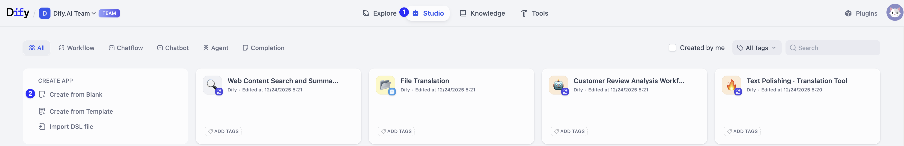

**2. 配置应用类型**

在弹窗中的选择应用类型里选择 **工作流**，填写 **应用名称&图标和描述**后，点击 **创建**。

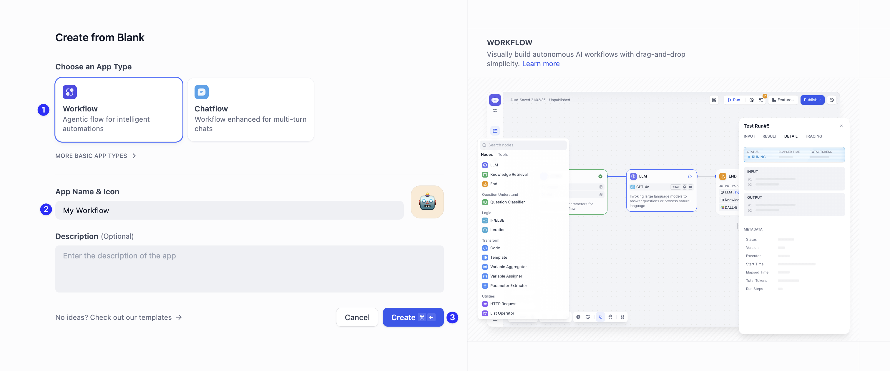

**3. 选择开始节点类型**

在弹窗中，你会看到一个包含两个选项的弹窗。这两个选项，代表不同的运行逻辑，让我们来做个简单的了解。

* **用户输入**

  你可以理解为 **手动模式**。当你/用户输入具体信息（如问题、指令）后，才会开始运行。

  使用场景：对话机器人、写作助手、翻译等多数 AI 应用。
* **触发器**

  你可以理解为 **自动模式**。它依靠特定的信号（如特定时间、事件）自动运行。

  使用场景：每天定时发新闻、当特定事项完成后再运行这个工作流。

我们在这一课，将搭建 AI 邮件助理，需要我们输入邮件内容，所以在这里我们选择 **用户输入**。

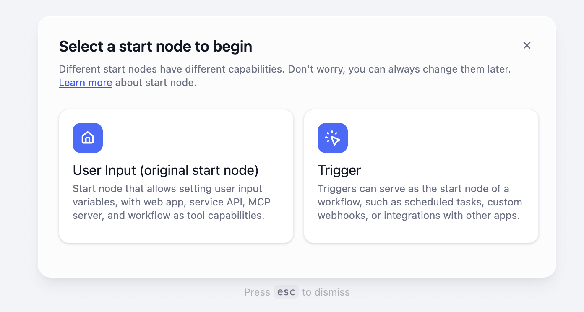

## 认识画布（Orchestration Canvas）

选择完开始节点后，你会看到一片空白的区域，这里就是你用来编排工作流的画布。

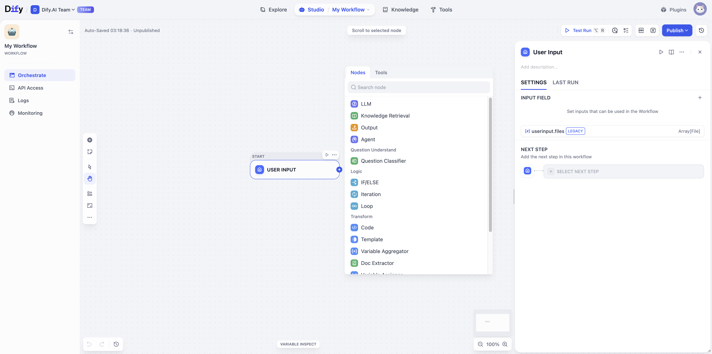

还记得我们在第一课里学到的节点吗？现在画布上出现的用户输入节点，就是我们工作流的起点。任何一个完整的工作流，都离不开一副最基础的骨架：**开始节点（头）和输出节点（尾）**。

## 开始节点 (Start Node)

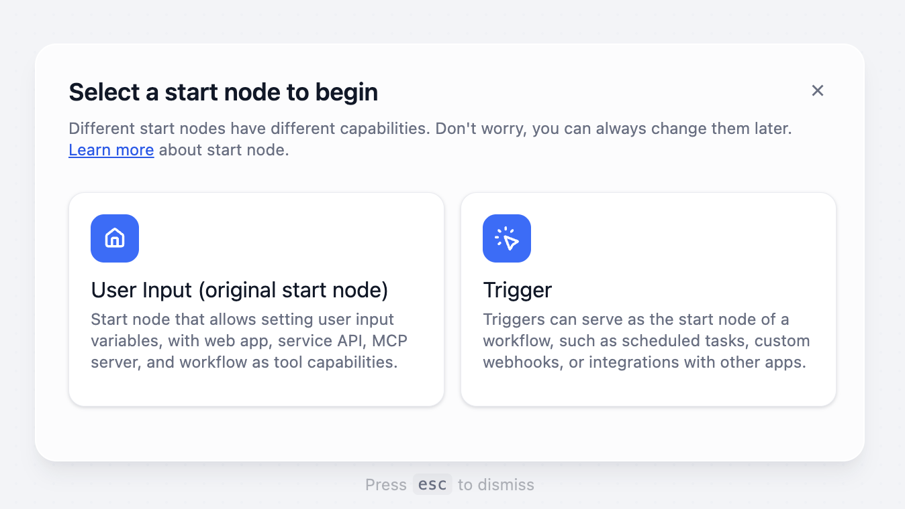

开始节点是整个工作流的唯一入口，相当于准备材料环节。它的作用是定义工作流开始时，需要从用户那里接收的信息。我们刚刚选择了用户输入作为开始节点。

### 核心概念：变量 (Variable)

你可以把变量想象成贴着不同标签的 **储物盒**，每个盒子专门放一种特定的信息。

比如，如果你要做一个旅游计划生成器，你需要用户提供 `目的地` 和 `旅行天数` 这两个信息。然而，每个用户提供的目的地和旅行天数又都不同，所以每次运行时，这些盒子里装的内容都是变化的。

这就是变量的意义，让你的工作流能够灵活处理每一次不同的请求。

## 输出节点 (Output Node)

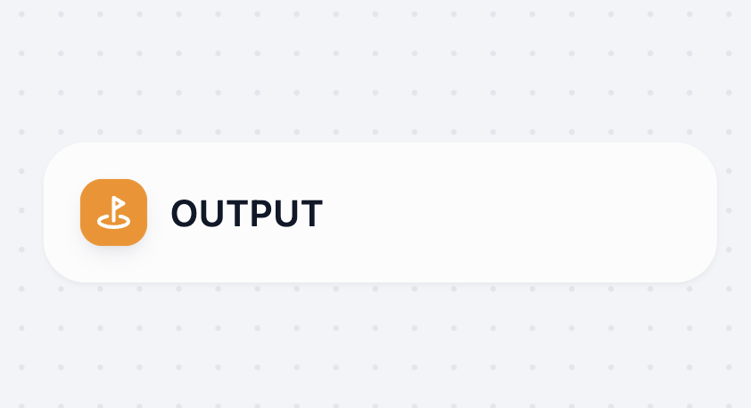

这是工作流的结尾，相当于出菜。

比如，刚刚的旅游计划生成器，当用户提供目的地：苏州，旅行天数：5，那么在结束节点，将会生成一个 5 天的苏州旅行计划。

开始节点和输出节点定义了一个工作流最基础的输入和输出，构成了它的基本框架。

## 动手实践：AI 邮件助理

搭建一个 AI 邮件助理工作流的基础框架。

**1. 创建应用**

你可以：

* 在刚刚创建的应用画布上，直接开始编排。
* 或者，你也可以点击顶部的工作室 > 在左侧创建应用中点击创建空白应用 > 在弹窗中选择 Workflow 应用类型，填写应用名为邮件助理（记得在弹窗中选择 **用户输入**）。

**2. 配置开始节点（准备材料）**

如果你需要 AI 写一封回复邮件，你需要提供什么信息？

没错，客户的名字和邮件原文。

1. 点击 **开始** 节点，在右侧面板中的 **输入字段** 内，点击 **+**。

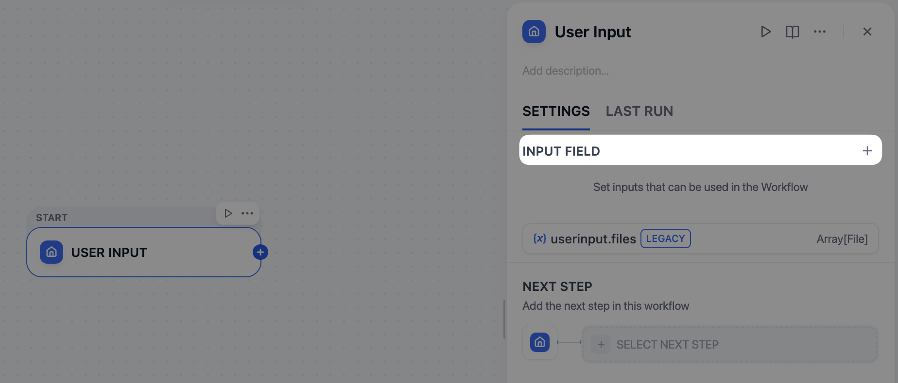

2. 在弹窗中，依次创建两个变量：

   1. **第一个变量（短文本）**

   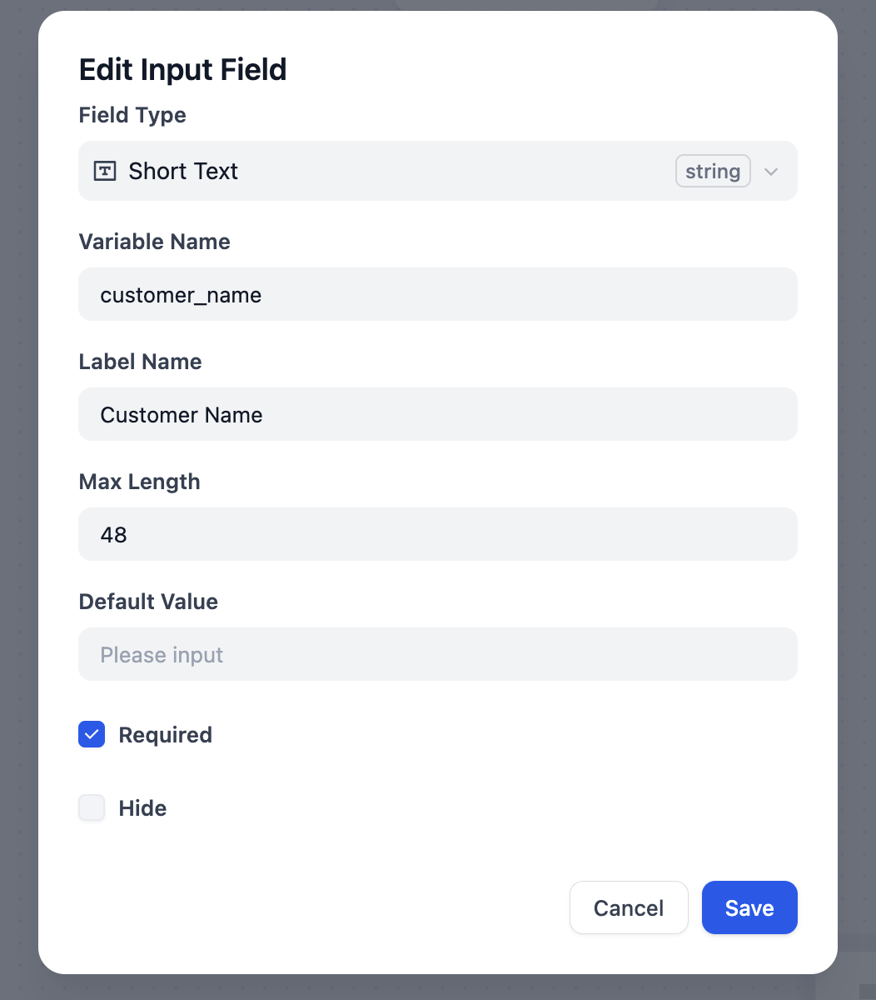

   * 变量名称：`customer_name`
   * 显示名称：客户名字
   * 其他选项保持默认

   2. **第二个变量（长文本）**

   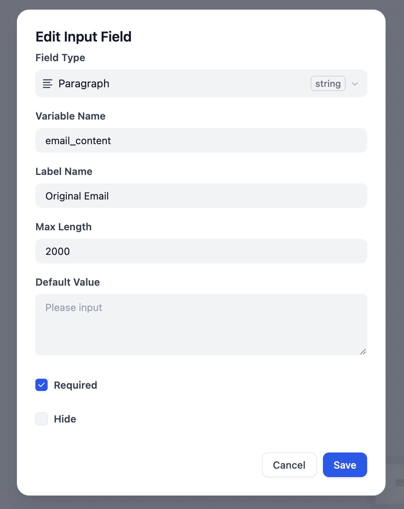

   * 字段类型：点击后在下拉菜单中选择 **段落**（这样输入框能够涵盖更多内容，方便粘贴邮件）
   * 变量名称：`email_content`
   * 显示名称：客户邮件原文
   * 最大长度：手动修改为 **2000**。确保能够涵盖完整的邮件内容

   > [!TIP]
   >
   > **变量名称 vs 显示名称**
   >
   > 你可能已经留意到，我们为每个变量都设置了两个名字，他们有什么区别呢？
   >
   > * **变量名称**：这是运行时，给系统看的名字。它必须是**独一无二**的，并且只能使用英文字母、数字和下划线 `_`，不能有空格。
   > * **显示名称**：这是给我们自己和最终用户看的名字。你可以使用任何语言（比如中文），让它变得清晰易懂。这个名字会显示在最终应用的输入框前面。

**3. 创建结束节点（设定目标）**

在画布上点击右键，选择 **添加节点**，选择 **输出**节点。

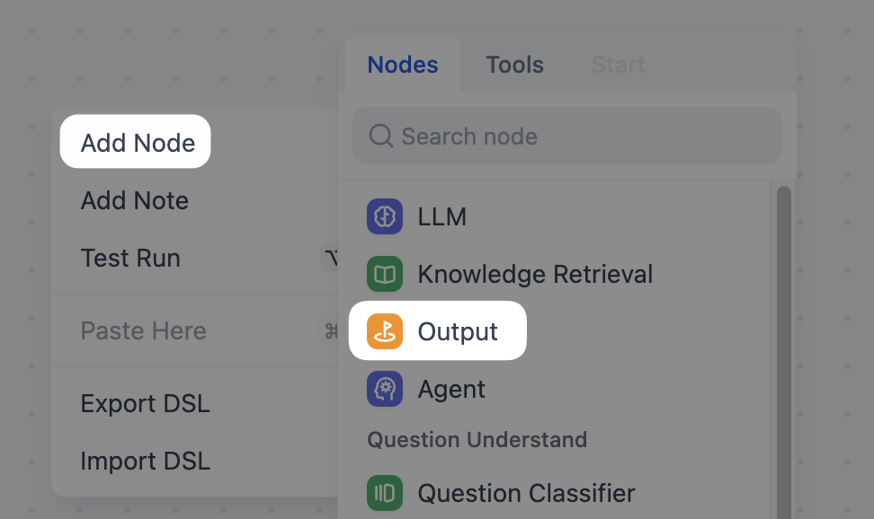

现在，你的画布上有一个准备好接收客户名字和邮件原文的 **开始节点**，和一个等待输出最终邮件的 **结束节点**。

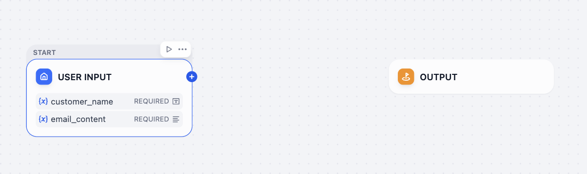

我们已经成功搭建了工作流的基本框架，画布中间的空白区域，就是我们下一课要放置 LLM 节点来处理这些信息的地方。

## 小挑战

**任务**：如果你需要创建一个旅游计划生成器，这个工作流的开始节点，需要包含哪些变量？

> [!TIP]
>
> 探索输入字段里 **添加变量** 的字段类型。
