# 第 4 课：小抄（知识检索）

> 本文档由 AI 自动翻译。如有任何不准确之处，请参考 [英文原版](https://docs.dify.ai/en/learn/tutorials/workflow-101/lesson-04.md)。

经过前三课的学习，我们的邮件助理已经初见雏形，能够草拟出基础的回复邮件。

但是，如果遇到公司特有的产品细节或者价格，它很可能会出现幻觉 (Hallucination)，也就是我们常说的一本正经地胡说八道，因为信息不准而出错。

那么我们该如何解决 AI 出现幻觉的问题呢？我们给它一本小抄。

## 检索增强生成 / RAG

解决幻觉的这套方法，叫做 RAG (Retrieval-Augmented Generation)，中文名称是检索增强生成。简单来说，RAG 就是让 AI 从凭空想象变成了有据可查，这是构建专业 AI 应用最核心的技术之一。而它的名字已经包含了这三个步骤。

**1. 检索（Retrieval）- 找菜谱**

根据用户的提问，从知识库中检索（查询）出最相关的信息片段。这就好比听到菜名宫保鸡丁，你先去找到这道菜的菜谱。

**2. 增强（Augmented）- 拿到菜谱和准备食材**

将检索到的信息片段（上下文），与用户的原始问题一起，组合并转换成给大型语言模型一个更新且更丰富的提示词（Prompt）。你可以理解为把这份菜谱放在手边，方便你随时查阅，同时准备好对应的食材。

**3. 生成（Generation）- 烹饪**

大语言模型根据这个包含上下文的新提示词（Prompt），生成一个有事实依据的和更准确的回答。你按照菜谱上的步骤，完成烹饪宫保鸡丁。

## 知识检索 (Knowledge Retrieval) 节点

这就像是给 AI 邮件助理旁边，放了一些资料。它会先根据用户的问题，在这本小抄里查找最相关的那几页，然后把找到的内容连同用户的问题一起进行思考。

在接下来的动手实践中，我们将使用知识库检索节点，给我们的 AI 邮件助理一些官方的小抄，让它在回答之前有据可查。

### 动手实践 1：创建知识库

**1. 进入知识库**

点击顶部的 **知识库**，在左侧点击 **创建知识库**。

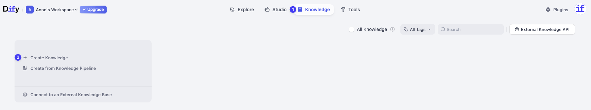

进入知识库后，你会看到多种创建文档的方式，比如从 Notion 同步、从网页抓取等，这让 Dify 可以灵活地接入不同来源的数据。

在今天的课程中，我们将学习最基础也是最常用的一种方式：上传本地文件。点击 [此处](https://drive.google.com/file/d/1imExB0-rtwASbmKjg3zdu-FAqSSI7-7K/view) 下载 Dify 简介文档，我们将使用它来做测试。

**2. 上传文件**

点击 **选择文件**，上传刚刚下载的文本内容，点击下一步。

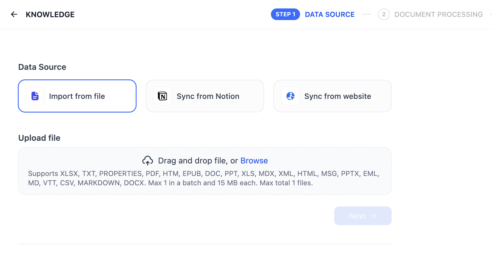

**3. 文本分段与清洗**

你可以把这里当作一个文本预处理的步骤。因为 AI 在检索信息时，直接阅读一整篇长文档效率很低。所以在这个页面，Dify 会自动帮你把文档切成更小的、逻辑连贯的段落（就像把一本书拆分成一张张知识卡片），并去掉一些不必要的格式，方便后续的检索和理解。

**分段设置**

此处自动将你的长文本切分成更易于检索的小段落。我们保持选择通用模式即可。

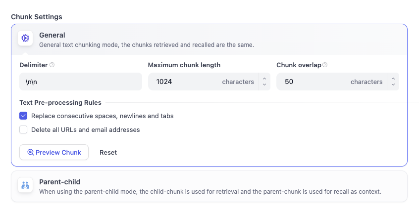

**索引方式**

* **高质量**：会消耗 Token 调用 AI 模型来处理文本，让检索结果更精准。
* **经济**：不消耗 Token，但会牺牲一定的准确性。

在处理结构和内容相对简单的文本时，我们可以选择经济模式。

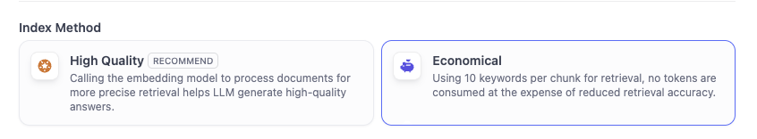

**4. 检索设置**

文档处理完成后，我们需要对召回设置进行最后一次检查。在这里，你可以配置 Dify 查找信息的方式。

在经济模式下，检索设置仅支持倒排索引。

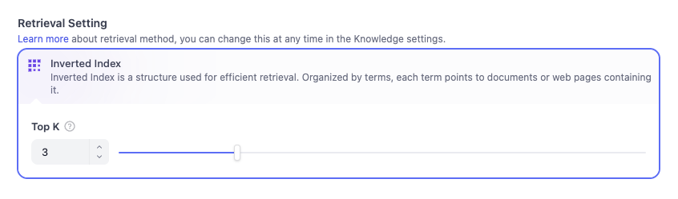

* **倒排索引**

  这是 Dify 使用的默认结构。可以把它想象成实体书背面的索引页，它列出了关键术语，并准确告诉 Dify 这些术语出现在哪些页面上。这让 Dify 能够根据关键词立即跳转到正确的知识卡片，而不是从头到尾阅读整本书。
* **Top K**

  你会看到一个设置为 3 的滑动条。这告诉 Dify：当用户提出问题时，从手册中找出前 3 张最相关的知识卡片展示给 AI。如果你将其设置得更高，AI 会获得更多的上下文参考，但如果设置得过高，过量的信息可能会让 AI 难以处理。

目前，我们只需保持默认设置即可，它们已经可以满足我们的需求。

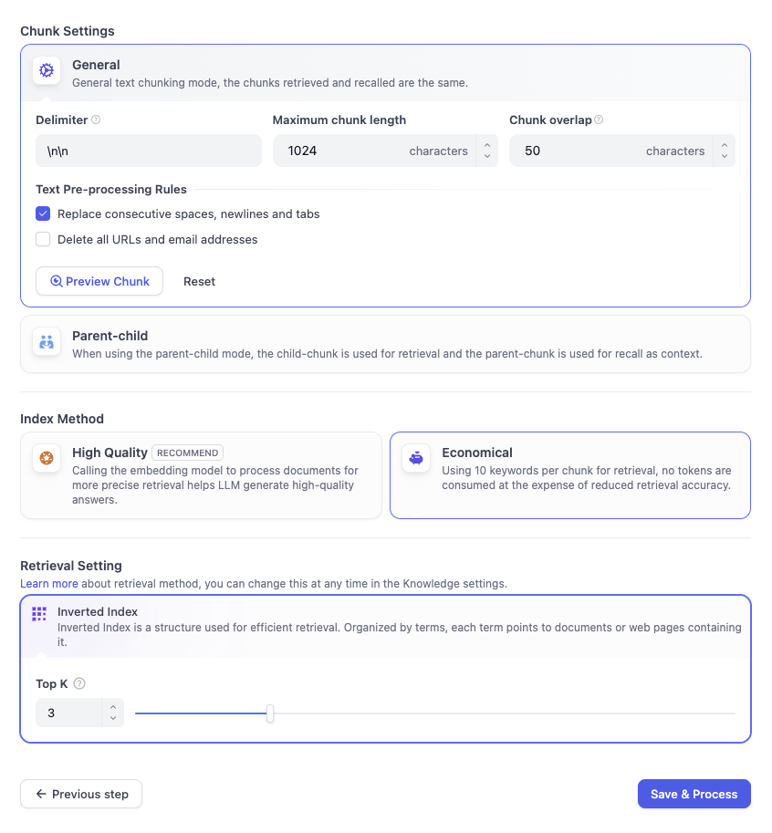

**5. 保存并处理**

点击 **保存并处理**。

> [!TIP]
>
> **太棒了！**
>
> 你已经成功创建了第一个知识库。接下来我们将使用知识库升级我们的 AI 邮件助理。

### 动手实践 2：添加知识检索节点

**1. 添加节点**

1. 回到我们的邮件助理工作流。
2. 鼠标悬停在开始节点和 LLM 节点中间的连线，点击出现的加号，选择 **知识检索** 节点。

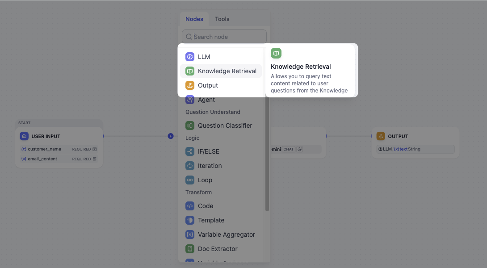

**2. 连接知识库**

1. 点击知识检索节点，在右侧面板 **知识库** 中，点击 **+** 按钮。

   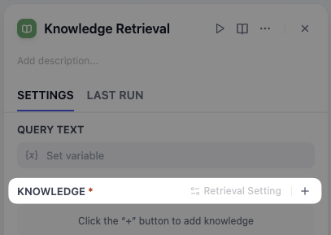
2. 在弹出的选择引用知识库窗口中，点击选中 **What's Dify**，点击 **添加**。

   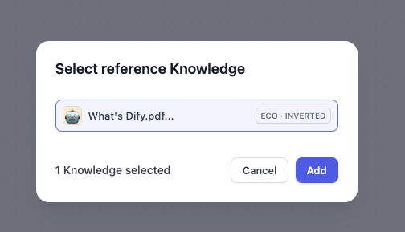

**3. 配置查询文本**

知识库已经准备就绪，我们如何确保 AI 会通过知识库来搜索邮件中的答案呢？

停留在当前面板，来到上方的 **查询文本**，点击后选择 `email_content`。

通过这种方式，我们是在告诉 AI：把客户的消息作为搜索关键词，去翻阅我们的知识库手册并寻找匹配信息。如果没有设置查询文本，AI 就像是在盯着一本合上的书，无从下手。

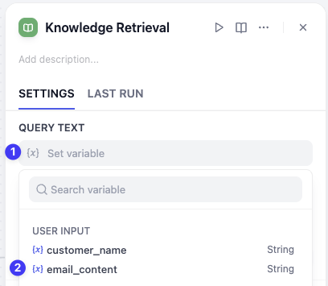

这样，邮件助理就会以客户的邮件原文作为关键词，去知识库中检索最相关的答案了。

### 动手实践 3：升级 AI 邮件助理

上下文已经准备好了，我们还需要在提示词（Prompt）里告诉大型语言模型先阅读这份资料，再生成邮件回复。

**1. 添加上下文**

1. 点击 LLM 节点，在模型设置的下方找到 **上下文 (Context)**。
2. 在上下文内选择知识检索里的 `{x} result`。

   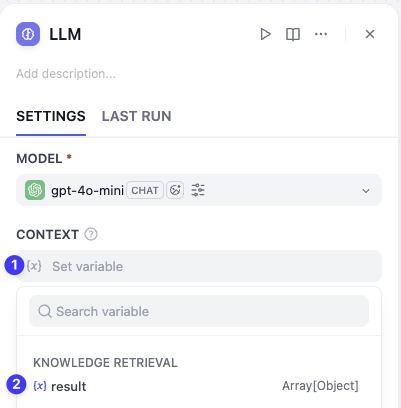

**2. 更新提示词**

在提示词中输入 `/` 符号，在弹出的变量列表中，选择最下方的 **上下文** 即可。然后补充完整这个 Prompt，需要根据上下文来回答客户的问题。

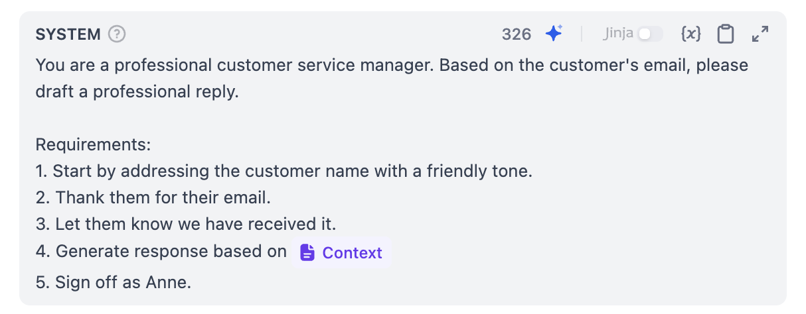

**太棒了！** 你已经完成了本次课程中最具挑战性的一步。你的邮件助理现在不仅拥有了大脑，更拥有了一本可以随时查阅的小抄。让我们来看看效果如何吧。

你可以直接使用下方的邮件示例，点击运行进行测试。

```text 邮件测试示例 theme={null}
客户名：Amanda

客户邮件原文：
Hi,

What does the name 'Dify' actually stand for, and what can it do for my business?

Best regards,
Amanda
```

你会发现，AI 生成的邮件回复内容是基于知识库里的文本完成的。

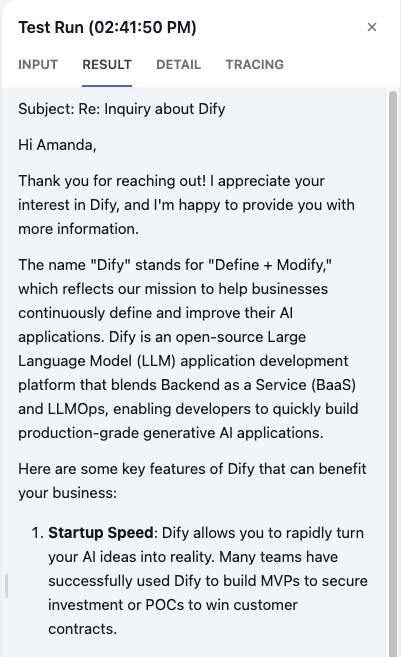

## 小挑战

1. 在刚才的工作流中，如果用户的提问超出了知识库的内容，该如何应对这样的情况？
2. 在你自己的工作或学习中，有哪些信息可以被制作成知识库？
3. 探索文本分段与清洗页面中，分段设置和检索设置、索引方式和默认配置的三者关系。
