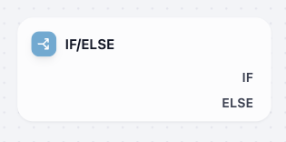
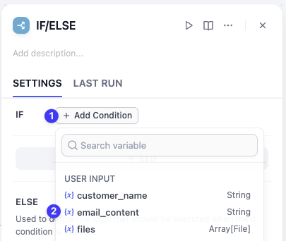
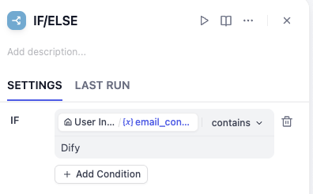
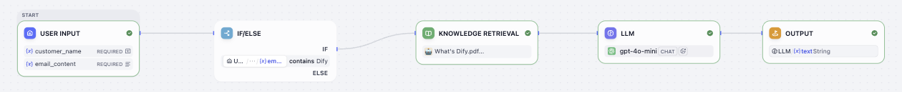
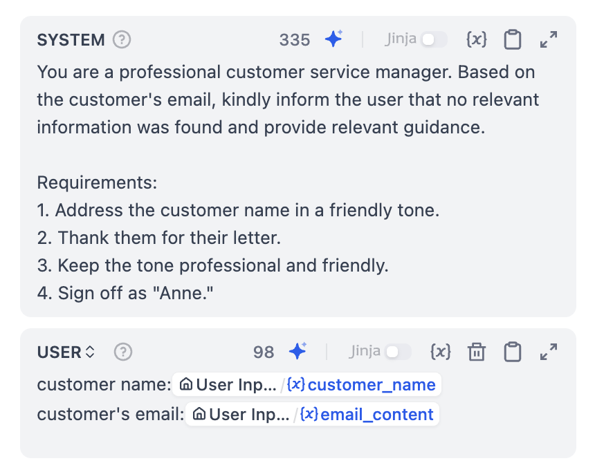
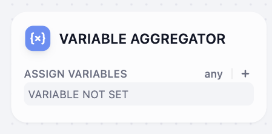
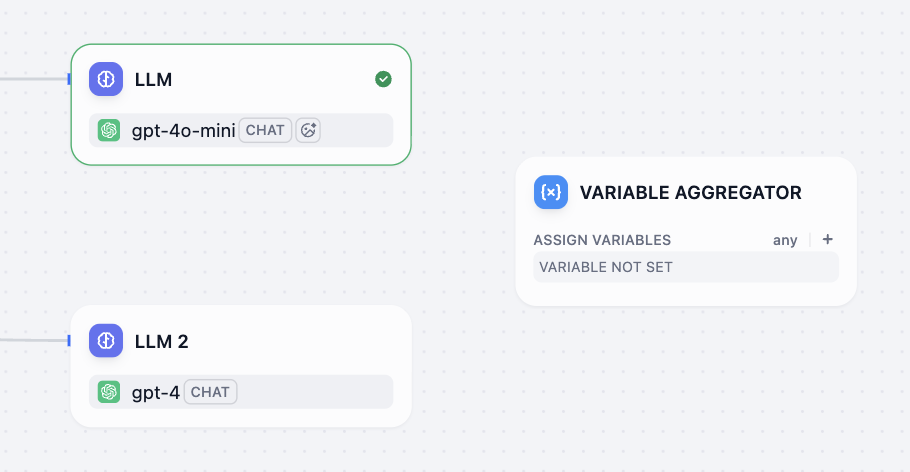
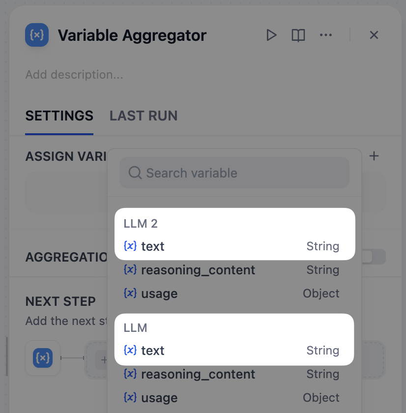
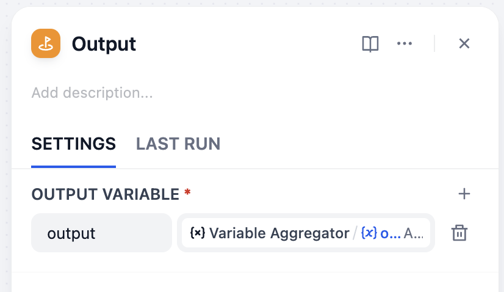
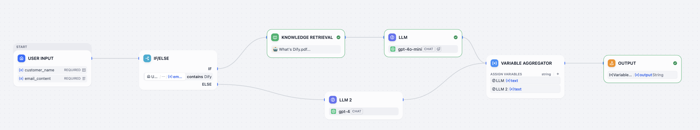

# 第 5 课：工作流的岔路口（分类与执行）

> 本文档由 AI 自动翻译。如有任何不准确之处，请参考 [英文原版](https://docs.dify.ai/en/learn/tutorials/workflow-101/lesson-05.md)。

目前，我们的邮件助理无论收到什么邮件，都会用同一套流程去处理。但这显然不够智能。一封询问产品价格的邮件和一封提交 BUG 的邮件，它们的回复口吻、需要查询的知识库都是完全不同的。

如何让我们的助理学会看人下菜碟，对不同类型的邮件进行差异化处理呢？让我们为工作流设置一个十字路口，它能根据不同的信号，让流程走向不同的轨道。

## 条件分支 (If/Else) 节点



工作流的十字路口。它会检查我们设定的条件（比如邮件内容是否包含某个关键词？），根据检查结果，让流程走向对应的方向。

### 动手实践 1：添加条件分支节点

现在，让我们继续升级邮件助理，让它能够通过关键词识别，自动区分和 Dify 有关的邮件和其他邮件。

**1. 插入节点**

将鼠标悬停在开始和知识检索的连接线，点击出现的加号，选择 **条件分支**。

**2. 配置条件规则**

1. 点击该节点，回到条件分支的右侧面板。
2. 点击 IF 右侧的 **+ 添加条件** 按钮，选择 `{x} email_content`。



3. 判断条件：保持默认的 **包含 (Contains)** 选项。在下方的输入值内填入 **Dify**。



现在，IF 分支的完整逻辑就是：`如果邮件内容中包含了 Dify 这个词。`

> [!NOTE]
>
> **读懂十字路口的判断逻辑**
>
> 在设置条件时，你会发现 Dify 提供了多种判断方式，就像给十字路口的红绿灯。
>
> * **是 / 不是**
>
>   完全等于或不等于某个值。可以把它想象成一把钥匙开一把锁，只有当变量内容和我们设定的值一模一样时，条件才算满足。
> * **包含 / 不包含**
>
>   文本中含有或不含某个关键词。这是我们今天将要使用的功能。
> * **开始是 / 结束是**
>
>   判断文本的开头或结尾是什么。
> * **为空 / 不为空**
>
>   判断一个变量里有没有内容。比如，判断用户是否上传了附件。
>
> 了解这些，你就能设置出准确和灵活的判断规则，继而构建更智能的工作流。

### 动手实践 2：规划不同处理路径

现在我们有了十字路口，需要决定每条路上会发生什么。

#### A. 相关邮件轨道（IF 分支）

点击 IF 分支右侧的加号，拖拽出一条线，与我们已有的知识检索节点连接。

这表明：当邮件原文内容中包含了 Dify 这个词，则执行我们上一课创建的、能够查询知识库的专业回复流程。



#### B. 无关邮件轨道（ELSE 分支）

对于其他所有不包含 Dify 的邮件，我们创建一个简单的通用回复流程。

**1. 添加新的节点**

点击 ELSE 右侧的加号，选择 LLM 节点。

**2. 配置这个 LLM 节点**

配置这个新的 LLM 2 节点。点击它，在 SYSTEM Prompt 中输入一个通用的礼貌回复提示词，你可以复制粘贴下方的内容

```plaintext wrap theme={null}
You are a professional customer service manager. Based on the customer's email, kindly inform the user that no relevant information was found and provide relevant guidance.

Requirements:
1. Address the customer name in a friendly tone.
2. Thank them for their letter.
3. Keep the tone professional and friendly.
4. Sign off as "Anne."
```

**3. 添加用户消息（User Message)**

1. 点击系统框下方的 **Add Message（添加消息）** 按钮。
2. 在用户消息框中，输入 `customer name:`。
3. 按下键盘上的 **/** 键。
4. 此时会弹出变量选择菜单，点击 **customer\_name**。
5. 按下 **Enter** 键开始新的一行，输入 `email content:`。
6. 再次按下 **/** 键并点击 **email\_content**。



现在我们有两条处理轨道了，它们分别生成了不同类型的回复。你可能会想，我们可以把它们都直接连接到各自的结束节点。对于两条轨道来说，这还算简单。但如果我们有 5 条、10 条甚至更多的分支（比如处理商务合作、投诉建议等），把每一条线都拉到最后的结束节点，整个工作流会看起来比较混乱。

为了让工作流保持整洁和清晰，我们需要一个交通枢纽来将所有分开的轨道重新合并回一条主干线上。

## 变量聚合器



可以把它想象成一个漏斗或一个交通枢纽。无论上游有多少不同分支的数据流，变量聚合器都能将它们汇集到一个出口，确保数据流的整洁和稳定，方便后续统一处理。

### 动手实践 3：添加变量聚合器

**1. 添加聚合器**

1. 选中结束节点和 LLM 之间的连线，然后进行删除。
2. 在画布上点击右键，选择 **添加节点**，选择 **变量聚合**节点。



**2. 合并路径**

将两个 LLM 节点连接至变量聚合器。

**3. 赋值输出**

1. 点击变量聚合器节点。
2. 在右侧的面板中点击 **变量赋值** 右侧的 **+**。
3. 依次选择 LLM 和 LLM 2 节点中输出的 **text**。



这样一来，无论哪一个 LLM 节点生成了回复，变量聚合器都会自动把内容汇集起来，再统一交给结束节点。

**4. 最后一步**

1. 将变量聚合器连接至结束节点。
2. 点击结束节点，在右侧面板删除原本的输出变量，改为变量聚合器的输出。



现在的工作流如图所示：



**5. 运行与测试**

点击 **运行**，你可以自行填入客户名字并分别测试包含 Dify 和不含 Dify 关键词的运行结果，看看输出结果。

## 小挑战

如果需要回复商务合作类型的邮件，工作流需要怎样修改？

> [!TIP]
>
> 别忘了在知识库新增与商务合作有关的文档。
