# 第 6 课：处理多个任务（参数提取 & 迭代）

> 本文档由 AI 自动翻译。如有任何不准确之处，请参考 [英文原版](https://docs.dify.ai/en/learn/tutorials/workflow-101/lesson-06.md)。

我们的邮件助理已经能够处理相对简单的邮件了，但是，如果邮件助理收到一封邮件，内容是：

> 您好，我想问一下 Dify 是什么？另外，它都支持哪些模型？还有免费套餐吗？

如果我们直接把整封邮件丢给之前的 AI 助理，它可能会只回答第一个问题，或者将两个问题混在一起回复模棱两可的内容。我们需要一种方法，能先把邮件里的所有问题都找出来，然后利用我们第四课创建的知识库，对每个问题逐一进行查询和回答。

## 参数提取器


你可以把它想象成一位*信息搜集员*。它的工作就是阅读一段文本（比如邮件），然后根据你给定的规则，把里面所有符合条件的关键信息（比如所有独立的问题）都提取出来，整理成一个列表。

### 动手实践 1：添加参数提取节点

现在，我们来继续升级邮件助理，让它能准确地回答客户的每一个问题。在开始之前，我们先移除以下节点：知识检索，条件分支，LLM，LLM 2 和变量聚合器。

**1. 添加节点**

在开始节点后，添加 **参数提取器** 节点。

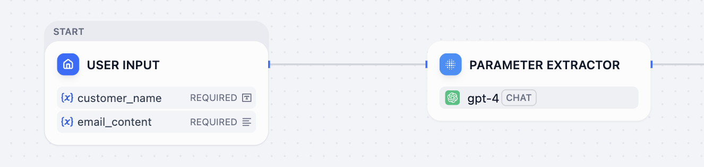

**2. 选择输入变量值**

点击参数提取器，在右侧面板的 **输入变量** 中点击设置变量值，在下拉菜单中选择 `email_content`。

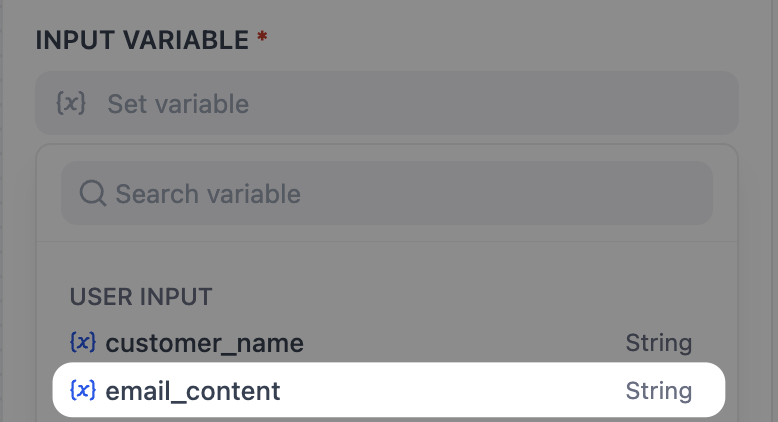

由于 AI 并不知道我们需要提取邮件里的那些信息，所以我们需要明确告诉它，我们需要收集邮件里的所有问题。

**3. 添加提取参数**

在下方的 **提取参数** 中，点击右侧的加号，后会弹出一个添加提取参数的窗口。在名称内，我们可以把这个参数命名为 `question_list`，即邮件内提取出的问题列表。

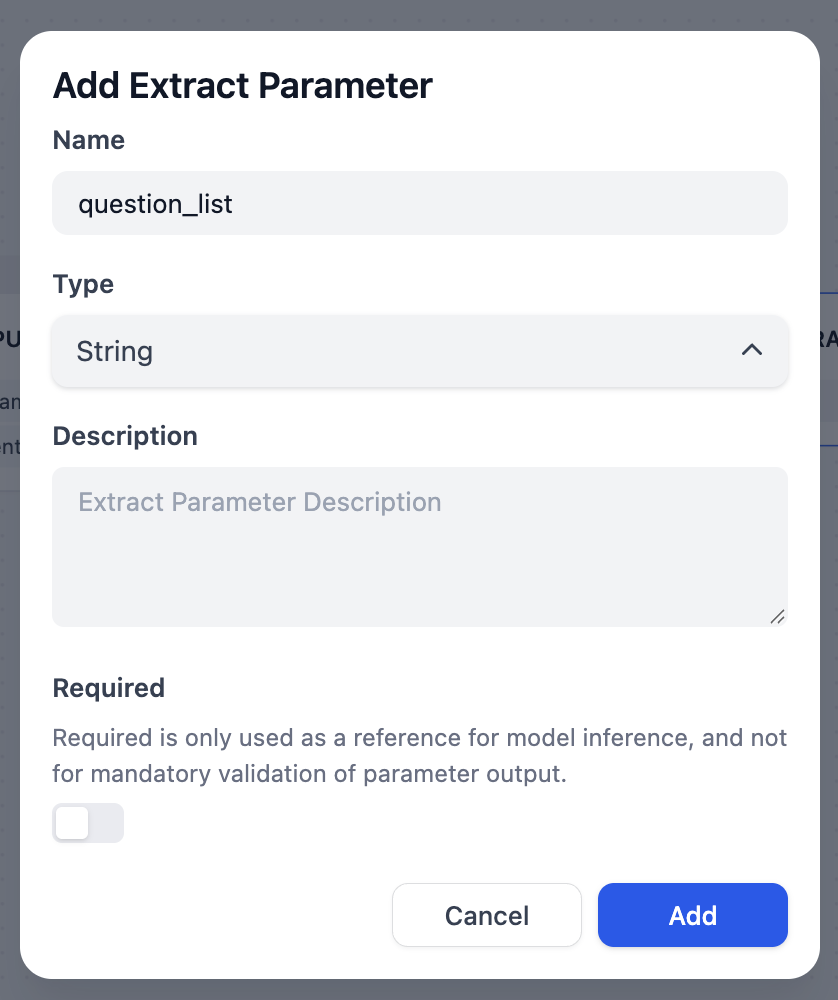

> [!NOTE]
>
> **参数类型**
>
> 如果说添加提取参数是一个搜集员，那么类型就相当于篮子。你需要将收集的信息放到对应的篮子里。
>
> **单项类型（只装一个）**
>
> * **String（文本）**：用来装单个文本信息，比如一个客户的名字。
> * **Number（数字）**：用来装单个数字，比如订单数量。
> * **Boolean（布尔值）**：用来装是或否这样的判断结果。
>
> **列表类型（装多个）**
>
> * **Array\[String]**（文本列表）：Array 代表列表，String 代表文本。所以，`Array[String]` 就意味着，我们要用一个能装多个文本的篮子，比如邮件里的所有问题。
> * **Array\[Number]**（数字列表）：用来装多个数字，比如一份清单里的所有商品价格。
> * **Array\[Boolean]**（布尔值列表）：用来装多个是/否判断结果。比如，检查一份包含多个待办事项的清单，返回每一项是否完成的结果，如 `[是，否，是]`。
> * **Array\[Object]**（对象列表）：这是更高级的类型，用来装多个结构化信息包，比如一份包含姓名和电话的完整通讯录。

**4. 完成提取参数**

1. 基于上面的参数类型，我们需要为邮件内容选择 `Array[String]`。
2. 接着，可以在描述内添加补充内容，比如：用户在邮件中提出的所有问题。完成后，点击 **添加**。

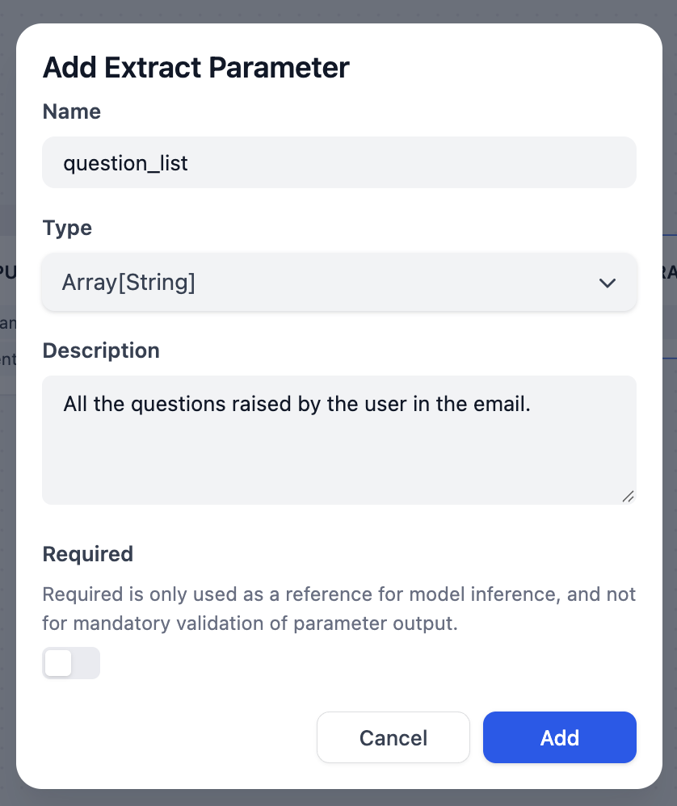

**5. 添加指令**

在提取参数下方的 **指令** 输入框中，输入清晰的指令，告诉 AI 如何执行提取。

例如：请从文本中提取所有独立的问题，每一个问题作为列表中的一项。

这样，这个节点就能在邮件中找到所有独立的问题了。接下来，我们需要让 AI 对每个提取到的问题进行先查询再回答的操作。

## 迭代

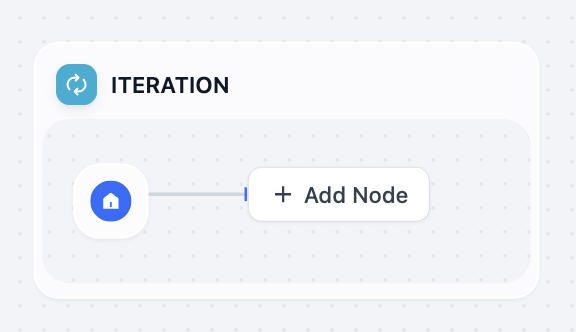

这就像是给助理配备了一个*分身*。当你把一个列表（比如上面提取到的问题列表）交给它时，它会为列表中的每一个项目，都单独执行一遍你设定好的子流程（比如查询知识库并回答）。

### 动手实践 2：配置迭代节点

**1. 添加节点**

1. 在参数节点后，新增迭代节点。
2. 点击迭代节点，在右侧面板的输入中，选择参数提取器下的 `{x} question_list`。
3. 输出变量暂时保持默认空白。

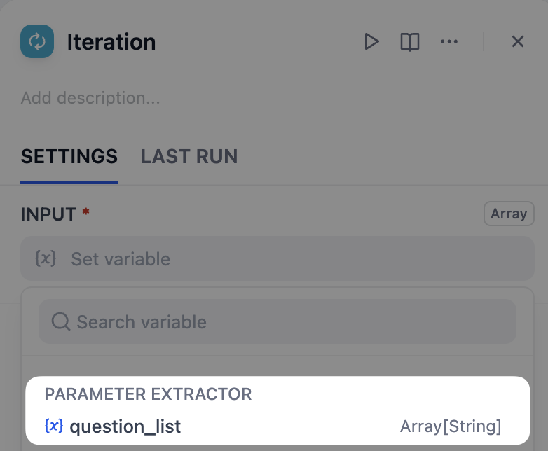

**迭代的高级选项**

在迭代的面板中，你能看到其他选项，让我们快速进行了解。

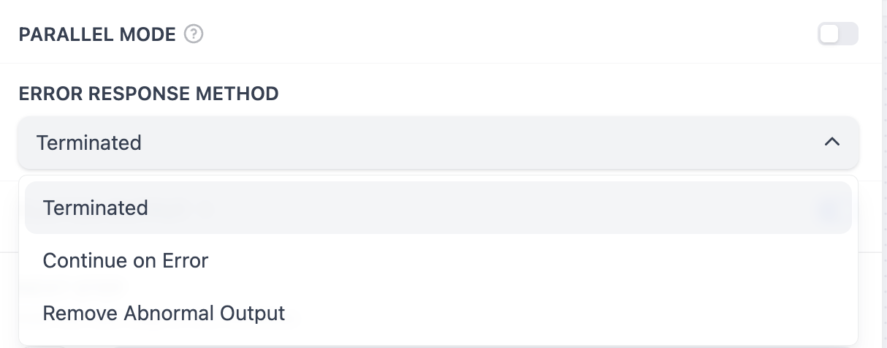

**并行模式**：默认关闭。

* 关闭时，工作流会按顺序处理列表中的每一项（处理完问题 1，再处理问题 2）。
* 开启后，工作流会尝试同时处理列表中的所有项（类似 5 个厨师同时炒 5 个菜）。

**错误响应方法**：默认为错误时终止。

* **错误时终止**：意味着如果列表中的任何一项（比如第 2 个问题）在子流程中执行失败了，整个工作流就会立刻停止。
* **忽略错误并继续**：意味着即使第 2 个问题处理失败了，工作流也会跳过它，继续处理后续问题。
* **移除错误输出**：和忽略相似，在最终的输出结果列表中，移除这一项。

回到工作流界面，你会看到迭代节点下方出现了一个子流程区域。所有在这个区域里的节点，都会为列表中的每一个问题单独运行一次。

**2. 添加知识检索节点**

1. 在迭代框内，点击添加节点，选择 **知识检索**。
2. 将查询变量设置为当前迭代 `{x} item`。

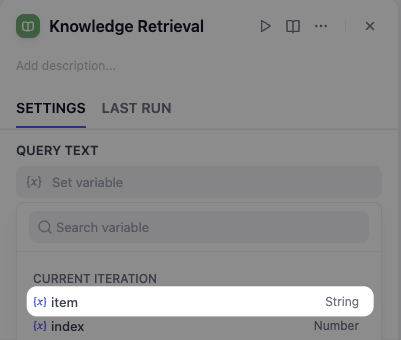

在迭代节点的子流程中，`item` 特指当前正在处理的列表项，也就是当前的这个问题。知识库选择我们之前创建的 Dify 简介。

**3. 添加 LLM 节点**

1. 在知识检索节点后，新增一个 LLM 节点。
2. 像我们在第四课学习的配置那样，对 LLM 进行配置。别忘了上下文和在 System 里选择上下文和完成包含变量的提示词（Prompt）。

> [!TIP]
>
> 还记得第四课吗？使用那些 Prompt 技巧，别忘了上下文！

你可以参考下面的提示词：

**System**:

```plaintext wrap theme={null}
You are a professional Dify Customer Service Manager. Please provide a response to questions strictly based on the `Context`.
```

**User**:

```plaintext wrap theme={null}
questions: Iteration/{x} item
```

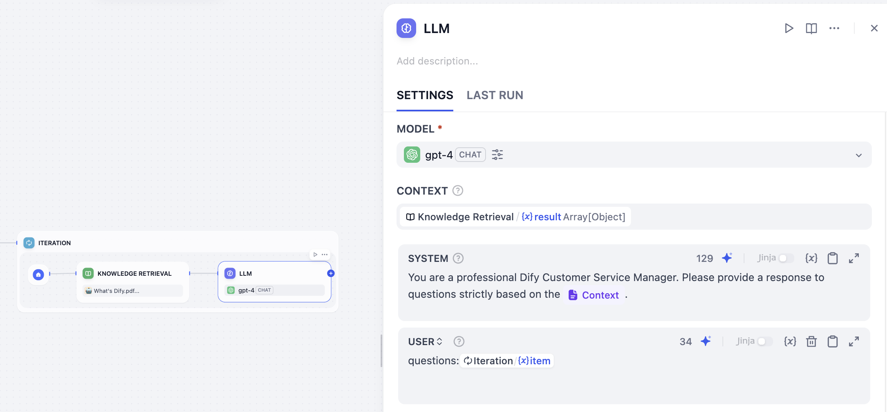

由于迭代节点会对每个问题都生成一个答案，所以我们需要将这些答案汇总起来形成一份完整的回复邮件。

**4. 选择迭代节点的输出**

1. 选中迭代节点。
2. 在 **输出变量** 选择 LLM 下对应的变量。这样，迭代节点就会把每次循环生成的答案内容收集起来，形成一个最终的答案列表。

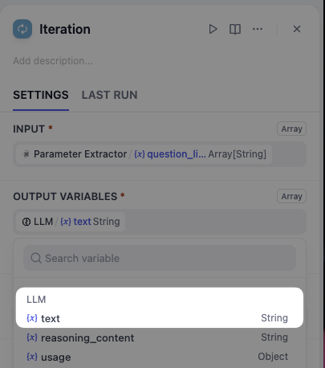

**5. 添加最后的 LLM 节点**

在迭代节点后，再连接一个 LLM 节点。这个节点负责将所有问题的答案，整理成一封完整的邮件。

别忘了在 System 里补充提示词（Prompt）并在用户信息中填入变量，你可以参考下面的提示词。

```plaintext wrap theme={null}
You are a professional customer service assistant. Please
organize the answers prepared for customer into a clear and
complete email reply.
Sign the email as Anne.
```

**User**:

```plaintext wrap theme={null}
answers: Iteration/{x}output
customer: User Input/{x}customer_name
```

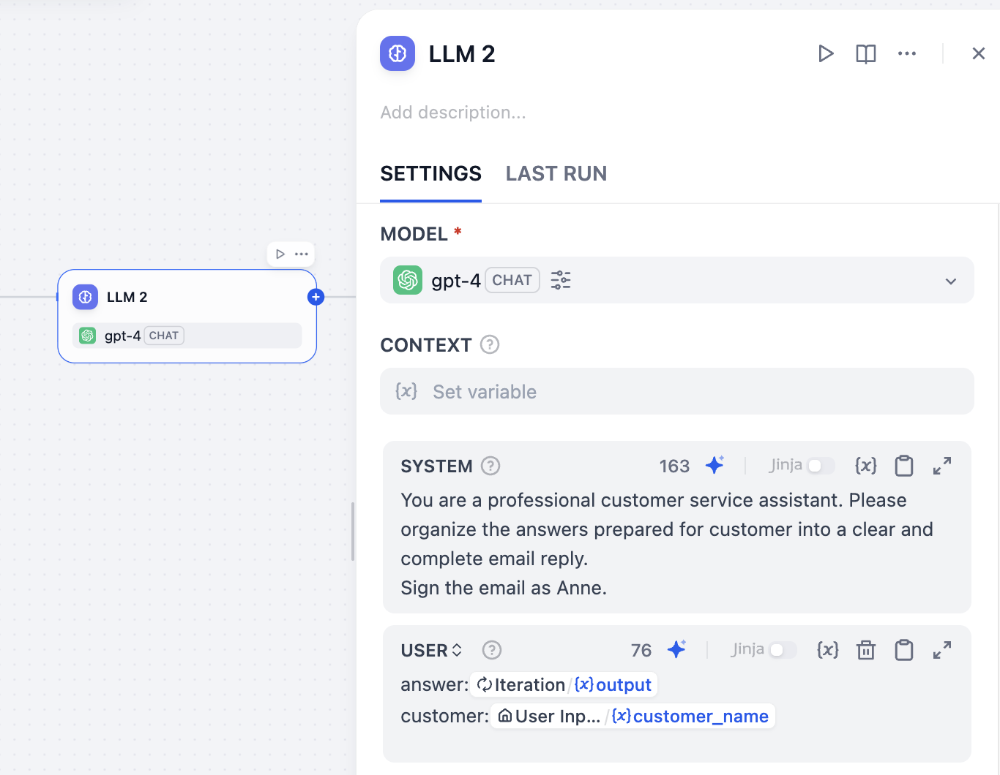

**6. 检查**

1. 点击右上角的检查清单，查看是否有遗漏的地方。根据提示，我们需要将输出节点与前面的节点连接，并为它选择一个正确的输出变量。
2. 将输出节点与前面的 LLM 2 连接，点击输出变量，选择 LLM 2 下面的 text。

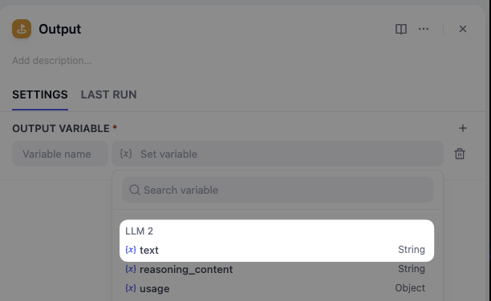

现在你可以在一封邮件里包含多个问题，看看最终的邮件回复是否包含了每个问题的回复。

## 小挑战

除了提取问题，参数提取器还能提取什么？

> [!TIP]
>
> 探索参数提取器内的类型。
