# 第 7 课：增强工作流（工具）

> 本文档由 AI 自动翻译。如有任何不准确之处，请参考 [英文原版](https://docs.dify.ai/en/learn/tutorials/workflow-101/lesson-07.md)。

我们的邮件助理现在已经能够熟练地在我们的专属知识库里查找答案。但如果邮件内容包含了一个知识库里没有的、最新的问题呢？比如：Dify 最近有什么新功能发布吗？

这个时候，邮件助理就不能只啃旧书本了，还需要学会上网搜索。

[Dify Marketplace](https://marketplace.dify.ai/) 里的工具能扩展你的工作流，让它拥有连接世界、执行多样任务的能力。

## 工具

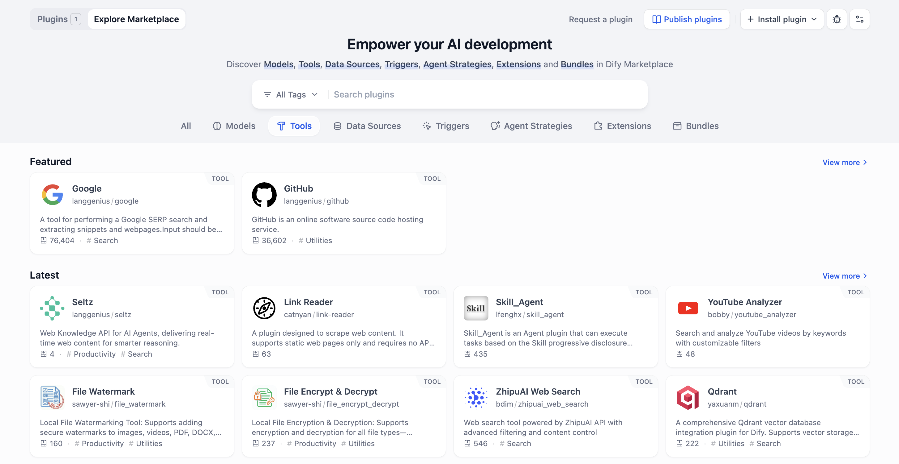

在 Dify 中，你可以在 Dify Marketplace 里找到各种各样的官方或社区提供的工具，极大地扩展你的工作流能力。

现在，我们在第六课完成的工作流上进行升级，让邮件助理能同时通过知识库查询和网页搜索来回答问题。

### 动手实践 1：升级迭代的子流程

我们需要先对提取出来的问题进行判断和分类，实现在必要时搜索的逻辑。

开始之前，我们仅保留如下节点：用户输入，参数提取器和迭代节点。

#### 第一步：知识库查询和基础判断

**1. 检查知识检索节点**

1. 找到迭代内的子流程，仅保留知识检索节点，删除其他所有节点。
2. 点击知识检索节点，在右侧面板内，确保查询变量为当前迭代下的 `{x} item`。

**2. 新增 LLM 节点**

在知识检索节点后，新增一个 LLM 节点，这个节点用来判断知识库能否回答提取出来的问题。

* 上下文选择知识检索中的 `{x} result Array [Object]`。
* 在 System 内，填入提示词：

  ```plaintext wrap theme={null}
  Based on the `Context`, determine if the answer contains enough information to answer the questions. If the information is insufficient, you MUST reply with: "Information not found in knowledge base".
  ```
* 在 User 内，引用对应的变量：

  ```plaintext wrap theme={null}
  questions: Iteration/{x} item
  ```

  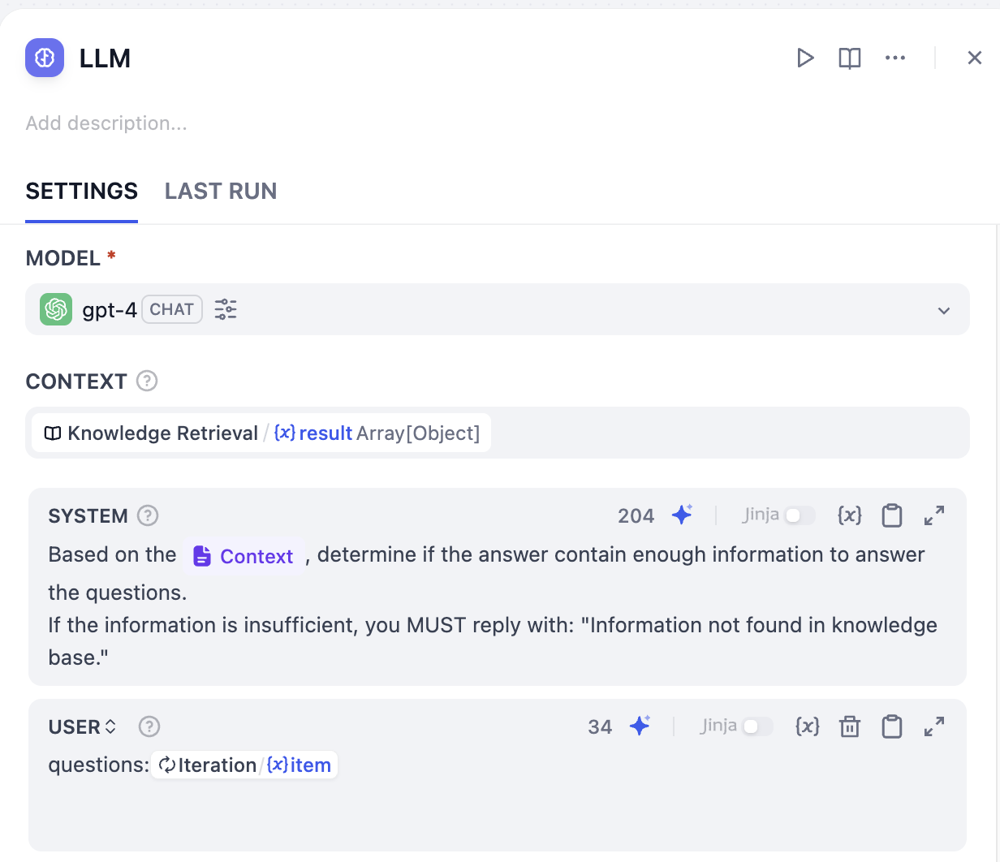

当前工作流如图所示。

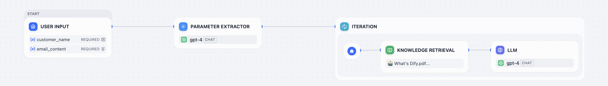

#### 第二步：判断是否需要搜索

**1. 添加条件分支节点**

在 LLM 节点后，新增条件分支节点。配置 If `LLM/{x} text` 包含 **知识库未找到的相关信息 (Information not found in knowledge base)**。

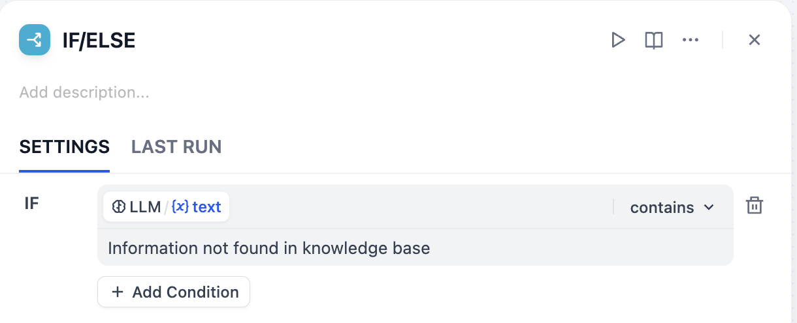

**2. 添加搜索工具**

让我们在 If 后连接搜索工具，这表明当知识库未找到相关回答信息时，使用搜索进行答案查询：

1. 在 If 节点后，添加工具，在搜索框中输入 Google。
2. 鼠标移至 Google，点击右侧的 **安装**。在弹窗中再次点击 **安装**。

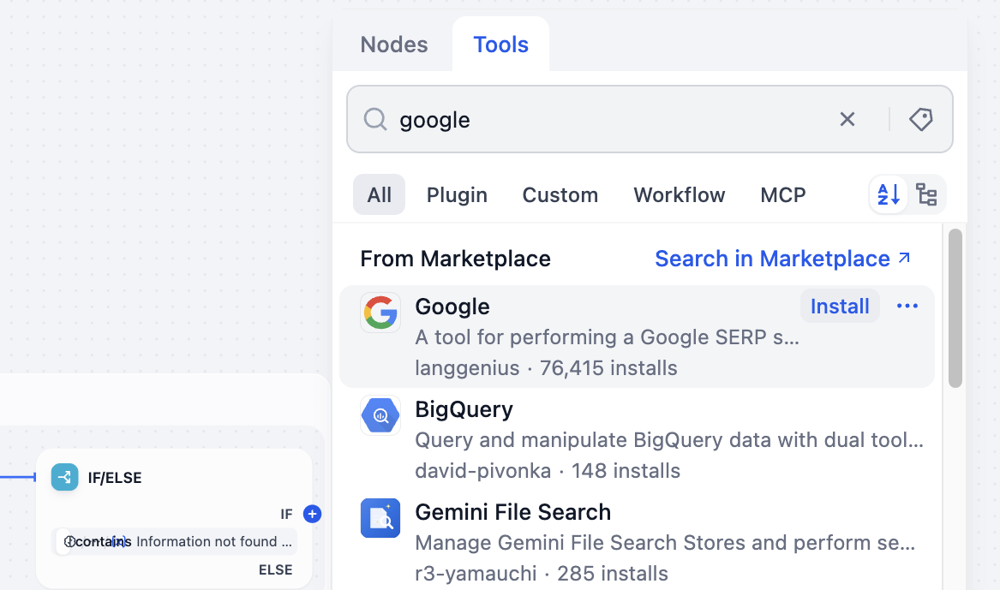

**3. 选择搜索功能**

选择 Google 下方的谷歌搜索，点击该节点。

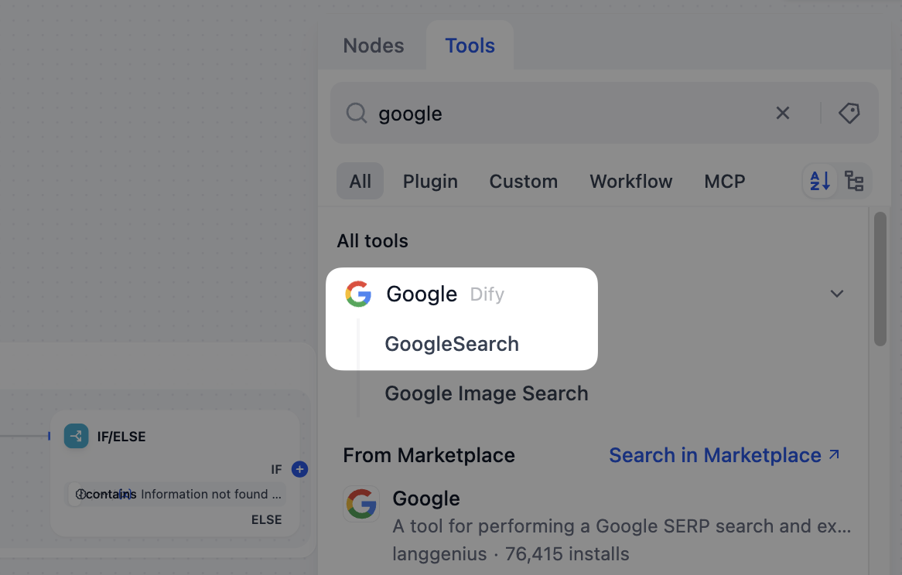

**4. 获取 API Key**

当你第一次尝试让邮件助理使用谷歌搜索时，它可能会突然*卡住*，提示你需要先进行 API Key 授权配置，就像在上网前输入 Wi-Fi 密码，只有输入正确的密钥，Dify 才能安全地帮你访问外部世界的信息。


1. 在谷歌搜索工具的设置页面中，点击 **API Key 授权配置**，这时候页面会提示从 SerpAPI 获取您的 SerpAPI API key。点击跳转进入 SerpAPI 官网后，简单注册一个账号，就能立即获得你的专属 API Key。

   > [!NOTE]
   >
   > API Key 是你访问外部世界的通行证，要妥善保管、避免泄露。

   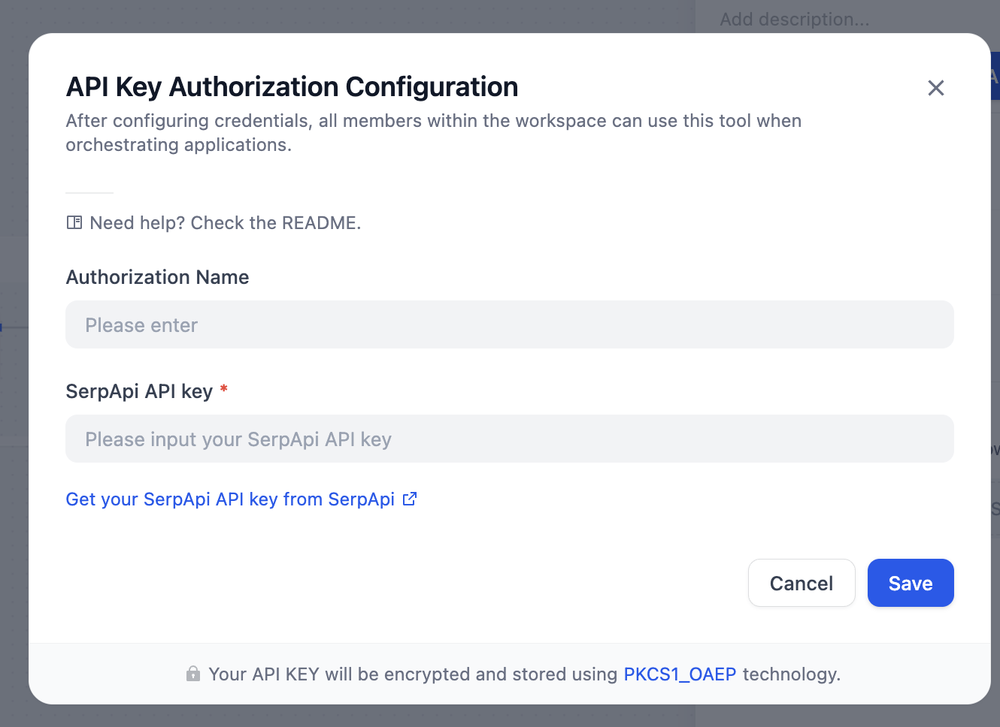
2. 点击复制，让我们回到工作室，填写一个容易分辨的凭据名称，粘贴从平台获取的密钥。现在，你已经成功配置谷歌搜索的 API Key 了！
3. 当 API Key 授权成功后，面板中会出现查询字段。选中 Google Search 节点，在查询字段中选择 `Iteration/{x} item`。

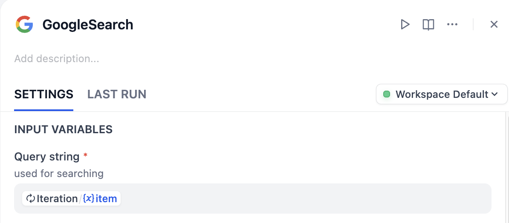

**5. 配置两条路径**

现在，我们需要根据不同的路径使用不同的方式来回答问题。

**搜索回答路径**

在 Google Search 节点后连接一个新的 LLM 节点，用于根据搜索结果回答问题。

**System**:

```plaintext wrap theme={null}
You are a Web Research Specialist. Based on Google Search, concisely answer the user's questions. Please do not mention the knowledge base in your response.
```

**User Message**:

```plaintext wrap theme={null}
results: GOOGLESEARCH/{x} text
questions: Iteration/{x} item
```

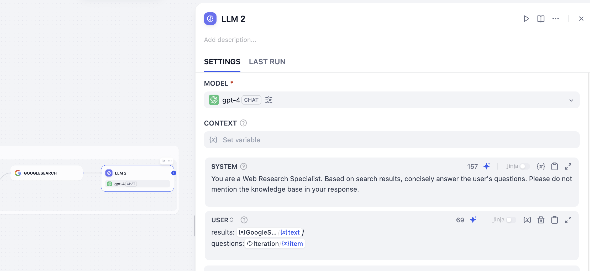

**知识库回答路径**

在 Else 节点后，新增一个 LLM 节点来处理基于知识库的回答。

**System**:

```plaintext wrap theme={null}
You are a professional Dify Customer Service Manager. Strictly follow the `Context` to reply to questions.
```

**User Message**:

```plaintext wrap theme={null}
questions: Iteration/{x} item
```

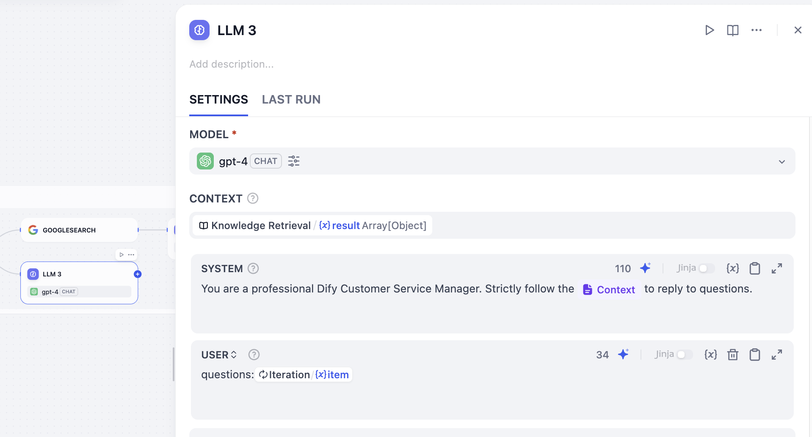

**6. 汇总信息**

1. 在子流程中（迭代框内部），在最后添加一个变量聚合器节点，将它与 LLM 2 和 LLM 3 连接。
2. 在变量聚合器面板中，将变量赋值设置为 `LLM 2/{x}text String` 和 `LLM 3/{x}text String`。

这样做可以将两个可能的答案合并到一条路径上。

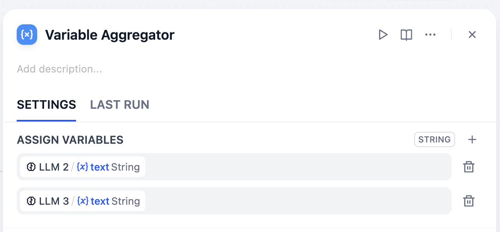

当前工作流是这样的：

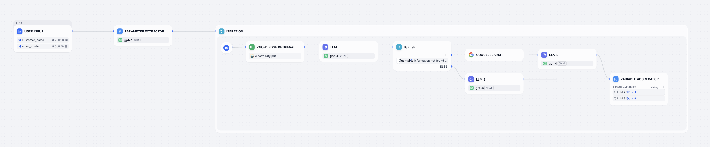

#### 第三步：汇总输出

我们已经完成了对邮件内容的判断，并根据判断执行不同的分支。现在我们要将输出进行汇总，完成一封最终的邮件。

**1. 配置迭代输出变量**

点击迭代节点，将输出变量设置为 `{x}Variable Aggregator/{x}output String`。

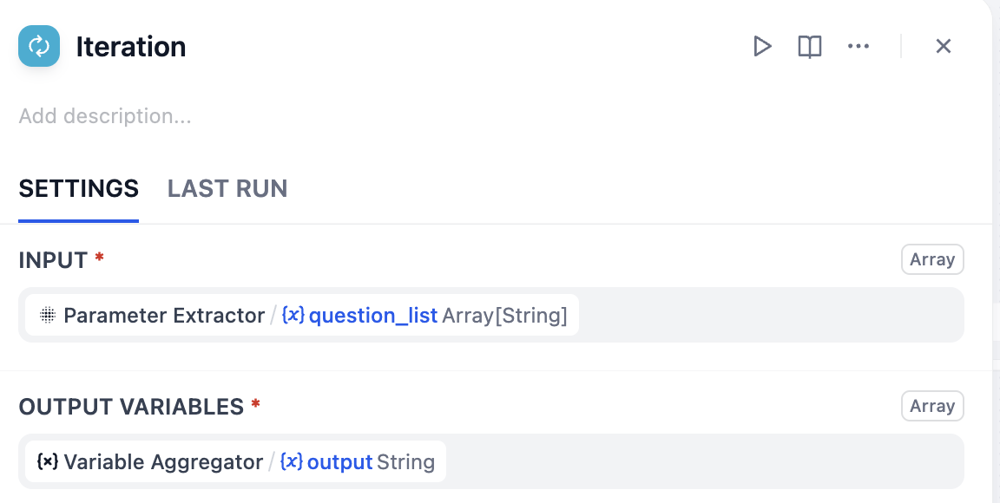

**2. 连接总结 LLM**

在迭代节点后，连接一个新的 LLM 节点，用来总结所有的输出内容。你可以参考下面的提示词。

**System**:

```plaintext wrap theme={null}
You are a professional Customer Service Manager. Summarize all the answers of the questions, and organize a clear and complete email reply for the customer.
Do not include content where the knowledge base could not find relevant information.
Signature: Anne.
```

**User Message**:

```plaintext wrap theme={null}
questions: Iteration/ {x} output
customer: User Input / {x} customer_name
```

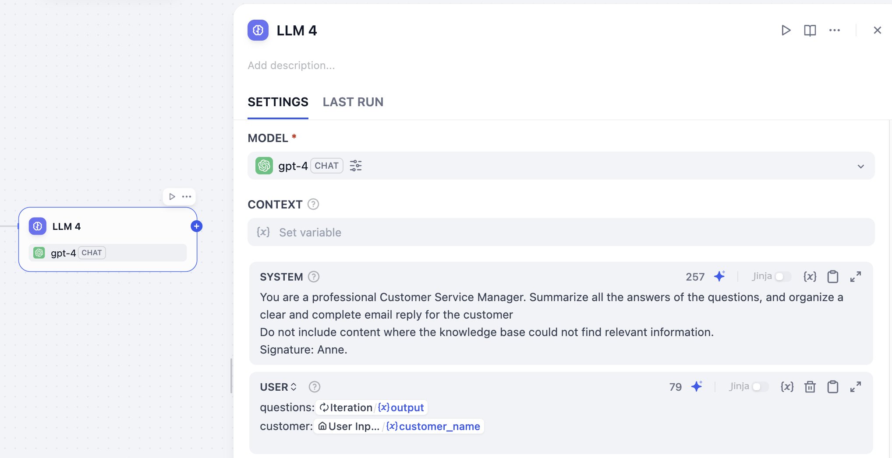

**3. 添加输出节点**

在 LLM 节点后，添加输出节点。将输出变量设置为 `LLM 4/{x}text String`。

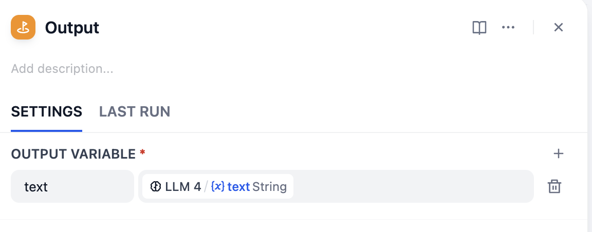

我们已经完成了工作流的所有搭建和配置。现在我们的邮件助理可以根据知识库内容完成对应问题的回答，也能使用谷歌搜索进行补充回答。

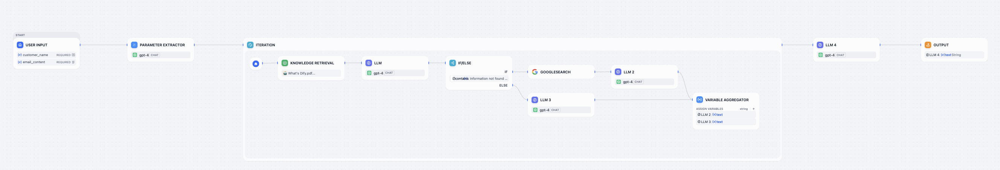

尝试发送一封包含知识库中肯定没有答案的问题的邮件，看看 AI 是否能够成功使用谷歌搜索找到相关答案。

## 小挑战

1. 条件分支节点还能根据哪些条件来决定执行下一步搜索？
2. 探索 Marketplace，为工作流添加其他工具。
