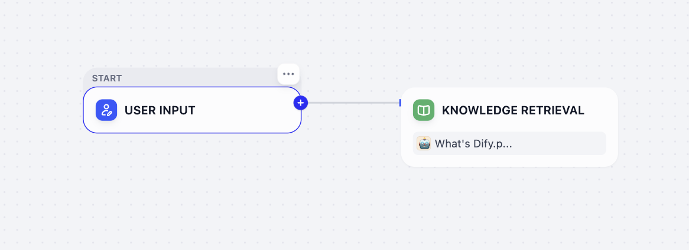
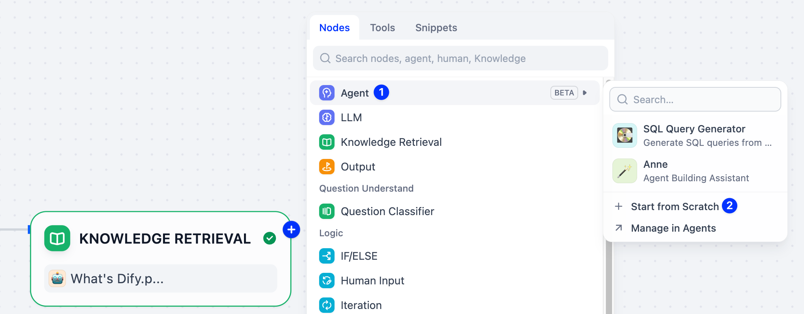
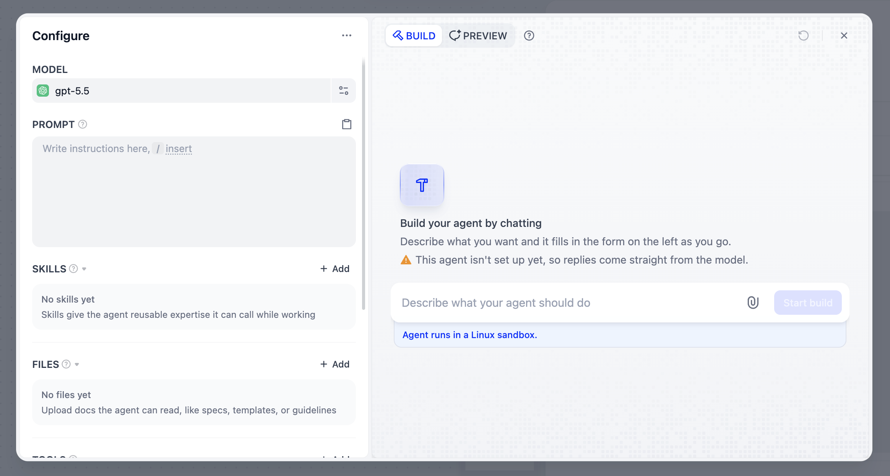
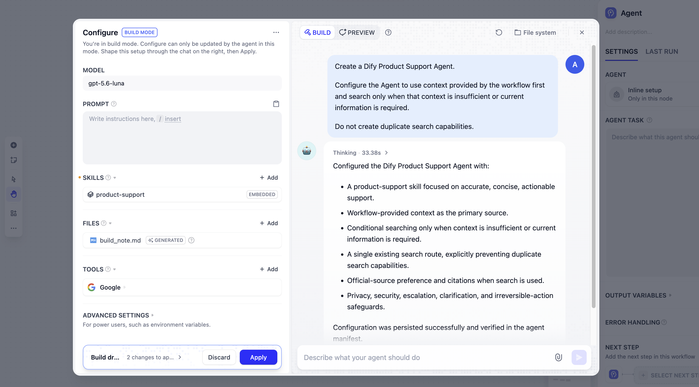
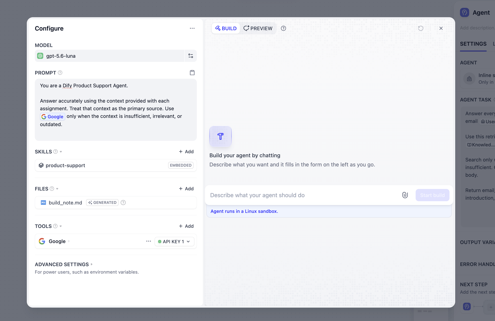
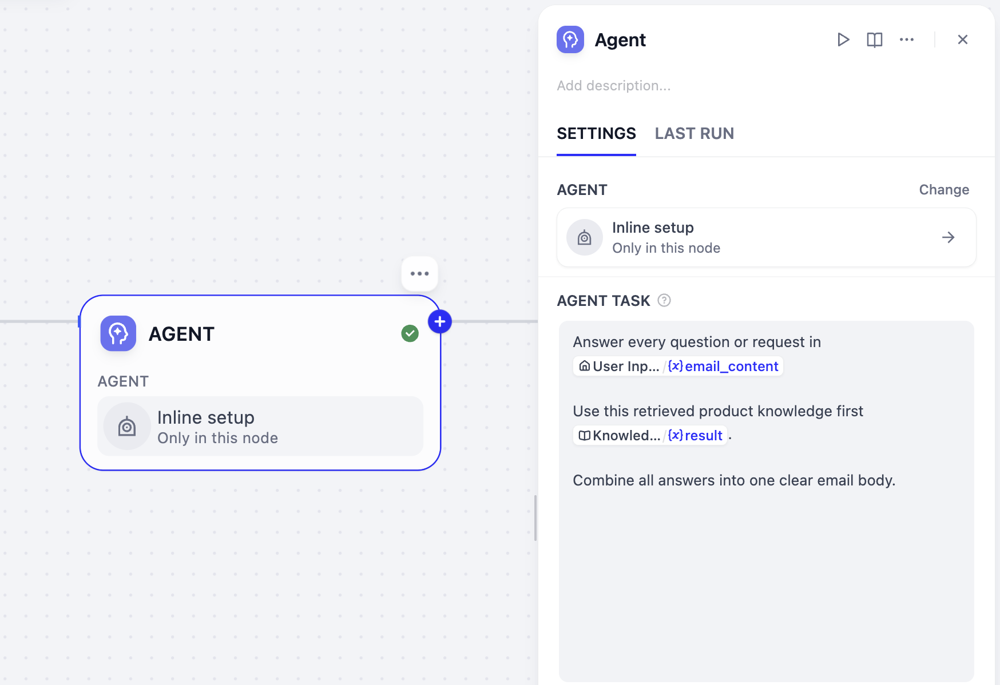
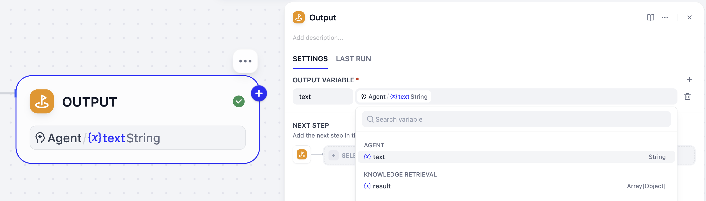
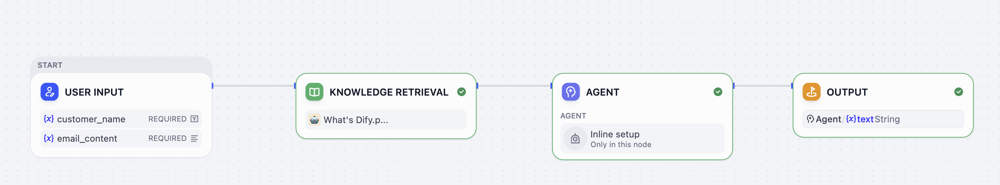
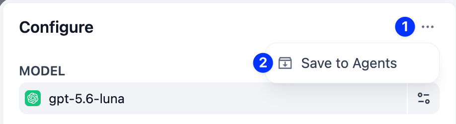
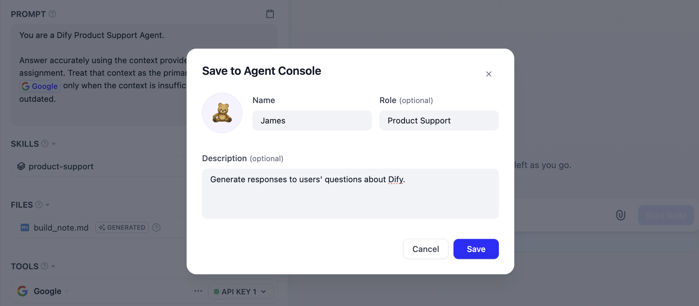

# 第 8 课：Agent 节点

> 本文档由 AI 自动翻译。如有任何不准确之处，请参考 [英文原版](https://docs.dify.ai/en/learn/tutorials/workflow-101/lesson-08.md)。

回顾一下我们为邮件助理做过的几次升级：

* 学会了查阅资料：知识库检索
* 学会了区分情况：条件判断
* 学会了处理多个任务：参数提取 + 迭代
* 学会了使用工具：通过 Google Search 访问互联网

这些节点都能工作，但每一步都要我们提前写清楚。如果能把这项工作直接交给一位会推理、会用手头资源、还能越做越好的 AI 同事呢？

来认识你的 AI 同事：**Agent**。

## 从工作流到 Agentic 工作流

传统工作流沿着构建者设计好的路径执行。Agentic 工作流则在这种可靠结构之上，加入一个能在你划定的边界内自行决定怎么完成任务的 Agent。

可以把工作流看作团队共用的操作流程，把 Agent 看作执行其中一环的同事：

* **工作流** 提供输入、顺序、检查、兜底和输出。
* **Agent** 朝着目标工作，调用自己掌握的知识和工具，交回结果。
* **Agent 节点** 是这个 Agent 在当前工作流中的落脚点。

同一个 Agent 可以被请进多个工作流，甚至在同一个工作流中出现多次。它的核心身份和能力属于 Agent 本身；你在 Agent 节点里写的指令，只描述它在工作流这一环的任务。

你不需要安装或挑选推理策略。Agent 自己管理推理循环，你要做的是给出合适的任务、输入和期望的输出。

## Agent 与 Agent 节点

向工作流添加 Agent 有两种方式：

* **邀请已有 Agent**：复用你或团队已经构建好的 Agent。
* **从空白开始**：直接在画布上创建一个一次性 Agent。适合只在这个工作流中出现的角色，之后觉得好用，可以把它保存到 **Agents** 页面复用。

前面的课程里我们还没有创建过 Agent，所以这次从空白开始，从零起步完成本课。最后，你可以把它保存到 **Agents** 页面，在别处复用。

完成本课后，整个工作流就是：`开始 → 知识检索 → Product Support Agent → 输出`

## 动手实践 1：创建 Agent

我们的目标是用一个 Agent 替换掉整段手工编排的中间流程。Agent 会拿到完整的客户邮件，找出并回答其中的每个问题，最后交回一封连贯的邮件正文。

**1. 移除多余节点**

从第 7 课的工作流出发，删除参数提取器和迭代节点（其内部的节点会一并删除），只留下开始节点和输出节点。

**2. 添加知识检索**

在开始节点之后点击 **+**，添加知识检索节点，选择前几课用过的 Dify 产品知识库。



**3. 添加 Agent 节点**

在知识检索节点之后点击 **+**，选择 **Agent**，再选择 **从空白开始**。



Agent 的设置界面会覆盖在工作流画布上打开：

* 左侧的 **配置** 面板包含模型、提示词、Skill、文件、工具等，可逐项手动设置。
* 右侧的 **构建** 让你通过对话构建 Agent，配置会自动填好。
* **预览** 让你在返回工作流之前先试用 Agent。



**4. 接入所需资源**

进入构建模式之前，先做两项准备：

* **模型**：若当前模型缺失或被标记为不兼容，换一个兼容的模型。
* **工具**：添加 Google Search。

**5. 通过对话构建 Agent**

在构建模式中输入下面的请求。

```text wrap theme={null}
创建一个 Dify 产品支持 Agent。
让它优先使用工作流提供的上下文，只有在上下文不足或需要最新信息时才去搜索。
不要创建重复的搜索能力。
```



构建完成后，Agent 已经为自己配好了这些资产：

* `product-support`：一个内嵌 Skill，承载 Agent 的支持行为和资料使用规则。
* `build_note.md`：一份笔记，记录这次构建对话中配置了什么。

**6. 补充主提示词**

点击 **应用** 后，构建模式关闭，**配置** 面板恢复可编辑。在 **提示词** 中补充下面的指令：

```text wrap theme={null}
根据每次任务附带的上下文准确作答，把上下文当作首要信息来源。只有在上下文不足、无关或过时的情况下，才使用 Google Search。
```

生成的 Skill 定义了 Agent 可复用的产品支持能力；提示词则给出了何时使用 Google Search 的明确规则。



**7. 预览 Agent**

切换到 **预览**，问一个 Dify 产品问题，确认 Agent 回答简洁、只在必要时才搜索。

确认设置无误后，关闭设置界面，回到工作流画布。

> [!TIP]
>
> 🎉 Agent 已经就绪。

## 动手实践 2：布置工作流任务

现在，Agent 已经具备可复用的角色、支持领域的专业能力和搜索工具。接下来，告诉它在这个工作流里要做什么。

**1. 交付邮件与检索结果**

选中 Agent 节点，在 **Agent 任务** 中描述这一步的任务：

```text wrap theme={null}
回答 {{email_content}} 中的每个问题或请求。
优先使用 {{result}} 中检索到的产品知识。
把所有回答合并成一封邮件正文。
```

输入 `/` 插入用户输入的 `email_content` 和知识检索的 `result`，让它们以变量形式传入，而不是普通文本。



**2. 连接输出节点**

点击输出节点，把输出变量设为 Agent 的 `text` 输出，让工作流返回生成的邮件回复。



最终的工作流如下。



点击 **测试运行**，输入一封包含几个问题的客户邮件。Agent 会基于检索到的知识作答，只在需要时才去搜索。

## 保存 Agent（可选）

Product Support Agent 已经作为工作流的一部分保存，不另存也能继续下一课。

若想在其他工作流中复用它：点击 Agent 节点打开设置，在 **配置** 中点击 **⋯**，选择 **保存到 Agents**。



为 Agent 设置名称、图标和描述。



## 小挑战

1. 加一条要求：Agent 必须明确标注哪些信息来自互联网搜索。
2. 问一个检索知识和 Google Search 都答不上来的问题，确认 Agent 会坦承局限，而不是略过这个问题。
