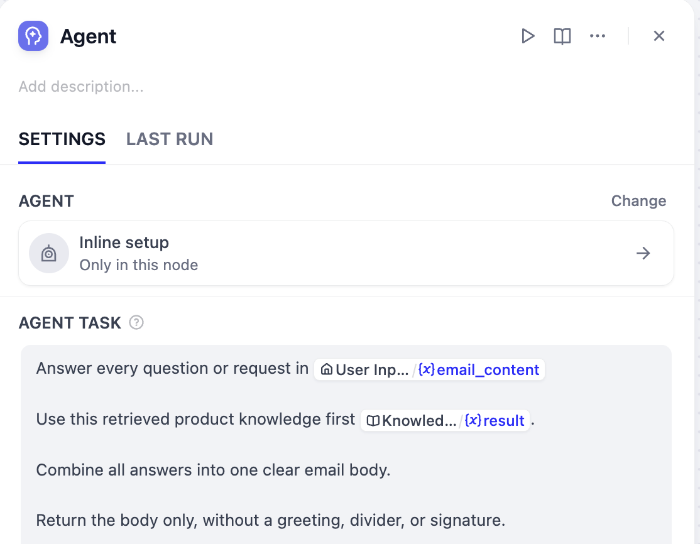
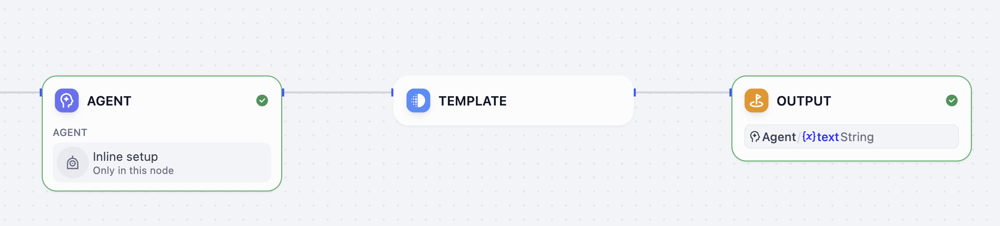
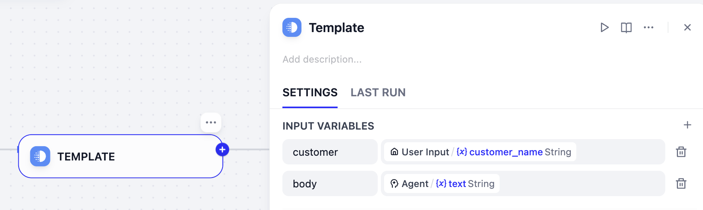
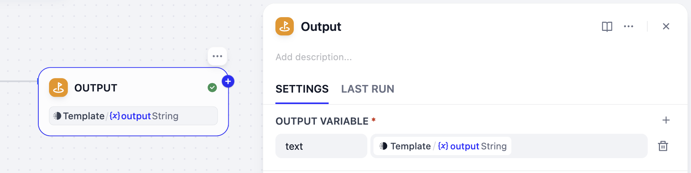
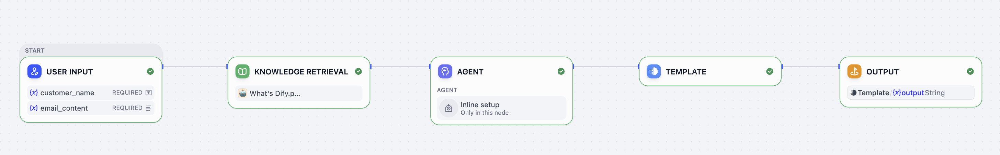

# 第 9 课：排版设计师（模板）

> 本文档由 AI 自动翻译。如有任何不准确之处，请参考 [英文原版](https://docs.dify.ai/en/learn/tutorials/workflow-101/lesson-09.md)。

在第 8 课中，我们把工作流精简成了一个 Product Support Agent。

内容可以做到准确、得体，但生成的排版仍会有波动：问候语可能换个说法，分隔线可能消失，署名的措辞也可能每次不同。

对于必须保持一致的元素，我们可以使用模板节点。

## 模板转换

你可以将它理解成排版设计师：它接收原始数据（比如你的答案列表），按照你设置好的模板和标准，输出一段排版完美的文本，每一次都保持一致。

## 动手实践：优化邮件排版

**1. 检查 Product Support Agent**

在工作流画布上选中 **Product Support**。它的任务应要求它处理完整邮件，但只返回实质性的正文。在 **Agent 任务** 中补充下面的文字：

```text wrap theme={null}
只返回正文，不要问候语、分隔线和署名。
```

这种分工很重要：Agent 负责表达和语气，模板负责固定的排版。



**2. 添加模板节点**

在 Agent 节点之后、输出节点之前插入一个模板转换节点。



**3. 设置输入变量**

打开模板节点，添加这两个变量：

* `customer`：`User Input /{x} customer_name`
* `body`：`Agent /{x} text`

使用 Agent 的 `text` 输出，交接过程一目了然，也便于排查。



**4. 使用 Jinja 语法进行排版**

**什么是 Jinja2？**

简单来说，Jinja2 就是一种让你把变量（比如答案列表）按照你想要的格式，填入到一个文本模板里的工具。它使用一些简单的符号来标记变量的位置和执行一些基本操作。通过它，我们能把一个原始的数据列表，转换成一段格式整齐的文本。

在这里，我们可以把开场白、邮件正文和署名落款拼装在一起，确保每次发出的邮件都既专业又格式统一。

请将下方这段排版代码直接复制并粘贴到模板节点的代码框中。

```text wrap theme={null}
Hi {{ customer }},

Thank you for reaching out. We are happy to help with your questions.

{{ body }}

---
Best regards,
Dify Support Team
```

`customer` 和 `body` 的值每次运行都会变化，它们周围的一切保持固定。这样既给了 Agent 撰写答案的自由，又确保最终的邮件永远遵循规定的排版。

**5. 更新输出节点**

打开输出节点，把原来的值替换为模板节点的输出。



这是最终的工作流：



点击 **测试运行**，在一封邮件中提出多个问题进行测试。你会发现，最终生成的回复完美包含了个性化的开场白、LLM 在中间部分出色总结的答案，以及最下方标准、专业的落款。

## 小挑战

1. 为 `customer` 为空的情况加一个兜底，比如 `Hi there,`。
2. 加一段 Agent 无法更改或省略的固定支持声明。
