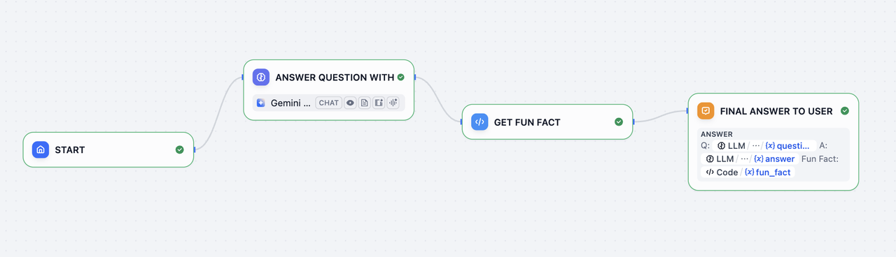

# 简单聊天机器人

> Hello World

> 本文档由 AI 自动翻译。如有任何不准确之处，请参考 [英文原版](https://docs.dify.ai/en/learn/tutorials/simple-chatbot.md)。

Dify 的真正价值在于，无论想法多么复杂，你都可以轻松构建、部署和扩展。它专为快速原型设计、流畅迭代和任何规模的可靠部署而打造。

让我们先学习将 LLM 可靠地集成到你的应用中。在本指南中，你将构建一个简单的聊天机器人，它能对用户的问题进行分类、使用 LLM 直接回应，并通过特定国家的趣事来增强回应。

[Dify 快速入门视频](https://www.youtube.com/embed/dJ34OU_JY7Y?si=AiYJq7WY1iUCgGAO)

## 步骤 1：创建新工作流（2 分钟）

1. 前往 **工作室** > **工作流** > **从空白创建** > **编排** > **新建 Chatflow** > **创建**

## 步骤 2：添加工作流节点（6 分钟）

> [!TIP]
>
> 当你想引用任何变量时，先输入 `{` 或 `/`，就能看到工作流中可用的不同变量。

### 1. LLM 节点和输出：理解并回答问题

> [!NOTE]
>
> `LLM` 节点向语言模型发送提示词，根据用户输入生成响应。它抽象了 API 调用、速率限制和基础设施的复杂性，让你可以专注于设计逻辑。

**1. 创建 LLM 节点**

使用 `添加节点` 按钮创建一个 LLM 节点，并将其连接到起始节点

**2. 配置模型**

选择一个默认模型

**3. 设置系统提示词**

将以下内容粘贴到系统提示词字段：

```text theme={null}
用户将询问关于某个国家的问题。问题是 {{sys.query}}
任务：
1. 识别提到的国家。
2. 清晰地重新表述问题。
3. 使用常识知识回答问题。

以以下 JSON 格式响应：
{
  "country": "<国家名称>",
  "question": "<重新表述的问题>",
  "answer": "<对问题的直接回答>"
}
```

**4. 启用结构化输出**

**启用结构化输出** 让你可以轻松控制 LLM 返回的内容，确保输出一致且机器可读，用于下游的精确数据提取或条件逻辑。

* 将输出变量结构化切换为开启 > `配置` 并点击 `从 JSON 导入`
* 粘贴：

```json theme={null}
{
  "country": "string",
  "question": "string",
  "answer": "string"
}
```

### 2. 代码块：获取趣事

> [!NOTE]
>
> `代码` 节点使用代码执行自定义逻辑。它让你可以在需要的确切位置注入代码（在可视化工作流中），让你无需搭建整个后端。

**1. 创建代码节点**

使用 `添加节点` 按钮创建一个 `代码` 节点，并连接到 LLM 块

**2. 配置输入变量**

将一个 `输入变量` 名称改为 "country"，并将变量设置为 `structured_output` > `country`

**3. 添加 Python 代码**

将此代码粘贴到 `PYTHON3`：

```python theme={null}
def main(country: str) -> dict:
  country_name = country.lower()
  fun_facts = {
    "japan": "日本有超过 500 万台自动售货机。",
    "france": "法国是世界上访问量最大的国家。",
    "italy": "意大利拥有的联合国教科文组织世界遗产地比任何其他国家都多。"
  }
  fun_fact = fun_facts.get(country_name, f"没有关于 {country.title()} 的趣事。")
  return {"fun_fact": fun_fact}
```

**4. 重命名输出变量**

将输出变量 `result` 改为 `fun_fact` 以获得更好标记的变量

### 3. 答案节点：给用户的最终答案

> [!NOTE]
>
> `答案` 节点创建一个简洁的最终输出返回给用户。

**1. 创建答案节点**

使用 `添加节点` 按钮创建一个 `答案` 节点

**2. 配置答案字段**

粘贴到答案字段：

```text theme={null}
问：{{ structured_output.question }}

答：{{ structured_output.answer }}

趣事：{{ fun_fact }}
```

工作流结束：



***

## 步骤 3：测试机器人（3 分钟）

点击 `预览`，然后询问：

* "法国的首都是什么？"
* "给我介绍一下日本料理"
* "描述一下意大利的文化"
* 任何其他问题

确保你的机器人按预期工作！

## 你已完成机器人！

本指南展示了如何可靠且可扩展地集成语言模型，而无需重新发明基础设施。通过 Dify 的可视化工作流和模块化节点，你不仅构建得更快，还为 LLM 驱动的应用采用了干净、生产就绪的架构。
