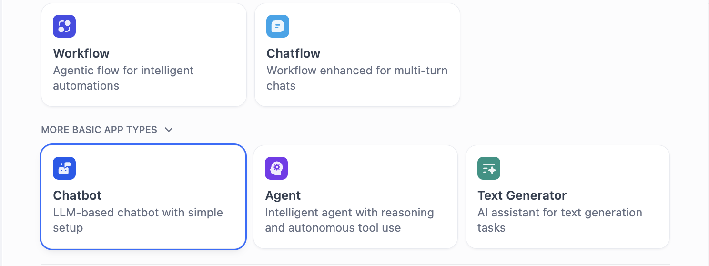
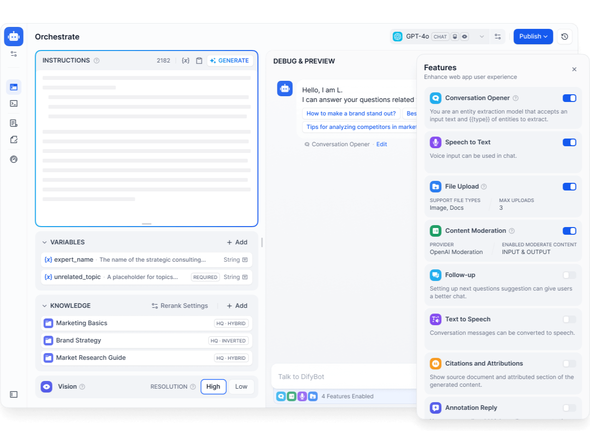
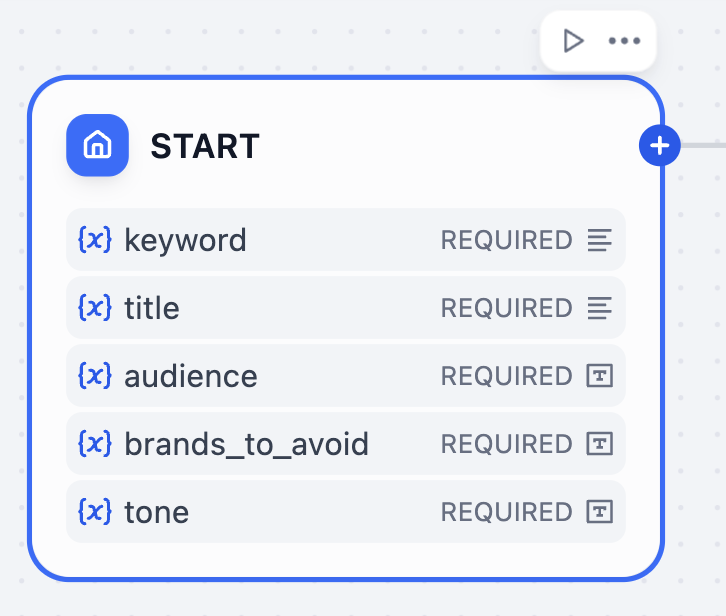
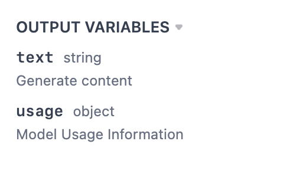
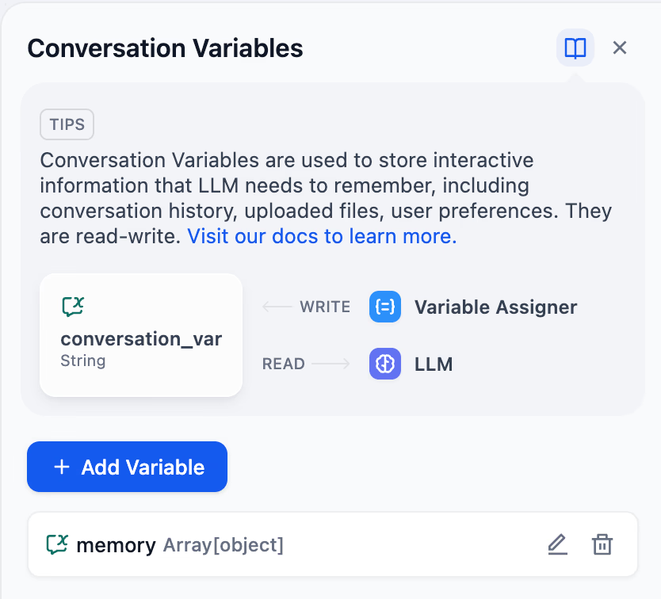
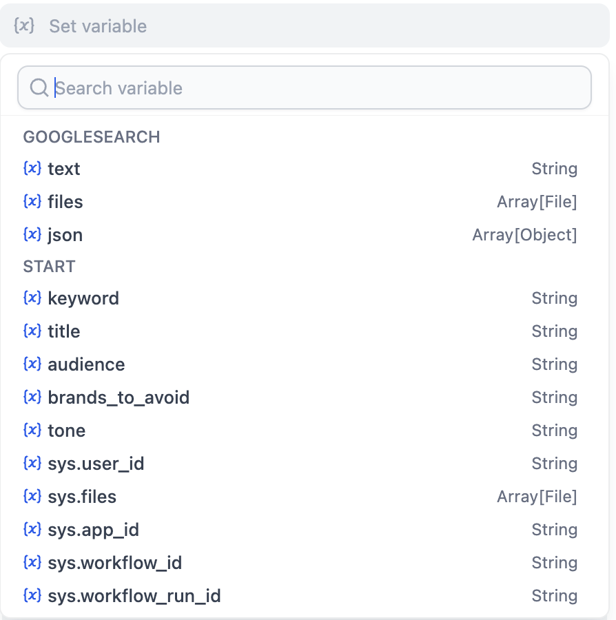
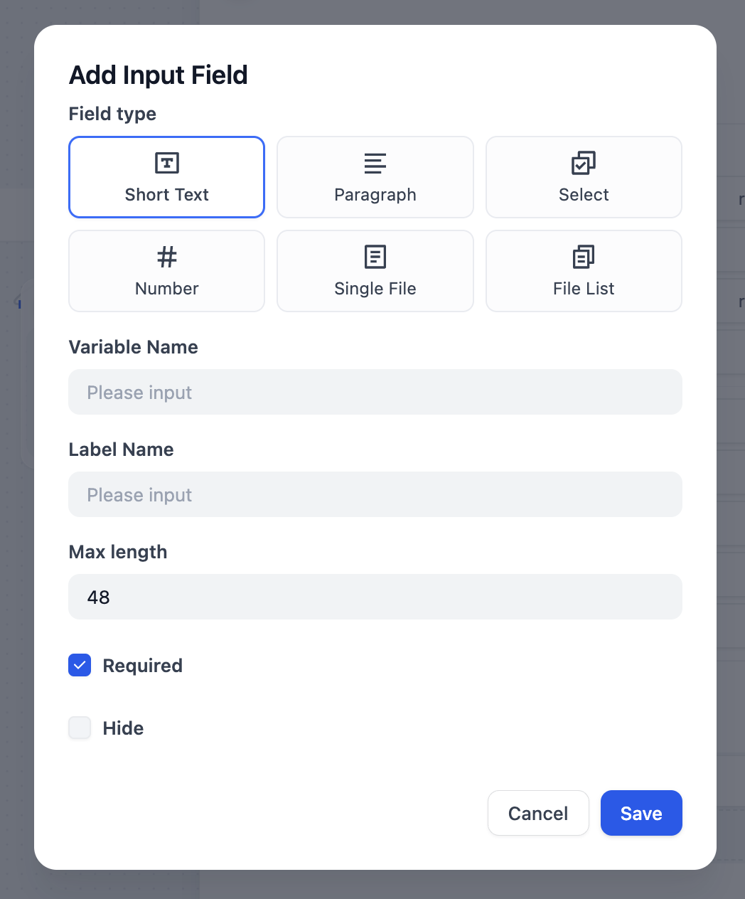

# 核心概念

> Dify 核心概念快速概览

> 本文档由 AI 自动翻译。如有任何不准确之处，请参考 [英文原版](https://docs.dify.ai/en/learn/key-concepts.md)。

## Dify 应用

Dify 专为智能体应用构建而设计。在 **Studio** 中，你可以通过拖拽界面快速构建智能体工作流并将其发布为应用。你可以通过 API、Web 或作为 [MCP 服务器](../%E4%BD%BF%E7%94%A8/%E5%8F%91%E5%B8%83/MCP%20%E6%9C%8D%E5%8A%A1%E5%99%A8.md)访问已发布的应用。Dify 提供两种主要的应用类型：Workflow 和 Chatflow。在创建新应用时，你需要选择一种应用类型。

> [!NOTE]
>
> 我们推荐选择 Workflow 或 Chatflow 作为你的应用类型。但除了这些之外，Dify 还提供 3 种更基础的应用类型：聊天机器人、Agent 和文本生成器。
>
> 
>
> 这些应用类型在底层运行相同的工作流引擎，但提供了更简单的传统界面：
>
> 

## Workflow

构建 Workflow 应用来处理单轮任务。Web 应用界面和 API 提供了便捷的批量执行多个任务的访问方式。

> [!NOTE]
>
> 在底层，工作流构成了 Dify 中所有其他应用类型的基础。

每个工作流都以一个 [开始节点](../%E4%BD%BF%E7%94%A8/%E7%BC%96%E6%8E%92/Workflow%20%E4%B8%8E%20Chatflow/%E5%BC%80%E5%A7%8B/%E5%BC%80%E5%A7%8B%E8%8A%82%E7%82%B9.md) 开始：用户输入（按需启动，由用户或 API 调用触发）或触发器（自动启动，按计划或响应外部事件）。

## Chatflow

Chatflow 是一种特殊类型的工作流应用，在对话的每一轮都会被触发。除了工作流功能外，Chatflow 还具有存储和更新自定义对话特定变量的能力，在大型语言模型节点中启用记忆功能，并在 Chatflow 运行的不同节点流式传输格式化的文本、图像和文件。

Chatflow 始终以用户输入开始。

## Dify DSL

Dify DSL（Domain-Specific Language，领域特定语言）是 Dify 用来描述应用的 YAML 格式。它记录应用的搭建和配置，涵盖节点、提示词、变量和各项设置，但不含日志、知识库这类数据。

导出应用时，Dify 会生成它的 DSL；导入时，再根据 DSL 重建应用。分享应用、发布模板、在工作空间或 Dify 实例之间迁移应用，用的都是这种方式。

在 Dify 1.18.0 及以上版本中，导出应用得到的是一个 **应用包**（`.ifpkg`），里面除了 DSL 文件，还有应用所需的文件，例如上传的图标，以及 [Agent](../%E4%BD%BF%E7%94%A8/%E7%BC%96%E6%8E%92/Agent/Agent.md) 的 Skill 和文件。更早的版本则只导出 DSL 文件（`.yml`）。

## 变量

变量是一个带标签的容器，用来存放信息。之后通过变量名引用，就能找到并使用其中的信息。在构建 Dify 应用时，你会遇到不同类型的变量。

### 输入

你可以在 [用户输入](../%E4%BD%BF%E7%94%A8/%E7%BC%96%E6%8E%92/Workflow%20%E4%B8%8E%20Chatflow/%E5%BC%80%E5%A7%8B/%E7%94%A8%E6%88%B7%E8%BE%93%E5%85%A5.md) 节点为你的应用终端用户指定任意数量的输入变量来填写。

此外，用户输入节点还带有一组输入变量，你可以在流程中稍后引用。根据应用类型（Workflow 或 Chatflow），会提供不同的变量。

> [tab] Workflow
>
> | 变量名 | 数据类型 | 描述 | 注释 |
> | :- | :- | :- | :- |
> | `sys.user_id` | String | 用户 ID：系统在用户使用 Workflow 应用时自动分配给每个用户的唯一标识符。用于区分不同的用户。 | |
> | `sys.app_id` | String | 应用 ID：系统自动分配给每个应用的唯一标识符。此参数用于记录当前应用的基本信息。 | 此参数用于具有开发能力的用户区分和定位不同的 Workflow 应用。 |
> | `sys.workflow_id` | String | 工作流 ID：此参数记录当前 Workflow 应用中所有节点的信息。 | 此参数可供具有开发能力的用户用于跟踪和记录工作流中包含的节点信息。 |
> | `sys.workflow_run_id` | String | 工作流运行 ID：用于记录 Workflow 应用的运行时状态和执行日志。 | 此参数可供具有开发能力的用户用于跟踪应用的历史执行记录。 |
> | `sys.timestamp` | Number | 每次工作流执行的开始时间。 | |

> [tab] Chatflow
>
> | 变量名 | 数据类型 | 描述 | 注释 |
> | :- | :- | :- | :- |
> | `sys.conversation_id` | String | 聊天框交互会话的唯一 ID，将所有相关消息分组到同一对话中，确保 LLM 在相同的主题和上下文中继续聊天。 | |
> | `sys.dialogue_count` | Number | 用户与 Chatflow 应用交互期间的对话轮次数。每次聊天轮次后计数自动增加 1，可与 if-else 节点结合使用以创建丰富的分支逻辑。 例如，LLM 将在第 X 个对话轮次时审查对话历史并自动提供分析。 | |
> | `sys.user_id` | String | 为每个应用用户分配一个唯一 ID，以区分不同的对话用户。 | 服务 API 不共享 Web 应用创建的对话。这意味着具有相同 ID 的用户将在 API 和 Web 应用界面之间具有单独的对话历史记录。 |
> | `sys.app_id` | String | 应用 ID：系统自动分配给每个应用的唯一标识符。此参数用于记录当前应用的基本信息。 | 此参数用于具有开发能力的用户区分和定位不同的应用。 |
> | `sys.workflow_id` | String | 工作流 ID：此参数记录当前应用中所有节点的信息。 | 此参数可供具有开发能力的用户用于跟踪和记录工作流中包含的节点信息。 |
> | `sys.workflow_run_id` | String | 工作流运行 ID：用于记录应用的运行时状态和执行日志。 | 此参数可供具有开发能力的用户用于跟踪应用的历史执行记录。 |

用户输入在每次工作流运行开始时设置，无法更新。

### 输出

每个节点产生一个或多个输出，可以在后续节点中引用。例如，LLM 节点有以下输出：

与输入一样，节点输出也无法更新。

### 环境变量

搭建 Workflow 或 Chatflow 时添加的环境变量，保存的是整个应用共用的值。

多个节点共用的值，或应用各副本之间需要不同的值（如测试系统或生产系统的 API 端点），都适合放在环境变量里。API 密钥这类机密信息使用 Secret 类型即可：除非你选择包含，否则导出时不会带上它们的值。

### 会话变量

会话变量仅存在于 Chatflow 中。它们在同一会话的多轮对话中保留各自的值，可用来存放随对话推进而变化的信息，比如待办事项列表或 token 消耗。可通过 [变量赋值](../%E4%BD%BF%E7%94%A8/%E7%BC%96%E6%8E%92/Workflow%20%E4%B8%8E%20Chatflow/%E8%8A%82%E7%82%B9/%E5%8F%98%E9%87%8F%E8%B5%8B%E5%80%BC%E5%99%A8.md) 节点更新会话变量的值：

### 变量引用

在配置输入字段时，你可以通过从下拉菜单中选择，轻松将变量传递给任何节点：

你还可以通过键入 `/` 斜杠并从下拉菜单中选择所需变量，将变量值插入到复杂的文本输入中。

