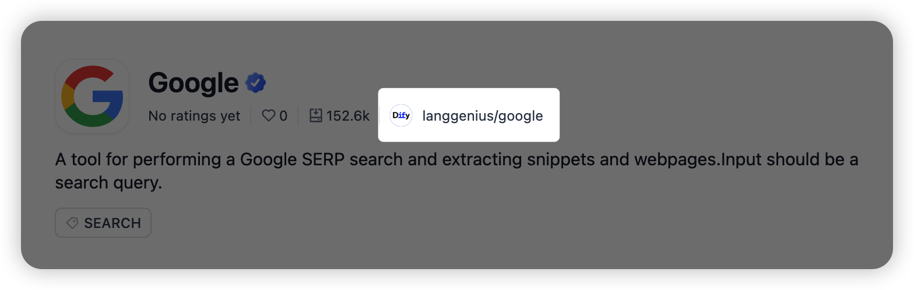

# 发布插件到 Marketplace

> 准备并验证 .difypkg，提交 Marketplace 审核，处理 Pull Request，并在创作者中心查看已发布插件的表现和反馈

> 本文档由 AI 自动翻译。如有任何不准确之处，请参考 [英文原版](https://docs.dify.ai/en/develop-plugin/publishing/marketplace-listing/submit-plugin-to-marketplace.md)。

在 [`langgenius/dify-plugins`](https://github.com/langgenius/dify-plugins) 中创建 Pull Request，提交插件供 Marketplace 审核。

## 准备条件

* 已在当前版本的 Dify Community Edition 或 Dify Cloud 中测试通过的插件项目。
* 用于打包的 [Dify 插件 CLI](https://github.com/langgenius/dify-plugin-daemon)。
* 用于本地验证的 Python 3 和 [`yq`](https://github.com/mikefarah/yq)。
* 供审核者与用户检查的公开源码仓库。

> [!NOTE]
>
> Marketplace 接收打包后的 `.difypkg`，而非源码目录。审核者仍会查看元数据和 PR 中声明的源码仓库，以了解无法仅凭软件包确认的行为。

## 准备软件包

> [tab] 运行时文件
>
> 只包含插件运行所需的文件，例如 `manifest.yaml`、Provider 或工具定义、源码、依赖、README、隐私政策和资源文件。
>
> 不要打包 `.git/`、虚拟环境、缓存、日志、`.DS_Store`、本地设置、IDE 文件或测试产物。切勿包含 `.env`、访问令牌、私钥、云凭据或其他密钥。

> [tab] 元数据与文档
>
> 确认 `manifest.yaml` 准确声明作者、名称、版本、插件类型、runner、图标、源码仓库、联系信息和隐私政策。
>
> 主 `README.md` 必须使用英文，并说明配置、用法、所需 API 或凭据、连接要求和源码仓库。译文放在 `readme/README_<locale>.md` 下。

> [tab] 依赖
>
> 尽量减少依赖，并采用足够明确的版本约束以保证可复现性。避免无版本约束的依赖、直接 URL 安装和 Git 安装；确有必要时，应在 PR 中说明原因。
>
> Python 插件必须使用 `dify-plugin >= 0.9.0`。验证器还会检查依赖元数据，并通过 [OSV 数据库](https://osv.dev/) 查询已知漏洞。

### 说明隐私与网络访问

`PRIVACY.md` 或托管的隐私政策必须说明插件会收集、存储、记录哪些用户数据，以及会向哪些第三方发送数据。插件不收集用户数据时，也应明确说明。

插件访问外部服务时，可在 `manifest.yaml` 中声明预期域名：

```yaml theme={null}
network:
  domains:
    - api.example.com
    - "*.cdn.example.com"
```

静态分析无法发现运行时拼接的所有 URL，也无法完全分析供应商 SDK 中隐藏的请求。声明域名后，即使扫描器无法从源码推断，也能明确展示这些访问目标。

## 确定风险等级

选择与插件匹配的最高风险等级。填写 Marketplace PR 模板时，只能选择 1 个等级。

| 等级 | 适用情况 |
| :- | :- |
| **低风险** | 插件只调用固定且有文档的 HTTPS API，不执行用户可控的代码、命令、SQL、文件操作、浏览器自动化或任意网络请求。 |
| **中风险** | 插件处理上传文件或用户提供的 URL、写入第三方服务、向外部发送用户内容，或处理非高度敏感的个人数据。 |
| **高风险** | 插件可执行代码或命令、运行 SQL、访问数据库或文件系统、使用 SSH/SFTP、自动操作浏览器、代理或抓取任意 URL、捆绑可执行文件，或处理敏感个人数据。 |

> [!WARNING]
>
> 多个等级都适用时，选择更高等级。降低标签不会缩小审核范围，只会造成证据不一致并拖慢审核。

对于中风险和高风险插件，应说明安全边界：如何约束输入、数据发送到哪里、使用哪些凭据、采用什么超时设置，以及错误处理如何避免泄露密钥。

## 本地构建与验证

**1. 打包插件**

在插件项目上一级目录运行：

```bash theme={null}
dify plugin package ./your-plugin
```

命令会生成 `.difypkg`。继续前，检查文件名和大小。

**2. 克隆 Marketplace Toolkit**

```bash theme={null}
git clone https://github.com/langgenius/dify-marketplace-toolkit.git
cd dify-marketplace-toolkit
```

**3. 验证软件包**

```bash theme={null}
python3 validator/validate-difypkg.py /path/to/your-plugin.difypkg \
  --output-dir ./validation-report
```

如需核对敏感能力扫描结果与计划提交的 PR 声明，可将 PR 正文保存为文件，再添加 `--pr-body-file /path/to/pr-body.md`。

**4. 处理报告**

打开 `validation-report/summary.md`，再检查生成的 `*.errors.txt` 和 `*.warnings.txt`。

退出码 `0` 表示没有发现软件包级阻断错误。退出码 `1` 表示存在阻断项或环境错误，必须先解决。警告不会使验证失败，但审核者可能要求补充说明。

本地验证器会检查安全解压、软件包内容与大小、密钥模式、二进制文件、manifest 与 README 元数据、依赖策略、Python 编译与安全模式、出站域名、依赖漏洞、金融活动信号，以及可选的敏感能力声明。

> [!TIP]
>
> 只有漏洞查询需要联网。必要时可添加 `--offline`；报告会列出依赖，但不会声称这些依赖不存在漏洞。

## 选择提交类型

> [tab] 新插件
>
> 在作者命名空间下创建软件包目录：
>
> ```text theme={null}
> <author>/<plugin-name>/<plugin-package>.difypkg
> ```
>
> 软件包元数据、源码仓库、联系信息、README、隐私政策与风险声明必须指向同一插件。

> [tab] 版本更新
>
> 提高 `manifest.yaml` 中的 `version`，重新构建软件包，再把新的 `.difypkg` 添加到已有插件目录。
>
> 更新 PR 通常只添加新的软件包文件。除非维护者明确要求，否则保留已发布的旧软件包。在 **What changed** 中概述修复、功能、迁移事项和破坏性变更，便于发布流水线提取有效的发布说明。

## 创建 PR

**1. Fork 并同步仓库**

Fork [`langgenius/dify-plugins`](https://github.com/langgenius/dify-plugins)，然后克隆 fork，并使 `main` 与上游保持同步。

```bash theme={null}
git clone https://github.com/<your-github-name>/dify-plugins.git
cd dify-plugins
git remote add upstream https://github.com/langgenius/dify-plugins.git
git fetch upstream
git switch main
git merge --ff-only upstream/main
```

**2. 创建专用分支**

```bash theme={null}
git switch -c add-<plugin-name>-<version>
mkdir -p <author>/<plugin-name>
cp /path/to/plugin.difypkg <author>/<plugin-name>/
```

确认分支只变更 1 个 `.difypkg`：

```bash theme={null}
git status --short
git diff --stat
```

**3. 提交并推送**

```bash theme={null}
git add <author>/<plugin-name>/<plugin-package>.difypkg
git commit -m "add <plugin-name> <version>"
git push -u origin HEAD
```

**4. 创建 Pull Request**

从 fork 向 `langgenius/dify-plugins:main` 创建 PR。只有软件包与说明都已可供自动和人工审核时，才将 PR 标记为 Ready for review。

> [!WARNING]
>
> 每个 PR 只提交 1 个 `.difypkg`。同时提交多个插件或版本时，CI 无法确定唯一的软件包路径，会直接阻断提交。

## 填写提交模板

当前模板是审核约定的一部分。不要删除字段，也不要用简短的自由格式说明替代模板。

> [accordion] 插件信息
>
> 填写作者、插件名称、版本、公开源码仓库和有人维护的联系渠道。这些信息必须与 `manifest.yaml` 和软件包文档一致。

> [accordion] 提交类型与变更
>
> 选择 **New plugin** 或 **Version update**，再说明插件用途或本版本的变化。更新时应提供可直接作为发布说明的细节，包括迁移事项和破坏性变更。

> [accordion] 风险等级
>
> 在 **Low risk**、**Medium risk** 和 **High risk** 中只选 1 项。仓库会添加相应的 `risk:*` 标签。未选或多选都会产生 `risk: missing` 标签和机器人评论。

> [accordion] 必备检查
>
> 逐项确认软件包整洁度、测试、README 质量、隐私范围和英文主文档。存在限制时，应在 **Reviewer notes** 中说明，而不是直接勾选。

> [accordion] 安全与隐私说明
>
> 列出命令或代码执行、SQL、SSH/SFTP、浏览器自动化、文件操作、任意 URL 获取、代理和敏感数据处理。均不适用时再填写 `None`。

> [accordion] 本地验证与审核者备注
>
> 粘贴验证命令与结果。补充已知限制、软件包或二进制例外、迁移事项，以及审核者判断警告时需要的背景。

## 提供插件审核依据

| 推荐做法 | 避免 |
| :- | :- |
| PR 标题、正文和主 README 使用英文。 | 在主要提交字段中混入未翻译的 CJK 文本。 |
| 链接该软件包对应的准确公开源码仓库。 | 只链接组织主页，或不说明具体位置的无关 monorepo 根目录。 |
| 说明敏感行为为何必要，以及如何限制。 | 因高风险能力是可选功能，就将其描述为低风险。 |
| 提供具体的验证命令和结果。 | 只写「已测试」，不提供环境或结果。 |
| 保持软件包内容与披露一致。 | 插件版本已变更，仍复制旧 PR 正文。 |

## 跟进 PR 检查与审核

创建 PR、推送 commit 或将草稿标记为 Ready for review 都会启动自动检查。根据结果判断是否需要处理。

| 结果 | 需要执行的操作 |
| :- | :- |
| **通过** | 等待维护者审核。检查通过不代表一定会获批。 |
| **阻断错误** | 修复软件包或 PR，必要时重新构建，再更新同一个 PR。不要新建替代 PR。 |
| **警告** | 查看具体发现。确有问题时予以修复；行为符合预期时，补充相关背景。警告本身不会使检查失败，但审核者可能要求修改。 |
| **要求修改** | 更新源码，必要时重新构建软件包，将修正内容推送到同一个 PR，并回复审核者。 |

审核通过并合并后，仓库会再次验证软件包，并将其上传到正式 Marketplace。你无需自行启动 CI，也无需上传已批准的软件包。

## 在创作者中心查看插件表现和反馈

插件出现在 Marketplace 后，可在 [创作者中心](https://creators.dify.ai/) 的 **插件** 页面查看其表现数据。在 [**消息**](https://creators.dify.ai/dashboard/inbox) 中逐条查看评分、点赞和反馈消息。

### 查看已发布插件

切换至个人账户后，关联用于发布插件的 GitHub 账号。如果关联了多个账号，选择要查看其插件的账号。

每张插件卡都会显示下载量、总体评分、评分数量和点赞数。

### 与团队共同查看插件表现和反馈

选择团队使用的组织。该组织中列出的插件对所有组织成员可见。

如果要为插件创建新组织，请先在插件的 Marketplace 详情页查找插件 ID，再将 `/` 前的部分填入 **唯一标识**。例如，插件 ID 为 `team-name/plugin-name` 时，输入 `team-name`。



Marketplace 详情页中的插件 ID

该组织被确认为发布者后，以其名义发布的插件会显示在 **插件** 页面。邀请团队成员后，他们无需关联自己的 GitHub 账号，也能查看相同插件。

#### 认领缺失的组织插件

如果以你的组织名义发布的插件没有显示在该组织的 **插件** 页面，打开 **认领插件**，申请查看该插件数据和反馈的权限。

1. 切换至个人账户，选择 **认领插件**。
2. 在 Marketplace 详情页复制每个插件的插件 ID，并将其与首次发布该插件的 PR 配对。
3. 确认联系邮箱，并说明你在插件维护中的职责。如果 PR 由其他 GitHub 账号创建，说明原因。
4. 选择 **提交认领**。

在 **认领记录** 中跟踪请求。审核通过后，你可以查看该发布者的所有插件。如果认领被拒绝，查看原因并选择 **新建认领**，更新证明材料后重新提交。

## 相关资源

> [card] [PR 模板](https://github.com/langgenius/dify-plugins/blob/main/.github/pull_request_template.md)
>
> 提交前查看最新模板；仓库要求可能持续演进。

> [card] [插件审核指南](https://github.com/langgenius/dify-plugins/blob/main/docs/plugin-review-guidelines.md)
>
> 了解维护者如何检查文档、依赖、隐私和敏感能力。
