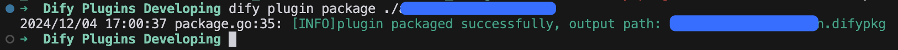
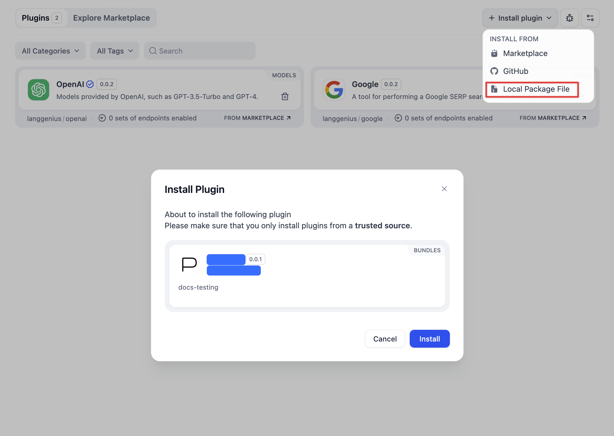

# 打包为本地文件并分享

> 将 Dify 插件打包为 `.difypkg` 文件，可直接安装或分发给他人，无需发布到 Marketplace 或 GitHub

> 本文档由 AI 自动翻译。如有任何不准确之处，请参考 [英文原版](https://docs.dify.ai/en/develop-plugin/publishing/marketplace-listing/release-by-file.md)。

`.difypkg` 是 Dify 插件的可移植形式。生成该文件后，任何人都可在插件页面上传文件来安装。这种方式适用于 **私有插件**、**内部测试**，或面向小范围群体的 **非公开分发**。

如需更广泛地分发，参见[发布概览](../%E5%8F%91%E5%B8%83%E6%8F%92%E4%BB%B6.md)。

## 前提条件

* 已安装 [Dify 插件 CLI](../../%E5%BF%AB%E9%80%9F%E5%BC%80%E5%A7%8B/Dify%20%E6%8F%92%E4%BB%B6%20CLI.md)。运行 `dify version` 进行确认。
* 一个开发完成的插件项目。如果尚未构建过插件，可从 [Tool 插件教程](../../%E5%BC%80%E5%8F%91%E6%8C%87%E5%8D%97%E4%B8%8E%E7%A4%BA%E4%BE%8B/%E6%8C%89%E6%8F%92%E4%BB%B6%E7%B1%BB%E5%9E%8B/%E5%B7%A5%E5%85%B7%E6%8F%92%E4%BB%B6.md) 开始。
* 打包前已通过[远程调试](../../%E7%89%B9%E6%80%A7%E4%B8%8E%E8%A7%84%E8%8C%83/%E6%8F%92%E4%BB%B6%E7%B1%BB%E5%9E%8B/%E6%8F%92%E4%BB%B6%E8%B0%83%E8%AF%95.md)测试插件。

> [!NOTE]
>
> `manifest.yaml` 以及每个 `provider/*.yaml` 中的 `author` 字段都必须与你的 GitHub 用户名一致。不一致会在安装时导致 `plugin_unique_identifier is not valid` 错误。完整的 manifest 规范参见[通用规范](../../%E7%89%B9%E6%80%A7%E4%B8%8E%E8%A7%84%E8%8C%83/%E6%8F%92%E4%BB%B6%E7%B1%BB%E5%9E%8B/%E9%80%9A%E7%94%A8%E8%A7%84%E8%8C%83.md)。

## 打包插件

**1. 进入项目上级目录**

导航到插件项目的 **上级** 目录（使该项目成为当前工作目录的子目录）。

**2. 运行打包命令**

```bash theme={null}
dify plugin package ./your_plugin_project
```

CLI 会在当前目录生成一个 `your_plugin_project.difypkg` 文件。



## 从文件安装

**1. 打开插件页面**

在 Dify 中，点击右上角的 **插件** 图标。

**2. 选择安装插件 > 通过本地文件**

或将 `.difypkg` 文件拖放到插件页面的空白区域。

**3. 确认安装**

查看插件请求的权限，然后点击 **安装**。



> [!TIP]
>
> 插件现已加入工作空间，可在 Agent、工作流或工具中使用，无需任何后续操作。

> [!WARNING]
>
> 自部署 Dify 默认强制执行签名验证。通过本地文件安装的未签名 `.difypkg` 文件会被拒绝，除非你为其签名或更改验证设置。参见[第三方签名验证](%E4%B8%BA%E7%AC%AC%E4%B8%89%E6%96%B9%E7%AD%BE%E5%90%8D%E9%AA%8C%E8%AF%81%E7%AD%BE%E7%BD%B2%E6%8F%92%E4%BB%B6.md)。

## 分享文件

将 `.difypkg` 文件直接交给用户：通过电子邮件、内部文件共享，或任何你能掌控的渠道。他们使用上述相同的流程进行安装。

如果你希望更广泛地分发，可考虑：

> [card] [发布到 GitHub](../GitHub%20%E4%BB%93%E5%BA%93/%E5%8F%91%E5%B8%83%E5%88%B0%E4%B8%AA%E4%BA%BA%20GitHub%20%E4%BB%93%E5%BA%93.md)
>
> 将 `.difypkg` 附加到 GitHub release，用户通过仓库 URL 安装。

> [card] [发布到 Marketplace](../%E5%8F%91%E5%B8%83%E6%8F%92%E4%BB%B6%E5%88%B0%20Marketplace.md)
>
> 向 `langgenius/dify-plugins` 提交 PR，进入官方目录。

## 相关资源

* [发布概览](../%E5%8F%91%E5%B8%83%E6%8F%92%E4%BB%B6.md)
* [Dify 插件 CLI](../../%E5%BF%AB%E9%80%9F%E5%BC%80%E5%A7%8B/Dify%20%E6%8F%92%E4%BB%B6%20CLI.md)
* [远程调试](../../%E7%89%B9%E6%80%A7%E4%B8%8E%E8%A7%84%E8%8C%83/%E6%8F%92%E4%BB%B6%E7%B1%BB%E5%9E%8B/%E6%8F%92%E4%BB%B6%E8%B0%83%E8%AF%95.md)
* [第三方签名验证](%E4%B8%BA%E7%AC%AC%E4%B8%89%E6%96%B9%E7%AD%BE%E5%90%8D%E9%AA%8C%E8%AF%81%E7%AD%BE%E7%BD%B2%E6%8F%92%E4%BB%B6.md)
* [通用规范](../../%E7%89%B9%E6%80%A7%E4%B8%8E%E8%A7%84%E8%8C%83/%E6%8F%92%E4%BB%B6%E7%B1%BB%E5%9E%8B/%E9%80%9A%E7%94%A8%E8%A7%84%E8%8C%83.md)
