# Slack Bot

> 构建一个将 Dify 应用连接到 Slack 的 Slack Bot 插件，涵盖从项目初始化到调试和打包的完整流程

> 本文档由 AI 自动翻译。如有任何不准确之处，请参考 [英文原版](https://docs.dify.ai/en/develop-plugin/dev-guides-and-walkthroughs/develop-a-slack-bot-plugin.md)。

在本指南中，你将构建一个由 AI 驱动的 Slack Bot，让它直接在 Slack 中回答用户问题。如果你之前没有开发过插件，先阅读 [插件开发快速入门指南](../%E6%8C%89%E6%8F%92%E4%BB%B6%E7%B1%BB%E5%9E%8B/%E5%B7%A5%E5%85%B7%E6%8F%92%E4%BB%B6.md)。

## 项目背景

Slack Bot 插件让团队直接在 Slack 中与 LLM 对话，把 AI 带到对话发生的地方。

Slack 是一个开放的实时通信平台，拥有强大的 API，其中包括一套基于 webhook 的事件系统，开发起来非常简单。本指南利用该系统来创建 Slack Bot 插件，如下图所示：

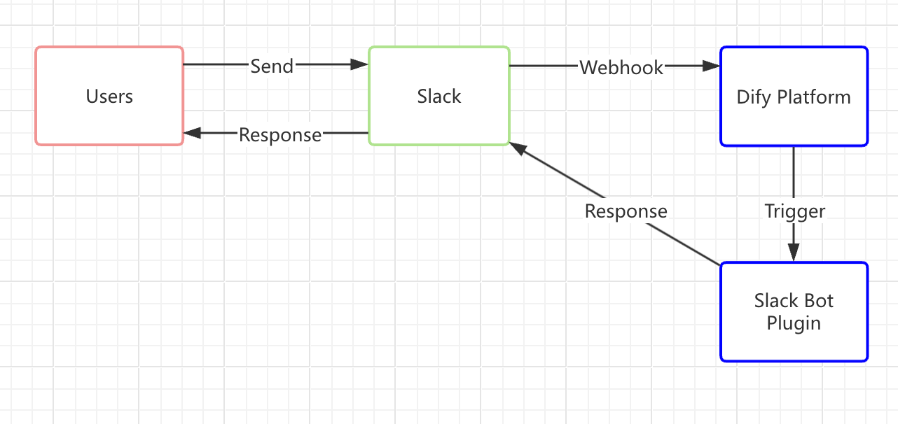

> [!NOTE]
>
> 本指南中会反复出现两个相似的术语：
>
> * **Slack Bot**：Slack 平台上的聊天机器人，是一个可与之实时交互的虚拟用户。
> * **Slack Bot 插件**：Dify Marketplace 中的一个插件，用于连接 Dify 应用与 Slack。本指南介绍如何构建它。

### 工作原理

1. **用户向 Slack Bot 发送消息**

   当 Slack 中的用户向 Bot 发送消息时，Slack Bot 会立即向 Dify 平台发出 webhook 请求。

2. **Slack 将消息转发给 Slack Bot 插件**

   Dify 平台触发 Slack Bot 插件，由它把消息转交给 Dify 应用，就像电子邮件系统把邮件投递到收件人地址一样。你通过 Slack 的 API 设置 Slack webhook 地址并填入插件中，从而建立这一连接。插件处理 Slack 请求并转发给 Dify 应用，由 LLM 分析输入并生成响应。

3. **插件将响应返回给 Slack**

   插件收到 Dify 应用的回复后，会沿同一路径把 LLM 的答案发送回 Slack Bot，让用户在聊天的地方就能得到回复。

## 前提条件

* **Dify 插件开发工具**：参见 [初始化开发工具](../../%E5%BF%AB%E9%80%9F%E5%BC%80%E5%A7%8B/Dify%20%E6%8F%92%E4%BB%B6%20CLI.md)。
* **Python 环境（版本 3.12）**：参见 [Python 官方下载页面](https://www.python.org/downloads/)。
* **带 OAuth 令牌的 Slack App**：参见下面的步骤。

要创建 Slack App，前往 [Slack API 平台](https://api.slack.com/apps)，从头创建一个应用，并选择部署它的工作区。

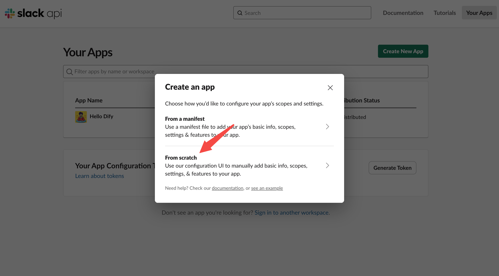

1. **启用 Webhooks**：

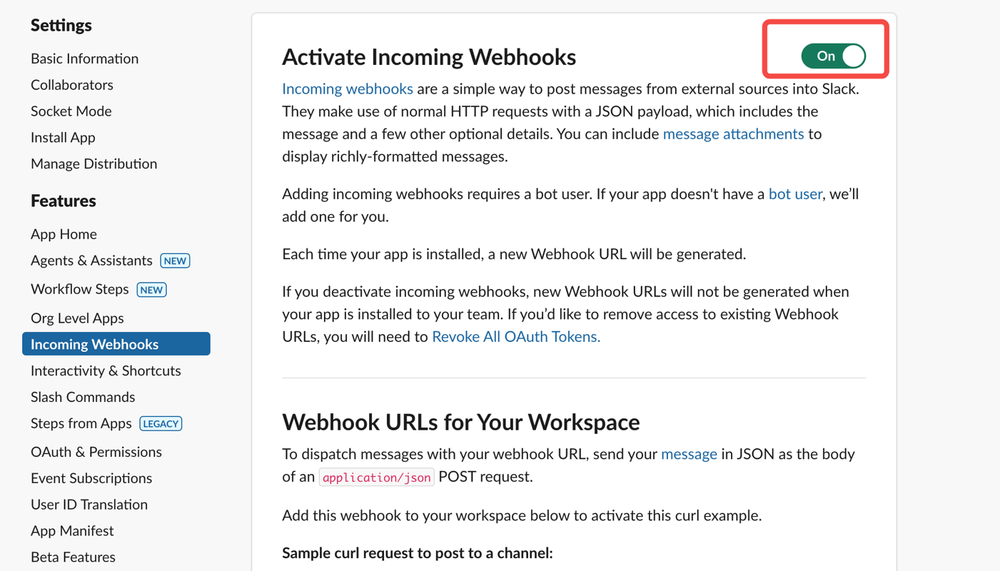

2. **在 Slack 工作区中安装应用**：

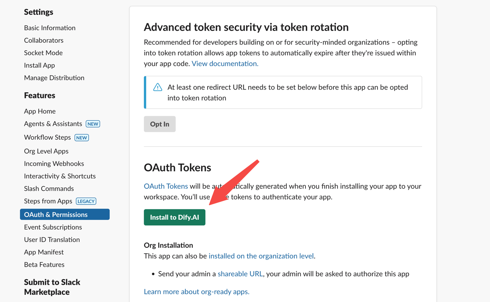

3. **获取 OAuth 令牌**，以供插件开发使用：

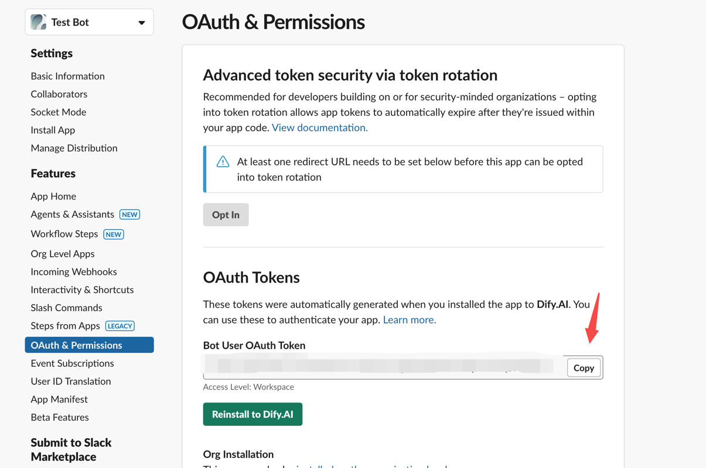

## 1. 开发插件

开始编码前，请确保你已阅读 [快速入门：开发扩展插件](../%E6%8C%89%E6%8F%92%E4%BB%B6%E7%B1%BB%E5%9E%8B/Endpoint%20%E6%8F%92%E4%BB%B6.md)，或已经构建过 Dify 插件。

### 1.1 初始化项目

运行以下命令来设置插件开发环境：

```bash theme={null}
dify plugin init
```

按照提示提供基本的项目信息。选择 `extension` 模板，并同时授予 `Apps` 和 `Endpoints` 权限。

有关在插件中反向调用 Dify 服务的更多细节，参见 [反向调用：App](../../%E7%89%B9%E6%80%A7%E4%B8%8E%E8%A7%84%E8%8C%83/%E9%AB%98%E7%BA%A7%E5%BC%80%E5%8F%91/%E5%8F%8D%E5%90%91%E8%B0%83%E7%94%A8/%E5%BA%94%E7%94%A8.md)。

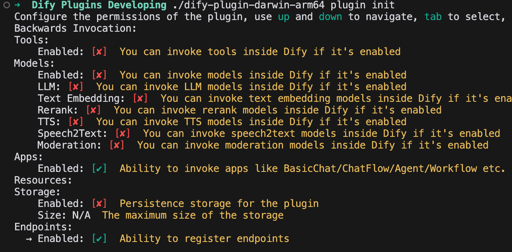

### 1.2 编辑配置表单

插件需要两项信息：由哪个 Dify 应用处理回复，以及用于验证 Bot 响应身份的 Slack App 令牌。请把这两个字段都添加到插件的表单中。

修改 `group` 目录中的 YAML 文件（例如 `group/slack.yaml`）。表单的文件名取决于你创建插件时提供的信息，请相应调整路径。

**示例代码**：

`slack.yaml`

```yaml theme={null}
settings:
  - name: bot_token
    type: secret-input
    required: true
    label:
      en_US: Bot Token
      zh_Hans: Bot Token
      pt_BR: Token do Bot
      ja_JP: Bot Token
    placeholder:
      en_US: Please input your Bot Token
      zh_Hans: 请输入你的 Bot Token
      pt_BR: Por favor, insira seu Token do Bot
      ja_JP: ボットトークンを入力してください
  - name: allow_retry
    type: boolean
    required: false
    label:
      en_US: Allow Retry
      zh_Hans: 允许重试
      pt_BR: Permitir Retentativas
      ja_JP: 再試行を許可
    default: false
  - name: app
    type: app-selector
    required: true
    label:
      en_US: App
      zh_Hans: 应用
      pt_BR: App
      ja_JP: アプリ
    placeholder:
      en_US: the app you want to use to answer Slack messages
      zh_Hans: 你想要用来回答 Slack 消息的应用
      pt_BR: o app que você deseja usar para responder mensagens do Slack
      ja_JP: あなたが Slack メッセージに回答するために使用するアプリ
endpoints:
  - endpoints/slack.yaml
```

有两个配置字段值得细看：

```yaml theme={null}
  - name: app
    type: app-selector
    scope: chat
```

* **`type`**：设为 `app-selector`，让用户在使用此插件时把消息转发到指定的 Dify 应用。
* **`scope`**：设为 `chat`，表示该插件只能与 agent、chatbot、chatflow 等应用类型交互。

最后，在 `endpoints/slack.yaml` 文件中，把请求方法改为 `POST`，使端点能够处理传入的 Slack 消息。

**示例代码**：

`endpoints/slack.yaml`

```yaml theme={null}
path: "/"
method: "POST"
extra:
  python:
    source: "endpoints/slack.py"
```

## 2. 编辑功能代码

修改 `endpoints/slack.py` 文件并添加以下代码：

```python theme={null}
import json
import traceback
from typing import Mapping
from werkzeug import Request, Response
from dify_plugin import Endpoint
from slack_sdk import WebClient
from slack_sdk.errors import SlackApiError


class SlackEndpoint(Endpoint):
    def _invoke(self, r: Request, values: Mapping, settings: Mapping) -> Response:
        """
        Invokes the endpoint with the given request.
        """
        retry_num = r.headers.get("X-Slack-Retry-Num")
        if (not settings.get("allow_retry") and (r.headers.get("X-Slack-Retry-Reason") == "http_timeout" or ((retry_num is not None and int(retry_num) > 0)))):
            return Response(status=200, response="ok")
        data = r.get_json()

        # Handle Slack URL verification challenge
        if data.get("type") == "url_verification":
            return Response(
                response=json.dumps({"challenge": data.get("challenge")}),
                status=200,
                content_type="application/json"
            )

        if (data.get("type") == "event_callback"):
            event = data.get("event")
            if (event.get("type") == "app_mention"):
                message = event.get("text", "")
                if message.startswith("<@"):
                    message = message.split("> ", 1)[1] if "> " in message else message
                    channel = event.get("channel", "")
                    blocks = event.get("blocks", [])
                    blocks[0]["elements"][0]["elements"] = blocks[0].get("elements")[0].get("elements")[1:]
                    token = settings.get("bot_token")
                    client = WebClient(token=token)
                    try:
                        response = self.session.app.chat.invoke(
                            app_id=settings["app"]["app_id"],
                            query=message,
                            inputs={},
                            response_mode="blocking",
                        )
                        try:
                            blocks[0]["elements"][0]["elements"][0]["text"] = response.get("answer")
                            result = client.chat_postMessage(
                                channel=channel,
                                text=response.get("answer"),
                                blocks=blocks
                            )
                            return Response(
                                status=200,
                                response=json.dumps(result),
                                content_type="application/json"
                            )
                        except SlackApiError as e:
                            raise e
                    except Exception as e:
                        err = traceback.format_exc()
                        return Response(
                            status=200,
                            response="Sorry, I'm having trouble processing your request. Please try again later." + str(err),
                            content_type="text/plain",
                        )
                else:
                    return Response(status=200, response="ok")
            else:
                return Response(status=200, response="ok")
        else:
            return Response(status=200, response="ok")
```

## 3. 调试插件

前往 Dify 平台，获取插件的远程调试地址和密钥。

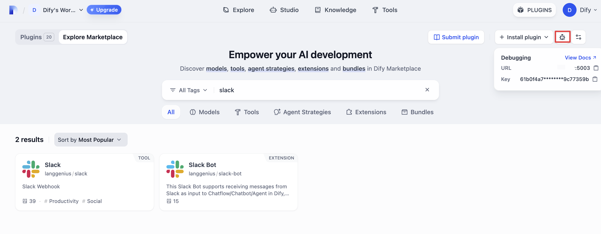

回到你的插件项目，复制 `.env.example` 文件，重命名为 `.env`，并填入调试信息：

```bash theme={null}
INSTALL_METHOD=remote
REMOTE_INSTALL_URL=debug.dify.ai:5003
REMOTE_INSTALL_KEY=********-****-****-****-************
```

启动插件：

```bash theme={null}
python -m main
```

此时你应该能在 Dify 插件管理页面的工作空间中看到插件已安装，其他团队成员也可以访问它。

### 配置插件端点

在 Dify 的插件管理页面，找到新安装的测试插件并创建一个新端点。填入名称和你的 **Bot Token**，然后选择要连接的应用。

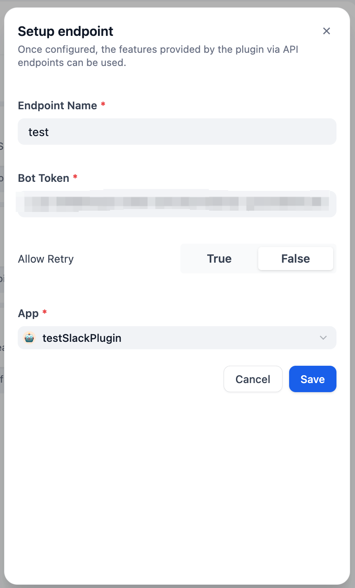

保存后，会生成一个 **POST** 请求 URL：

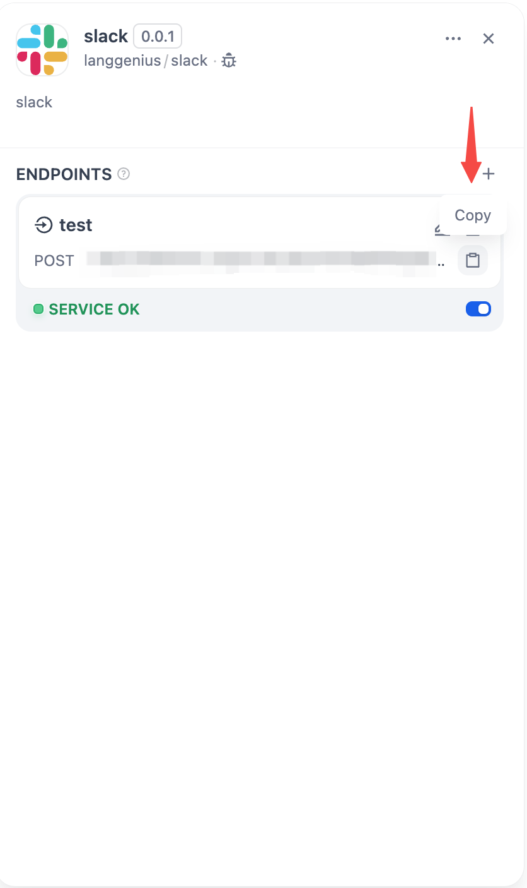

接下来，完成 Slack App 设置：

1. **启用事件订阅**

   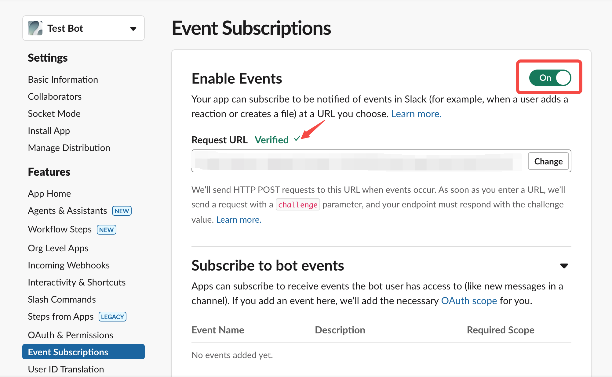

   粘贴你上面生成的 POST 请求 URL。

   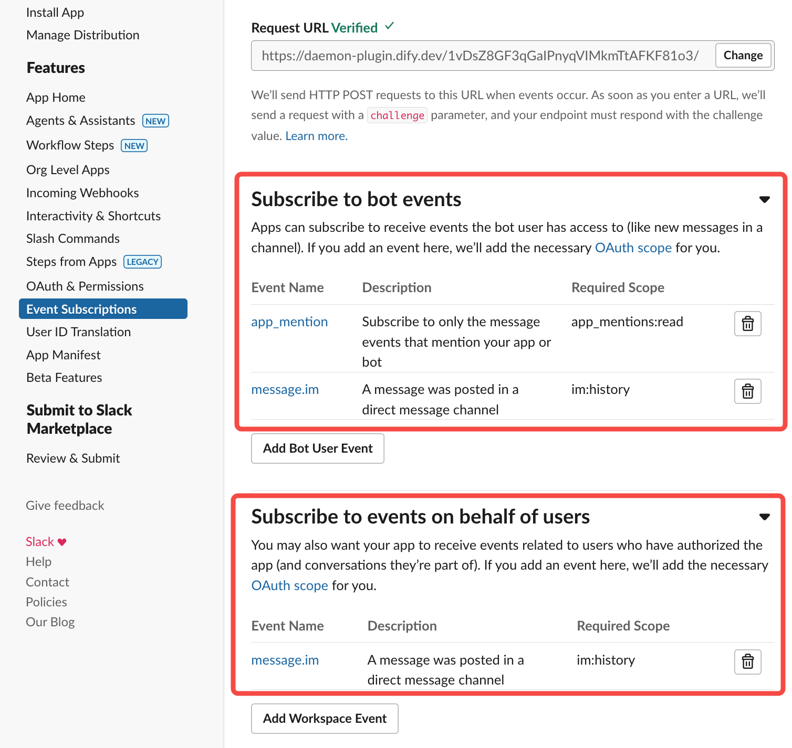

2. **授予所需权限**

   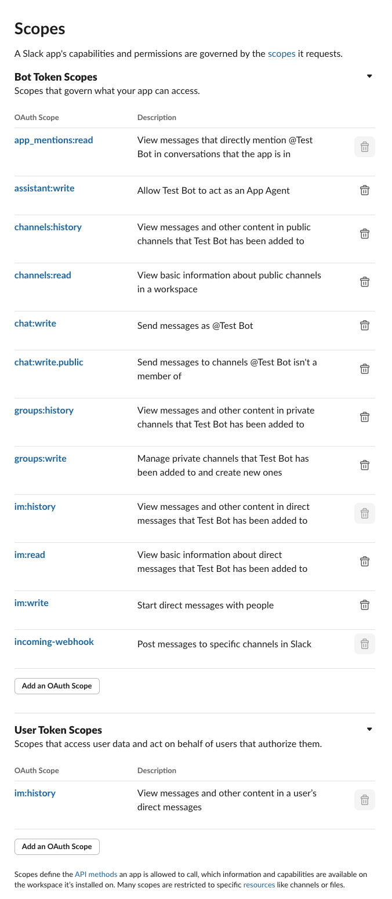

***

## 4. 验证插件

插件通过 `self.session.app.chat.invoke` 调用 Dify 应用，传入 `app_id`、`query` 等参数，并把响应返回给 Slack Bot。再次运行 `python -m main` 重启插件，然后检查 Slack 是否显示出 Dify 应用的回复：

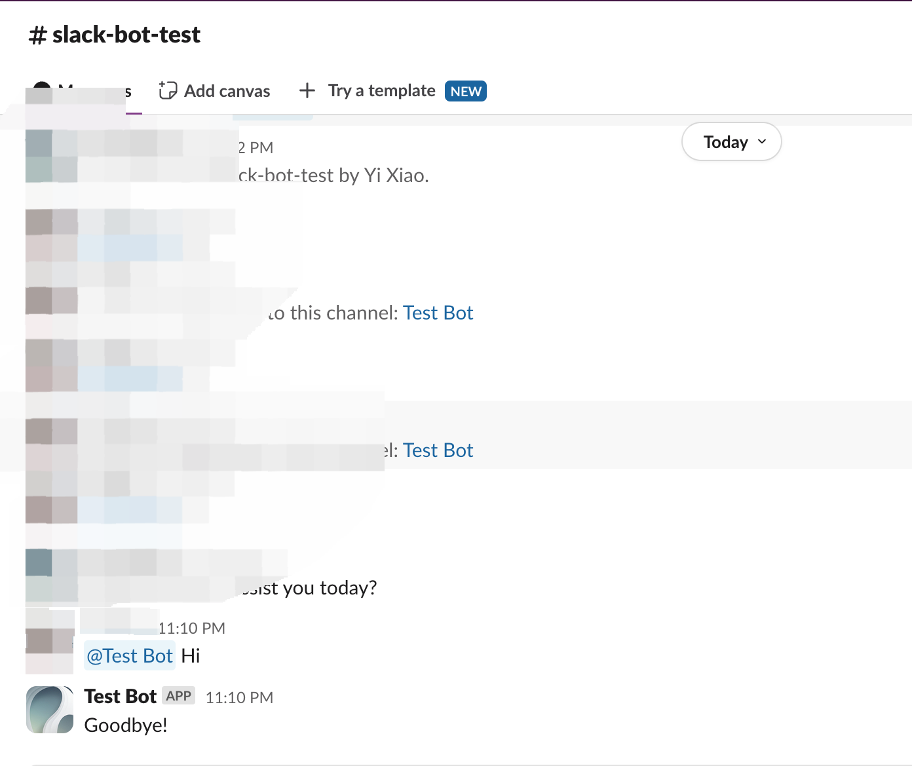

***

## 5. 打包插件（可选）

确认插件正常工作后，用以下命令打包。该命令会在当前目录生成一个 `slack_bot.difypkg` 文件，也就是你的最终插件包。有关详细的打包步骤，参见 [打包为本地文件并分享](../../%E5%8F%91%E5%B8%83/%E6%9C%AC%E5%9C%B0%E6%96%87%E4%BB%B6/%E6%89%93%E5%8C%85%E4%B8%BA%E6%9C%AC%E5%9C%B0%E6%96%87%E4%BB%B6%E5%B9%B6%E5%88%86%E4%BA%AB.md)。

```bash theme={null}
# 将 ./slack_bot 替换为你实际的插件项目路径。

dify plugin package ./slack_bot
```

恭喜！你已经开发、测试并打包了一个插件！

***

## 6. 发布插件（可选）

现在可将它提交到 [Dify Marketplace 仓库](https://github.com/langgenius/dify-plugins) 公开发布。提交前，确保插件符合 [Marketplace 准备与验证要求](../../%E5%8F%91%E5%B8%83/%E5%8F%91%E5%B8%83%E6%8F%92%E4%BB%B6%E5%88%B0%20Marketplace.md#准备软件包)。审核通过后，软件包会合并到主分支，并通过 Marketplace 流水线发布。

***

## 相关资源

* [插件开发基础](../../%E5%BF%AB%E9%80%9F%E5%BC%80%E5%A7%8B/Dify%20%E6%8F%92%E4%BB%B6.md)：Dify 插件开发的全面概述
* [插件开发快速入门指南](../%E6%8C%89%E6%8F%92%E4%BB%B6%E7%B1%BB%E5%9E%8B/%E5%B7%A5%E5%85%B7%E6%8F%92%E4%BB%B6.md)：从零开始开发插件
* [开发扩展插件](../%E6%8C%89%E6%8F%92%E4%BB%B6%E7%B1%BB%E5%9E%8B/Endpoint%20%E6%8F%92%E4%BB%B6.md)：扩展插件开发
* [反向调用 Dify 服务](../../%E7%89%B9%E6%80%A7%E4%B8%8E%E8%A7%84%E8%8C%83/%E9%AB%98%E7%BA%A7%E5%BC%80%E5%8F%91/%E5%8F%8D%E5%90%91%E8%B0%83%E7%94%A8/Dify%20%E6%9C%8D%E5%8A%A1%E7%9A%84%E5%8F%8D%E5%90%91%E8%B0%83%E7%94%A8.md)：如何调用 Dify 平台能力
* [反向调用：App](../../%E7%89%B9%E6%80%A7%E4%B8%8E%E8%A7%84%E8%8C%83/%E9%AB%98%E7%BA%A7%E5%BC%80%E5%8F%91/%E5%8F%8D%E5%90%91%E8%B0%83%E7%94%A8/%E5%BA%94%E7%94%A8.md)：如何调用平台内的应用
* [发布插件](../../%E5%8F%91%E5%B8%83/%E5%8F%91%E5%B8%83%E6%8F%92%E4%BB%B6.md)：发布流程
* [发布插件到 Marketplace](../../%E5%8F%91%E5%B8%83/%E5%8F%91%E5%B8%83%E6%8F%92%E4%BB%B6%E5%88%B0%20Marketplace.md)：软件包准备、验证与提交指南
* [端点详细定义](../%E6%8C%89%E6%8F%92%E4%BB%B6%E7%B1%BB%E5%9E%8B/Endpoint%20%E6%8F%92%E4%BB%B6.md)：端点参考

## 延伸阅读

要查看完整的 Dify 插件项目示例，访问 [GitHub 仓库](https://github.com/langgenius/dify-plugins)。你还能找到包含完整源代码和实现细节的其他插件。

要进一步了解插件开发，参见以下内容：

**快速入门**：

* [开发扩展插件](../%E6%8C%89%E6%8F%92%E4%BB%B6%E7%B1%BB%E5%9E%8B/Endpoint%20%E6%8F%92%E4%BB%B6.md)
* [开发模型插件](../%E6%8C%89%E6%8F%92%E4%BB%B6%E7%B1%BB%E5%9E%8B/%E6%A8%A1%E5%9E%8B%E4%BE%9B%E5%BA%94%E5%95%86%E6%8F%92%E4%BB%B6.md)
* [Bundle 插件：打包多个插件](../../%E7%89%B9%E6%80%A7%E4%B8%8E%E8%A7%84%E8%8C%83/%E9%AB%98%E7%BA%A7%E5%BC%80%E5%8F%91/%E5%8F%8D%E5%90%91%E8%B0%83%E7%94%A8/Bundle%20%E6%8F%92%E4%BB%B6%E5%8C%85.md)

**插件接口文档**：

* [通过 Manifest 文件定义插件信息](../../%E7%89%B9%E6%80%A7%E4%B8%8E%E8%A7%84%E8%8C%83/%E6%8F%92%E4%BB%B6%E7%B1%BB%E5%9E%8B/Manifest.md)：Manifest 结构
* [端点](../%E6%8C%89%E6%8F%92%E4%BB%B6%E7%B1%BB%E5%9E%8B/Endpoint%20%E6%8F%92%E4%BB%B6.md)：端点参考
* [反向调用](../../%E7%89%B9%E6%80%A7%E4%B8%8E%E8%A7%84%E8%8C%83/%E9%AB%98%E7%BA%A7%E5%BC%80%E5%8F%91/%E5%8F%8D%E5%90%91%E8%B0%83%E7%94%A8/Dify%20%E6%9C%8D%E5%8A%A1%E7%9A%84%E5%8F%8D%E5%90%91%E8%B0%83%E7%94%A8.md)：从插件调用 Dify 能力
* [通用规范](../../%E7%89%B9%E6%80%A7%E4%B8%8E%E8%A7%84%E8%8C%83/%E6%8F%92%E4%BB%B6%E7%B1%BB%E5%9E%8B/%E9%80%9A%E7%94%A8%E8%A7%84%E8%8C%83.md)：工具规范
* [模型 Schema](../../%E7%89%B9%E6%80%A7%E4%B8%8E%E8%A7%84%E8%8C%83/%E6%8F%92%E4%BB%B6%E7%B1%BB%E5%9E%8B/%E6%A8%A1%E5%9E%8B%20API%20%E6%8E%A5%E5%8F%A3.md)：模型 schema 参考
