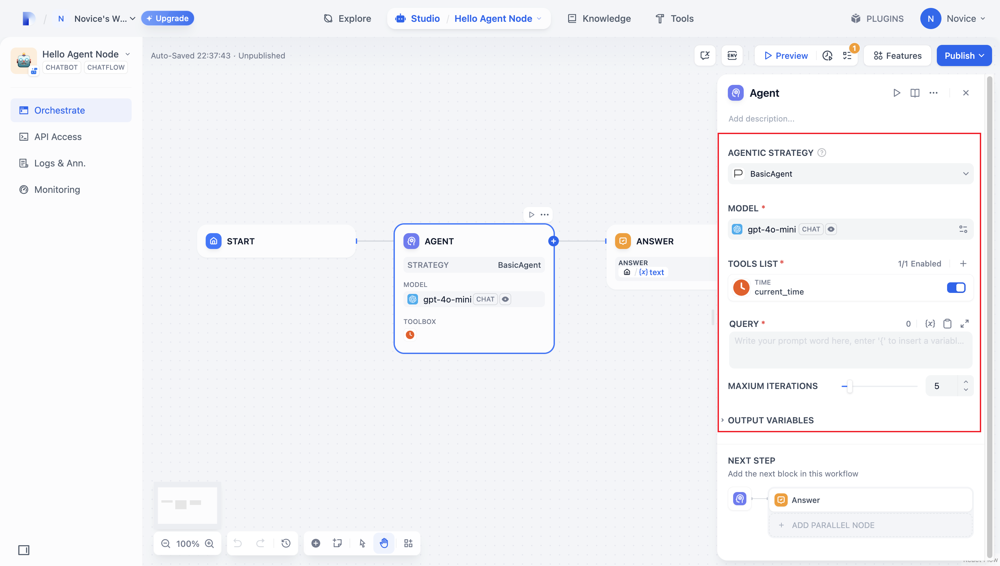
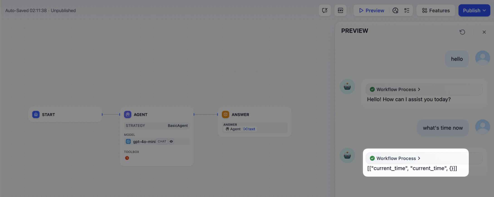
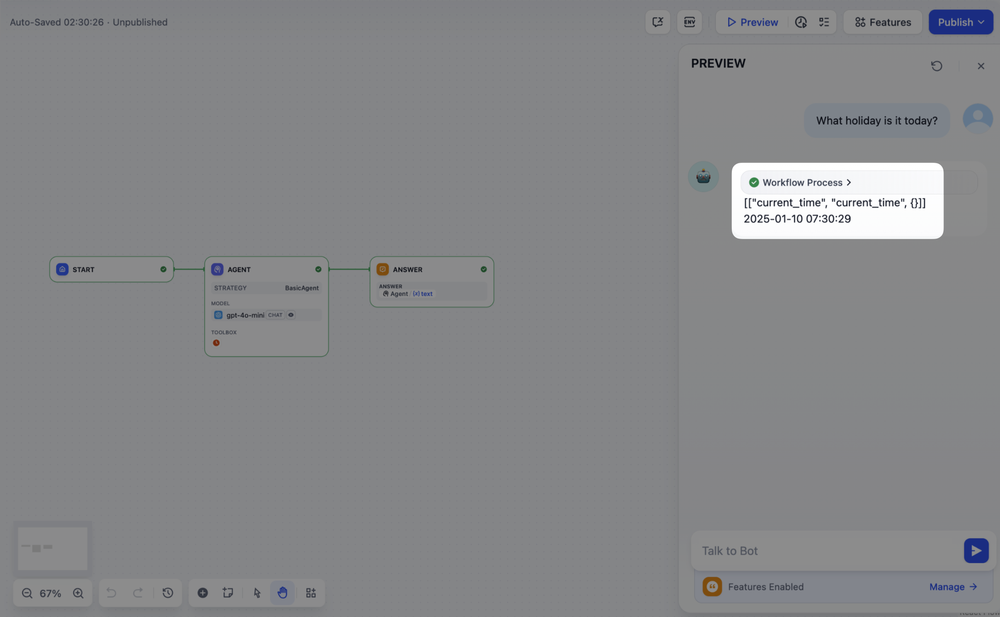
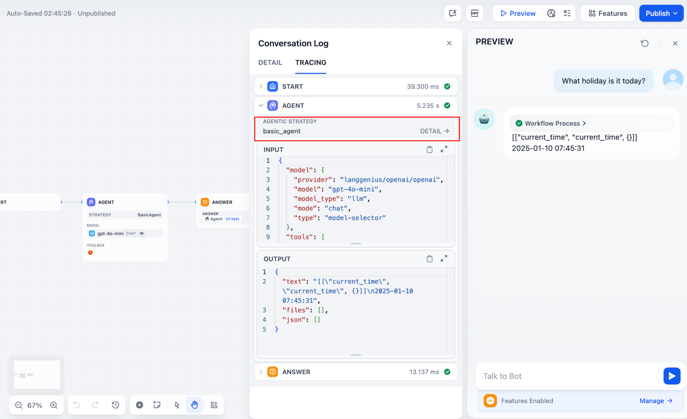
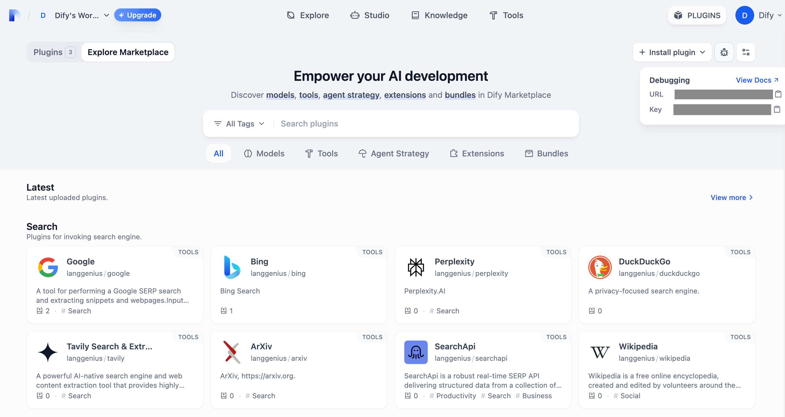
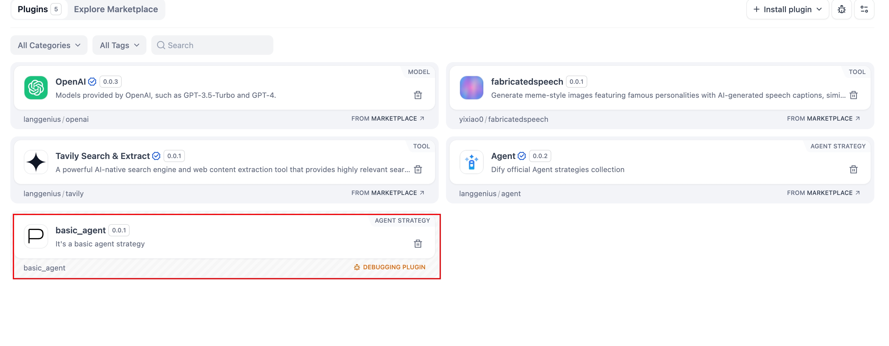

# Agent 策略插件

> 从零开始构建一个 Function Calling Agent 策略，通过实战示例展示如何为 LLM 提供工具并让其自主获取当前时间

> 本文档由 AI 自动翻译。如有任何不准确之处，请参考 [英文原版](https://docs.dify.ai/en/develop-plugin/dev-guides-and-walkthroughs/agent-strategy-plugin.md)。

**Agent 策略插件**为 LLM 提供推理与决策逻辑，使其能够选择工具、调用工具并处理工具结果，从而自主解决问题。

本指南将带你构建一个 **Function Calling** 策略，让模型自行获取当前时间。

## 前置条件

* Dify 插件脚手架工具
* Python 环境（版本 3.12）

有关准备插件开发工具的详细信息，参见 [CLI](../../%E5%BF%AB%E9%80%9F%E5%BC%80%E5%A7%8B/Dify%20%E6%8F%92%E4%BB%B6%20CLI.md)。

> [!TIP]
>
> 在终端中运行 `dify version` 以确认脚手架工具已安装。

***

## 1. 初始化插件模板

运行以下命令为你的 Agent 插件创建开发模板：

```bash theme={null}
dify plugin init
```

按照屏幕提示操作，下方注释解释了每一项选择。

```bash theme={null}
➜  Dify Plugins Developing dify plugin init
Edit profile of the plugin
Plugin name (press Enter to next step): # Enter the plugin name
Author (press Enter to next step): Author name # Enter the plugin author
Description (press Enter to next step): Description # Enter the plugin description
---
Select the language you want to use for plugin development, and press Enter to con
BTW, you need Python 3.12+ to develop the Plugin if you choose Python.
-> python # Select Python environment
  go (not supported yet)
---
Based on the ability you want to extend, we have divided the Plugin into four type

- Tool: It's a tool provider, but not only limited to tools, you can implement an
- Model: Just a model provider, extending others is not allowed.
- Extension: Other times, you may only need a simple http service to extend the fu
- Agent Strategy: Implement your own logics here, just by focusing on Agent itself

What's more, we have provided the template for you, you can choose one of them b
  tool
-> agent-strategy # Select Agent strategy template
  llm
  text-embedding
---
Configure the permissions of the plugin, use up and down to navigate, tab to sel
Backwards Invocation:
Tools:
    Enabled: [✔]  You can invoke tools inside Dify if it's enabled # Enabled by default
Models:
    Enabled: [✔]  You can invoke models inside Dify if it's enabled # Enabled by default
    LLM: [✔]  You can invoke LLM models inside Dify if it's enabled # Enabled by default
    Text Embedding: [✘]  You can invoke text embedding models inside Dify if it'
    Rerank: [✘]  You can invoke rerank models inside Dify if it's enabled
...
```

初始化会创建一个文件夹，包含插件开发所需的全部资源：

```text theme={null}
├── GUIDE.md               # User guide and documentation
├── PRIVACY.md             # Privacy policy and data handling guidelines
├── README.md              # Project overview and setup instructions
├── _assets/               # Static assets directory
│   └── icon.svg           # Agent strategy provider icon/logo
├── main.py                # Main application entry point
├── manifest.yaml          # Basic plugin configuration
├── provider/              # Provider configurations directory
│   └── basic_agent.yaml   # Your agent provider settings
├── requirements.txt       # Python dependencies list
└── strategies/            # Strategy implementation directory
    ├── basic_agent.py     # Basic agent strategy implementation
    └── basic_agent.yaml   # Basic agent strategy configuration
```

此插件的所有关键功能都在 `strategies/` 目录中。

***

## 2. 开发插件

Agent 策略插件的开发围绕两个文件展开：

* **插件声明**：`strategies/basic_agent.yaml`
* **插件实现**：`strategies/basic_agent.py`

### 2.1 定义参数

首先在 `strategies/basic_agent.yaml` 中声明插件的参数。这些参数驱动插件的核心功能，例如调用 LLM 或使用工具。

建议先从以下四个参数开始：

* **`model`**：要调用的大语言模型（例如 GPT-4、GPT-4o-mini）。
* **`tools`**：增强插件功能的工具列表。
* **`query`**：发送给模型的用户输入或提示词内容。
* **`maximum_iterations`**：最大迭代次数，用于防止过度计算。

示例：

```yaml theme={null}
identity:
  name: basic_agent # the name of the agent_strategy
  author: novice # the author of the agent_strategy
  label:
    en_US: BasicAgent # the English label of the agent_strategy
description:
  en_US: BasicAgent # the English description of the agent_strategy
parameters:
  - name: model # the name of the model parameter
    type: model-selector # model-type
    scope: tool-call&llm # the scope of the parameter
    required: true
    label:
      en_US: Model
      zh_Hans: 模型
      pt_BR: Model
  - name: tools # the name of the tools parameter
    type: array[tools] # the type of tool parameter
    required: true
    label:
      en_US: Tools list
      zh_Hans: 工具列表
      pt_BR: Tools list
  - name: query # the name of the query parameter
    type: string # the type of query parameter
    required: true
    label:
      en_US: Query
      zh_Hans: 查询
      pt_BR: Query
  - name: maximum_iterations
    type: number
    required: false
    default: 5
    label:
      en_US: Maxium Iterations
      zh_Hans: 最大迭代次数
      pt_BR: Maxium Iterations
    max: 50 # if you set the max and min value, the display of the parameter will be a slider
    min: 1
extra:
  python:
    source: strategies/basic_agent.py
```

Dify 会根据这些参数声明自动渲染配置界面：



### 2.2 获取参数并执行

用户填写这些字段后，插件会收到提交的值。在 `strategies/basic_agent.py` 中，定义一个 Pydantic 模型来校验传入的参数：

```python theme={null}
from dify_plugin.entities.agent import AgentInvokeMessage
from dify_plugin.interfaces.agent import AgentModelConfig, AgentStrategy, ToolEntity
from pydantic import BaseModel

class BasicParams(BaseModel):
    maximum_iterations: int
    model: AgentModelConfig
    tools: list[ToolEntity]
    query: str
```

然后在 `_invoke` 中解析参数并运行你的策略逻辑：

```python theme={null}
class BasicAgentAgentStrategy(AgentStrategy):
    def _invoke(self, parameters: dict[str, Any]) -> Generator[AgentInvokeMessage]:
        params = BasicParams(**parameters)
```

## 3. 调用模型

调用模型是 Agent 策略的核心。使用 SDK 中的 `session.model.llm.invoke()` 调用 LLM，处理文本生成、对话等任务。

要让 LLM 驱动工具调用，它必须输出与各工具接口匹配的结构化参数，即根据用户指令推导出工具可接受的输入。

该方法接受以下参数：

* `model`
* `prompt_messages`
* `tools`
* `stop`
* `stream`

方法签名：

```python theme={null}
def invoke(
        self,
        model_config: LLMModelConfig,
        prompt_messages: list[PromptMessage],
        tools: list[PromptMessageTool] | None = None,
        stop: list[str] | None = None,
        stream: bool = True,
    ) -> Generator[LLMResultChunk, None, None] | LLMResult:...
```

完整实现参见下方[示例代码](Agent%20%E7%AD%96%E7%95%A5%E6%8F%92%E4%BB%B6.md#示例代码)中的 **Invoke Model** 标签页。

完成上述设置后，每当用户输入命令，插件就会调用 LLM，根据模型输出构造工具调用参数，并让模型调度已配置的工具来完成复杂任务。



## 4. 调用工具

模型生成工具参数后，插件必须实际调用这些工具。使用 `session.tool.invoke()` 发起这些请求。

该方法接受以下参数：

* `provider`
* `tool_name`
* `parameters`

方法签名：

```python theme={null}
 def invoke(
        self,
        provider_type: ToolProviderType,
        provider: str,
        tool_name: str,
        parameters: dict[str, Any],
    ) -> Generator[ToolInvokeMessage, None, None]:...
```

要让 LLM 自行生成工具调用参数，将模型提取出的工具调用传入你的调用代码：

```python theme={null}
tool_instances = (
    {tool.identity.name: tool for tool in params.tools} if params.tools else {}
)
for tool_call_id, tool_call_name, tool_call_args in tool_calls:
    tool_instance = tool_instances[tool_call_name]
    self.session.tool.invoke(
        provider_type=ToolProviderType.BUILT_IN,
        provider=tool_instance.identity.provider,
        tool_name=tool_instance.identity.name,
        parameters={**tool_instance.runtime_parameters, **tool_call_args},
    )
```

现在，你的插件即可自动执行 Function Calling，例如获取当前时间。



## 5. 创建日志

复杂任务通常需要多个步骤，你需要跟踪每一步的结果，以分析决策并优化策略。SDK 的 `create_log_message` 和 `finish_log_message` 可在每次调用前后记录状态，从而加快问题诊断。

例如：

* 在调用模型之前记录一条「开始模型调用」消息，以显示执行进度。
* 模型响应后记录一条「调用成功」消息，使其输出可端到端追踪。

```python theme={null}
model_log = self.create_log_message(
            label=f"{params.model.model} Thought",
            data={},
            metadata={"start_at": model_started_at, "provider": params.model.provider},
            status=ToolInvokeMessage.LogMessage.LogStatus.START,
        )
yield model_log
self.session.model.llm.invoke(...)
yield self.finish_log_message(
    log=model_log,
    data={
        "output": response,
        "tool_name": tool_call_names,
        "tool_input": tool_call_inputs,
    },
    metadata={
        "started_at": model_started_at,
        "finished_at": time.perf_counter(),
        "elapsed_time": time.perf_counter() - model_started_at,
        "provider": params.model.provider,
    },
)
```

设置完成后，工作流日志会显示执行结果：



当任务跨越多轮时，在日志调用中设置 `parent` 参数，将日志嵌套为层级结构，便于跟踪：

```python theme={null}
function_call_round_log = self.create_log_message(
    label="Function Call Round1 ",
    data={},
    metadata={},
)
yield function_call_round_log

model_log = self.create_log_message(
    label=f"{params.model.model} Thought",
    data={},
    metadata={"start_at": model_started_at, "provider": params.model.provider},
    status=ToolInvokeMessage.LogMessage.LogStatus.START,
    # add parent log
    parent=function_call_round_log,
)
yield model_log
```

### 示例代码

> [tab] 调用模型
>
> 以下代码为 Agent 策略插件赋予调用模型的能力：
>
> ```python theme={null}
> import json
> from collections.abc import Generator
> from typing import Any, cast
>
> from dify_plugin.entities.agent import AgentInvokeMessage
> from dify_plugin.entities.model.llm import LLMModelConfig, LLMResult, LLMResultChunk
> from dify_plugin.entities.model.message import (
>     PromptMessageTool,
>     UserPromptMessage,
> )
> from dify_plugin.entities.tool import ToolInvokeMessage, ToolParameter, ToolProviderType
> from dify_plugin.interfaces.agent import AgentModelConfig, AgentStrategy, ToolEntity
> from pydantic import BaseModel
>
> class BasicParams(BaseModel):
>     maximum_iterations: int
>     model: AgentModelConfig
>     tools: list[ToolEntity]
>     query: str
>
> class BasicAgentAgentStrategy(AgentStrategy):
>     def _invoke(self, parameters: dict[str, Any]) -> Generator[AgentInvokeMessage]:
>         params = BasicParams(**parameters)
>         chunks: Generator[LLMResultChunk, None, None] | LLMResult = (
>             self.session.model.llm.invoke(
>                 model_config=LLMModelConfig(**params.model.model_dump(mode="json")),
>                 prompt_messages=[UserPromptMessage(content=params.query)],
>                 tools=[
>                     self._convert_tool_to_prompt_message_tool(tool)
>                     for tool in params.tools
>                 ],
>                 stop=params.model.completion_params.get("stop", [])
>                 if params.model.completion_params
>                 else [],
>                 stream=True,
>             )
>         )
>         response = ""
>         tool_calls = []
>         tool_instances = (
>             {tool.identity.name: tool for tool in params.tools} if params.tools else {}
>         )
>
>         for chunk in chunks:
>             # check if there is any tool call
>             if self.check_tool_calls(chunk):
>                 tool_calls = self.extract_tool_calls(chunk)
>                 tool_call_names = ";".join([tool_call[1] for tool_call in tool_calls])
>                 try:
>                     tool_call_inputs = json.dumps(
>                         {tool_call[1]: tool_call[2] for tool_call in tool_calls},
>                         ensure_ascii=False,
>                     )
>                 except json.JSONDecodeError:
>                     # ensure ascii to avoid encoding error
>                     tool_call_inputs = json.dumps(
>                         {tool_call[1]: tool_call[2] for tool_call in tool_calls}
>                     )
>                 print(tool_call_names, tool_call_inputs)
>             if chunk.delta.message and chunk.delta.message.content:
>                 if isinstance(chunk.delta.message.content, list):
>                     for content in chunk.delta.message.content:
>                         response += content.data
>                         print(content.data, end="", flush=True)
>                 else:
>                     response += str(chunk.delta.message.content)
>                     print(str(chunk.delta.message.content), end="", flush=True)
>
>             if chunk.delta.usage:
>                 # usage of the model
>                 usage = chunk.delta.usage
>
>         yield self.create_text_message(
>             text=f"{response or json.dumps(tool_calls, ensure_ascii=False)}\n"
>         )
>         result = ""
>         for tool_call_id, tool_call_name, tool_call_args in tool_calls:
>             tool_instance = tool_instances[tool_call_name]
>             tool_invoke_responses = self.session.tool.invoke(
>                 provider_type=ToolProviderType.BUILT_IN,
>                 provider=tool_instance.identity.provider,
>                 tool_name=tool_instance.identity.name,
>                 parameters={**tool_instance.runtime_parameters, **tool_call_args},
>             )
>             if not tool_instance:
>                 tool_invoke_responses = {
>                     "tool_call_id": tool_call_id,
>                     "tool_call_name": tool_call_name,
>                     "tool_response": f"there is not a tool named {tool_call_name}",
>                 }
>             else:
>                 # invoke tool
>                 tool_invoke_responses = self.session.tool.invoke(
>                     provider_type=ToolProviderType.BUILT_IN,
>                     provider=tool_instance.identity.provider,
>                     tool_name=tool_instance.identity.name,
>                     parameters={**tool_instance.runtime_parameters, **tool_call_args},
>                 )
>                 result = ""
>                 for tool_invoke_response in tool_invoke_responses:
>                     if tool_invoke_response.type == ToolInvokeMessage.MessageType.TEXT:
>                         result += cast(
>                             ToolInvokeMessage.TextMessage, tool_invoke_response.message
>                         ).text
>                     elif (
>                         tool_invoke_response.type == ToolInvokeMessage.MessageType.LINK
>                     ):
>                         result += (
>                             f"result link: {cast(ToolInvokeMessage.TextMessage, tool_invoke_response.message).text}."
>                             + " please tell user to check it."
>                         )
>                     elif tool_invoke_response.type in {
>                         ToolInvokeMessage.MessageType.IMAGE_LINK,
>                         ToolInvokeMessage.MessageType.IMAGE,
>                     }:
>                         result += (
>                             "image has been created and sent to user already, "
>                             + "you do not need to create it, just tell the user to check it now."
>                         )
>                     elif (
>                         tool_invoke_response.type == ToolInvokeMessage.MessageType.JSON
>                     ):
>                         text = json.dumps(
>                             cast(
>                                 ToolInvokeMessage.JsonMessage,
>                                 tool_invoke_response.message,
>                             ).json_object,
>                             ensure_ascii=False,
>                         )
>                         result += f"tool response: {text}."
>                     else:
>                         result += f"tool response: {tool_invoke_response.message!r}."
>
>                 tool_response = {
>                     "tool_call_id": tool_call_id,
>                     "tool_call_name": tool_call_name,
>                     "tool_response": result,
>                 }
>         yield self.create_text_message(result)
>
>     def _convert_tool_to_prompt_message_tool(
>         self, tool: ToolEntity
>     ) -> PromptMessageTool:
>         """
>         convert tool to prompt message tool
>         """
>         message_tool = PromptMessageTool(
>             name=tool.identity.name,
>             description=tool.description.llm if tool.description else "",
>             parameters={
>                 "type": "object",
>                 "properties": {},
>                 "required": [],
>             },
>         )
>
>         parameters = tool.parameters
>         for parameter in parameters:
>             if parameter.form != ToolParameter.ToolParameterForm.LLM:
>                 continue
>
>             parameter_type = parameter.type
>             if parameter.type in {
>                 ToolParameter.ToolParameterType.FILE,
>                 ToolParameter.ToolParameterType.FILES,
>             }:
>                 continue
>             enum = []
>             if parameter.type == ToolParameter.ToolParameterType.SELECT:
>                 enum = (
>                     [option.value for option in parameter.options]
>                     if parameter.options
>                     else []
>                 )
>
>             message_tool.parameters["properties"][parameter.name] = {
>                 "type": parameter_type,
>                 "description": parameter.llm_description or "",
>             }
>
>             if len(enum) > 0:
>                 message_tool.parameters["properties"][parameter.name]["enum"] = enum
>
>             if parameter.required:
>                 message_tool.parameters["required"].append(parameter.name)
>
>         return message_tool
>
>     def check_tool_calls(self, llm_result_chunk: LLMResultChunk) -> bool:
>         """
>         Check if there is any tool call in llm result chunk
>         """
>         return bool(llm_result_chunk.delta.message.tool_calls)
>
>     def extract_tool_calls(
>         self, llm_result_chunk: LLMResultChunk
>     ) -> list[tuple[str, str, dict[str, Any]]]:
>         """
>         Extract tool calls from llm result chunk
>
>         Returns:
>             List[Tuple[str, str, Dict[str, Any]]]: [(tool_call_id, tool_call_name, tool_call_args)]
>         """
>         tool_calls = []
>         for prompt_message in llm_result_chunk.delta.message.tool_calls:
>             args = {}
>             if prompt_message.function.arguments != "":
>                 args = json.loads(prompt_message.function.arguments)
>
>             tool_calls.append(
>                 (
>                     prompt_message.id,
>                     prompt_message.function.name,
>                     args,
>                 )
>             )
>
>         return tool_calls
> ```

> [tab] 处理工具
>
> 以下代码调用模型，并向模型所选的工具发送格式规范的请求：
>
> ```python theme={null}
> import json
> from collections.abc import Generator
> from typing import Any, cast
>
> from dify_plugin.entities.agent import AgentInvokeMessage
> from dify_plugin.entities.model.llm import LLMModelConfig, LLMResult, LLMResultChunk
> from dify_plugin.entities.model.message import (
>     PromptMessageTool,
>     UserPromptMessage,
> )
> from dify_plugin.entities.tool import ToolInvokeMessage, ToolParameter, ToolProviderType
> from dify_plugin.interfaces.agent import AgentModelConfig, AgentStrategy, ToolEntity
> from pydantic import BaseModel
>
> class BasicParams(BaseModel):
>     maximum_iterations: int
>     model: AgentModelConfig
>     tools: list[ToolEntity]
>     query: str
>
> class BasicAgentAgentStrategy(AgentStrategy):
>     def _invoke(self, parameters: dict[str, Any]) -> Generator[AgentInvokeMessage]:
>         params = BasicParams(**parameters)
>         chunks: Generator[LLMResultChunk, None, None] | LLMResult = (
>             self.session.model.llm.invoke(
>                 model_config=LLMModelConfig(**params.model.model_dump(mode="json")),
>                 prompt_messages=[UserPromptMessage(content=params.query)],
>                 tools=[
>                     self._convert_tool_to_prompt_message_tool(tool)
>                     for tool in params.tools
>                 ],
>                 stop=params.model.completion_params.get("stop", [])
>                 if params.model.completion_params
>                 else [],
>                 stream=True,
>             )
>         )
>         response = ""
>         tool_calls = []
>         tool_instances = (
>             {tool.identity.name: tool for tool in params.tools} if params.tools else {}
>         )
>
>         for chunk in chunks:
>             # check if there is any tool call
>             if self.check_tool_calls(chunk):
>                 tool_calls = self.extract_tool_calls(chunk)
>                 tool_call_names = ";".join([tool_call[1] for tool_call in tool_calls])
>                 try:
>                     tool_call_inputs = json.dumps(
>                         {tool_call[1]: tool_call[2] for tool_call in tool_calls},
>                         ensure_ascii=False,
>                     )
>                 except json.JSONDecodeError:
>                     # ensure ascii to avoid encoding error
>                     tool_call_inputs = json.dumps(
>                         {tool_call[1]: tool_call[2] for tool_call in tool_calls}
>                     )
>                 print(tool_call_names, tool_call_inputs)
>             if chunk.delta.message and chunk.delta.message.content:
>                 if isinstance(chunk.delta.message.content, list):
>                     for content in chunk.delta.message.content:
>                         response += content.data
>                         print(content.data, end="", flush=True)
>                 else:
>                     response += str(chunk.delta.message.content)
>                     print(str(chunk.delta.message.content), end="", flush=True)
>
>             if chunk.delta.usage:
>                 # usage of the model
>                 usage = chunk.delta.usage
>
>         yield self.create_text_message(
>             text=f"{response or json.dumps(tool_calls, ensure_ascii=False)}\n"
>         )
>         result = ""
>         for tool_call_id, tool_call_name, tool_call_args in tool_calls:
>             tool_instance = tool_instances[tool_call_name]
>             tool_invoke_responses = self.session.tool.invoke(
>                 provider_type=ToolProviderType.BUILT_IN,
>                 provider=tool_instance.identity.provider,
>                 tool_name=tool_instance.identity.name,
>                 parameters={**tool_instance.runtime_parameters, **tool_call_args},
>             )
>             if not tool_instance:
>                 tool_invoke_responses = {
>                     "tool_call_id": tool_call_id,
>                     "tool_call_name": tool_call_name,
>                     "tool_response": f"there is not a tool named {tool_call_name}",
>                 }
>             else:
>                 # invoke tool
>                 tool_invoke_responses = self.session.tool.invoke(
>                     provider_type=ToolProviderType.BUILT_IN,
>                     provider=tool_instance.identity.provider,
>                     tool_name=tool_instance.identity.name,
>                     parameters={**tool_instance.runtime_parameters, **tool_call_args},
>                 )
>                 result = ""
>                 for tool_invoke_response in tool_invoke_responses:
>                     if tool_invoke_response.type == ToolInvokeMessage.MessageType.TEXT:
>                         result += cast(
>                             ToolInvokeMessage.TextMessage, tool_invoke_response.message
>                         ).text
>                     elif (
>                         tool_invoke_response.type == ToolInvokeMessage.MessageType.LINK
>                     ):
>                         result += (
>                             f"result link: {cast(ToolInvokeMessage.TextMessage, tool_invoke_response.message).text}."
>                             + " please tell user to check it."
>                         )
>                     elif tool_invoke_response.type in {
>                         ToolInvokeMessage.MessageType.IMAGE_LINK,
>                         ToolInvokeMessage.MessageType.IMAGE,
>                     }:
>                         result += (
>                             "image has been created and sent to user already, "
>                             + "you do not need to create it, just tell the user to check it now."
>                         )
>                     elif (
>                         tool_invoke_response.type == ToolInvokeMessage.MessageType.JSON
>                     ):
>                         text = json.dumps(
>                             cast(
>                                 ToolInvokeMessage.JsonMessage,
>                                 tool_invoke_response.message,
>                             ).json_object,
>                             ensure_ascii=False,
>                         )
>                         result += f"tool response: {text}."
>                     else:
>                         result += f"tool response: {tool_invoke_response.message!r}."
>
>                 tool_response = {
>                     "tool_call_id": tool_call_id,
>                     "tool_call_name": tool_call_name,
>                     "tool_response": result,
>                 }
>         yield self.create_text_message(result)
>
>     def _convert_tool_to_prompt_message_tool(
>         self, tool: ToolEntity
>     ) -> PromptMessageTool:
>         """
>         convert tool to prompt message tool
>         """
>         message_tool = PromptMessageTool(
>             name=tool.identity.name,
>             description=tool.description.llm if tool.description else "",
>             parameters={
>                 "type": "object",
>                 "properties": {},
>                 "required": [],
>             },
>         )
>
>         parameters = tool.parameters
>         for parameter in parameters:
>             if parameter.form != ToolParameter.ToolParameterForm.LLM:
>                 continue
>
>             parameter_type = parameter.type
>             if parameter.type in {
>                 ToolParameter.ToolParameterType.FILE,
>                 ToolParameter.ToolParameterType.FILES,
>             }:
>                 continue
>             enum = []
>             if parameter.type == ToolParameter.ToolParameterType.SELECT:
>                 enum = (
>                     [option.value for option in parameter.options]
>                     if parameter.options
>                     else []
>                 )
>
>             message_tool.parameters["properties"][parameter.name] = {
>                 "type": parameter_type,
>                 "description": parameter.llm_description or "",
>             }
>
>             if len(enum) > 0:
>                 message_tool.parameters["properties"][parameter.name]["enum"] = enum
>
>             if parameter.required:
>                 message_tool.parameters["required"].append(parameter.name)
>
>         return message_tool
>
>     def check_tool_calls(self, llm_result_chunk: LLMResultChunk) -> bool:
>         """
>         Check if there is any tool call in llm result chunk
>         """
>         return bool(llm_result_chunk.delta.message.tool_calls)
>
>     def extract_tool_calls(
>         self, llm_result_chunk: LLMResultChunk
>     ) -> list[tuple[str, str, dict[str, Any]]]:
>         """
>         Extract tool calls from llm result chunk
>
>         Returns:
>             List[Tuple[str, str, Dict[str, Any]]]: [(tool_call_id, tool_call_name, tool_call_args)]
>         """
>         tool_calls = []
>         for prompt_message in llm_result_chunk.delta.message.tool_calls:
>             args = {}
>             if prompt_message.function.arguments != "":
>                 args = json.loads(prompt_message.function.arguments)
>
>             tool_calls.append(
>                 (
>                     prompt_message.id,
>                     prompt_message.function.name,
>                     args,
>                 )
>             )
>
>         return tool_calls
> ```

> [tab] 完整功能代码示例
>
> 一个完整示例，涵盖模型调用、工具处理和多轮日志记录：
>
> ```python theme={null}
> import json
> import time
> from collections.abc import Generator
> from typing import Any, cast
>
> from dify_plugin.entities.agent import AgentInvokeMessage
> from dify_plugin.entities.model.llm import LLMModelConfig, LLMResult, LLMResultChunk
> from dify_plugin.entities.model.message import (
>     PromptMessageTool,
>     UserPromptMessage,
> )
> from dify_plugin.entities.tool import ToolInvokeMessage, ToolParameter, ToolProviderType
> from dify_plugin.interfaces.agent import AgentModelConfig, AgentStrategy, ToolEntity
> from pydantic import BaseModel
>
> class BasicParams(BaseModel):
>     maximum_iterations: int
>     model: AgentModelConfig
>     tools: list[ToolEntity]
>     query: str
>
> class BasicAgentAgentStrategy(AgentStrategy):
>     def _invoke(self, parameters: dict[str, Any]) -> Generator[AgentInvokeMessage]:
>         params = BasicParams(**parameters)
>         function_call_round_log = self.create_log_message(
>             label="Function Call Round1 ",
>             data={},
>             metadata={},
>         )
>         yield function_call_round_log
>         model_started_at = time.perf_counter()
>         model_log = self.create_log_message(
>             label=f"{params.model.model} Thought",
>             data={},
>             metadata={"start_at": model_started_at, "provider": params.model.provider},
>             status=ToolInvokeMessage.LogMessage.LogStatus.START,
>             parent=function_call_round_log,
>         )
>         yield model_log
>         chunks: Generator[LLMResultChunk, None, None] | LLMResult = (
>             self.session.model.llm.invoke(
>                 model_config=LLMModelConfig(**params.model.model_dump(mode="json")),
>                 prompt_messages=[UserPromptMessage(content=params.query)],
>                 tools=[
>                     self._convert_tool_to_prompt_message_tool(tool)
>                     for tool in params.tools
>                 ],
>                 stop=params.model.completion_params.get("stop", [])
>                 if params.model.completion_params
>                 else [],
>                 stream=True,
>             )
>         )
>         response = ""
>         tool_calls = []
>         tool_instances = (
>             {tool.identity.name: tool for tool in params.tools} if params.tools else {}
>         )
>         tool_call_names = ""
>         tool_call_inputs = ""
>         for chunk in chunks:
>             # check if there is any tool call
>             if self.check_tool_calls(chunk):
>                 tool_calls = self.extract_tool_calls(chunk)
>                 tool_call_names = ";".join([tool_call[1] for tool_call in tool_calls])
>                 try:
>                     tool_call_inputs = json.dumps(
>                         {tool_call[1]: tool_call[2] for tool_call in tool_calls},
>                         ensure_ascii=False,
>                     )
>                 except json.JSONDecodeError:
>                     # ensure ascii to avoid encoding error
>                     tool_call_inputs = json.dumps(
>                         {tool_call[1]: tool_call[2] for tool_call in tool_calls}
>                     )
>                 print(tool_call_names, tool_call_inputs)
>             if chunk.delta.message and chunk.delta.message.content:
>                 if isinstance(chunk.delta.message.content, list):
>                     for content in chunk.delta.message.content:
>                         response += content.data
>                         print(content.data, end="", flush=True)
>                 else:
>                     response += str(chunk.delta.message.content)
>                     print(str(chunk.delta.message.content), end="", flush=True)
>
>             if chunk.delta.usage:
>                 # usage of the model
>                 usage = chunk.delta.usage
>
>         yield self.finish_log_message(
>             log=model_log,
>             data={
>                 "output": response,
>                 "tool_name": tool_call_names,
>                 "tool_input": tool_call_inputs,
>             },
>             metadata={
>                 "started_at": model_started_at,
>                 "finished_at": time.perf_counter(),
>                 "elapsed_time": time.perf_counter() - model_started_at,
>                 "provider": params.model.provider,
>             },
>         )
>         yield self.create_text_message(
>             text=f"{response or json.dumps(tool_calls, ensure_ascii=False)}\n"
>         )
>         result = ""
>         for tool_call_id, tool_call_name, tool_call_args in tool_calls:
>             tool_instance = tool_instances[tool_call_name]
>             tool_invoke_responses = self.session.tool.invoke(
>                 provider_type=ToolProviderType.BUILT_IN,
>                 provider=tool_instance.identity.provider,
>                 tool_name=tool_instance.identity.name,
>                 parameters={**tool_instance.runtime_parameters, **tool_call_args},
>             )
>             if not tool_instance:
>                 tool_invoke_responses = {
>                     "tool_call_id": tool_call_id,
>                     "tool_call_name": tool_call_name,
>                     "tool_response": f"there is not a tool named {tool_call_name}",
>                 }
>             else:
>                 # invoke tool
>                 tool_invoke_responses = self.session.tool.invoke(
>                     provider_type=ToolProviderType.BUILT_IN,
>                     provider=tool_instance.identity.provider,
>                     tool_name=tool_instance.identity.name,
>                     parameters={**tool_instance.runtime_parameters, **tool_call_args},
>                 )
>                 result = ""
>                 for tool_invoke_response in tool_invoke_responses:
>                     if tool_invoke_response.type == ToolInvokeMessage.MessageType.TEXT:
>                         result += cast(
>                             ToolInvokeMessage.TextMessage, tool_invoke_response.message
>                         ).text
>                     elif (
>                         tool_invoke_response.type == ToolInvokeMessage.MessageType.LINK
>                     ):
>                         result += (
>                             f"result link: {cast(ToolInvokeMessage.TextMessage, tool_invoke_response.message).text}."
>                             + " please tell user to check it."
>                         )
>                     elif tool_invoke_response.type in {
>                         ToolInvokeMessage.MessageType.IMAGE_LINK,
>                         ToolInvokeMessage.MessageType.IMAGE,
>                     }:
>                         result += (
>                             "image has been created and sent to user already, "
>                             + "you do not need to create it, just tell the user to check it now."
>                         )
>                     elif (
>                         tool_invoke_response.type == ToolInvokeMessage.MessageType.JSON
>                     ):
>                         text = json.dumps(
>                             cast(
>                                 ToolInvokeMessage.JsonMessage,
>                                 tool_invoke_response.message,
>                             ).json_object,
>                             ensure_ascii=False,
>                         )
>                         result += f"tool response: {text}."
>                     else:
>                         result += f"tool response: {tool_invoke_response.message!r}."
>
>                 tool_response = {
>                     "tool_call_id": tool_call_id,
>                     "tool_call_name": tool_call_name,
>                     "tool_response": result,
>                 }
>         yield self.create_text_message(result)
>
>     def _convert_tool_to_prompt_message_tool(
>         self, tool: ToolEntity
>     ) -> PromptMessageTool:
>         """
>         convert tool to prompt message tool
>         """
>         message_tool = PromptMessageTool(
>             name=tool.identity.name,
>             description=tool.description.llm if tool.description else "",
>             parameters={
>                 "type": "object",
>                 "properties": {},
>                 "required": [],
>             },
>         )
>
>         parameters = tool.parameters
>         for parameter in parameters:
>             if parameter.form != ToolParameter.ToolParameterForm.LLM:
>                 continue
>
>             parameter_type = parameter.type
>             if parameter.type in {
>                 ToolParameter.ToolParameterType.FILE,
>                 ToolParameter.ToolParameterType.FILES,
>             }:
>                 continue
>             enum = []
>             if parameter.type == ToolParameter.ToolParameterType.SELECT:
>                 enum = (
>                     [option.value for option in parameter.options]
>                     if parameter.options
>                     else []
>                 )
>
>             message_tool.parameters["properties"][parameter.name] = {
>                 "type": parameter_type,
>                 "description": parameter.llm_description or "",
>             }
>
>             if len(enum) > 0:
>                 message_tool.parameters["properties"][parameter.name]["enum"] = enum
>
>             if parameter.required:
>                 message_tool.parameters["required"].append(parameter.name)
>
>         return message_tool
>
>     def check_tool_calls(self, llm_result_chunk: LLMResultChunk) -> bool:
>         """
>         Check if there is any tool call in llm result chunk
>         """
>         return bool(llm_result_chunk.delta.message.tool_calls)
>
>     def extract_tool_calls(
>         self, llm_result_chunk: LLMResultChunk
>     ) -> list[tuple[str, str, dict[str, Any]]]:
>         """
>         Extract tool calls from llm result chunk
>
>         Returns:
>             List[Tuple[str, str, Dict[str, Any]]]: [(tool_call_id, tool_call_name, tool_call_args)]
>         """
>         tool_calls = []
>         for prompt_message in llm_result_chunk.delta.message.tool_calls:
>             args = {}
>             if prompt_message.function.arguments != "":
>                 args = json.loads(prompt_message.function.arguments)
>
>             tool_calls.append(
>                 (
>                     prompt_message.id,
>                     prompt_message.function.name,
>                     args,
>                 )
>             )
>
>         return tool_calls
> ```

## 6. 调试插件

声明文件和实现代码完成后，验证插件能否正常运行。Dify 支持远程调试：前往 **插件管理** 获取调试密钥和远程服务器地址。



在插件项目中，将 `.env.example` 复制为 `.env`，并填入远程服务器地址和调试密钥。

```bash theme={null}
INSTALL_METHOD=remote
REMOTE_INSTALL_URL=debug.dify.ai:5003
REMOTE_INSTALL_KEY=********-****-****-****-************
```

然后运行：

```bash theme={null}
python -m main
```

插件会出现在你的工作空间中，团队成员也可以访问。



## 打包插件（可选）

一切正常后，运行以下命令打包你的插件：

```bash theme={null}
# Replace ./basic_agent/ with your actual plugin project path.

dify plugin package ./basic_agent/
```

当前文件夹中会出现一个名为 `basic_agent.difypkg`（与你的插件名称匹配）的文件。这就是你的最终插件包。

恭喜！你已经开发、测试并打包了你的 Agent 策略插件。

## 发布插件（可选）

现在可将插件包提交到 [Dify 插件仓库](https://github.com/langgenius/dify-plugins)。提交前，确保它符合 [Marketplace 准备与验证要求](../../%E5%8F%91%E5%B8%83/%E5%8F%91%E5%B8%83%E6%8F%92%E4%BB%B6%E5%88%B0%20Marketplace.md#准备软件包)。审核通过后，软件包会合并到主分支，并通过 Marketplace 流水线发布。

***

## 进一步探索

复杂任务通常需要多轮思考和工具调用，会重复「模型调用 → 工具使用」的循环，直到任务结束或达到迭代上限。在此过程中，妥善管理提示词至关重要。参见[完整的 Function Calling 实现](https://github.com/langgenius/dify-official-plugins/blob/main/agent-strategies/cot_agent/strategies/function_calling.py)，了解让模型调用外部工具并处理其输出的标准化方法。
