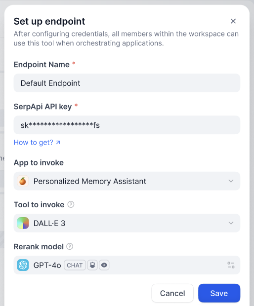
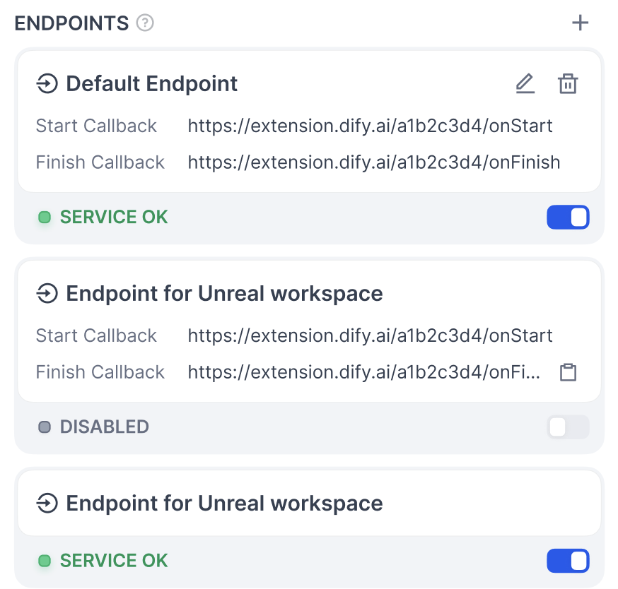

# Endpoint 插件

> 以 Neko Cat 项目为例，定义、配置并实现 Dify 插件中的 HTTP Endpoint

> 本文档由 AI 自动翻译。如有任何不准确之处，请参考 [英文原版](https://docs.dify.ai/en/develop-plugin/dev-guides-and-walkthroughs/endpoint.md)。

Endpoint 是插件对外暴露的 HTTP 接口，用于与外部系统集成。本文以 [Neko Cat](https://github.com/langgenius/dify-plugin-sdks/tree/739b16ebd300e0b0c5e8c977f70d9c43094b1af7/python/examples/neko) 项目为例，讲解其结构。

> [!NOTE]
>
> 该示例已从 SDK 仓库移除，链接指向最后包含它的版本。持续维护的插件示例参考 [官方插件示例](https://github.com/langgenius/dify-official-plugins)。

## 分组定义

Endpoint 分组是多个 Endpoint 的集合。在 Dify 插件中创建新的 Endpoint 时，可能需要填写以下配置。



除了 **Endpoint Name** 之外，可通过编写分组的配置来添加表单项。保存后，即可看到该分组包含的多个接口，它们共用同一份配置。



### 结构

* **`settings`** (map\[string] [ProviderConfig](../../%E7%89%B9%E6%80%A7%E4%B8%8E%E8%A7%84%E8%8C%83/%E6%8F%92%E4%BB%B6%E7%B1%BB%E5%9E%8B/%E9%80%9A%E7%94%A8%E8%A7%84%E8%8C%83.md#providerconfig))：Endpoint 配置定义。
* **`endpoints`** (list\[string]，必填)：指向具体的 `endpoint` 接口定义。

```yaml theme={null}
settings:
  api_key:
    type: secret-input
    required: true
    label:
      en_US: API key
      zh_Hans: API key
      ja_Jp: API key
      pt_BR: API key
    placeholder:
      en_US: Please input your API key
      zh_Hans: 请输入你的 API key
      ja_Jp: あなたの API key を入れてください
      pt_BR: Por favor, insira sua chave API
endpoints:
  - endpoints/duck.yaml
  - endpoints/neko.yaml
```

## 接口定义

* **`path`** (string)：遵循 Werkzeug 接口标准。
* **`method`** (string)：接口方法，仅支持 `HEAD`、`GET`、`POST`、`PUT`、`DELETE` 和 `OPTIONS`。
* **`extra`** (object)：基本详情之外的配置信息。
  * **`python`** (object)
    * **`source`** (string)：实现此接口的源代码。

```yaml theme={null}
path: "/duck/<app_id>"
method: "GET"
extra:
  python:
    source: "endpoints/duck.py"
```

## 接口实现

实现一个继承自 `dify_plugin.Endpoint` 的子类，并实现其 `_invoke` 方法。

* **输入参数**
  * **`r`** (Request)：来自 `werkzeug` 的 `Request` 对象。
  * **`values`** (Mapping)：从路径解析出的路径参数。
  * **`settings`** (Mapping)：此 Endpoint 的配置信息。
* **返回**
  * 来自 `werkzeug` 的 `Response` 对象，支持流式响应。
  * 不支持直接返回字符串。

示例代码：

```python theme={null}
import json
from typing import Mapping
from werkzeug import Request, Response
from dify_plugin import Endpoint

class Duck(Endpoint):
    def _invoke(self, r: Request, values: Mapping, settings: Mapping) -> Response:
        """
        Invokes the endpoint with the given request.
        """
        app_id = values["app_id"]

        def generator():
            yield f"{app_id} <br>"

        return Response(generator(), status=200, content_type="text/html")
```

## 注意事项

* Endpoint 仅在插件被调用时实例化，并非长期运行的服务。
* 开发 Endpoint 时注意安全性，避免执行危险操作。
* Endpoint 可用于处理 Webhook 回调，或为其他系统提供对接接口。

如果你刚接触插件开发，可先阅读 [插件开发入门](%E5%B7%A5%E5%85%B7%E6%8F%92%E4%BB%B6.md) 和 [开发者速查表](../%E9%80%9F%E6%9F%A5%E8%A1%A8.md)。

## 相关资源

* [插件开发基本概念](../../%E5%BF%AB%E9%80%9F%E5%BC%80%E5%A7%8B/Dify%20%E6%8F%92%E4%BB%B6.md)：插件开发的整体架构。
* [Neko Cat 示例](Endpoint%20%E6%8F%92%E4%BB%B6.md)：扩展插件开发示例。
* [通用规范定义](../../%E7%89%B9%E6%80%A7%E4%B8%8E%E8%A7%84%E8%8C%83/%E6%8F%92%E4%BB%B6%E7%B1%BB%E5%9E%8B/%E9%80%9A%E7%94%A8%E8%A7%84%E8%8C%83.md)：ProviderConfig 等通用结构。
* [开发 Slack Bot 插件示例](../%E5%AE%8C%E6%95%B4%E7%A4%BA%E4%BE%8B/Slack%20Bot.md)：另一个插件开发示例。
* [插件开发入门](%E5%B7%A5%E5%85%B7%E6%8F%92%E4%BB%B6.md)：从零开始开发插件。
* [反向调用 Dify 服务](../../%E7%89%B9%E6%80%A7%E4%B8%8E%E8%A7%84%E8%8C%83/%E9%AB%98%E7%BA%A7%E5%BC%80%E5%8F%91/%E5%8F%8D%E5%90%91%E8%B0%83%E7%94%A8/%E5%BA%94%E7%94%A8.md)：使用反向调用功能。
