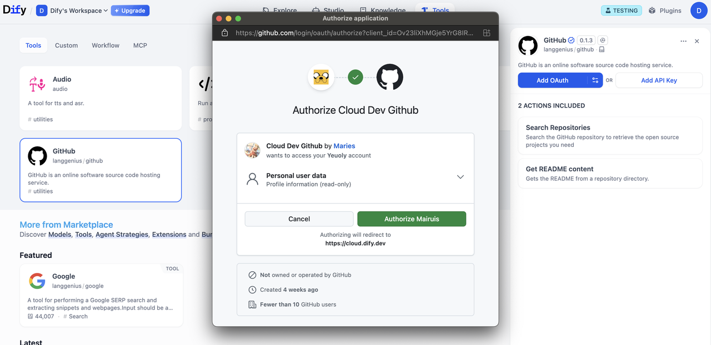
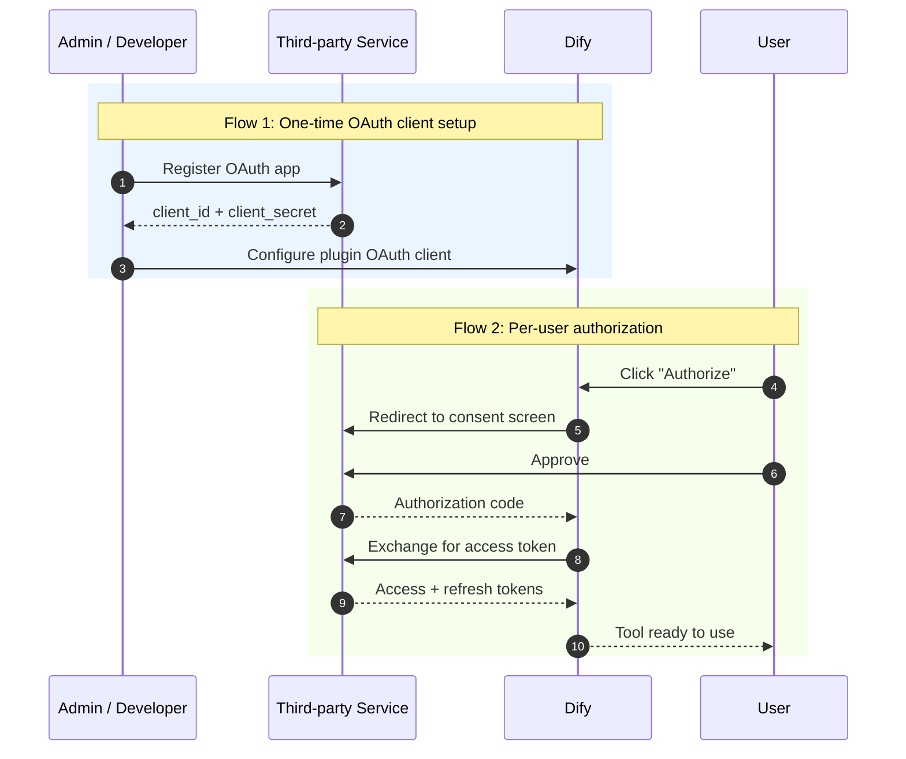
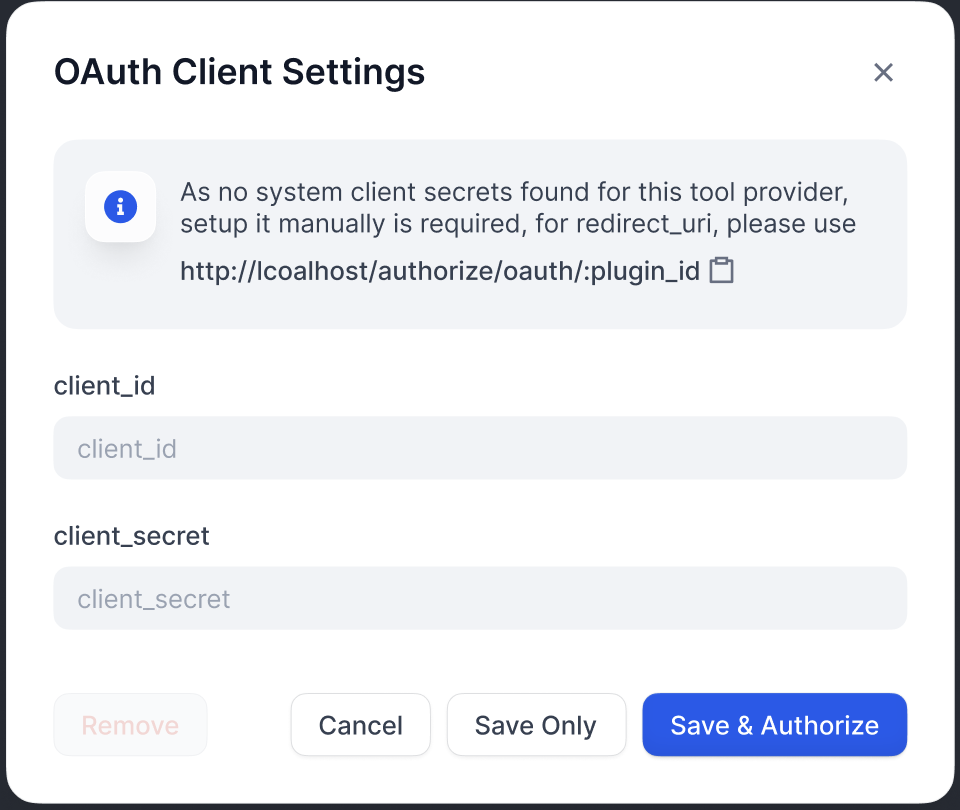
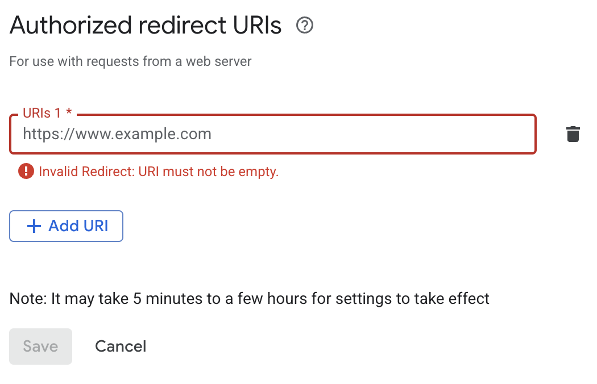
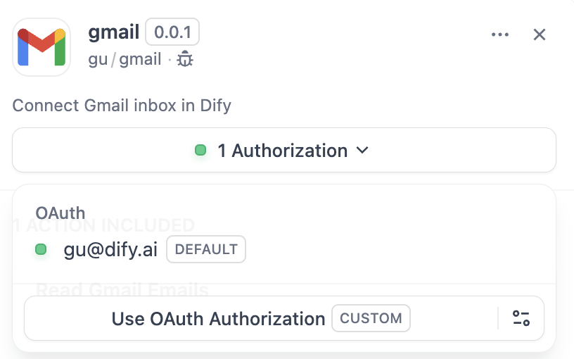

# Tool OAuth

> 用 OAuth 授权流程替代手动输入 API 密钥，让用户一键授权访问第三方服务

> 本文档由 AI 自动翻译。如有任何不准确之处，请参考 [英文原版](https://docs.dify.ai/en/develop-plugin/dev-guides-and-walkthroughs/tool-oauth.md)。



本指南将教你如何为工具插件构建 [OAuth](https://oauth.net/2/) 支持。

OAuth 是为需要访问第三方服务（如 Gmail 或 GitHub）用户数据的工具插件提供授权的更好方式。OAuth 允许工具在用户明确同意的情况下代表用户执行操作，而无需用户手动输入 API 密钥。

## 背景

Dify 中的 OAuth 涉及**两个独立的流程**，开发者需要理解并为其进行设计。



### 流程 1：OAuth 客户端设置（管理员/开发者流程）

> [!NOTE]
>
> 在 Dify Cloud 上，Dify 团队会为热门工具插件创建 OAuth 应用并设置 OAuth 客户端，省去用户自行配置的麻烦。
>
> 自部署 Dify 实例的管理员必须完成此设置流程。

Dify 实例的管理员或开发者首先在第三方服务上将 OAuth 应用注册为受信任的应用，由此获取将 Dify 工具提供者配置为 OAuth 客户端所需的凭证。

以下是为 Dify 的 Gmail 工具提供者设置 OAuth 客户端的步骤示例：

> [accordion] 创建 Google Cloud 项目
>
> 1. 前往 [Google Cloud Console](https://console.cloud.google.com) 创建新项目，或选择现有项目。
> 2. 启用所需的 API（例如 Gmail API）。

> [accordion] 配置 OAuth 同意屏幕
>
> 1. 导航至 **APIs & Services** > **OAuth consent screen**。
> 2. 为公共插件选择 **External** 用户类型。
> 3. 填写应用名称、用户支持邮箱和开发者联系方式。
> 4. 如需要，添加授权域名。
> 5. 测试阶段：在 **Test users** 部分添加测试用户。

> [accordion] 创建 OAuth 2.0 凭证
>
> 1. 前往 **APIs & Services** > **Credentials**。
> 2. 点击 **Create Credentials** > **OAuth 2.0 Client IDs**。
> 3. 选择 **Web application** 类型。
> 4. 将生成 `client_id` 和 `client_secret`。保存这些凭证。

> [accordion] 在 Dify 中输入凭证
>
> 在 OAuth 客户端配置弹窗中输入 `client_id` 和 `client_secret`，以将工具提供者设置为客户端。
>
> 

> [accordion] 授权重定向 URI
>
> 在 Google OAuth 客户端页面上注册 Dify 生成的重定向 URI：
>
> 
>
> > [!NOTE]
> >
> > Dify 在 OAuth 客户端配置弹窗中显示 `redirect_uri`。它通常遵循以下格式：
> >
> > ```bash theme={null}
> > https://{your-dify-domain}/console/api/oauth/plugin/{plugin-id}/{provider-name}/{tool-name}/callback
> > ```
> >
> > 对于自部署 Dify，`your-dify-domain` 应与 `CONSOLE_WEB_URL` 保持一致。

> [!TIP]
>
> 每个服务都有独特的要求，因此请务必查阅你所集成服务的具体 OAuth 文档。

### 流程 2：用户授权（Dify 用户流程）

配置 OAuth 客户端后，Dify 用户可以授权你的插件访问他们的个人账户。



## 实现

### 1. 在提供者清单中定义 OAuth Schema

提供者清单中的 `oauth_schema` 部分告诉 Dify，插件的 OAuth 设置需要哪些凭证，以及 OAuth 流程会产生什么。设置 OAuth 需要两个 schema：

#### client\_schema

定义 OAuth 客户端设置的输入：

```yaml gmail.yaml theme={null}
oauth_schema:
  client_schema:
    - name: "client_id"
      type: "secret-input"
      required: true
      url: "https://developers.google.com/identity/protocols/oauth2"
    - name: "client_secret"
      type: "secret-input"
      required: true
```

> [!NOTE]
>
> `url` 字段链接到第三方服务的帮助文档，为管理员和开发者在设置过程中提供参考。

#### credentials\_schema

指定用户授权流程产生的内容（Dify 自动管理这些）：

```yaml theme={null}
# also under oauth_schema
  credentials_schema:
    - name: "access_token"
      type: "secret-input"
    - name: "refresh_token"
      type: "secret-input"
    - name: "expires_at"
      type: "secret-input"
```

> [!NOTE]
>
> 同时包含 `oauth_schema` 和 `credentials_for_provider`，可同时提供 OAuth 和 API 密钥两种认证选项。

### 2. 在工具提供者中完成必需的 OAuth 方法

在实现 `ToolProvider` 的位置添加以下导入：

```python theme={null}
from dify_plugin.entities.oauth import ToolOAuthCredentials
from dify_plugin.errors.tool import ToolProviderCredentialValidationError, ToolProviderOAuthError
```

你的 `ToolProvider` 类必须实现以下三个 OAuth 方法（以 `GmailProvider` 为例）：

> [!WARNING]
>
> 切勿在 `ToolOAuthCredentials` 的凭证中返回 `client_secret`，否则可能导致安全问题。

```python _oauth_get_authorization_url expandable theme={null}
def _oauth_get_authorization_url(self, redirect_uri: str, system_credentials: Mapping[str, Any]) -> str:
	"""
	Generate the authorization URL using credentials from OAuth Client Setup Flow.
    This URL is where users grant permissions.
    """
    # Generate random state for CSRF protection (recommended for all OAuth flows)
    state = secrets.token_urlsafe(16)

    # Define Gmail-specific scopes - request minimal necessary permissions
    scope = "read:user read:data"  # Replace with your required scopes

    # Assemble Gmail-specific payload
    params = {
        "client_id": system_credentials["client_id"],    # From OAuth Client Setup
        "redirect_uri": redirect_uri,                    # Dify generates this - DON'T modify
        "scope": scope,
        "response_type": "code",                         # Standard OAuth authorization code flow
        "access_type": "offline",                        # Critical: gets refresh token (if supported)
        "prompt": "consent",                             # Forces reauth when scopes change (if supported)
        "state": state,                                  # CSRF protection
    }

    return f"{self._AUTH_URL}?{urllib.parse.urlencode(params)}"
```

```python _oauth_get_credentials expandable theme={null}
def _oauth_get_credentials(
    self, redirect_uri: str, system_credentials: Mapping[str, Any], request: Request
) -> ToolOAuthCredentials:
    """
    Exchange authorization code for access token and refresh token. This is called
	to create ONE credential set for one account connection.
    """
    # Extract authorization code from OAuth callback
    code = request.args.get("code")
    if not code:
        raise ToolProviderOAuthError("Authorization code not provided")

    # Check for authorization errors from OAuth provider
    error = request.args.get("error")
    if error:
        error_description = request.args.get("error_description", "")
        raise ToolProviderOAuthError(f"OAuth authorization failed: {error} - {error_description}")

    # Exchange authorization code for tokens using OAuth Client Setup credentials

	# Assemble Gmail-specific payload
    data = {
        "client_id": system_credentials["client_id"],        # From OAuth Client Setup
        "client_secret": system_credentials["client_secret"], # From OAuth Client Setup
        "code": code,                                        # From user's authorization
        "grant_type": "authorization_code",                  # Standard OAuth flow type
        "redirect_uri": redirect_uri,                        # Must exactly match authorization URL
    }

    headers = {"Content-Type": "application/x-www-form-urlencoded"}

    try:
        response = requests.post(
            self._TOKEN_URL,
            data=data,
            headers=headers,
            timeout=10
        )
        response.raise_for_status()

        token_data = response.json()

        # Handle OAuth provider errors in response
        if "error" in token_data:
            error_desc = token_data.get('error_description', token_data['error'])
            raise ToolProviderOAuthError(f"Token exchange failed: {error_desc}")

        access_token = token_data.get("access_token")
        if not access_token:
            raise ToolProviderOAuthError("No access token received from provider")

        # Build credentials dict matching your credentials_schema
        credentials = {
            "access_token": access_token,
            "token_type": token_data.get("token_type", "Bearer"),
        }

        # Include refresh token if provided (critical for long-term access)
        refresh_token = token_data.get("refresh_token")
        if refresh_token:
            credentials["refresh_token"] = refresh_token

        # Handle token expiration - some providers don't provide expires_in
        expires_in = token_data.get("expires_in", 3600)  # Default to 1 hour
        expires_at = int(time.time()) + expires_in

        return ToolOAuthCredentials(credentials=credentials, expires_at=expires_at)

    except requests.RequestException as e:
        raise ToolProviderOAuthError(f"Network error during token exchange: {str(e)}")
    except Exception as e:
        raise ToolProviderOAuthError(f"Failed to exchange authorization code: {str(e)}")
```

```python _oauth_refresh_credentials theme={null}
def _oauth_refresh_credentials(
    self, redirect_uri: str, system_credentials: Mapping[str, Any], credentials: Mapping[str, Any]
) -> ToolOAuthCredentials:
    """
    Refresh the credentials using the refresh token.
	Dify calls this automatically when tokens expire.
    """
    refresh_token = credentials.get("refresh_token")
    if not refresh_token:
        raise ToolProviderOAuthError("No refresh token available")

    # Standard OAuth refresh token flow
    data = {
        "client_id": system_credentials["client_id"],       # From OAuth Client Setup
        "client_secret": system_credentials["client_secret"], # From OAuth Client Setup
        "refresh_token": refresh_token,                     # From previous authorization
        "grant_type": "refresh_token",                      # OAuth refresh flow
    }

    headers = {"Content-Type": "application/x-www-form-urlencoded"}

    try:
        response = requests.post(
            self._TOKEN_URL,
            data=data,
            headers=headers,
            timeout=10
        )
        response.raise_for_status()

        token_data = response.json()

        # Handle refresh errors
        if "error" in token_data:
            error_desc = token_data.get('error_description', token_data['error'])
            raise ToolProviderOAuthError(f"Token refresh failed: {error_desc}")

        access_token = token_data.get("access_token")
        if not access_token:
            raise ToolProviderOAuthError("No access token received from provider")

        # Build new credentials, preserving existing refresh token
        new_credentials = {
            "access_token": access_token,
            "token_type": token_data.get("token_type", "Bearer"),
            "refresh_token": refresh_token,  # Keep existing refresh token
        }

        # Handle token expiration
        expires_in = token_data.get("expires_in", 3600)

        # update refresh token if new one provided
        new_refresh_token = token_data.get("refresh_token")
        if new_refresh_token:
            new_credentials["refresh_token"] = new_refresh_token

        # Calculate new expiration timestamp for Dify's token management
        expires_at = int(time.time()) + expires_in

        return ToolOAuthCredentials(credentials=new_credentials, expires_at=expires_at)

    except requests.RequestException as e:
        raise ToolProviderOAuthError(f"Network error during token refresh: {str(e)}")
    except Exception as e:
        raise ToolProviderOAuthError(f"Failed to refresh credentials: {str(e)}")
```

### 3. 在工具中访问令牌

在 `Tool` 实现中使用 OAuth 凭证发起经过身份验证的 API 调用：

```python theme={null}
class YourTool(BuiltinTool):
    def _invoke(self, user_id: str, tool_parameters: dict[str, Any]) -> ToolInvokeMessage:
        if self.runtime.credential_type == CredentialType.OAUTH:
            access_token = self.runtime.credentials["access_token"]

        response = requests.get("https://api.service.com/data",
                              headers={"Authorization": f"Bearer {access_token}"})
        return self.create_text_message(response.text)
```

`self.runtime.credentials` 自动提供当前用户的令牌。Dify 自动处理刷新。

对于同时支持 OAuth 和 `API_KEY` 认证的插件，可使用 `self.runtime.credential_type` 来区分这两种认证类型。

### 4. 指定正确的版本

OAuth 需要较新版本的 SDK 和 Dify。在 `requirements.txt` 中固定插件 SDK 版本：

```text theme={null}
dify_plugin>=0.5.0
```

在 `manifest.yaml` 中，添加最低 Dify 版本：

```yaml theme={null}
meta:
  version: 0.0.1
  arch:
    - amd64
    - arm64
  runner:
    language: python
    version: "3.12"
    entrypoint: main
  minimum_dify_version: 1.7.1
```
