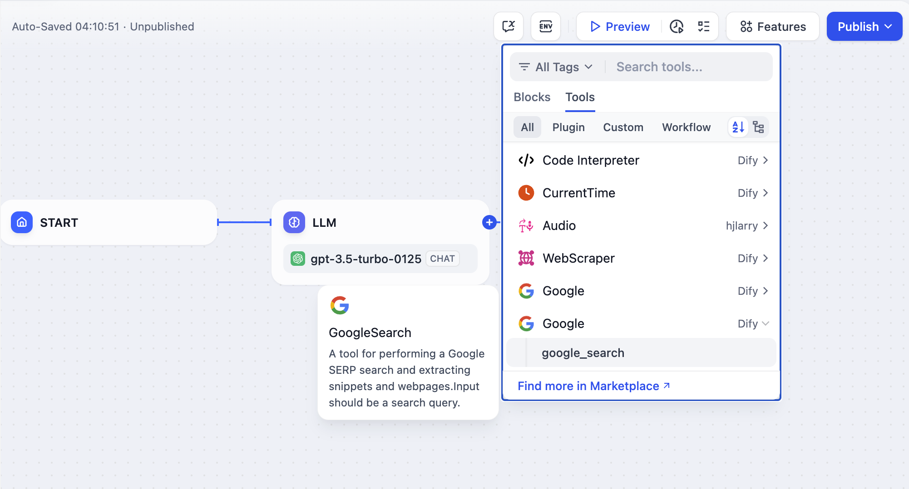
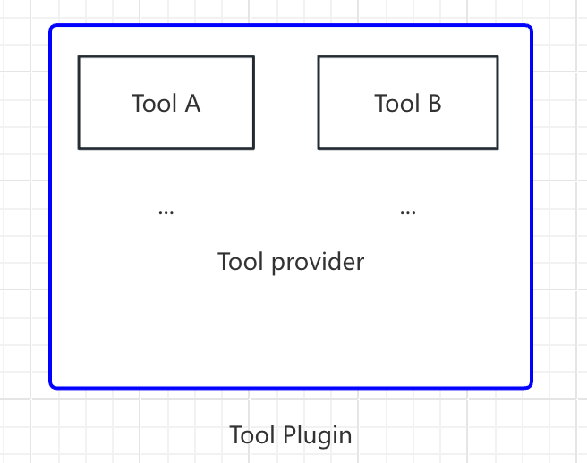
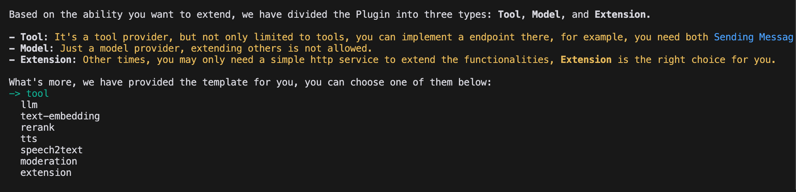
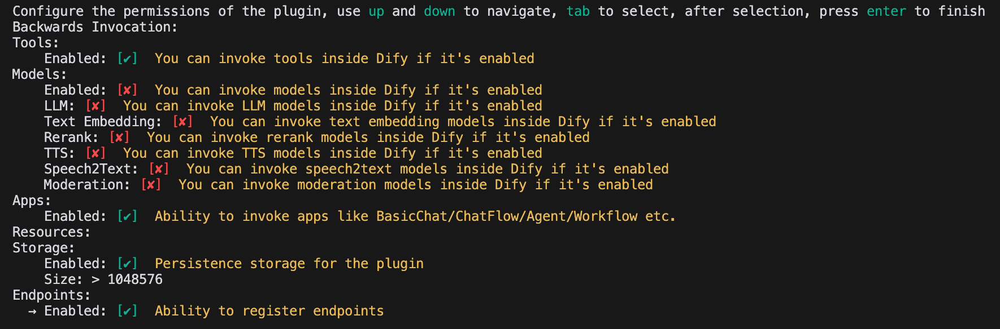
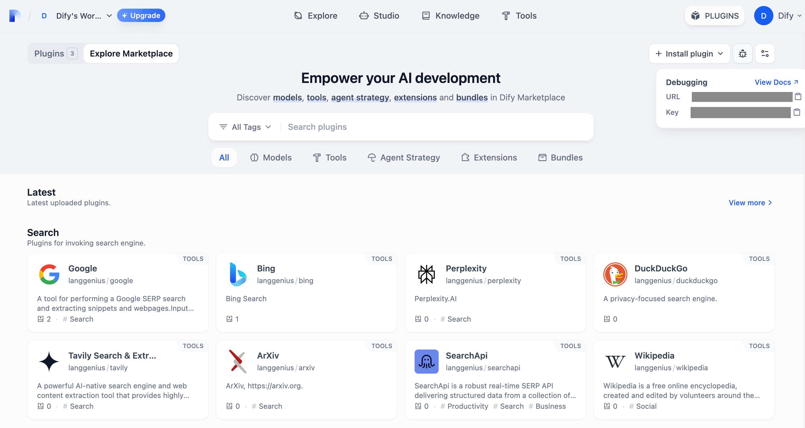
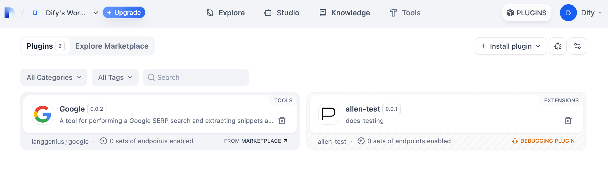

# 工具插件

> 从初始化到打包，以 Google Search 为示例完整开发一个 Dify 工具插件

> 本文档由 AI 自动翻译。如有任何不准确之处，请参考 [英文原版](https://docs.dify.ai/en/develop-plugin/dev-guides-and-walkthroughs/tool-plugin.md)。

工具是 Chatflow、Workflow 和 Agent 应用可以调用的第三方服务，能为 Dify 应用扩展在线搜索、图像生成等能力。



本指南中的 **工具插件** 是一个完整的项目，包含工具提供者文件、功能代码及配套结构。一个工具提供者可以打包多个工具，每个工具提供一项独立的能力：

```text theme={null}
- Tool Provider
    - Tool A
    - Tool B
```



本指南以 Google Search 为例，逐步介绍工具插件的开发过程。

## 前置条件

* Dify 插件脚手架工具
* Python 环境（版本 3.12）

关于如何配置脚手架工具，参见 [初始化开发工具](../../%E5%BF%AB%E9%80%9F%E5%BC%80%E5%A7%8B/Dify%20%E6%8F%92%E4%BB%B6%20CLI.md)。

## 创建新项目

运行脚手架命令行工具来创建一个新的 Dify 插件项目。

```bash theme={null}
./dify-plugin-darwin-arm64 plugin init
```

如果你已将二进制文件重命名为 `dify` 并复制到 `/usr/local/bin` 路径，可以运行以下命令来创建新的插件项目：

```bash theme={null}
dify plugin init
```

> [!NOTE]
>
> 以下示例使用 `dify` 作为命令。如果遇到问题，请将 `dify` 替换为命令行工具的路径。

## 选择插件类型和模板

脚手架工具中的每个模板都是一个完整的代码项目。本示例选择 `Tool` 插件。

> [!TIP]
>
> 如果你已熟悉插件开发且不需要模板，参见 [通用规范](../../%E7%89%B9%E6%80%A7%E4%B8%8E%E8%A7%84%E8%8C%83/%E6%8F%92%E4%BB%B6%E7%B1%BB%E5%9E%8B/%E9%80%9A%E7%94%A8%E8%A7%84%E8%8C%83.md) 指南，构建任意类型的插件。



### 配置插件权限

插件还需要从 Dify 平台读取数据的权限。为本示例插件授予以下权限：

* Tools
* Apps
* 启用持久化存储，并分配默认大小
* 允许注册 Endpoints

> [!TIP]
>
> 在终端中使用方向键选择权限，使用 Tab 键授予权限。

勾选所有权限项后，按 Enter 完成插件创建。系统将自动生成插件项目代码。



## 开发工具插件

### 1. 创建工具提供者文件

工具提供者文件是一个 YAML 文件，作为插件的基础配置，为工具提供所需的授权信息。

在插件模板项目中，进入 `/provider` 目录，将 YAML 文件重命名为 `google.yaml`。该文件描述工具提供者：名称、图标、作者等详细信息，这些信息会在安装插件时显示。

示例代码：

```yaml theme={null}
identity: # Basic information of the tool provider
    author: Your-name # Author
    name: google # Name, unique, cannot have the same name as other providers
    label: # Label, for frontend display
        en_US: Google # English label
        zh_Hans: Google # Chinese label
    description: # Description, for frontend display
        en_US: Google # English description
        zh_Hans: Google # Chinese description
    icon: icon.svg # Tool icon, needs to be placed in the _assets folder
    tags: # Tags, for frontend display
        - search
```

确保文件路径在 `/tools` 目录中，完整路径如下：

```yaml theme={null}
plugins:
    tools:
        - 'google.yaml'
```

`google.yaml` 必须使用其在插件项目中的绝对路径引用；本示例中它位于项目根目录。YAML 文件中的 `identity` 包含工具提供者的基本信息：作者、名称、标签、描述和图标。

* 图标必须是附件资源，放置在项目根目录的 `_assets` 文件夹中。
* 标签帮助用户按分类查找插件。以下是目前支持的所有标签：

```python theme={null}
class ToolLabelEnum(Enum):
  SEARCH = 'search'
  IMAGE = 'image'
  VIDEOS = 'videos'
  WEATHER = 'weather'
  FINANCE = 'finance'
  DESIGN = 'design'
  TRAVEL = 'travel'
  SOCIAL = 'social'
  NEWS = 'news'
  MEDICAL = 'medical'
  PRODUCTIVITY = 'productivity'
  EDUCATION = 'education'
  BUSINESS = 'business'
  ENTERTAINMENT = 'entertainment'
  UTILITIES = 'utilities'
  OTHER = 'other'
```

### 2. 添加第三方服务凭据

为方便开发，本示例使用第三方服务 SerpApi 提供的 Google Search API。SerpApi 需要 API Key，因此在 YAML 文件中添加 `credentials_for_provider` 字段。

完整代码：

```yaml theme={null}
identity:
    author: Dify
    name: google
    label:
        en_US: Google
        zh_Hans: Google
        pt_BR: Google
    description:
        en_US: Google
        zh_Hans: GoogleSearch
        pt_BR: Google
    icon: icon.svg
    tags:
        - search
credentials_for_provider: #Add credentials_for_provider field
    serpapi_api_key:
        type: secret-input
        required: true
        label:
            en_US: SerpApi API key
            zh_Hans: SerpApi API key
        placeholder:
            en_US: Please input your SerpApi API key
            zh_Hans: Please enter your SerpApi API key
        help:
            en_US: Get your SerpApi API key from SerpApi
            zh_Hans: Get your SerpApi API key from SerpApi
        url: https://serpapi.com/manage-api-key
tools:
    - tools/google_search.yaml
extra:
    python:
        source: google.py
```

* `credentials_for_provider` 的子级结构必须满足 [通用规范](../../%E7%89%B9%E6%80%A7%E4%B8%8E%E8%A7%84%E8%8C%83/%E6%8F%92%E4%BB%B6%E7%B1%BB%E5%9E%8B/%E9%80%9A%E7%94%A8%E8%A7%84%E8%8C%83.md) 的要求。
* 指定提供者包含哪些工具。本示例只包含一个文件 `tools/google_search.yaml`。
* 除基本信息外，提供者还需要代码逻辑，因此需指定其实现文件。本示例使用 `google.py`，但暂不实现，先编写 `google_search` 工具代码。

### 3. 填写工具 YAML 文件

一个工具插件可以包含多个工具，每个工具由各自的 YAML 文件描述，涵盖基本信息、参数和输出。

继续以 `GoogleSearch` 工具为例，在 `/tools` 文件夹中创建一个新的 `google_search.yaml` 文件。

```yaml theme={null}
identity:
    name: google_search
    author: Dify
    label:
        en_US: GoogleSearch
        zh_Hans: Google Search
        pt_BR: GoogleSearch
description:
    human:
        en_US: A tool for performing a Google SERP search and extracting snippets and webpages. Input should be a search query.
        zh_Hans: A tool for performing a Google SERP search and extracting snippets and webpages. Input should be a search query.
        pt_BR: A tool for performing a Google SERP search and extracting snippets and webpages. Input should be a search query.
    llm: A tool for performing a Google SERP search and extracting snippets and webpages. Input should be a search query.
parameters:
    - name: query
      type: string
      required: true
      label:
          en_US: Query string
          zh_Hans: Query string
          pt_BR: Query string
      human_description:
          en_US: used for searching
          zh_Hans: used for searching web content
          pt_BR: used for searching
      llm_description: key words for searching
      form: llm
extra:
    python:
        source: tools/google_search.py
```

* **`identity`**：工具的基本信息，包括名称、作者、标签和描述。
* **`parameters`**：参数列表。
  * **`name`**（必填）：参数名称，在工具的参数中必须唯一。

  * **`type`**（必填）：参数类型。取值分为三类：

    * **普通值**：`string`、`number`、`boolean`、`any`。
    * **选项类**：`select` 基于 `options` 生成固定下拉框，`dynamic-select` 的选项由插件在配置时提供，以及 `checkbox`。
    * **选择器与上传**：
      * `secret-input` 用于敏感信息，渲染为加密输入框。
      * `file` 和 `files` 用于上传文件。
      * `app-selector` 和 `model-selector` 用于从工作空间中选择应用或模型。
      * `date` 用于单个日期，渲染为日期选择器，以 `YYYY-MM-DD` 字符串传入。
      * `date-range` 用于起止日期，渲染为日期范围选择器，以包含 `start` 和 `end` 日期字符串的对象传入。

    另有 `array` 和 `object` 两个取值，用于 MCP 服务器工具而非插件声明的参数；`system-files` 已废弃。

  * **`label`**（必填）：参数标签，显示在前端。

  * **`form`**（必填）：表单类型，可选 `llm` 或 `form`。
    * 在 Agent 应用中，`llm` 表示由 LLM 自行推断参数，`form` 表示可在使用工具前预先设置参数。
    * 在 Workflow 应用中，`llm` 和 `form` 参数都通过前端填写，但 `llm` 参数会用作工具节点的输入变量。

  * **`required`**（可选）：参数是否必填。
    * 在 `llm` 模式下，必填参数必须由 Agent 推断。
    * 在 `form` 模式下，必填参数必须在对话开始前于前端填写。

  * **`options`**（可选）：参数选项。
    * 在 `llm` 模式下，Dify 会将所有选项传递给 LLM，由其据此推断。
    * 在 `form` 模式下，当 `type` 为 `select` 时，前端会显示这些选项。

  * **`multiple`**（可选）：用于 `select` 和 `dynamic-select` 参数，设为 `true` 后用户可选择多个选项。参数值以选项值列表传递；此时若设置 `default`，必须为列表。

    ```yaml theme={null}
    - name: formats
      type: select
      multiple: true
      form: form
      label:
        en_US: Formats
      options:
        - label:
            en_US: Markdown
          value: markdown
        - label:
            en_US: Links
          value: links
      default:
        - markdown
    ```

  * **`default`**（可选）：默认值。

  * **`min`**（可选）：最小值，参数类型为 `number` 时适用。

  * **`max`**（可选）：最大值，参数类型为 `number` 时适用。

  * **`human_description`**（可选）：显示在前端的说明，支持多语言。

  * **`placeholder`**（可选）：输入字段的提示文本，当表单类型为 `form` 且参数类型为 `string`、`number` 或 `secret-input` 时适用。支持多语言。

  * **`llm_description`**（可选）：传递给 LLM 的说明。请尽可能详细地描述，以便 LLM 理解该参数。

### 4. 编写工具代码

完成工具配置后，编写实现工具逻辑的代码。在 `/tools` 目录中创建 `google_search.py`，内容如下：

```python theme={null}
from collections.abc import Generator
from typing import Any

import requests

from dify_plugin import Tool
from dify_plugin.entities.tool import ToolInvokeMessage

SERP_API_URL = "https://serpapi.com/search"

class GoogleSearchTool(Tool):
    def _parse_response(self, response: dict) -> dict:
        result = {}
        if "knowledge_graph" in response:
            result["title"] = response["knowledge_graph"].get("title", "")
            result["description"] = response["knowledge_graph"].get("description", "")
        if "organic_results" in response:
            result["organic_results"] = [
                {
                    "title": item.get("title", ""),
                    "link": item.get("link", ""),
                    "snippet": item.get("snippet", ""),
                }
                for item in response["organic_results"]
            ]
        return result

    def _invoke(self, tool_parameters: dict[str, Any]) -> Generator[ToolInvokeMessage]:
        params = {
            "api_key": self.runtime.credentials["serpapi_api_key"],
            "q": tool_parameters["query"],
            "engine": "google",
            "google_domain": "google.com",
            "gl": "us",
            "hl": "en",
        }

        response = requests.get(url=SERP_API_URL, params=params, timeout=5)
        response.raise_for_status()
        valuable_res = self._parse_response(response.json())

        yield self.create_json_message(valuable_res)
```

这段代码向 `serpapi` 发送请求，并使用 `self.create_json_message` 返回格式化的 JSON 数据。如需了解更多返回数据类型，参见 [远程调试插件](../../%E7%89%B9%E6%80%A7%E4%B8%8E%E8%A7%84%E8%8C%83/%E6%8F%92%E4%BB%B6%E7%B1%BB%E5%9E%8B/%E6%8F%92%E4%BB%B6%E8%B0%83%E8%AF%95.md) 和 [持久化存储 KV](../../%E7%89%B9%E6%80%A7%E4%B8%8E%E8%A7%84%E8%8C%83/%E6%8F%92%E4%BB%B6%E7%B1%BB%E5%9E%8B/%E6%8C%81%E4%B9%85%E5%8C%96%E5%AD%98%E5%82%A8.md)。

### 5. 完善工具提供者代码

最后，实现提供者的凭据验证逻辑。如果验证失败，代码会抛出 `ToolProviderCredentialValidationError` 异常；验证成功后，会正确请求 `google_search` 工具服务。

在 `/provider` 目录中创建 `google.py` 文件，内容如下：

```python theme={null}
from typing import Any

from dify_plugin import ToolProvider
from dify_plugin.errors.tool import ToolProviderCredentialValidationError
from tools.google_search import GoogleSearchTool

class GoogleProvider(ToolProvider):
    def _validate_credentials(self, credentials: dict[str, Any]) -> None:
        try:
            for _ in GoogleSearchTool.from_credentials(credentials).invoke(
                tool_parameters={"query": "test", "result_type": "link"},
            ):
                pass
        except Exception as e:
            raise ToolProviderCredentialValidationError(str(e))
```

## 调试插件

开发完成后，测试插件是否正常工作。Dify 提供远程调试，帮助你在测试环境中快速验证插件功能。

前往 [插件管理](https://cloud.dify.ai/plugins) 页面获取远程服务器地址和调试 Key。



返回插件项目，复制 `.env.example` 文件并重命名为 `.env`，然后填入远程服务器地址和调试 Key。

`.env` 文件：

```bash theme={null}
INSTALL_METHOD=remote
REMOTE_INSTALL_URL=debug.dify.ai:5003
REMOTE_INSTALL_KEY=********-****-****-****-************
```

运行 `python -m main` 启动插件。在 **插件** 页面，可以看到插件已安装在工作空间中，团队的其他成员也可以访问该插件。



## 打包插件（可选）

插件正常运行后，使用以下命令打包并命名插件。运行后会在当前文件夹生成一个 `google.difypkg` 文件，即最终的插件包。

```bash theme={null}
# Replace ./google with the actual path of the plugin project

dify plugin package ./google
```

恭喜，你已完成工具插件的开发、调试和打包！

## 发布插件（可选）

如需将插件发布到 Dify Marketplace，应先满足 [Marketplace 准备与验证要求](../../%E5%8F%91%E5%B8%83/%E5%8F%91%E5%B8%83%E6%8F%92%E4%BB%B6%E5%88%B0%20Marketplace.md#准备软件包)。审核通过后，软件包会合并到主分支，并通过 Marketplace 流水线发布。

完整流程参见 [发布概述](../../%E5%8F%91%E5%B8%83/%E5%8F%91%E5%B8%83%E6%8F%92%E4%BB%B6.md)。

## 探索更多

### 快速开始

* [开发扩展插件](Endpoint%20%E6%8F%92%E4%BB%B6.md)
* [开发模型插件](%E6%A8%A1%E5%9E%8B%E4%BE%9B%E5%BA%94%E5%95%86%E6%8F%92%E4%BB%B6.md)
* [Bundle 插件：打包多个插件](../../%E7%89%B9%E6%80%A7%E4%B8%8E%E8%A7%84%E8%8C%83/%E9%AB%98%E7%BA%A7%E5%BC%80%E5%8F%91/%E5%8F%8D%E5%90%91%E8%B0%83%E7%94%A8/Bundle%20%E6%8F%92%E4%BB%B6%E5%8C%85.md)

### 插件接口文档

* [通用规范](../../%E7%89%B9%E6%80%A7%E4%B8%8E%E8%A7%84%E8%8C%83/%E6%8F%92%E4%BB%B6%E7%B1%BB%E5%9E%8B/%E9%80%9A%E7%94%A8%E8%A7%84%E8%8C%83.md)：Manifest 结构和工具规范。
* [Endpoint](Endpoint%20%E6%8F%92%E4%BB%B6.md)：详细的 Endpoint 定义。
* [反向调用](../../%E7%89%B9%E6%80%A7%E4%B8%8E%E8%A7%84%E8%8C%83/%E9%AB%98%E7%BA%A7%E5%BC%80%E5%8F%91/%E5%8F%8D%E5%90%91%E8%B0%83%E7%94%A8/Dify%20%E6%9C%8D%E5%8A%A1%E7%9A%84%E5%8F%8D%E5%90%91%E8%B0%83%E7%94%A8.md)：反向调用 Dify 能力。
* [模型 Schema](../../%E7%89%B9%E6%80%A7%E4%B8%8E%E8%A7%84%E8%8C%83/%E6%8F%92%E4%BB%B6%E7%B1%BB%E5%9E%8B/%E6%A8%A1%E5%9E%8B%20API%20%E6%8E%A5%E5%8F%A3.md)：模型。
* [Agent 插件](../../%E7%89%B9%E6%80%A7%E4%B8%8E%E8%A7%84%E8%8C%83/%E9%AB%98%E7%BA%A7%E5%BC%80%E5%8F%91/%E5%8F%8D%E5%90%91%E8%B0%83%E7%94%A8/Dify%20%E6%9C%8D%E5%8A%A1%E7%9A%84%E5%8F%8D%E5%90%91%E8%B0%83%E7%94%A8.md)：扩展 Agent 策略。

## 下一步

* [远程调试插件](../../%E7%89%B9%E6%80%A7%E4%B8%8E%E8%A7%84%E8%8C%83/%E6%8F%92%E4%BB%B6%E7%B1%BB%E5%9E%8B/%E6%8F%92%E4%BB%B6%E8%B0%83%E8%AF%95.md)：学习更多高级调试技巧。
* [持久化存储](../../%E7%89%B9%E6%80%A7%E4%B8%8E%E8%A7%84%E8%8C%83/%E6%8F%92%E4%BB%B6%E7%B1%BB%E5%9E%8B/%E6%8C%81%E4%B9%85%E5%8C%96%E5%AD%98%E5%82%A8.md)：在插件中使用数据存储。
* [Slack Bot 插件开发示例](../%E5%AE%8C%E6%95%B4%E7%A4%BA%E4%BE%8B/Slack%20Bot.md)：更复杂的插件开发案例。
* [工具插件](../../%E7%89%B9%E6%80%A7%E4%B8%8E%E8%A7%84%E8%8C%83/%E6%8F%92%E4%BB%B6%E7%B1%BB%E5%9E%8B/%E5%B7%A5%E5%85%B7%E8%BF%94%E5%9B%9E.md)：工具插件的高级功能。
