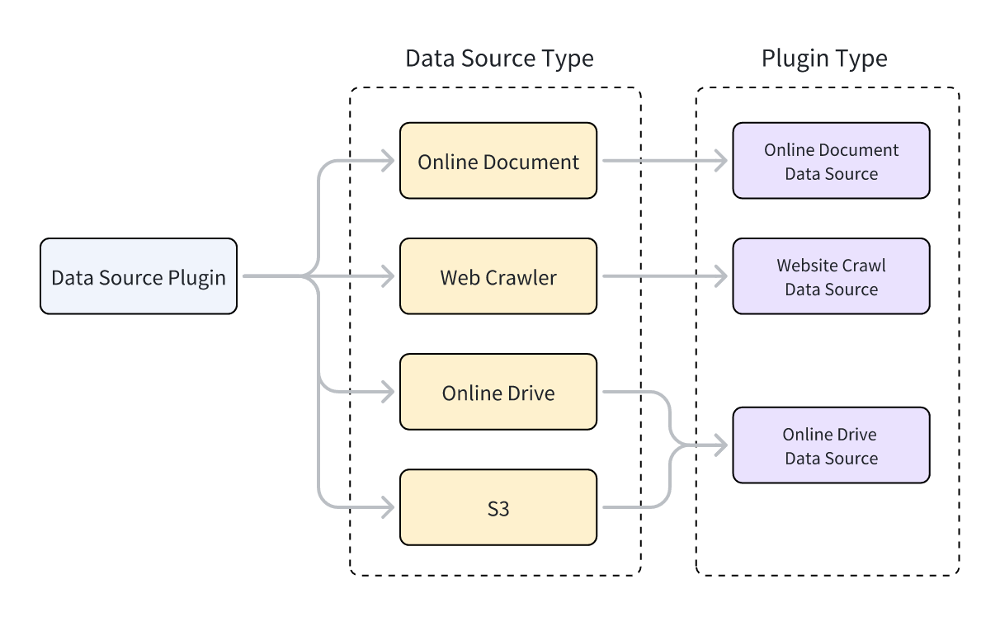
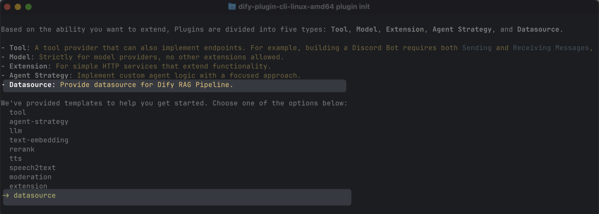

# 数据源插件

> 构建 Dify 1.9.0+ 数据源插件，将文档输入知识库管道

> 本文档由 AI 自动翻译。如有任何不准确之处，请参考 [英文原版](https://docs.dify.ai/en/develop-plugin/dev-guides-and-walkthroughs/datasource-plugin.md)。

数据源插件于 Dify 1.9.0 引入，为知识库管道提供文档，是整个管道的起点。

本指南涵盖构建并发布数据源插件所需的插件架构、代码示例和调试方法。

## 前置条件

你应对知识库管道和插件开发有基本了解：

* [步骤 2：知识库管道编排](../../../../%E4%BD%BF%E7%94%A8/%E7%9F%A5%E8%AF%86%E5%BA%93/%E7%BB%8F%E5%85%B8%E7%9F%A5%E8%AF%86%E5%BA%93/%E6%9E%84%E5%BB%BA%E8%87%AA%E5%AE%9A%E4%B9%89%E7%9F%A5%E8%AF%86%E5%BA%93/%E6%AD%A5%E9%AA%A4%E4%BA%8C%EF%BC%9A%E7%BC%96%E6%8E%92%E7%9F%A5%E8%AF%86%E6%B5%81%E6%B0%B4%E7%BA%BF.md)
* [Dify 插件开发：Hello World 指南](%E5%B7%A5%E5%85%B7%E6%8F%92%E4%BB%B6.md)

## 数据源插件类型

Dify 支持三种类型的数据源插件：网页爬虫、在线文档和在线云盘。每种类型对应不同的父类，实现插件功能的类必须继承自对应的父类。

> [!NOTE]
>
> 要了解如何通过继承父类来实现插件功能，参见 [工具插件：准备工具代码](%E5%B7%A5%E5%85%B7%E6%8F%92%E4%BB%B6.md#4-编写工具代码)。

每种数据源插件类型支持多个数据源。例如：

* **网页爬虫**：Jina Reader、FireCrawl
* **在线文档**：Notion、Confluence、GitHub
* **在线云盘**：OneDrive、Google Drive、Box、AWS S3、腾讯 COS

数据源类型和数据源插件类型之间的关系如下图所示。



## 开发数据源插件

### 创建数据源插件

使用脚手架命令行工具，选择 `datasource` 类型创建数据源插件。完成设置后，该工具会生成插件项目代码。

```bash theme={null}
dify plugin init
```



> [!NOTE]
>
> 通常，数据源插件不需要使用 Dify 平台的其他功能，因此不需要额外的权限。

#### 数据源插件结构

数据源插件由三个主要部分组成：

* `manifest.yaml` 文件：描述插件的基本信息。
* `provider` 目录：包含插件提供者的描述和认证实现代码。
* `datasources` 目录：包含从数据源获取数据的描述和核心逻辑。

```text theme={null}
├── _assets
│   └── icon.svg
├── datasources
│   ├── your_datasource.py
│   └── your_datasource.yaml
├── main.py
├── manifest.yaml
├── PRIVACY.md
├── provider
│   ├── your_datasource.py
│   └── your_datasource.yaml
├── README.md
└── requirements.txt
```

#### 设置正确的版本和标签

* 在 `manifest.yaml` 文件中，设置最低支持的 Dify 版本：

  ```yaml theme={null}
  minimum_dify_version: 1.9.0
  ```

* 在同一文件中，添加以下标签，使插件显示在 Dify Marketplace 的数据源类别下：

  ```yaml theme={null}
  tags:
    - rag
  ```

* 在 `requirements.txt` 文件中，设置插件 SDK 版本：

  ```text theme={null}
  dify-plugin>=0.5.0,<0.6.0
  ```

### 添加数据源提供者

#### 创建提供者 YAML 文件

提供者 YAML 文件的内容与工具插件的基本相同，只有以下两点不同：

```yaml theme={null}
# 指定数据源插件的提供者类型：online_drive、online_document 或 website_crawl
provider_type: online_drive # online_document, website_crawl

# 指定数据源
datasources:
  - datasources/PluginName.yaml
```

> [!NOTE]
>
> 有关创建提供者 YAML 文件的更多信息，参见 [工具插件：完善第三方服务凭据](%E5%B7%A5%E5%85%B7%E6%8F%92%E4%BB%B6.md#2-添加第三方服务凭据)。

> [!NOTE]
>
> 数据源插件支持通过 OAuth 2.0 或 API Key 进行认证。
>
> 要配置 OAuth，参见 [为工具插件添加 OAuth 支持](Tool%20OAuth.md)。

#### 创建提供者代码文件

* 使用 API Key 认证时，提供者代码文件与工具插件相同，只需将提供者类的父类改为 `DatasourceProvider`。

  ```python theme={null}
  class YourDatasourceProvider(DatasourceProvider):

      def _validate_credentials(self, credentials: Mapping[str, Any]) -> None:
          try:
              """
              IMPLEMENT YOUR VALIDATION HERE
              """
          except Exception as e:
              raise ToolProviderCredentialValidationError(str(e))
  ```
* 使用 OAuth 认证时，数据源插件与工具插件略有不同：通过 OAuth 获取访问权限时，还可返回用于在前端显示的用户名和头像。因此，`_oauth_get_credentials` 和 `_oauth_refresh_credentials` 必须返回包含 `name`、`avatar_url`、`expires_at` 和 `credentials` 的 `DatasourceOAuthCredentials` 对象。

  `DatasourceOAuthCredentials` 类定义如下：

  ```python theme={null}
  class DatasourceOAuthCredentials(BaseModel):
      name: str | None = Field(None, description="The name of the OAuth credential")
      avatar_url: str | None = Field(None, description="The avatar url of the OAuth")
      credentials: Mapping[str, Any] = Field(..., description="The credentials of the OAuth")
      expires_at: int | None = Field(
          default=-1,
          description="""The expiration timestamp (in seconds since Unix epoch, UTC) of the credentials.
          Set to -1 or None if the credentials do not expire.""",
      )
  ```

`_oauth_get_authorization_url`、`_oauth_get_credentials` 和 `_oauth_refresh_credentials` 的函数签名如下：

> [tab] \_oauth\_get\_authorization\_url
>
> ```python theme={null}
> def _oauth_get_authorization_url(self, redirect_uri: str, system_credentials: Mapping[str, Any]) -> str:
> """
> Generate the authorization URL for {{ .PluginName }} OAuth.
> """
> try:
>     """
>     IMPLEMENT YOUR AUTHORIZATION URL GENERATION HERE
>     """
> except Exception as e:
>     raise DatasourceOAuthError(str(e))
> return ""
> ```

> [tab] \_oauth\_get\_credentials
>
> ```python theme={null}
> def _oauth_get_credentials(
> self, redirect_uri: str, system_credentials: Mapping[str, Any], request: Request
> ) -> DatasourceOAuthCredentials:
> """
> Exchange code for access_token.
> """
> try:
>     """
>     IMPLEMENT YOUR CREDENTIALS EXCHANGE HERE
>     """
> except Exception as e:
>     raise DatasourceOAuthError(str(e))
> return DatasourceOAuthCredentials(
>     name="",
>     avatar_url="",
>     expires_at=-1,
>     credentials={},
> )
> ```

> [tab] \_oauth\_refresh\_credentials
>
> ```python theme={null}
> def _oauth_refresh_credentials(
> self, redirect_uri: str, system_credentials: Mapping[str, Any], credentials: Mapping[str, Any]
> ) -> DatasourceOAuthCredentials:
> """
> Refresh the credentials
> """
> return DatasourceOAuthCredentials(
>     name="",
>     avatar_url="",
>     expires_at=-1,
>     credentials={},
> )
> ```

### 添加数据源

三种数据源类型的 YAML 文件格式和数据源代码格式各不相同。

#### 网页爬虫

在网页爬虫数据源插件的提供者 YAML 文件中，`output_schema` 必须始终返回四个参数：`source_url`、`content`、`title` 和 `description`。

```yaml theme={null}
output_schema:
    type: object
    properties:
      source_url:
        type: string
        description: the source url of the website
      content:
        type: string
        description: the content from the website
      title:
        type: string
        description: the title of the website
      "description":
        type: string
        description: the description of the website
```

在网页爬虫插件的主要逻辑代码中，类必须继承自 `WebsiteCrawlDatasource` 并实现 `_get_website_crawl` 方法，通过 `create_crawl_message` 方法返回爬取结果。

要爬取多个网页并分批返回，将 `WebSiteInfo.status` 设置为 `processing`，并对每批爬取的页面调用 `create_crawl_message`。所有页面爬取完成后，将 `WebSiteInfo.status` 设置为 `completed`。

```python theme={null}
class YourDataSource(WebsiteCrawlDatasource):

    def _get_website_crawl(
        self, datasource_parameters: dict[str, Any]
    ) -> Generator[ToolInvokeMessage, None, None]:

        crawl_res = WebSiteInfo(web_info_list=[], status="", total=0, completed=0)
        crawl_res.status = "processing"
        yield self.create_crawl_message(crawl_res)

        ### your crawl logic
           ...
        crawl_res.status = "completed"
        crawl_res.web_info_list = [
            WebSiteInfoDetail(
                title="",
                source_url="",
                description="",
                content="",
            )
        ]
        crawl_res.total = 1
        crawl_res.completed = 1

        yield self.create_crawl_message(crawl_res)
```

#### 在线文档

在线文档数据源插件的返回值必须至少包含一个 `content` 字段来表示文档内容。例如：

```yaml theme={null}
output_schema:
    type: object
    properties:
      workspace_id:
        type: string
        description: workspace id
      page_id:
        type: string
        description: page id
      content:
        type: string
        description: page content
```

在在线文档插件的主要逻辑代码中，类必须继承自 `OnlineDocumentDatasource` 并实现两个方法：`_get_pages` 和 `_get_content`。

当用户运行插件时，它首先调用 `_get_pages` 方法获取文档列表。用户从列表中选择文档后，它再调用 `_get_content` 方法获取文档内容。

> [tab] \_get\_pages
>
> ```python theme={null}
> def _get_pages(self, datasource_parameters: dict[str, Any]) -> DatasourceGetPagesResponse:
>     # your get pages logic
>     response = requests.get(url, headers=headers, params=params, timeout=30)
>     pages = []
>     for item in  response.json().get("results", []):
>         page = OnlineDocumentPage(
>             page_name=item.get("title", ""),
>             page_id=item.get("id", ""),
>             type="page",
>             last_edited_time=item.get("version", {}).get("createdAt", ""),
>             parent_id=item.get("parentId", ""),
>             page_icon=None,
>         )
>         pages.append(page)
>     online_document_info = OnlineDocumentInfo(
>         workspace_name=workspace_name,
>         workspace_icon=workspace_icon,
>         workspace_id=workspace_id,
>         pages=[page],
>         total=pages.length(),
>     )
>     return DatasourceGetPagesResponse(result=[online_document_info])
> ```

> [tab] \_get\_content
>
> ```python theme={null}
> def _get_content(self, page: GetOnlineDocumentPageContentRequest) -> Generator[DatasourceMessage, None, None]:
> # your fetch content logic, example
> response = requests.get(url, headers=headers, params=params, timeout=30)
> ...
> yield self.create_variable_message("content", "")
> yield self.create_variable_message("page_id", "")
> yield self.create_variable_message("workspace_id", "")
> ```

#### 在线云盘

在线云盘数据源插件返回文件，因此必须遵循以下规范：

```yaml theme={null}
output_schema:
    type: object
    properties:
      file:
        $ref: "https://dify.ai/schemas/v1/file.json"
```

在在线云盘插件的主要逻辑代码中，类必须继承自 `OnlineDriveDatasource` 并实现两个方法：`_browse_files` 和 `_download_file`。

当用户运行插件时，它首先调用 `_browse_files` 获取文件列表。此时，`prefix` 为空，表示请求根目录的文件列表。该列表同时包含文件夹和文件条目。如果用户打开文件夹，会再次调用 `_browse_files`，此时 `OnlineDriveBrowseFilesRequest` 中的 `prefix` 即为用于检索该文件夹内文件列表的文件夹 ID。

用户选择文件后，插件使用 `_download_file` 方法和文件 ID 获取文件内容。你可以使用 `_get_mime_type_from_filename` 方法获取文件的 MIME 类型，使管道能够适当处理不同的文件类型。

当文件列表包含多个文件时，可将 `OnlineDriveFileBucket.is_truncated` 设置为 `True`，并将 `OnlineDriveFileBucket.next_page_parameters` 设置为获取下一页所需的参数，例如下一页的请求 ID 或 URL，具体取决于服务提供商。

> [tab] \_browse\_files
>
> ```python theme={null}
> def _browse_files(
> self, request: OnlineDriveBrowseFilesRequest
> ) -> OnlineDriveBrowseFilesResponse:
>
> credentials = self.runtime.credentials
> bucket_name = request.bucket
> prefix = request.prefix or ""  # Allow empty prefix for root folder; When you browse the folder, the prefix is the folder id
> max_keys = request.max_keys or 10
> next_page_parameters = request.next_page_parameters or {}
>
> files = []
> files.append(OnlineDriveFile(
>     id="",
>     name="",
>     size=0,
>     type="folder" # or "file"
> ))
>
> return OnlineDriveBrowseFilesResponse(result=[
>     OnlineDriveFileBucket(
>         bucket="",
>         files=files,
>         is_truncated=False,
>         next_page_parameters={}
>     )
> ])
> ```

> [tab] \_download\_file
>
> ```python theme={null}
> def _download_file(self, request: OnlineDriveDownloadFileRequest) -> Generator[DatasourceMessage, None, None]:
> credentials = self.runtime.credentials
> file_id = request.id
>
> file_content = bytes()
> file_name = ""
>
> mime_type = self._get_mime_type_from_filename(file_name)
>
> yield self.create_blob_message(file_content, meta={
>     "file_name": file_name,
>     "mime_type": mime_type
> })
>
> def _get_mime_type_from_filename(self, filename: str) -> str:
> """Determine MIME type from file extension."""
> import mimetypes
> mime_type, _ = mimetypes.guess_type(filename)
> return mime_type or "application/octet-stream"
> ```

对于 AWS S3 等存储服务，`prefix`、`bucket` 和 `id` 变量有特殊用途，可以在开发过程中根据需要灵活应用：

* `prefix`：表示文件路径前缀。例如，`prefix=container1/folder1/` 从 `container1` 存储桶的 `folder1` 文件夹中检索文件或文件列表。
* `bucket`：表示文件存储桶。例如，`bucket=container1` 检索 `container1` 存储桶中的文件或文件列表。对于非标准 S3 协议的云盘，此字段可以留空。
* `id`：由于 `_download_file` 方法不使用 `prefix` 变量，因此完整文件路径必须包含在 `id` 中。例如，`id=container1/folder1/file1.txt` 表示从 `container1` 存储桶的 `folder1` 文件夹中检索 `file1.txt` 文件。

> [!TIP]
>
> 参考实现参见 [官方 Google Drive 插件](https://github.com/langgenius/dify-official-plugins/blob/main/datasources/google_cloud_storage/datasources/google_cloud_storage.py) 和 [官方 AWS S3 插件](https://github.com/langgenius/dify-official-plugins/blob/main/datasources/aws_s3_storage/datasources/aws_s3_storage.py)。

## 调试插件

数据源插件支持两种调试方法：远程调试和将插件安装到本地。请注意以下事项：

* 如果插件使用 OAuth 认证，远程调试的 `redirect_uri` 与本地插件不同。请在服务提供商的 OAuth App 中相应更新相关配置。
* 虽然数据源插件支持单步调试，但我们仍建议在完整的知识库管道中测试它们，以确保完整功能。

## 最终检查

在打包和发布之前，请确保你已完成以下所有事项：

* 将最低支持的 Dify 版本设置为 `1.9.0`。
* 将 SDK 版本设置为 `dify-plugin>=0.5.0,<0.6.0`。
* 编写 `README.md` 和 `PRIVACY.md` 文件。
* 代码文件中仅包含英文内容。
* 将默认图标替换为数据源提供商的 logo。

## 打包和发布

在插件目录中，运行以下命令生成 `.difypkg` 插件包：

```bash theme={null}
dify plugin package . -o your_datasource.difypkg
```

接下来，你可以：

* 在你的 Dify 环境中导入和使用插件。
* 通过提交 pull request 将插件发布到 Dify Marketplace。

> [!NOTE]
>
> 有关插件发布流程，参见 [发布插件](../../%E5%8F%91%E5%B8%83/%E5%8F%91%E5%B8%83%E6%8F%92%E4%BB%B6.md)。
