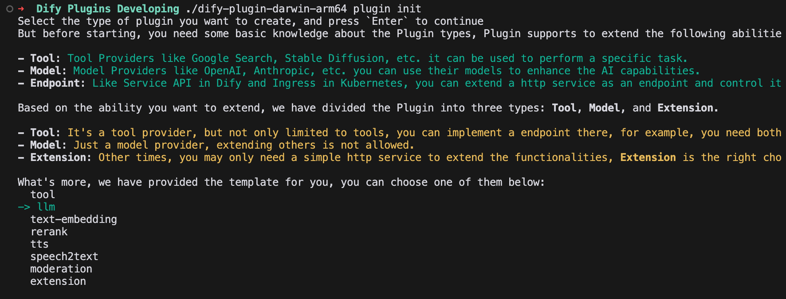
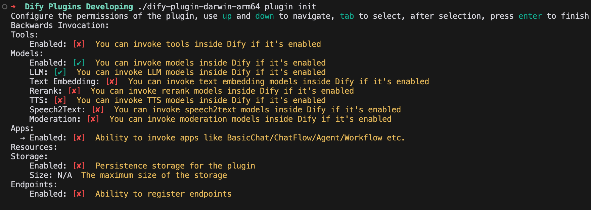

# 模型供应商插件

> 构建模型供应商插件，从项目搭建、供应商配置到模型实现、调试与发布。

> 本文档由 AI 自动翻译。如有任何不准确之处，请参考 [英文原版](https://docs.dify.ai/en/develop-plugin/dev-guides-and-walkthroughs/creating-new-model-provider.md)。

## 前提条件

* [Dify 插件 CLI](../../%E5%BF%AB%E9%80%9F%E5%BC%80%E5%A7%8B/Dify%20%E6%8F%92%E4%BB%B6%20CLI.md)
* 基本的 Python 编程技能和对面向对象编程的理解
* 熟悉想要集成的模型供应商的 API 文档

## 步骤 1：创建和配置新插件项目

### 初始化项目

```bash theme={null}
dify plugin init
```

### 选择模型插件模板

从可用选项中选择 `LLM` 类型的插件模板。此模板提供了完整的模型集成代码结构。



### 配置插件权限

对于模型供应商插件，配置以下基本权限：

* **Models**：模型操作的基础权限。
* **LLM**：大语言模型功能的权限。
* **Storage**：文件操作的权限（如果需要）。



### 目录结构概述

初始化后，插件项目的目录结构类似如下（假设供应商名为 `my_provider`，支持 LLM 和 Embedding）：

```bash theme={null}
models/my_provider/
├── models                # 模型实现和配置目录
│   ├── llm               # LLM 类型
│   │   ├── _position.yaml  (可选，控制排序)
│   │   ├── model1.yaml     # 特定模型的配置
│   │   └── llm.py          # LLM 实现逻辑
│   └── text_embedding    # Embedding 类型
│       ├── _position.yaml
│       ├── embedding-model.yaml
│       └── text_embedding.py
├── provider              # 供应商级代码目录
│   └── my_provider.py    # 供应商凭证验证
└── manifest.yaml         # 插件清单文件
```

## 步骤 2：了解模型配置方法

Dify 支持两种模型配置方法，它们决定了用户如何与供应商的模型交互：

### 预定义模型（`predefined-model`）

预定义模型只需统一的供应商凭证即可使用。用户为供应商配置好 API 密钥或其他身份验证信息后，即可立即访问所有预定义模型。

**示例**：OpenAI 供应商提供 `gpt-3.5-turbo-0125`、`gpt-4o-2024-05-13` 等预定义模型。用户只需配置一次 OpenAI API 密钥，即可访问所有这些模型。

### 自定义模型（`customizable-model`）

自定义模型需要为每个模型实例单独配置。当模型需要供应商级凭证之外的单独参数时，这种方法很有用。

**示例**：Xinference 同时支持 LLM 和 Text Embedding，但每个模型都有唯一的 `model_uid`。用户必须为每个要使用的模型单独配置 `model_uid`。

两种配置方法可在同一个供应商中共存。例如，供应商可提供一部分预定义模型，同时允许用户添加带有特定配置的自定义模型。

## 步骤 3：创建模型供应商文件

创建新的模型供应商涉及两个主要组件：

* **供应商配置 YAML 文件**：定义供应商的基本信息、支持的模型类型和凭证要求。
* **供应商类实现**：实现身份验证和其他供应商级功能。

### 3.1 创建模型供应商配置文件

供应商配置是一个 YAML 文件，用于声明供应商的基本信息、支持的模型类型、配置方法和凭证规则。将其放在插件项目的根目录中。

以下是带注释的 `anthropic.yaml` 配置文件示例：

```yaml theme={null}
# 基本供应商标识
provider: anthropic                # 供应商 ID（必须唯一）
label:
  en_US: Anthropic                 # UI 中的显示名称
description:
  en_US: Anthropic's powerful models, such as Claude 3.
  zh_Hans: Anthropic 的强大模型，例如 Claude 3。
icon_small:
  en_US: icon_s_en.svg            # 供应商的小图标（在选择 UI 中显示）
icon_large:
  en_US: icon_l_en.svg            # 大图标（在详情视图中显示）
background: "#F0F0EB"             # UI 中供应商的背景颜色

# 用户帮助信息
help:
  title:
    en_US: Get your API Key from Anthropic
    zh_Hans: 从 Anthropic 获取 API Key
  url:
    en_US: https://console.anthropic.com/account/keys

# 支持的模型类型和配置方法
supported_model_types:
  - llm                           # 此供应商提供 LLM 模型
configurate_methods:
  - predefined-model              # 使用预定义模型方法

# 供应商级凭证表单定义
provider_credential_schema:
  credential_form_schemas:
    - variable: anthropic_api_key  # API 密钥的变量名
      label:
        en_US: API Key
      type: secret-input           # 敏感数据的安全输入
      required: true
      placeholder:
        zh_Hans: 在此输入你的 API Key
        en_US: Enter your API Key
    - variable: anthropic_api_url
      label:
        en_US: API URL
      type: text-input             # 常规文本输入
      required: false
      placeholder:
        zh_Hans: 在此输入你的 API URL
        en_US: Enter your API URL

# 模型配置
models:
  llm:                            # LLM 类型模型的配置
    predefined:
      - "models/llm/*.yaml"       # 定位模型配置文件的模式
    position: "models/llm/_position.yaml"  # 定义显示顺序的文件

# 实现文件位置
extra:
  python:
    provider_source: provider/anthropic.py  # 供应商类实现
    model_sources:
      - "models/llm/llm.py"                 # 模型实现文件
```

### 自定义模型配置

如果供应商支持自定义模型，需添加 `model_credential_schema` 部分，用于定义用户为每个模型配置的额外字段。这对于支持微调模型或需要模型特定参数的供应商很常见。

以下是来自 OpenAI 供应商的示例：

```yaml theme={null}
model_credential_schema:
  model: # 微调模型名称字段
    label:
      en_US: Model Name
      zh_Hans: 模型名称
    placeholder:
      en_US: Enter your model name
      zh_Hans: 输入模型名称
  credential_form_schemas:
  - variable: openai_api_key
    label:
      en_US: API Key
    type: secret-input
    required: true
    placeholder:
      zh_Hans: 在此输入你的 API Key
      en_US: Enter your API Key
  - variable: openai_organization
    label:
        zh_Hans: 组织 ID
        en_US: Organization
    type: text-input
    required: false
    placeholder:
      zh_Hans: 在此输入你的组织 ID
      en_US: Enter your Organization ID
  # 根据需要添加其他字段...
```

完整的模型供应商 YAML 规范，参见 [模型 Schema](../../%E7%89%B9%E6%80%A7%E4%B8%8E%E8%A7%84%E8%8C%83/%E6%8F%92%E4%BB%B6%E7%B1%BB%E5%9E%8B/%E6%A8%A1%E5%9E%8B%20API%20%E6%8E%A5%E5%8F%A3.md)。

### 3.2 编写模型供应商代码

接下来，在 `/provider` 目录中为供应商类创建一个 Python 文件，并以供应商名称命名（例如 `anthropic.py`）。

供应商类必须继承自 `ModelProvider` 并至少实现 `validate_provider_credentials` 方法：

```python theme={null}
import logging
from dify_plugin.entities.model import ModelType
from dify_plugin.errors.model import CredentialsValidateFailedError
from dify_plugin import ModelProvider

logger = logging.getLogger(__name__)


class AnthropicProvider(ModelProvider):
    def validate_provider_credentials(self, credentials: dict) -> None:
        """
        Validate provider credentials by testing them against the API.

        This method should attempt to make a simple API call to verify
        that the credentials are valid.

        :param credentials: Provider credentials as defined in the YAML schema
        :raises CredentialsValidateFailedError: If validation fails
        """
        try:
            # Get an instance of the LLM model type and use it to validate credentials
            model_instance = self.get_model_instance(ModelType.LLM)
            model_instance.validate_credentials(
                model="claude-3-opus-20240229",
                credentials=credentials
            )
        except CredentialsValidateFailedError as ex:
            # Pass through credential validation errors
            raise ex
        except Exception as ex:
            # Log and re-raise other exceptions
            logger.exception(f"{self.get_provider_schema().provider} credentials validate failed")
            raise ex
```

每当用户在 Dify 中保存供应商凭证时，Dify 都会调用 `validate_provider_credentials`，因此该方法应：

1. 通过一次简单的 API 调用来尝试验证凭证。
2. 验证成功时静默返回。
3. 验证失败时抛出 `CredentialsValidateFailedError`，并附带有用的提示信息。

#### 对于自定义模型供应商

对于只使用自定义模型的供应商（每个模型都需要各自的配置），可实现一个更简单的供应商类。例如 Xinference：

```python theme={null}
from dify_plugin import ModelProvider

class XinferenceProvider(ModelProvider):
    def validate_provider_credentials(self, credentials: dict) -> None:
        """
        For custom-only model providers, validation happens at the model level.
        This method exists to satisfy the abstract base class requirement.
        """
        pass
```

## 步骤 4：实现模型特定代码

设置好供应商后，实现模型特定代码来处理所支持的每种模型类型的 API 调用。这涉及：

1. 为每个特定模型创建模型配置 YAML 文件。
2. 实现处理 API 通信的模型类型类。

详细说明参见：

* [模型设计规则](../../%E7%89%B9%E6%80%A7%E4%B8%8E%E8%A7%84%E8%8C%83/%E6%8F%92%E4%BB%B6%E7%B1%BB%E5%9E%8B/%E6%A8%A1%E5%9E%8B%E8%A7%84%E8%8C%83.md)：集成预定义模型的标准。
* [模型 Schema](../../%E7%89%B9%E6%80%A7%E4%B8%8E%E8%A7%84%E8%8C%83/%E6%8F%92%E4%BB%B6%E7%B1%BB%E5%9E%8B/%E6%A8%A1%E5%9E%8B%20API%20%E6%8E%A5%E5%8F%A3.md)：模型配置文件的标准。

### 4.1 定义模型配置（YAML）

对于每个特定模型，在相应的模型类型目录中创建一个 YAML 文件（例如 `models/llm/`）来定义其属性、参数和功能。

**示例（`claude-3-5-sonnet-20240620.yaml`）**：

```yaml theme={null}
model: claude-3-5-sonnet-20240620   # 模型的 API 标识符
label:
  en_US: claude-3-5-sonnet-20240620 # UI 中的显示名称
model_type: llm                     # 必须与目录类型匹配
features:                           # 特殊功能
  - agent-thought
  - vision
  - tool-call
  - stream-tool-call
  - document
model_properties:                   # 固有模型属性
  mode: chat                        # "chat" 或 "completion"
  context_size: 200000              # 最大上下文窗口
parameter_rules:                    # 用户可调整的参数
  - name: temperature
    use_template: temperature       # 引用预定义模板
  - name: top_p
    use_template: top_p
  - name: max_tokens
    use_template: max_tokens
    required: true
    default: 8192
    min: 1
    max: 8192
pricing:                           # 可选的定价信息
  input: '3.00'
  output: '15.00'
  unit: '0.000001'                 # 每百万 token
  currency: USD
```

### 4.2 实现模型调用代码（Python）

为所支持的每种模型类型创建一个 Python 文件（例如 `models/llm/` 目录中的 `llm.py`）。该类负责处理 API 通信、参数转换和结果格式化。

以下是 LLM 的实现结构示例：

```python theme={null}
import logging
from typing import Union, Generator, Optional, List
from dify_plugin.provider_kits.llm import LargeLanguageModel # Base class
from dify_plugin.provider_kits.llm import LLMResult, LLMResultChunk, LLMUsage # Result classes
from dify_plugin.provider_kits.llm import PromptMessage, PromptMessageTool # Message classes
from dify_plugin.errors.provider_error import InvokeError, InvokeAuthorizationError # Error classes

logger = logging.getLogger(__name__)

class MyProviderLargeLanguageModel(LargeLanguageModel):
    def _invoke(self, model: str, credentials: dict, prompt_messages: List[PromptMessage],
                model_parameters: dict, tools: Optional[List[PromptMessageTool]] = None,
                stop: Optional[List[str]] = None, stream: bool = True,
                user: Optional[str] = None) -> Union[LLMResult, Generator[LLMResultChunk, None, None]]:
        """
        Core method for invoking the model API.

        Parameters:
            model: The model identifier to call
            credentials: Authentication credentials
            prompt_messages: List of messages to send
            model_parameters: Parameters like temperature, max_tokens
            tools: Optional tool definitions for function calling
            stop: Optional list of stop sequences
            stream: Whether to stream responses (True) or return complete response (False)
            user: Optional user identifier for API tracking

        Returns:
            If stream=True: Generator yielding LLMResultChunk objects
            If stream=False: Complete LLMResult object
        """
        # Prepare API request parameters
        api_params = self._prepare_api_params(
            credentials, model_parameters, prompt_messages, tools, stop
        )

        try:
            # Call appropriate helper method based on streaming preference
            if stream:
                return self._invoke_stream(model, api_params, user)
            else:
                return self._invoke_sync(model, api_params, user)
        except Exception as e:
            # Handle and map errors
            self._handle_api_error(e)

    def _invoke_stream(self, model: str, api_params: dict, user: Optional[str]) -> Generator[LLMResultChunk, None, None]:
        """Helper method for streaming API calls"""
        # Implementation details for streaming calls
        pass

    def _invoke_sync(self, model: str, api_params: dict, user: Optional[str]) -> LLMResult:
        """Helper method for synchronous API calls"""
        # Implementation details for synchronous calls
        pass

    def validate_credentials(self, model: str, credentials: dict) -> None:
        """
        Validate that the credentials work for this specific model.
        Called when a user tries to add or modify credentials.
        """
        # Implementation for credential validation
        pass

    def get_num_tokens(self, model: str, credentials: dict,
                       prompt_messages: List[PromptMessage],
                       tools: Optional[List[PromptMessageTool]] = None) -> int:
        """
        Estimate the number of tokens for given input.
        Optional but recommended for accurate cost estimation.
        """
        # Implementation for token counting
        pass

    @property
    def _invoke_error_mapping(self) -> dict[type[InvokeError], list[type[Exception]]]:
        """
        Define mapping from vendor-specific exceptions to Dify standard exceptions.
        This helps standardize error handling across different providers.
        """
        return {
            InvokeAuthorizationError: [
                # List vendor-specific auth errors here
            ],
            # Other error mappings
        }
```

需要实现的最重要方法是 `_invoke`，它处理核心 API 通信。该方法应：

1. 将 Dify 的标准化输入转换为供应商 API 所需的格式。
2. 进行 API 调用并妥善处理错误。
3. 将 API 响应转换为 Dify 的标准化输出格式。
4. 同时处理流式和非流式模式。

## 步骤 5：调试和测试您的插件

Dify 支持远程调试，可在开发期间测试插件：

1. 在 Dify 实例中进入 **插件管理**，点击 **调试插件**，获取调试密钥和服务器地址。

2. 在 `.env` 文件中用这些值配置本地环境：

   ```dotenv theme={null}
   INSTALL_METHOD=remote
   REMOTE_INSTALL_URL=<your-dify-host>:5003
   REMOTE_INSTALL_KEY=****-****-****-****-****
   ```

3. 使用 `python -m main` 在本地运行插件，并在 Dify 中测试。

## 步骤 6：打包和发布

当您的插件准备就绪时：

1. 使用脚手架工具打包：

   ```bash theme={null}
   dify plugin package models/<provider_name>
   ```

2. 提交前先在本地测试打包好的插件。

3. 向 [Dify 官方插件仓库](https://github.com/langgenius/dify-official-plugins) 提交拉取请求。

发布流程的更多详情，参见 [发布概述](../../%E5%8F%91%E5%B8%83/%E5%8F%91%E5%B8%83%E6%8F%92%E4%BB%B6.md)。

## 参考资源

* [快速集成新模型](%E6%A8%A1%E5%9E%8B%E4%BE%9B%E5%BA%94%E5%95%86%E6%8F%92%E4%BB%B6.md)：如何向现有供应商添加新模型。
* [插件开发基本概念](../../%E5%BF%AB%E9%80%9F%E5%BC%80%E5%A7%8B/Dify%20%E6%8F%92%E4%BB%B6.md)：返回插件开发入门指南。
* [模型 Schema](../../%E7%89%B9%E6%80%A7%E4%B8%8E%E8%A7%84%E8%8C%83/%E6%8F%92%E4%BB%B6%E7%B1%BB%E5%9E%8B/%E6%A8%A1%E5%9E%8B%20API%20%E6%8E%A5%E5%8F%A3.md)：详细的模型配置规范。
* [通用规范](../../%E7%89%B9%E6%80%A7%E4%B8%8E%E8%A7%84%E8%8C%83/%E6%8F%92%E4%BB%B6%E7%B1%BB%E5%9E%8B/%E9%80%9A%E7%94%A8%E8%A7%84%E8%8C%83.md)：插件清单文件配置。
* [Dify 插件 SDK 参考](https://github.com/langgenius/dify-plugin-sdks)：基类、数据结构和错误类型。
