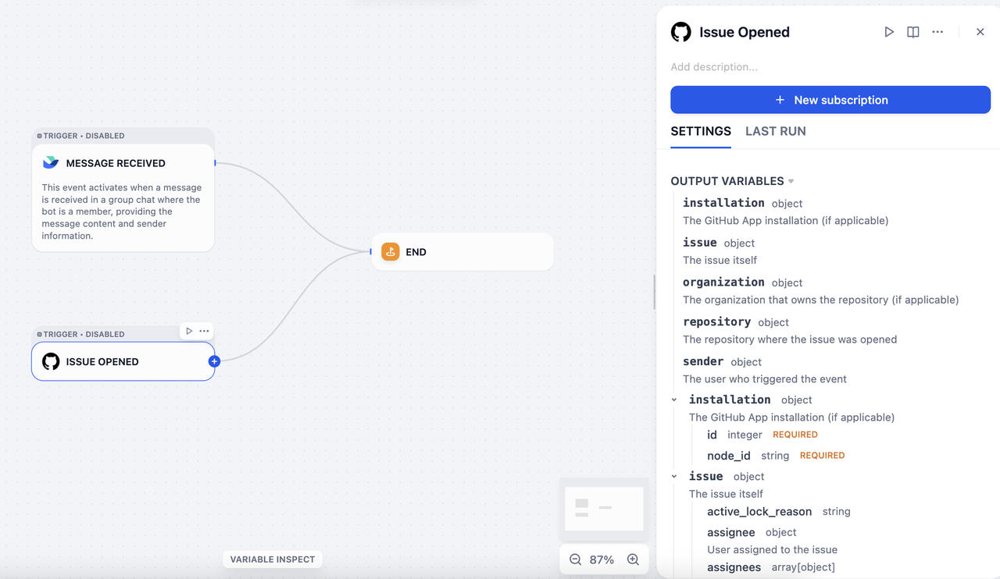
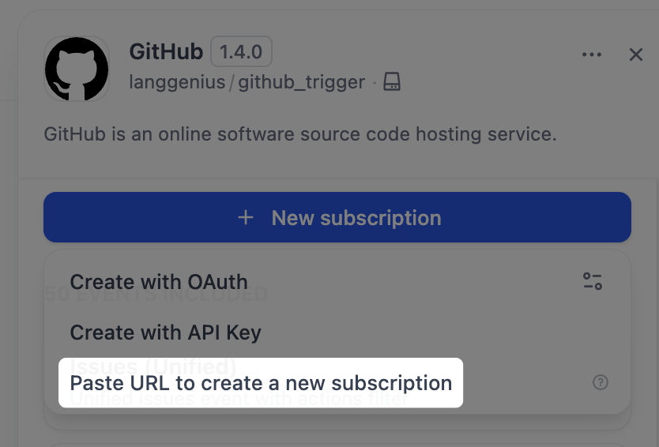
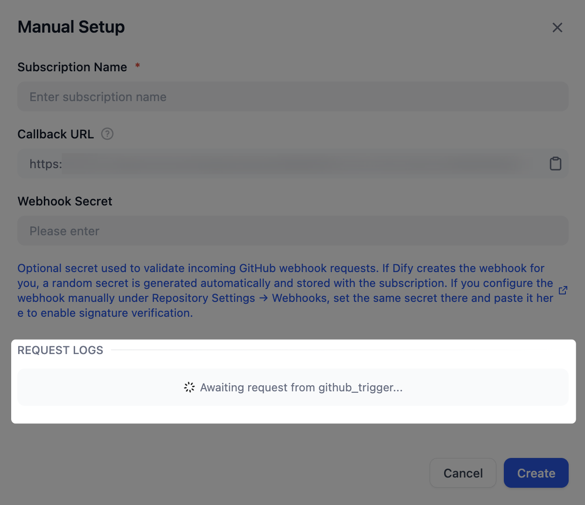
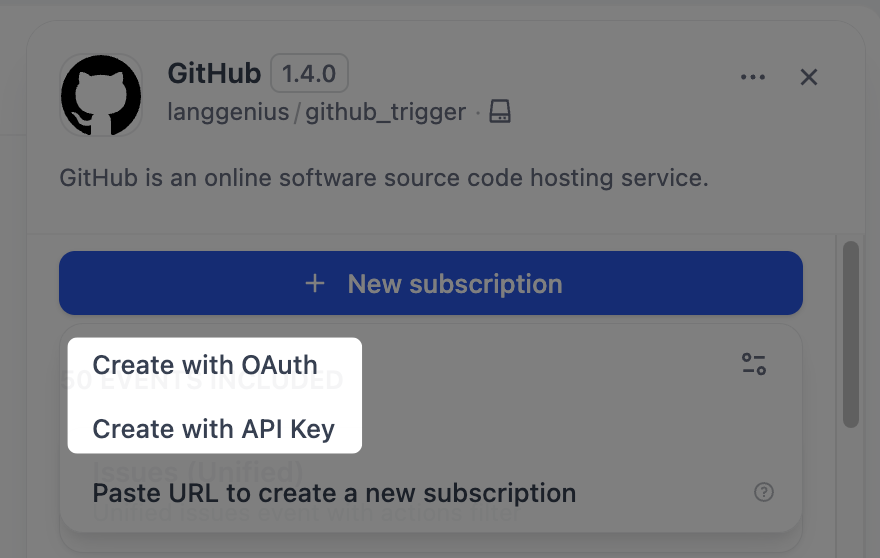

# 触发器插件

> 构建 Dify 1.10.0+ 触发器插件，将第三方 webhook 事件转换为工作流启动信号

> 本文档由 AI 自动翻译。如有任何不准确之处，请参考 [英文原版](https://docs.dify.ai/en/develop-plugin/dev-guides-and-walkthroughs/trigger-plugin.md)。

## 什么是触发器插件？

触发器是 Dify v1.10.0 版本中引入的一种新型起始节点。与代码、工具或知识库检索等功能节点不同，触发器 **将第三方事件转换为 Dify 可以识别和处理的输入格式**。



例如，如果你在 Gmail 中将 Dify 配置为 `new email` 事件接收器，每当收到新邮件时，Gmail 会自动向 Dify 发送一个事件，该事件可用于触发工作流。然而：

* Gmail 的原始事件格式与 Dify 的输入格式不兼容。
* 全球有数千个平台，每个平台都有其独特的事件格式。

触发器插件填补了这一空缺：它们定义和解析来自不同平台的事件，并将其统一为 Dify 可以接受的输入格式。

## 技术概述

Dify 触发器基于 webhook 构建，这是一种在网络上被广泛采用的机制。GitHub、Slack、Linear 等主流 SaaS 平台都支持 webhook，并提供完善的文档。

Webhook 是一种基于 HTTP 的事件分发器：一旦配置了事件接收地址，平台会在订阅的事件发生时自动将事件数据推送到该地址。

为了以统一的方式处理来自不同平台的 webhook 事件，Dify 定义了两个核心概念：**订阅（Subscription）** 和 **事件（Event）**。

* **订阅（Subscription）**：在第三方平台的开发者控制台中将 Dify 的网络地址注册为目标服务器的配置。
* **事件（Event）**：一个平台可能发送多种类型的事件（例如*收到邮件*、*删除邮件*或*标记邮件为已读*），所有这些都会推送到注册的地址。触发器插件可以处理多种事件类型，每个事件对应 Dify 工作流中的一个集成触发器节点。

## 插件开发

触发器插件的开发流程与其他插件类型（工具、数据源、模型等）相同。

使用 `dify plugin init` 命令创建开发模板。生成的文件结构遵循标准的插件格式规范。

```text theme={null}
├── _assets
│   └── icon.svg
├── events
│   └── star
│       ├── star_created.py
│       └── star_created.yaml
├── main.py
├── manifest.yaml
├── provider
│   ├── github.py
│   └── github.yaml
├── README.md
├── PRIVACY.md
└── requirements.txt
```

* `manifest.yaml`：描述插件的基本元数据。
* `provider` 目录：包含提供者的元数据、创建订阅的代码，以及接收 webhook 请求后对事件进行分类的代码。
* `events` 目录：包含事件处理和过滤的代码，支持在节点级别进行本地事件过滤。你可以创建子目录来分组相关事件。

> [!NOTE]
>
> 对于触发器插件，将 Dify 最低版本设置为 `1.10.0`，SDK 版本设置为 `>= 0.6.0`。

以下各节以 GitHub 为例，逐步介绍开发流程。

### 创建订阅

主流 SaaS 平台的 Webhook 配置方式差异很大：

* 一些平台（如 GitHub）支持基于 API 的 webhook 配置。对于这些平台，一旦完成 OAuth 认证，Dify 可以自动设置 webhook。

* 其他平台（如 Notion）不提供 webhook 配置 API，可能需要用户手动进行认证。

为了适应这些差异，我们将订阅过程分为两部分：\*\*订阅构造器（Subscription Constructor）**和**订阅（Subscription）\*\*本身。

对于像 Notion 这样的平台，创建订阅需要用户手动复制 Dify 提供的回调 URL，并将其粘贴到他们的 Notion 工作区以完成 webhook 设置。这个过程对应 Dify 界面中的**粘贴 URL 创建新订阅**选项。



要支持通过手动粘贴 URL 创建订阅，需修改两个文件：`github.yaml` 和 `github.py`。

> [tab] github.yaml
>
> GitHub webhook 使用加密机制，因此需要一个密钥来解密和验证传入的请求。在 `github.yaml` 中声明 `webhook_secret`。
>
> ```yaml theme={null}
> subscription_schema:
> - name: "webhook_secret"
>   type: "secret-input"
>   required: false
>   label:
>     zh_Hans: "Webhook Secret"
>     en_US: "Webhook Secret"
>     ja_JP: "Webhookシークレット"
>   help:
>     en_US: "Optional webhook secret for validating GitHub webhook requests"
>     ja_JP: "GitHub Webhookリクエストの検証用のオプションのWebhookシークレット"
>     zh_Hans: "可选的用于验证 GitHub webhook 请求的 webhook 密钥"
> ```

> [tab] github.py
>
> 首先，实现 `dispatch_event` 接口。所有发送到回调 URL 的请求都由这个接口处理，处理后的事件会显示在 **请求日志** 部分，用于调试和验证。
>
> 
>
> 在代码中，你可以通过 `subscription.properties` 获取在 `github.yaml` 中声明的 `webhook_secret`。
>
> `dispatch_event` 方法根据请求内容确定事件类型。在下面的示例中，事件提取由 `_dispatch_trigger_event` 方法处理。
>
> > [!TIP]
> >
> > 完整代码示例，请参阅 [Dify 的 GitHub 触发器插件](https://github.com/langgenius/dify-official-plugins/tree/main/triggers/github_trigger)。
>
> ```python theme={null}
> class GithubTrigger(Trigger):
>     """Handle GitHub webhook event dispatch."""
>
>     def _dispatch_event(self, subscription: Subscription, request: Request) -> EventDispatch:
>         webhook_secret = subscription.properties.get("webhook_secret")
>         if webhook_secret:
>             self._validate_signature(request=request, webhook_secret=webhook_secret)
>
>         event_type: str | None = request.headers.get("X-GitHub-Event")
>         if not event_type:
>             raise TriggerDispatchError("Missing GitHub event type header")
>
>         payload: Mapping[str, Any] = self._validate_payload(request)
>         response = Response(response='{"status": "ok"}', status=200, mimetype="application/json")
>         event: str = self._dispatch_trigger_event(event_type=event_type, payload=payload)
>         return EventDispatch(events=[event] if event else [], response=response)
> ```

### 事件处理

一旦提取了事件，相应的实现必须过滤原始 HTTP 请求并将其转换为 Dify 工作流可以接受的输入格式。

以 Issue 事件为例，在 `events/issues/issues.yaml` 中定义事件，在 `events/issues/issues.py` 中定义其实现。在 `issues.yaml` 的 `output_schema` 部分定义事件的输出，它遵循与工具插件相同的 JSON Schema 规范。

> [tab] issues.yaml
>
> ```yaml theme={null}
> identity:
>   name: issues
>   author: langgenius
>   label:
>     en_US: Issues
>     zh_Hans: 议题
>     ja_JP: イシュー
> description:
>   en_US: Unified issues event with actions filter
>   zh_Hans: 带 actions 过滤的统一 issues 事件
>   ja_JP: アクションフィルタ付きの統合イシューイベント
> output_schema:
>   type: object
>   properties:
>     action:
>       type: string
>     issue:
>       type: object
>       description: The issue itself
> extra:
>   python:
>     source: events/issues/issues.py
> ```

> [tab] issues.py
>
> ```python theme={null}
> from collections.abc import Mapping
> from typing import Any
>
> from werkzeug import Request
>
> from dify_plugin.entities.trigger import Variables
> from dify_plugin.errors.trigger import EventIgnoreError
> from dify_plugin.interfaces.trigger import Event
>
> class IssuesUnifiedEvent(Event):
>     """Unified Issues event. Filters by actions and common issue attributes."""
>
>     def _on_event(self, request: Request, parameters: Mapping[str, Any], payload: Mapping[str, Any]) -> Variables:
>         payload = request.get_json()
>         if not payload:
>             raise ValueError("No payload received")
>
>         allowed_actions = parameters.get("actions") or []
>         action = payload.get("action")
>         if allowed_actions and action not in allowed_actions:
>             raise EventIgnoreError()
>
>         issue = payload.get("issue")
>         if not isinstance(issue, Mapping):
>             raise ValueError("No issue in payload")
>
>         return Variables(variables={**payload})
> ```

### 事件过滤

要过滤掉某些事件（例如，只关注具有特定标签的 Issue 事件），在 `issues.yaml` 的事件定义中添加 `parameters`。然后，在 `_on_event` 方法中，对不符合配置条件的事件抛出 `EventIgnoreError` 异常。

> [tab] issues.yaml
>
> ```yaml theme={null}
> parameters:
> - name: added_label
>   label:
>     en_US: Added Label
>     zh_Hans: 添加的标签
>     ja_JP: 追加されたラベル
>   type: string
>   required: false
>   description:
>     en_US: "Only trigger if these specific labels were added (e.g., critical, priority-high, security, comma-separated). Leave empty to trigger for any label addition."
>     zh_Hans: "仅当添加了这些特定标签时触发（例如：critical, priority-high, security，逗号分隔）。留空则对任何标签添加触发。"
>     ja_JP: "これらの特定のラベルが追加された場合のみトリガー（例: critical, priority-high, security，カンマ区切り）。空の場合は任意のラベル追加でトリガー。"
> ```

> [tab] issues.py
>
> ```python theme={null}
> def _check_added_label(self, payload: Mapping[str, Any], added_label_param: str | None) -> None:
>     """Check if the added label matches the allowed labels"""
>     if not added_label_param:
>         return
>
>     allowed_labels = [label.strip() for label in added_label_param.split(",") if label.strip()]
>     if not allowed_labels:
>         return
>
>     # The payload contains the label that was added
>     label = payload.get("label", {})
>     label_name = label.get("name", "")
>
>     if label_name not in allowed_labels:
>         raise EventIgnoreError()
>
> def _on_event(self, request: Request, parameters: Mapping[str, Any], payload: Mapping[str, Any]) -> Variables:
>     # ...
>     # Apply all filters
>     self._check_added_label(payload, parameters.get("added_label"))
>
>     return Variables(variables={**payload})
> ```

### 通过 OAuth 或 API 密钥创建订阅

要启用通过 OAuth 或 API 密钥自动创建订阅，需修改 `github.yaml` 和 `github.py` 文件。

> [tab] github.yaml
>
> 在 `github.yaml` 中，添加以下字段。
>
> ```yaml theme={null}
> subscription_constructor:
>   parameters:
>   - name: "repository"
>     label:
>       en_US: "Repository"
>       zh_Hans: "仓库"
>       ja_JP: "リポジトリ"
>     type: "dynamic-select"
>     required: true
>     placeholder:
>       en_US: "owner/repo"
>       zh_Hans: "owner/repo"
>       ja_JP: "owner/repo"
>     help:
>       en_US: "GitHub repository in format owner/repo (e.g., microsoft/vscode)"
>       zh_Hans: "GitHub 仓库，格式为 owner/repo（例如：microsoft/vscode）"
>       ja_JP: "GitHubリポジトリは owner/repo 形式で入力してください（例: microsoft/vscode）"
>   credentials_schema:
>     access_tokens:
>       help:
>         en_US: Get your Access Tokens from GitHub
>         ja_JP: GitHub からアクセストークンを取得してください
>         zh_Hans: 从 GitHub 获取您的 Access Tokens
>       label:
>         en_US: Access Tokens
>         ja_JP: アクセストークン
>         zh_Hans: Access Tokens
>       placeholder:
>         en_US: Please input your GitHub Access Tokens
>         ja_JP: GitHub のアクセストークンを入力してください
>         zh_Hans: 请输入你的 GitHub Access Tokens
>       required: true
>       type: secret-input
>       url: https://github.com/settings/tokens?type=beta
>   extra:
>     python:
>       source: provider/github.py
> ```
>
> `subscription_constructor` 是 Dify 抽象出来的一个概念，用于定义如何构造订阅。它包含以下字段：
>
> * `parameters`（可选）：定义创建订阅所需的参数，例如要订阅的事件类型或目标 GitHub 仓库。
> * `credentials_schema`（可选）：声明使用 API 密钥或访问令牌创建订阅所需的凭据，例如 GitHub 的 `access_tokens`。
> * `oauth_schema`（可选）：通过 OAuth 创建订阅时需要。有关定义方法的详细信息，参见 [为你的工具插件添加 OAuth 支持](Tool%20OAuth.md)。

> [tab] github.py
>
> 在 `github.py` 中，创建一个 `Constructor` 类来实现自动订阅逻辑。
>
> ```python theme={null}
> class GithubSubscriptionConstructor(TriggerSubscriptionConstructor):
>     """Manage GitHub trigger subscriptions."""
>     def _validate_api_key(self, credentials: Mapping[str, Any]) -> None:
>         # ...
>
>     def _create_subscription(
>         self,
>         endpoint: str,
>         parameters: Mapping[str, Any],
>         credentials: Mapping[str, Any],
>         credential_type: CredentialType,
>     ) -> Subscription:
>         repository = parameters.get("repository")
>         if not repository:
>             raise ValueError("repository is required (format: owner/repo)")
>
>         try:
>             owner, repo = repository.split("/")
>         except ValueError:
>             raise ValueError("repository must be in format 'owner/repo'") from None
>
>         events: list[str] = parameters.get("events", [])
>         webhook_secret = uuid.uuid4().hex
>         url = f"https://api.github.com/repos/{owner}/{repo}/hooks"
>         headers = {
>             "Authorization": f"Bearer {credentials.get('access_tokens')}",
>             "Accept": "application/vnd.github+json",
>         }
>
>         webhook_data = {
>             "name": "web",
>             "active": True,
>             "events": events,
>             "config": {"url": endpoint, "content_type": "json", "insecure_ssl": "0", "secret": webhook_secret},
>         }
>
>         try:
>             response = requests.post(url, json=webhook_data, headers=headers, timeout=10)
>         except requests.RequestException as exc:
>             raise SubscriptionError(f"Network error while creating webhook: {exc}", error_code="NETWORK_ERROR") from exc
>
>         if response.status_code == 201:
>             webhook = response.json()
>             return Subscription(
>                 expires_at=int(time.time()) + self._WEBHOOK_TTL,
>                 endpoint=endpoint,
>                 parameters=parameters,
>                 properties={
>                     "external_id": str(webhook["id"]),
>                     "repository": repository,
>                     "events": events,
>                     "webhook_secret": webhook_secret,
>                     "active": webhook.get("active", True),
>                 },
>             )
>
>         response_data: dict[str, Any] = response.json() if response.content else {}
>         error_msg = response_data.get("message", "Unknown error")
>         error_details = response_data.get("errors", [])
>         detailed_error = f"Failed to create GitHub webhook: {error_msg}"
>         if error_details:
>             detailed_error += f" Details: {error_details}"
>
>         raise SubscriptionError(
>             detailed_error,
>             error_code="WEBHOOK_CREATION_FAILED",
>             external_response=response_data,
>         )
> ```

***

修改完这两个文件后，你将在 Dify 界面中看到**使用 API 密钥创建**选项。

同一个 `Constructor` 类也支持通过 OAuth 自动创建订阅：在 `subscription_constructor` 下添加 `oauth_schema` 字段即可启用 OAuth 认证。



## 深入探索

触发器插件开发中核心类的接口定义如下。

### Trigger

```python theme={null}
class Trigger(ABC):
    @abstractmethod
    def _dispatch_event(self, subscription: Subscription, request: Request) -> EventDispatch:
        """
        Internal method to implement event dispatch logic.

        Subclasses must override this method to handle incoming webhook events.

        Implementation checklist:
        1. Validate the webhook request:
           - Check the signature/HMAC using the properties stored in subscription.properties when the subscription was created
           - Verify the request is from the expected source
        2. Extract event information:
           - Parse event type from headers or body
           - Extract relevant payload data
        3. Return EventDispatch with:
           - events: List of Event names to invoke (can be single or multiple)
           - response: Appropriate HTTP response for the webhook

        Args:
            subscription: The Subscription object with endpoint and properties fields
            request: Incoming webhook HTTP request

        Returns:
            EventDispatch: Event dispatch routing information

        Raises:
            TriggerValidationError: For security validation failures
            TriggerDispatchError: For parsing or routing errors
        """
        raise NotImplementedError("This plugin should implement `_dispatch_event` method to enable event dispatch")

```

### TriggerSubscriptionConstructor

```python theme={null}
class TriggerSubscriptionConstructor(ABC, OAuthProviderProtocol):
    # OPTIONAL
    def _validate_api_key(self, credentials: Mapping[str, Any]) -> None:
        raise NotImplementedError(
            "This plugin should implement `_validate_api_key` method to enable credentials validation"
        )

    # OPTIONAL
    def _oauth_get_authorization_url(self, redirect_uri: str, system_credentials: Mapping[str, Any]) -> str:
        raise NotImplementedError(
            "The trigger you are using does not support OAuth, please implement `_oauth_get_authorization_url` method"
        )

    # OPTIONAL
    def _oauth_get_credentials(
        self, redirect_uri: str, system_credentials: Mapping[str, Any], request: Request
    ) -> TriggerOAuthCredentials:
        raise NotImplementedError(
            "The trigger you are using does not support OAuth, please implement `_oauth_get_credentials` method"
        )

    # OPTIONAL
    def _oauth_refresh_credentials(
        self, redirect_uri: str, system_credentials: Mapping[str, Any], credentials: Mapping[str, Any]
    ) -> OAuthCredentials:
        raise NotImplementedError(
            "The trigger you are using does not support OAuth, please implement `_oauth_refresh_credentials` method"
        )

    @abstractmethod
    def _create_subscription(
        self,
        endpoint: str,
        parameters: Mapping[str, Any],
        credentials: Mapping[str, Any],
        credential_type: CredentialType,
    ) -> Subscription:
        """
        Internal method to implement subscription logic.

        Subclasses must override this method to handle subscription creation.

        Implementation checklist:
        1. Use the endpoint parameter provided by Dify
        2. Register webhook with external service using their API
        3. Store all necessary information in Subscription.properties for future operations (e.g., dispatch_event)
        4. Return Subscription with:
           - expires_at: Set appropriate expiration time
           - endpoint: The webhook endpoint URL allocated by Dify for receiving events, same as the endpoint parameter
           - parameters: The parameters of the subscription
           - properties: All configuration and external IDs

        Args:
            endpoint: The webhook endpoint URL allocated by Dify for receiving events
            parameters: Subscription creation parameters
            credentials: Authentication credentials
            credential_type: The type of the credentials, e.g., "api-key", "oauth2", "unauthorized"

        Returns:
            Subscription: Subscription details with metadata for future operations

        Raises:
            SubscriptionError: For operational failures (API errors, invalid credentials)
            ValueError: For programming errors (missing required params)
        """
        raise NotImplementedError(
            "This plugin should implement `_create_subscription` method to enable event subscription"
        )

    @abstractmethod
    def _delete_subscription(
        self, subscription: Subscription, credentials: Mapping[str, Any], credential_type: CredentialType
    ) -> UnsubscribeResult:
        """
        Internal method to implement unsubscription logic.

        Subclasses must override this method to handle subscription removal.

        Implementation guidelines:
        1. Extract necessary IDs from subscription.properties (e.g., external_id)
        2. Use credentials and credential_type to call external service API to delete the webhook
        3. Handle common errors (not found, unauthorized, etc.)
        4. Always return UnsubscribeResult with detailed status
        5. Never raise exceptions for operational failures - use UnsubscribeResult.success=False

        Args:
            subscription: The Subscription object with endpoint and properties fields

        Returns:
            UnsubscribeResult: Always returns result, never raises for operational failures
        """
        raise NotImplementedError(
            "This plugin should implement `_delete_subscription` method to enable event unsubscription"
        )

    @abstractmethod
    def _refresh_subscription(
        self, subscription: Subscription, credentials: Mapping[str, Any], credential_type: CredentialType
    ) -> Subscription:
        """
        Internal method to implement subscription refresh logic.

        Subclasses must override this method to handle simple expiration extension.

        Implementation patterns:
        1. For webhooks without expiration (e.g., GitHub):
           - Update the Subscription.expires_at=-1 then Dify will never call this method again

        2. For lease-based subscriptions (e.g., Microsoft Graph):
           - Use the information in Subscription.properties to call service's lease renewal API if available
           - Handle renewal limits (some services limit renewal count)
           - Update Subscription.properties and Subscription.expires_at for the next renewal if needed

        Args:
            subscription: Current subscription with properties
            credential_type: The type of the credentials, e.g., "api-key", "oauth2", "unauthorized"
            credentials: Current authentication credentials from credentials_schema.
                        For API key auth, according to `credentials_schema` defined in the YAML.
                        For OAuth auth, according to `oauth_schema.credentials_schema` defined in the YAML.
                        For unauthorized auth, there is no credentials.

        Returns:
            Subscription: Same subscription with extended expiration
                        or new properties and expires_at for the next renewal

        Raises:
            SubscriptionError: For operational failures (API errors, invalid credentials)
        """
        raise NotImplementedError("This plugin should implement `_refresh` method to enable subscription refresh")

    # OPTIONAL
    def _fetch_parameter_options(
        self, parameter: str, credentials: Mapping[str, Any], credential_type: CredentialType
    ) -> list[ParameterOption]:
        """
        Fetch the parameter options of the trigger.

        Implementation guidelines:
        When you need to fetch parameter options from an external service, use the credentials
        and credential_type to call the external service API, then return the options to Dify
        for user selection.

        Args:
            parameter: The parameter name for which to fetch options
            credentials: Authentication credentials for the external service
            credential_type: The type of credentials (e.g., "api-key", "oauth2", "unauthorized")

        Returns:
            list[ParameterOption]: A list of available options for the parameter

        Examples:
            GitHub Repositories:
            >>> result = provider.fetch_parameter_options(parameter="repository")
            >>> print(result)  # [ParameterOption(label="owner/repo", value="owner/repo")]

            Slack Channels:
            >>> result = provider.fetch_parameter_options(parameter="channel")
            >>> print(result)
```

### Event

```python theme={null}
class Event(ABC):
    @abstractmethod
    def _on_event(self, request: Request, parameters: Mapping[str, Any], payload: Mapping[str, Any]) -> Variables:
        """
        Transform the incoming webhook request into structured Variables.

        This method should:
        1. Parse the webhook payload from the request
        2. Apply filtering logic based on parameters
        3. Extract relevant data matching the output_schema
        4. Return a structured Variables object

        Args:
            request: The incoming webhook HTTP request containing the raw payload.
                    Use request.get_json() to parse JSON body.
            parameters: User-configured parameters for filtering and transformation
                       (e.g., label filters, regex patterns, threshold values).
                       These come from the subscription configuration.
            payload: The decoded payload from previous step `Trigger.dispatch_event`.
                     It will be delivered into `_on_event` method.
        Returns:
            Variables: Structured variables matching the output_schema
                      defined in the event's YAML configuration.

        Raises:
            EventIgnoreError: When the event should be filtered out based on parameters
            ValueError: When the payload is invalid or missing required fields

        Example:
            >>> def _on_event(self, request, parameters):
            ...     payload = request.get_json()
            ...
            ...     # Apply filters
            ...     if not self._matches_filters(payload, parameters):
            ...         raise EventIgnoreError()
            ...
            ...     # Transform data
            ...     return Variables(variables={
            ...         "title": payload["issue"]["title"],
            ...         "author": payload["issue"]["user"]["login"],
            ...         "url": payload["issue"]["html_url"],
            ...     })
        """

    def _fetch_parameter_options(self, parameter: str) -> list[ParameterOption]:
        """
        Fetch the parameter options of the trigger.

        To be implemented by subclasses.

        Implementing it is optional, which is why it's not an abstract method.
        """
        raise NotImplementedError(
            "This plugin should implement `_fetch_parameter_options` method to enable dynamic select parameter"
        )
```
