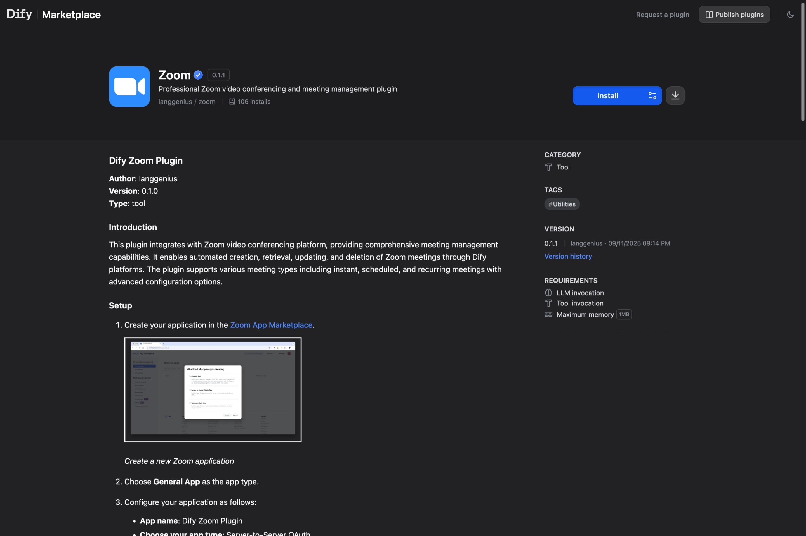

# 多语言 README

> 添加各语言的 README 文件，让 Dify Marketplace 以用户的首选语言展示插件文档

> 本文档由 AI 自动翻译。如有任何不准确之处，请参考 [英文原版](https://docs.dify.ai/en/develop-plugin/features-and-specs/plugin-types/multilingual-readme.md)。

README 是用户在 [Dify Marketplace](https://marketplace.dify.ai) 详情页最先看到的内容。添加翻译后，非英语用户无需丢失原文即可用母语阅读文档。

## 文件规范

| 语言 | 是否必需 | 文件名 | 路径 |
| :- | :- | :- | :- |
| 英语 | 是 | `README.md` | 插件根目录 |
| 简体中文 | 否 | `README_zh_Hans.md` | `readme/` |
| 日语 | 否 | `README_ja_JP.md` | `readme/` |
| 葡萄牙语（巴西） | 否 | `README_pt_BR.md` | `readme/` |

所有文件须采用 UTF-8 编码。英语 `README.md` 始终位于插件根目录，其他语言一律放在 `readme/` 子目录中。

```text theme={null}
your_plugin/
├── README.md
├── readme/
│   ├── README_zh_Hans.md
│   ├── README_ja_JP.md
│   └── README_pt_BR.md
├── manifest.yaml
├── main.py
└── ...
```

## 推荐结构

README 应保持简洁，控制在 500 字以内。Marketplace 详情页会直接呈现 README，因此请针对正在评估是否安装的用户进行优化：

```markdown theme={null}
# Plugin Name

One-sentence summary of what the plugin does.

## Features

- Key capability 1
- Key capability 2
- Key capability 3

## Setup

1. Where to get the credentials (link to the upstream service).
2. Where to paste them in Dify.

## Usage

A minimal example — for a tool, show the inputs and outputs. For a model
provider, show the model selector. Screenshots help.

## Privacy

Briefly describe what data the plugin sends to third parties. Link to your
PRIVACY.md.
```

不要在 README 中放入完整的 API 参考或开发说明，这些内容应写在源码注释或独立的文档站点中。Marketplace 面向的是挑选插件的终端用户，而非阅读代码库的贡献者。

## Marketplace 如何选择语言

访客打开插件详情页时，Marketplace 会查找与其界面语言匹配的 README。若 `readme/` 目录中存在匹配项，则渲染该文件；否则回退到英语 `README.md`。



> [!NOTE]
>
> 语言代码严格匹配：`README_zh_Hans.md` 仅服务于简体中文，繁体中文用户会看到英语回退版本。
