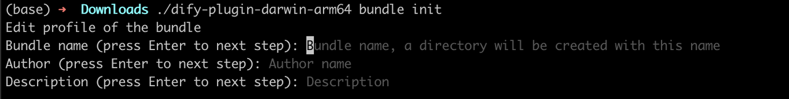
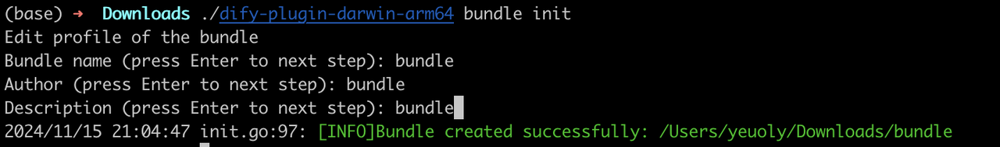

# Bundle 插件包

> 将多个插件打包进一个 Bundle，支持 Marketplace、GitHub 和 Package 三种依赖类型

> 本文档由 AI 自动翻译。如有任何不准确之处，请参考 [英文原版](https://docs.dify.ai/en/develop-plugin/features-and-specs/advanced-development/bundle.md)。

Bundle 插件包是多个插件打包在一起的集合，用户一步即可全部安装。

使用 Dify 插件 CLI 将多个插件打包成一个 Bundle。Bundle 依赖分为三种类型：

* **`Marketplace`**：存储插件的 ID 和版本。导入时，Dify 从 Dify Marketplace 下载插件包。
* **`GitHub`**：存储 GitHub 仓库地址、发布版本号和资源文件名。导入时，Dify 从对应的 GitHub 仓库下载插件包。
* **`Package`**：将插件包直接存储在 Bundle 内部。不存储引用来源，但会使 Bundle 文件体积较大。

## 前置条件

* Dify 插件脚手架工具
* Python 环境（版本 3.12）

要配置插件开发脚手架工具，参见 [初始化开发工具](../../../%E5%BF%AB%E9%80%9F%E5%BC%80%E5%A7%8B/Dify%20%E6%8F%92%E4%BB%B6%20CLI.md)。

## 创建 Bundle 项目

在当前目录下，运行脚手架命令行工具创建新的插件包项目：

```bash theme={null}
./dify-plugin-darwin-arm64 bundle init
```

如果已将二进制文件重命名为 `dify` 并复制到 `/usr/local/bin`，运行：

```bash theme={null}
dify bundle init
```

### 1. 填写插件信息

按照提示配置插件名称、作者信息和插件描述。如果你是团队协作，也可以输入组织名称作为作者。

> [!NOTE]
>
> 名称长度必须为 1～128 个字符，只能包含字母、数字、连字符和下划线。



按 Enter 后，将自动创建 Bundle 插件项目目录。



### 2. 添加依赖

#### Marketplace

```bash theme={null}
dify-plugin bundle append marketplace . --marketplace_pattern=langgenius/openai:0.0.1
```

`marketplace_pattern` 是插件在 Marketplace 中的引用，格式为 `organization_name/plugin_name:version_number`。

#### GitHub

```bash theme={null}
dify-plugin bundle append github . --repo_pattern=langgenius/openai:0.0.1/openai.difypkg
```

`repo_pattern` 是插件在 GitHub 上的引用，格式为 `organization_name/repository_name:release/asset_name`。

#### Package

```bash theme={null}
dify-plugin bundle append package . --package_path=./openai.difypkg
```

`package_path` 是插件包的路径。

## 打包 Bundle 项目

运行以下命令打包 Bundle 插件：

```bash theme={null}
dify-plugin bundle package ./bundle
```

该命令会在当前目录创建 `bundle.difybndl` 文件，即最终的打包结果。
