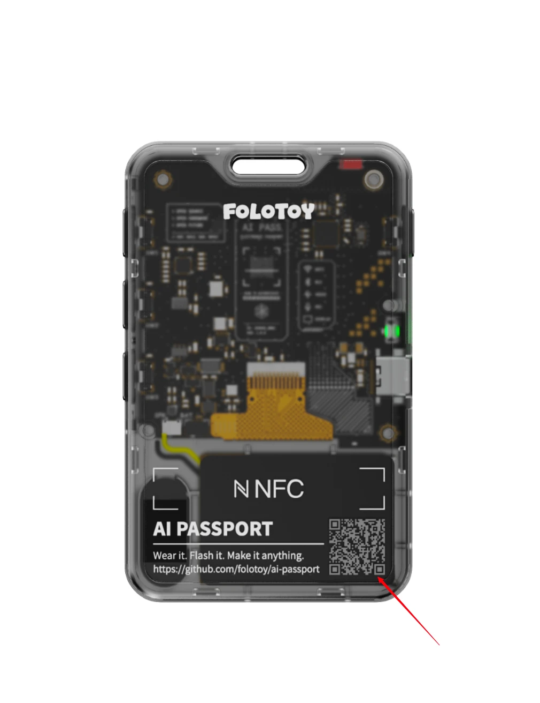
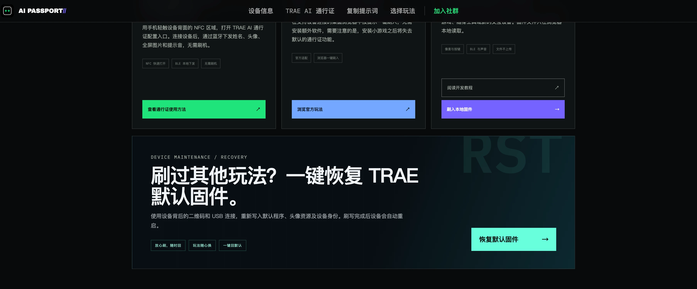

# 恢复出厂固件

扫描设备二维码后，把专属链接拷贝到电脑上，再用电脑上的 Chrome 或 Edge 浏览器和 Type-C 线恢复默认固件。

## 01 · 扫描设备背面的二维码

用手机相机扫描自己 AI Passport 背面的设备二维码，打开这台设备的专属页面。

扫描自己通行证背面的设备二维码

- 请扫描自己设备上的二维码

- 不要扫描教程图片中的示意二维码

## 02 · 把完整链接复制到电脑

在设备专属页面底部的恢复固件区域，点击醒目的“复制设备链接到电脑”按钮；也可以复制地址栏里的完整链接。通过微信文件传输助手或其他私密方式把链接拷贝到自己的电脑，再使用桌面版 Chrome 或 Edge 打开。

> **提示**
> 链接包含当前设备的 SN 和 KEY，只能发送给自己的电脑，请勿公开分享或转发给其他人。

## 03 · 用 Type-C 线连接并开机

使用支持数据传输的 USB-C（Type-C）线连接 AI Passport 和电脑，然后按住通行证左侧的电源键开机。

连接 Type-C 线，然后按左侧电源键开机

- 使用支持数据传输的 Type-C 线，不要使用只能充电的线

- 保持设备和电脑连接，直到恢复完成

## 04 · 进入恢复默认固件页面

在电脑打开的设备专属页面中向下滚动到底部，点击“恢复默认固件”。进入恢复页面后，点击“连接并核对设备”，在浏览器弹窗中选择 AI Passport 对应的 USB 串口；核对无误后勾选确认项，再点击“执行完整恢复”。

在设备专属页面底部点击“恢复默认固件”

> **提示**
> 浏览器弹窗中请选择名称包含 USB JTAG/serial debug unit 的串口，不要选择蓝牙或耳机设备。

## 05 · 等待固件刷入完成

保持页面打开并等待默认固件下载、校验和写入。恢复成功后，AI Passport 会自动重启；看到页面提示恢复完成后，再拔掉 Type-C 线。接着打开[微信小程序](<weixin://dl/business/?appid=wxd2a90fe8e2accc23&path=pages/index/index&env_version=release>)，重新连接设备，同步通行证内容。

- 恢复过程中不要拔线

- 不要关闭或刷新浏览器页面

- 设备自动重启并提示恢复完成后再断开连接
