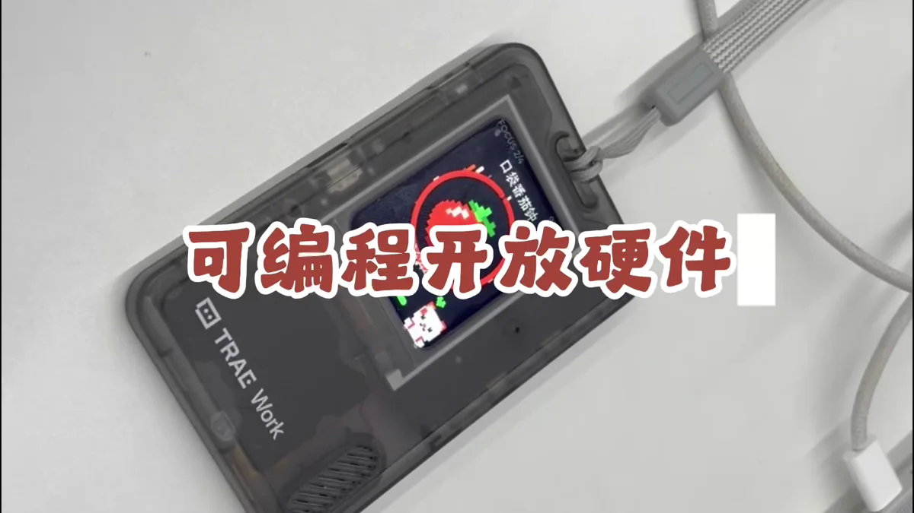
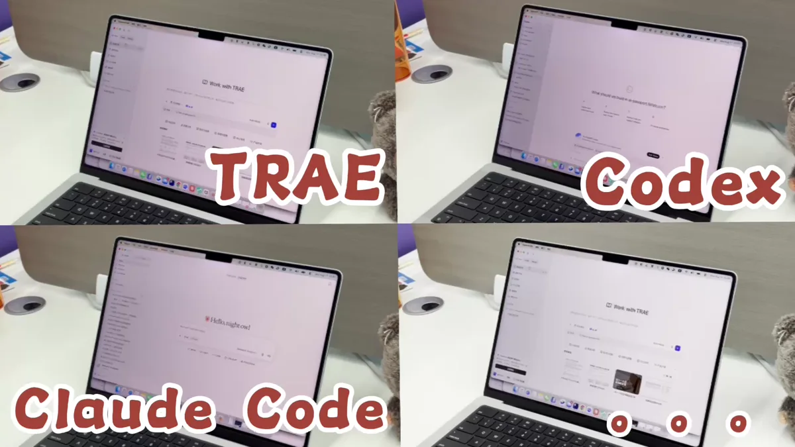
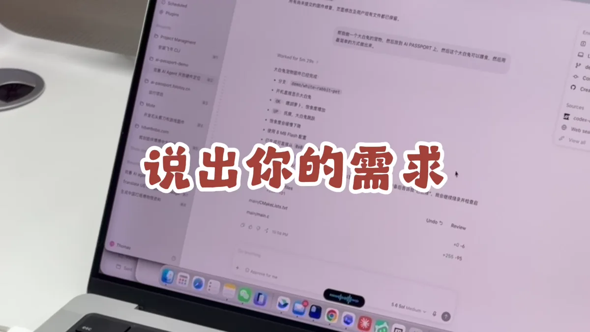

# 用 AI Agent 创造专属玩法

从一句清晰的需求开始，让 AI 编程 Agent 完成开发与构建，再把玩法安装到真实的 AI Passport。

<a id="step-1"></a>

## 01 · 先决定它要解决什么问题

AI Passport 的小屏幕、实体按键和随身形态可以承载学习工具、小游戏、计时器、身份展示等不同体验。先选定一个真实场景，并用一句话写清楚用户拿起设备后要完成什么。


一块小屏幕，也可以承载许多不同的体验

- 场景：它会在什么时候、由谁使用？

- 目标：用户完成哪个动作就算成功？

- 范围：第一版只保留一个核心体验。

<a id="step-2"></a>

## 02 · 先安装一个社区玩法，确认设备可连接

用 USB 数据线连接 AI Passport，从[玩法社区↗](<https://ai-passport.folotoy.cn/plays/>)选择一个用户分享的玩法并完成一次安装。这样可以先确认数据线、浏览器串口权限和设备连接都工作正常。


先用已发布玩法确认连接与安装流程

> **提示**
> 这一步不会替代开发，但能先排除线材或连接问题，给后面的自定义玩法验证留下可靠基线。

<a id="step-3"></a>

## 03 · 定义专属玩法的最小版本

把想法收敛成可以在真实硬件上验证的第一版。明确屏幕上显示什么、三个按键分别做什么，以及是否需要声音、蓝牙、网络或本地存储。



围绕真实硬件能力缩小第一版范围

- 界面：列出主要画面、文字和状态

- 输入：定义上键、下键和确定键的短按或长按行为

- 反馈：说明成功、失败、加载和退出时的表现

- 约束：写明屏幕尺寸、离线需求、资源大小和目标硬件

<a id="step-4"></a>

## 04 · 选择一个 AI 编程 Agent

使用 TRAE、Codex、Claude Code 或其它可以读取项目、修改代码并运行构建命令的 AI 编程 Agent。打开玩法项目目录，让 Agent 先检查项目说明、已有示例和构建方式，再开始修改。

**发送给 Agent 的提示词**

```text
请基于完整项目 https://gitee.com/FoloToy/ai-passport 开发<填写应用需求>；本地已有项目则复用。
先读 AGENTS.md 和 docs/README.md，按需查阅相关文档、硬件接口及示例，自行准备环境并安装项目要求的 Skill。
保留已有修改，新建分支开发。复用 BSP，重新设计应用界面，不照搬 demo；中文界面检查字体覆盖。关键需求不明确时询问，其余自主完成。
运行项目验证，交付可从 0x0 刷写的合并固件，说明测试结果与未验证项。完成后主动询问是否刷机测试，未经确认不烧录。
```



选择能够在完整项目中开发和构建的 Agent

> **提示**
> 不要只粘贴一段孤立代码。让 Agent 在完整项目中工作，才能复用正确的依赖、硬件配置和构建流程。

<a id="step-5"></a>

## 05 · 把需求说清楚

把前面整理好的场景、界面、按键和约束一次性交给 Agent，并要求它先复述方案和实施步骤。信息越具体，第一版越接近可以直接上手验证的体验。



先说清需求，再让 Agent 开始实现

- 我要做什么，以及给谁使用

- 启动后的第一屏和完整操作流程

- 每个按键在不同状态下的行为

- 必须复用的现有代码、素材或接口

- 完成标准：构建成功并输出可安装的玩法文件

<a id="step-6"></a>

## 06 · 让 Agent 完成开发、构建与自检

让 Agent 按计划实现功能，运行项目提供的构建命令，并根据错误继续修正。结束时请它说明改动内容、测试结果、玩法文件路径，以及仍然存在的限制。


把实现、构建和错误修正交给同一个工作流

> **提示**
> 源代码生成完不等于任务完成。至少确认构建命令成功结束，并能找到项目实际产出的玩法文件。

<a id="step-7"></a>

## 07 · 安装玩法，在真实硬件上验证

打开[本地玩法安装工具↗](<https://ai-passport.folotoy.cn/tools/web-flasher/>)，选择 Agent 构建出的玩法文件并连接 AI Passport。核对文件与设备后开始安装；完成后重启设备，逐项检查屏幕、按键、声音和连接功能。


构建结果最终要回到真实硬件上验证

- 安装过程中不要拔线或关闭页面

- 第一次先使用测试设备，并熟悉默认固件恢复方法

- 记录与预期不一致的画面、按键和异常日志，再交给 Agent 修正

<a id="step-8"></a>

## 08 · 把它带进真实场景，再迭代一轮

离开电脑后再使用一次，观察文字是否清楚、单手按键是否顺畅、反馈是否及时，以及电量和连接是否符合场景。把最影响使用的问题按优先级交给 Agent，重新构建和刷写。


它可以是学习工具、小游戏，也可以是只属于你的随身体验

- 先修复阻塞核心流程的问题

- 一次迭代只改变少量可验证内容

- 为每个可用版本保留版本号、源码提交和玩法备份
