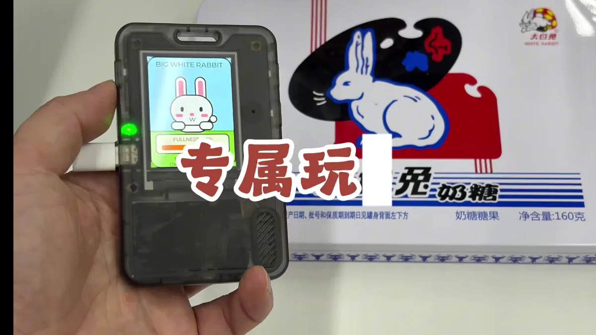
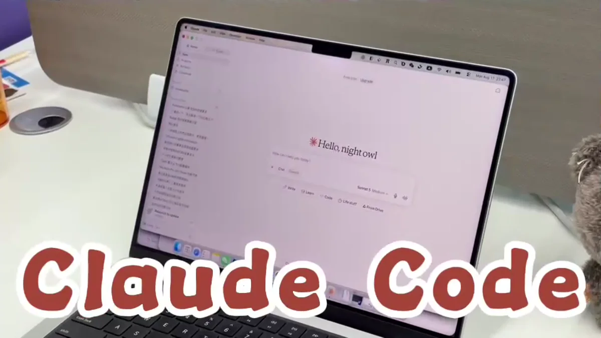
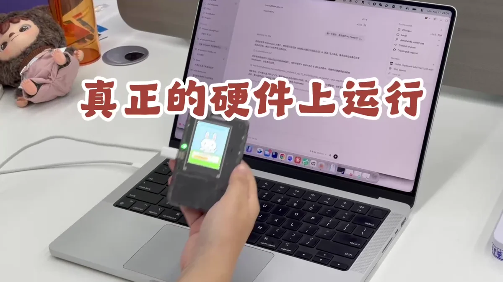

# 用 Claude Code 创造 AI Passport 玩法

让 Claude Code 理解玩法项目与硬件约束，生成可安装版本，并根据真实设备反馈继续完善。

<a id="step-1"></a>

## 01 · 选定专属玩法和最小目标

先用一句话定义这次要做的专属玩法，并把第一版限制在一个核心流程。例如一项学习练习、一局短游戏或一个随身提醒；暂时不要同时加入过多页面和连接能力。



从一个可以在设备上完成的专属体验开始

- 写清使用者和真实场景

- 定义一次完整操作从哪里开始、在哪里结束

- 列出第一版必须有和明确不做的内容

<a id="step-2"></a>

## 02 · 在 Claude Code 中打开玩法目录

从玩法项目根目录开始 Claude Code 会话。先让它阅读项目说明、构建脚本、目标芯片配置和相近示例，并请它在修改前说明准备调整哪些文件。

**发送给 Agent 的提示词**

```text
请基于完整项目 https://gitee.com/FoloToy/ai-passport 开发<填写应用需求>；本地已有项目则复用。
先读 AGENTS.md 和 docs/README.md，按需查阅相关文档、硬件接口及示例，自行准备环境并安装项目要求的 Skill。
保留已有修改，新建分支开发。复用 BSP，重新设计应用界面，不照搬 demo；中文界面检查字体覆盖。关键需求不明确时询问，其余自主完成。
运行项目验证，交付可从 0x0 刷写的合并固件，说明测试结果与未验证项。完成后主动询问是否刷机测试，未经确认不烧录。
```



在完整玩法目录中开始 Claude Code 会话

> **提示**
> 保留项目原有结构和命令。优先复用现有显示、按键和资源加载代码，减少无关重构。

<a id="step-3"></a>

## 03 · 补齐 AI Passport 的硬件约束

把屏幕尺寸、三个实体按键、声音和连接能力写进任务，说明每个页面的状态和退出方式。要求 Claude Code 以当前项目支持的硬件接口为准，不要假设不存在的输入或外设。


让需求始终对应真实设备能力

- 屏幕内容、刷新节奏和资源大小

- 上键、下键、确定键的行为

- 离线运行、蓝牙、网络或存储要求

- 启动、失败、重试和退出状态

<a id="step-4"></a>

## 04 · 让 Claude Code 修改、构建并总结

请 Claude Code 按确认后的方案实现，运行项目提供的构建和检查命令，并根据编译错误继续修正。完成时让它给出改动摘要、验证结果和最终玩法路径。

> **提示**
> 如果它只完成了代码修改，继续要求执行真实构建；只有构建成功并找到玩法文件后，才进入安装步骤。

<a id="step-5"></a>

## 05 · 把玩法安装到开发设备

使用[本地玩法安装工具↗](<https://ai-passport.folotoy.cn/tools/web-flasher/>)选择 Claude Code 生成的玩法，核对设备和文件后开始安装。写入完成后重启，依次检查首屏、按键、声音和需要的连接能力。



构建结果要在真实设备上完成第一次验证

- 安装前保留可恢复版本

- 写入过程中保持 USB 稳定连接

- 记录异常画面、操作步骤和设备日志

<a id="step-6"></a>

## 06 · 用实机反馈继续迭代

让目标使用者真正拿在手里完成一次任务，观察提示是否容易理解、按键是否顺手、反馈是否及时。把最重要的问题连同复现步骤交回 Claude Code，再完成下一轮小范围修改。


把真实使用反馈带回下一轮 Claude Code 迭代

- 优先修复阻塞核心流程的问题

- 一次只改动少量可验证内容

- 为稳定版本保留源码提交、玩法和测试记录
