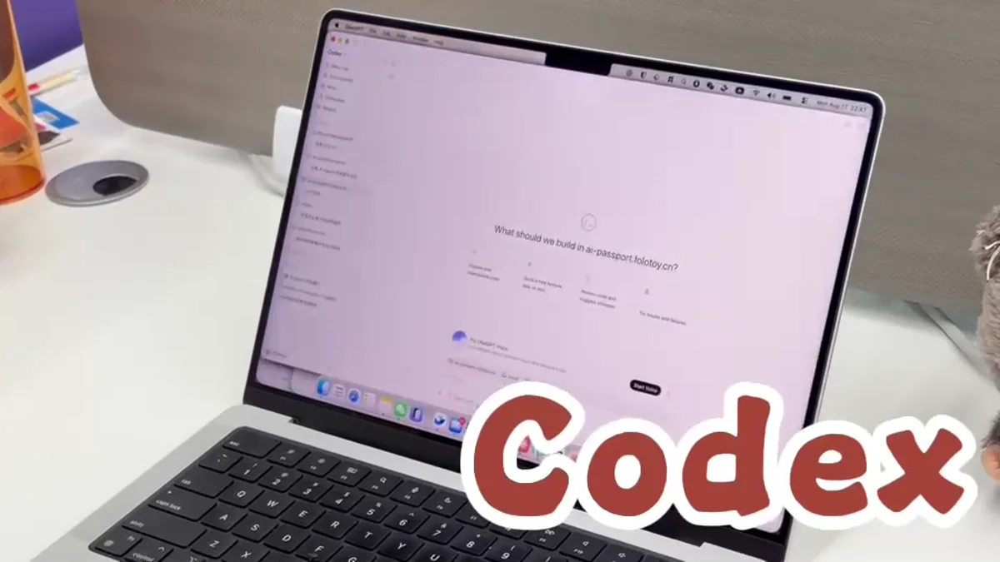

# 用 Codex 创造 AI Passport 玩法

在 Codex 中打开玩法项目，把想法写成可验收任务，完成构建、安装与实机迭代。

<a id="step-1"></a>

## 01 · 准备玩法项目和测试设备

先准备可以正常构建的 AI Passport 玩法项目，并选一台用于开发的设备。记录项目依赖、构建命令和当前可恢复的玩法，让后续问题能够区分是环境、代码还是硬件造成的。


先建立一套可以构建、刷写和恢复的开发基线

- 确认原项目可以完成一次干净构建

- 熟悉默认固件恢复方法，保留已验证的稳定版本

- 使用支持数据传输的 USB 线连接测试设备

<a id="step-2"></a>

## 02 · 在 Codex 中打开玩法项目

把完整玩法项目作为 Codex 的工作区。第一条消息先让 Codex 阅读项目说明、硬件配置、现有示例和构建脚本，并总结它准备复用的代码路径；确认理解一致后再开始修改。

**发送给 Agent 的提示词**

```text
请基于完整项目 https://gitee.com/FoloToy/ai-passport 开发<填写应用需求>；本地已有项目则复用。
先读 AGENTS.md 和 docs/README.md，按需查阅相关文档、硬件接口及示例，自行准备环境并安装项目要求的 Skill。
保留已有修改，新建分支开发。复用 BSP，重新设计应用界面，不照搬 demo；中文界面检查字体覆盖。关键需求不明确时询问，其余自主完成。
运行项目验证，交付可从 0x0 刷写的合并固件，说明测试结果与未验证项。完成后主动询问是否刷机测试，未经确认不烧录。
```



选择 Codex，并让它先理解完整项目

> **提示**
> 完整项目上下文比孤立代码片段更可靠，也更容易让构建、测试和最终玩法保持在同一条工作流里。

<a id="step-3"></a>

## 03 · 把玩法写成可验收任务

告诉 Codex 玩法给谁使用、启动后看到什么、三个实体按键如何操作，以及完成时应该出现什么结果。最后明确要求它运行构建并交付可刷写文件，而不是只生成源代码。


把想法变成包含硬件约束和完成标准的任务

- 场景与核心目标

- 屏幕页面、状态和文字

- 上键、下键、确定键的短按与长按行为

- 声音、蓝牙、网络和存储需求

- 完成标准、构建命令和玩法输出格式

<a id="step-4"></a>

## 04 · 让 Codex 实现、构建并修复错误

让 Codex 按计划修改代码，运行项目原有的构建或测试命令，并根据真实报错继续修正。完成后要求它列出修改内容、验证结果、玩法文件路径和仍未覆盖的风险。


让实现、构建、错误修正和结果说明连续完成

> **提示**
> 如果构建失败，把完整错误保留在当前任务里继续处理；不要跳过验证，也不要把未经构建的源码当作最终结果。

<a id="step-5"></a>

## 05 · 把构建结果安装到 AI Passport

打开[本地玩法安装工具↗](<https://ai-passport.folotoy.cn/tools/web-flasher/>)，选择 Codex 输出的玩法文件，核对目标设备后开始安装。写入期间保持 USB 连接；完成后重启设备，先检查能否正常启动。


最终结果必须在真实硬件上启动并运行

- 确认选择的是本次构建生成的文件

- 安装过程中不要拔线或关闭页面

- 出现异常时保留设备日志和构建标识

<a id="step-6"></a>

## 06 · 实机体验，再把反馈交回 Codex

离开电脑完整玩一遍，检查小屏文字、单手按键、启动速度和异常恢复。把复现步骤、画面和日志交回同一个 Codex 任务，请它只修改最影响体验的问题，再重新构建和刷写。


用真实操作反馈推动下一轮 Codex 迭代

- 一次迭代聚焦少量可复现问题

- 每个可用版本保留源码提交和玩法备份

- 稳定后再增加新的页面、规则或连接能力
