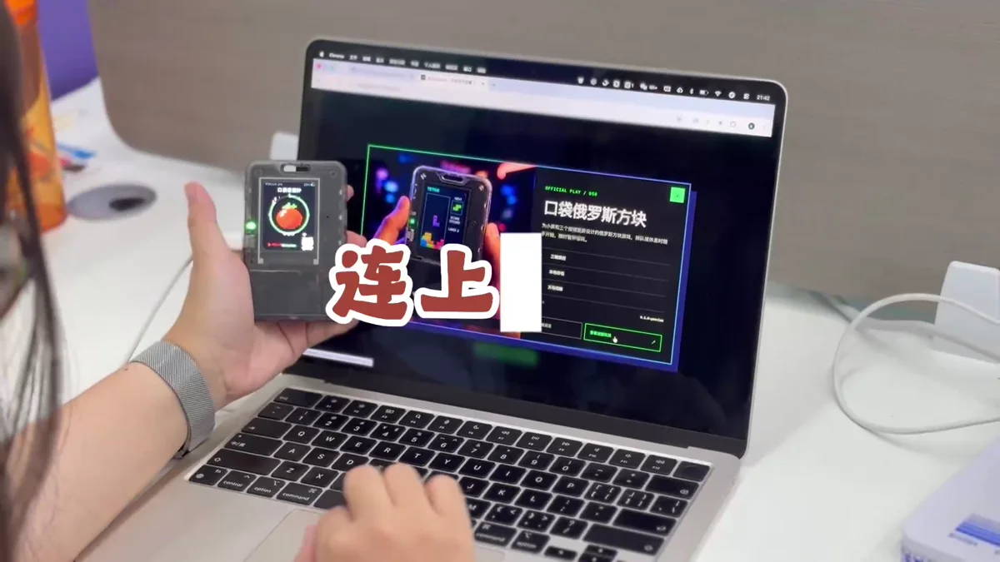
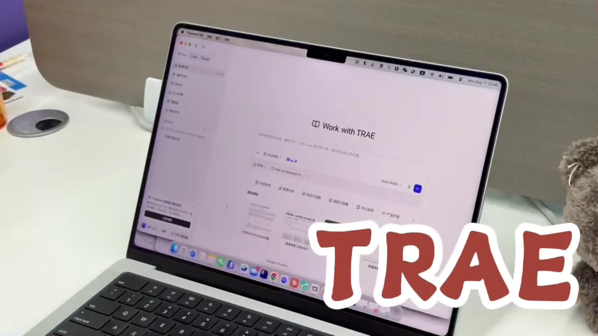
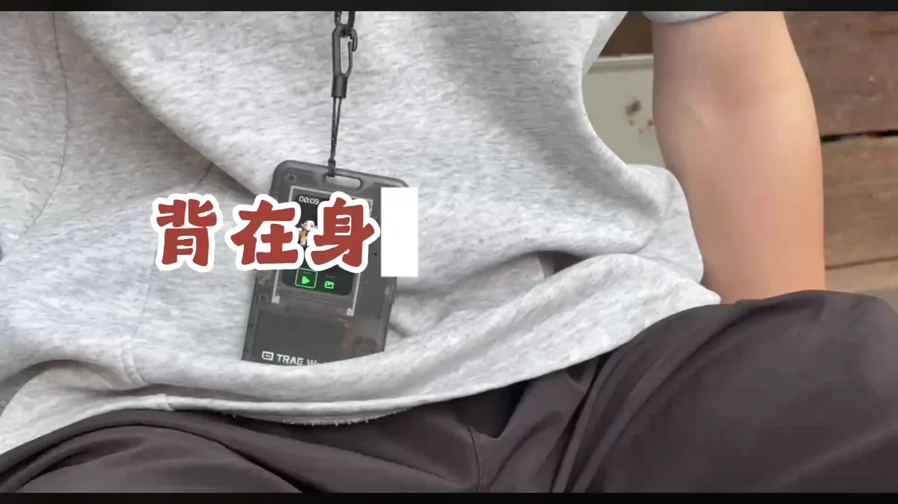

# 用 TRAE 创造 AI Passport 玩法

在 TRAE Work 中描述玩法、完成代码与构建，再把新体验装进随身的 AI Passport。

<a id="step-1"></a>

## 01 · 连接设备并确认安装基线

用 USB 数据线连接 AI Passport，先从[玩法社区↗](<https://ai-passport.folotoy.cn/plays/>)完成一次已发布玩法的安装，确认浏览器串口权限、线材和设备都能正常工作。



先确认设备连接和社区玩法安装流程正常

> **提示**
> 这一步能先排除连接问题，也为自定义玩法准备一个明确的恢复路径。

<a id="step-2"></a>

## 02 · 在 TRAE Work 中打开玩法项目

进入 TRAE Work，把完整玩法目录作为项目打开。先让 Agent 阅读项目说明、构建脚本、目标硬件和现有玩法示例，并在动手前总结开发方案。

**发送给 Agent 的提示词**

```text
请基于完整项目 https://gitee.com/FoloToy/ai-passport 开发<填写应用需求>；本地已有项目则复用。
先读 AGENTS.md 和 docs/README.md，按需查阅相关文档、硬件接口及示例，自行准备环境并安装项目要求的 Skill。
保留已有修改，新建分支开发。复用 BSP，重新设计应用界面，不照搬 demo；中文界面检查字体覆盖。关键需求不明确时询问，其余自主完成。
运行项目验证，交付可从 0x0 刷写的合并固件，说明测试结果与未验证项。完成后主动询问是否刷机测试，未经确认不烧录。
```



在 TRAE Work 中载入完整玩法项目

> **提示**
> 让 TRAE 在项目目录内完成修改和命令执行，不要只在聊天里生成一段脱离工程的代码。

<a id="step-3"></a>

## 03 · 说明你想做的专属玩法

用自然语言写清场景、首屏、操作流程和完成结果，并补充三个实体按键、声音、蓝牙或网络要求。先做可以在硬件上快速验证的最小版本。


从一项清晰的专属体验开始

- 谁会在什么场景使用

- 屏幕需要显示哪些页面和状态

- 三个按键分别如何操作

- 第一版的完成标准和明确边界

<a id="step-4"></a>

## 04 · 让 TRAE 完成代码、构建和检查

让 TRAE 按确认后的方案修改代码，运行项目提供的构建命令，并继续修复编译错误。完成时要求它说明改动文件、验证结果、玩法路径和仍需实机确认的部分。

> **提示**
> 不要在生成代码后直接结束。必须看到构建成功，并确认实际输出了可安装的玩法文件。

<a id="step-5"></a>

## 05 · 安装玩法并逐项检查

打开[本地玩法安装工具↗](<https://ai-passport.folotoy.cn/tools/web-flasher/>)，选择 TRAE 构建的玩法并写入测试设备。重启后检查首屏、按键、声音、连接与异常恢复是否符合需求。


让 TRAE 的构建结果在真实硬件上运行

- 写入过程中保持 USB 连接

- 先用测试设备验证并保留恢复版本

- 把异常操作步骤和日志记录下来

<a id="step-6"></a>

## 06 · 把它作为随身设备实际使用

佩戴或随身携带一段时间，观察户外可读性、单手操作、连接稳定性和电量表现。把最影响体验的问题按优先级交回 TRAE，完成下一轮小范围修改、构建和刷写。



从桌面开发走到真正的随身使用

- 真实场景优先于桌面演示

- 一次迭代只处理少量关键问题

- 为每个稳定版本保留代码与玩法备份
