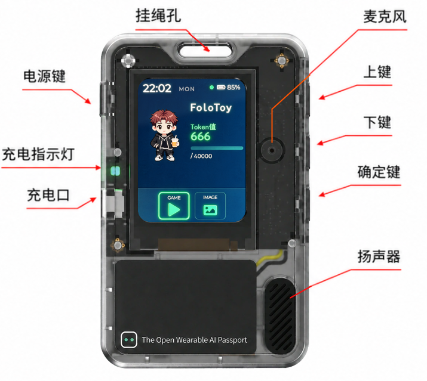
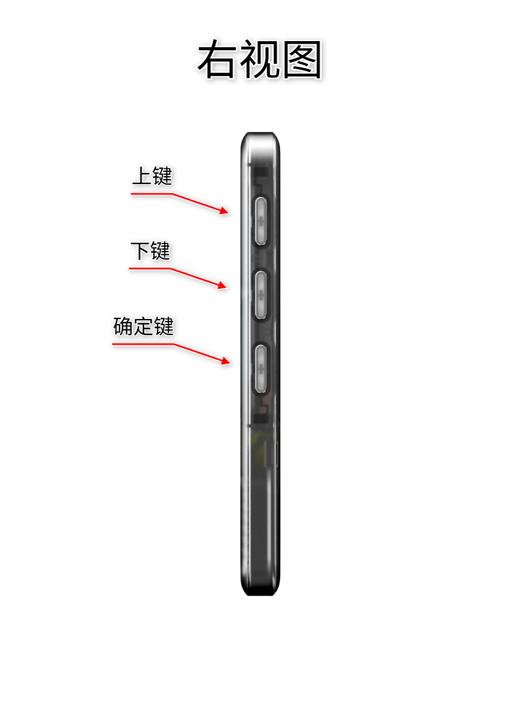

# 第一次使用 AI Passport

用[微信小程序](<weixin://dl/business/?appid=wxd2a90fe8e2accc23&path=pages/index/index&env_version=release>)同步名称、头像、简介和全屏图片，了解按键、内置游戏与充电。

## 01 · 认识按键与开关机

AI Passport 出厂已经内置身份卡玩法，不需要连接电脑或安装其他内容。先认识左侧电源键和右侧的上、下、确定三个功能键，再从主界面开始使用。

正面结构与按键位置（临时示意图）

右侧三个功能键（临时示意图）

- 开机：按住电源键 0.5 秒，屏幕点亮并进入主界面。

- 休眠唤醒：无操作一段时间后屏幕会自动熄灭省电，按任意功能键即可唤醒。

- 关机：长按电源键 2 秒。

> **提示**
> 第一次使用先保留出厂玩法。熟悉身份卡和内置小游戏后，再决定是否更换其他玩法。

## 02 · 连接微信小程序

打开手机蓝牙和 AI Passport [微信小程序](<weixin://dl/business/?appid=wxd2a90fe8e2accc23&path=pages/index/index&env_version=release>)，让设备保持开机并靠近手机。在“附近的设备”中选择你的 AI Passport，连接完成后进入内容工作台。

> 如果已安装过其他玩法，请先恢复默认固件，再使用小程序的通行证功能。
>
>
>
> 扫描设备背面的二维码，打开设备专属网页，再按引导在电脑上完成恢复。
>
> [查看恢复默认固件指引 →](<恢复出厂固件.md>)

- 打开手机系统蓝牙

- 让 AI Passport 靠近手机

- 在附近设备中选择并连接

## 03 · 同步身份内容与全屏图片

身份卡的内容都可以在 AI Passport [微信小程序](<weixin://dl/business/?appid=wxd2a90fe8e2accc23&path=pages/index/index&env_version=release>)中完成。你可以同步名称、头像和一段简单的自我介绍，也可以选择并发送一张全屏图片；传输完成后，设备屏幕会显示更新后的内容。

- 同步名称

- 同步头像

- 同步简单的自我介绍

- 同步全屏图片

> **提示**
> 这些内容通过本地蓝牙在微信小程序和当前设备之间传输。

## 04 · 体验内置小游戏

出厂身份卡玩法还内置了一款趣味小游戏，不需要安装其他玩法。使用右侧三个功能键即可完成选择、操作和退出。

- 进入游戏：在主界面用上 / 下键选中“游戏”磁贴，按确定键进入。

- 开始和操作：按确定键开始；游戏中用上 / 下键控制，短按确定键冲刺或操作。

- 重来和退出：游戏结束后按确定键重来；长按确定键退出并返回主界面。

## 05 · 为 AI Passport 充电

使用 USB-C 线连接充电器或电脑即可充电。

- 充电指示灯为绿色：充电时常亮，充满后自动熄灭。

- 屏幕界面不显示充电状态，请以充电指示灯为准。

## 身份卡只是开始。

设备已经内置一款趣味小游戏。想尝试更多内容，可以到玩法社区发现用户分享的小游戏、工具和创意互动。安装新玩法会覆盖设备当前的全部内容，请在安装前确认不再需要现有内容。你也可以跟着教程创造自己的玩法，再分享到社区。

[发现更多玩法↗](<https://ai-passport.folotoy.cn/plays/>)
