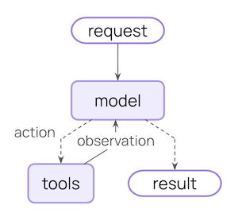

# Context engineering in agents

## Overview

The hard part of building agents (or any LLM application) is making them reliable enough. While they may work for a prototype, they often fail in real-world use cases.

### Why do agents fail?

When agents fail, it's usually because the LLM call inside the agent took the wrong action / didn't do what we expected. LLMs fail for one of two reasons:

1. The underlying LLM is not capable enough
2. The "right" context was not passed to the LLM

More often than not - it's actually the second reason that causes agents to not be reliable.

**Context engineering** is providing the right information and tools in the right format so the LLM can accomplish a task. This is the number one job of AI Engineers. This lack of "right" context is the number one blocker for more reliable agents, and LangChain's agent abstractions are uniquely designed to facilitate context engineering.

> [!TIP]
>
> New to context engineering? Start with the [conceptual overview](https://docs.langchain.com/oss/python/concepts/context.md) to understand the different types of context and when to use them.

### The agent loop

A typical agent loop consists of two main steps:

1. **Model call** - calls the LLM with a prompt and available tools, returns either a response or a request to execute tools
2. **Tool execution** - executes the tools that the LLM requested, returns tool results



This loop continues until the LLM decides to finish.

### What you can control

To build reliable agents, you need to control what happens at each step of the agent loop, as well as what happens between steps.

| Context Type | What You Control | Transient or Persistent |
| - | - | - |
| **[Model Context](#model-context)** | What goes into model calls (instructions, message history, tools, response format) | Transient |
| **[Tool Context](#tool-context)** | What tools can access and produce (reads/writes to state, store, runtime context) | Persistent |
| **[Life-cycle Context](#life-cycle-context)** | What happens between model and tool calls (summarization, guardrails, logging, etc.) | Persistent |

> [card] Transient context
>
> What the LLM sees for a single call. You can modify messages, tools, or prompts without changing what's saved in state.

> [card] Persistent context
>
> What gets saved in state across turns. Life-cycle hooks and tool writes modify this permanently.

### Data sources

Throughout this process, your agent accesses (reads / writes) different sources of data:

| Data Source | Also Known As | Scope | Examples |
| - | - | - | - |
| **Runtime Context** | Static configuration | Conversation-scoped | User ID, API keys, database connections, permissions, environment settings |
| **State** | Short-term memory | Conversation-scoped | Current messages, uploaded files, authentication status, tool results |
| **Store** | Long-term memory | Cross-conversation | User preferences, extracted insights, memories, historical data |

### How it works

LangChain [middleware](https://docs.langchain.com/oss/python/langchain/middleware.md) is the mechanism under the hood that makes context engineering practical for developers using LangChain.

Middleware allows you to hook into any step in the agent lifecycle and:

* Update context
* Jump to a different step in the agent lifecycle

Throughout this guide, you'll see frequent use of the middleware API as a means to the context engineering end.

## Model context

Control what goes into each model call - instructions, available tools, which model to use, and output format. These decisions directly impact reliability and cost.

> [card] [System Prompt](#system-prompt)
>
> Base instructions from the developer to the LLM.

> [card] [Messages](#messages)
>
> The full list of messages (conversation history) sent to the LLM.

> [card] [Tools](#tools)
>
> Utilities the agent has access to for taking actions.

> [card] [Model](#model)
>
> The actual model (including configuration) to be called.

> [card] [Response Format](#response-format)
>
> Schema specification for the model's final response.

All of these types of model context can draw from **state** (short-term memory), **store** (long-term memory), or **runtime context** (static configuration).

### System Prompt

The system prompt sets the LLM's behavior and capabilities. Different users, contexts, or conversation stages need different instructions. Successful agents draw on memories, preferences, and configuration to provide the right instructions for the current state of the conversation.

> [tab] State
>
> Access message count or conversation context from state:
>
> ```python
> from langchain.agents import create_agent
> from langchain.agents.middleware import dynamic_prompt, ModelRequest
>
> @dynamic_prompt
> def state_aware_prompt(request: ModelRequest) -> str:
>     # request.messages is a shortcut for request.state["messages"]
>     message_count = len(request.messages)
>
>     base = "You are a helpful assistant."
>
>     if message_count > 10:
>         base += "\nThis is a long conversation - be extra concise."
>
>     return base
>
> agent = create_agent(
>     model="gpt-6.1-sol",
>     tools=[...],
>     middleware=[state_aware_prompt]
> )
> ```

> [tab] Store
>
> Access user preferences from long-term memory:
>
> ```python
> from dataclasses import dataclass
> from langchain.agents import create_agent
> from langchain.agents.middleware import dynamic_prompt, ModelRequest
> from langgraph.store.memory import InMemoryStore
>
> @dataclass
> class Context:
>     user_id: str
>
> @dynamic_prompt
> def store_aware_prompt(request: ModelRequest) -> str:
>     user_id = request.runtime.context.user_id
>
>     # Read from Store: get user preferences
>     store = request.runtime.store
>     user_prefs = store.get(("preferences",), user_id)
>
>     base = "You are a helpful assistant."
>
>     if user_prefs:
>         style = user_prefs.value.get("communication_style", "balanced")
>         base += f"\nUser prefers {style} responses."
>
>     return base
>
> agent = create_agent(
>     model="gpt-6.1-sol",
>     tools=[...],
>     middleware=[store_aware_prompt],
>     context_schema=Context,
>     store=InMemoryStore()
> )
> ```

> [tab] Runtime Context
>
> Access user ID or configuration from Runtime Context:
>
> ```python
> from dataclasses import dataclass
> from langchain.agents import create_agent
> from langchain.agents.middleware import dynamic_prompt, ModelRequest
>
> @dataclass
> class Context:
>     user_role: str
>     deployment_env: str
>
> @dynamic_prompt
> def context_aware_prompt(request: ModelRequest) -> str:
>     # Read from Runtime Context: user role and environment
>     user_role = request.runtime.context.user_role
>     env = request.runtime.context.deployment_env
>
>     base = "You are a helpful assistant."
>
>     if user_role == "admin":
>         base += "\nYou have admin access. You can perform all operations."
>     elif user_role == "viewer":
>         base += "\nYou have read-only access. Guide users to read operations only."
>
>     if env == "production":
>         base += "\nBe extra careful with any data modifications."
>
>     return base
>
> agent = create_agent(
>     model="gpt-6.1-sol",
>     tools=[...],
>     middleware=[context_aware_prompt],
>     context_schema=Context
> )
> ```

### Messages

Messages make up the prompt that is sent to the LLM.
It's critical to manage the content of messages to ensure that the LLM has the right information to respond well.

> [tab] State
>
> Inject uploaded file context from State when relevant to current query:
>
> ```python
> from langchain.agents import create_agent
> from langchain.agents.middleware import wrap_model_call, ModelRequest, ModelResponse
> from typing import Callable
>
> @wrap_model_call
> def inject_file_context(
>     request: ModelRequest,
>     handler: Callable[[ModelRequest], ModelResponse]
> ) -> ModelResponse:
>     """Inject context about files user has uploaded this session."""
>     # Read from State: get uploaded files metadata
>     uploaded_files = request.state.get("uploaded_files", [])  # [!code highlight]
>
>     if uploaded_files:
>         # Build context about available files
>         file_descriptions = []
>         for file in uploaded_files:
>             file_descriptions.append(
>                 f"- {file['name']} ({file['type']}): {file['summary']}"
>             )
>
>         file_context = f"""Files you have access to in this conversation:
> {chr(10).join(file_descriptions)}
>
> Reference these files when answering questions."""
>
>         # Inject file context before recent messages
>         messages = [  # [!code highlight]
>             *request.messages,
>             {"role": "user", "content": file_context},
>         ]
>         request = request.override(messages=messages)  # [!code highlight]
>
>     return handler(request)
>
> agent = create_agent(
>     model="gpt-6.1-sol",
>     tools=[...],
>     middleware=[inject_file_context]
> )
> ```

> [tab] Store
>
> Inject user's email writing style from Store to guide drafting:
>
> ```python
> from dataclasses import dataclass
> from langchain.agents import create_agent
> from langchain.agents.middleware import wrap_model_call, ModelRequest, ModelResponse
> from typing import Callable
> from langgraph.store.memory import InMemoryStore
>
> @dataclass
> class Context:
>     user_id: str
>
> @wrap_model_call
> def inject_writing_style(
>     request: ModelRequest,
>     handler: Callable[[ModelRequest], ModelResponse]
> ) -> ModelResponse:
>     """Inject user's email writing style from Store."""
>     user_id = request.runtime.context.user_id  # [!code highlight]
>
>     # Read from Store: get user's writing style examples
>     store = request.runtime.store  # [!code highlight]
>     writing_style = store.get(("writing_style",), user_id)  # [!code highlight]
>
>     if writing_style:
>         style = writing_style.value
>         # Build style guide from stored examples
>         style_context = f"""Your writing style:
> - Tone: {style.get('tone', 'professional')}
> - Typical greeting: "{style.get('greeting', 'Hi')}"
> - Typical sign-off: "{style.get('sign_off', 'Best')}"
> - Example email you've written:
> {style.get('example_email', '')}"""
>
>         # Append at end - models pay more attention to final messages
>         messages = [
>             *request.messages,
>             {"role": "user", "content": style_context}
>         ]
>         request = request.override(messages=messages)  # [!code highlight]
>
>     return handler(request)
>
> agent = create_agent(
>     model="gpt-6.1-sol",
>     tools=[...],
>     middleware=[inject_writing_style],
>     context_schema=Context,
>     store=InMemoryStore()
> )
> ```

> [tab] Runtime Context
>
> Inject compliance rules from Runtime Context based on user's jurisdiction:
>
> ```python
> from dataclasses import dataclass
> from langchain.agents import create_agent
> from langchain.agents.middleware import wrap_model_call, ModelRequest, ModelResponse
> from typing import Callable
>
> @dataclass
> class Context:
>     user_jurisdiction: str
>     industry: str
>     compliance_frameworks: list[str]
>
> @wrap_model_call
> def inject_compliance_rules(
>     request: ModelRequest,
>     handler: Callable[[ModelRequest], ModelResponse]
> ) -> ModelResponse:
>     """Inject compliance constraints from Runtime Context."""
>     # Read from Runtime Context: get compliance requirements
>     jurisdiction = request.runtime.context.user_jurisdiction  # [!code highlight]
>     industry = request.runtime.context.industry  # [!code highlight]
>     frameworks = request.runtime.context.compliance_frameworks  # [!code highlight]
>
>     # Build compliance constraints
>     rules = []
>     if "GDPR" in frameworks:
>         rules.append("- Must obtain explicit consent before processing personal data")
>         rules.append("- Users have right to data deletion")
>     if "HIPAA" in frameworks:
>         rules.append("- Cannot share patient health information without authorization")
>         rules.append("- Must use secure, encrypted communication")
>     if industry == "finance":
>         rules.append("- Cannot provide financial advice without proper disclaimers")
>
>     if rules:
>         compliance_context = f"""Compliance requirements for {jurisdiction}:
> {chr(10).join(rules)}"""
>
>         # Append at end - models pay more attention to final messages
>         messages = [
>             *request.messages,
>             {"role": "user", "content": compliance_context}
>         ]
>         request = request.override(messages=messages)  # [!code highlight]
>
>     return handler(request)
>
> agent = create_agent(
>     model="gpt-6.1-sol",
>     tools=[...],
>     middleware=[inject_compliance_rules],
>     context_schema=Context
> )
> ```

> [!NOTE]
>
> **Transient vs Persistent Message Updates:**
>
> The examples above use `wrap_model_call` to make **transient** updates - modifying what messages are sent to the model for a single call without changing what's saved in state.
>
> For **persistent** updates that modify state, you can:
>
> * Return a [`ExtendedModelResponse`](https://reference.langchain.com/python/langchain/agents/middleware/types/ExtendedModelResponse) with a [`Command`](https://reference.langchain.com/python/langgraph/types/Command) from `wrap_model_call` to inject state updates from the model call layer.
> * Use life-cycle hooks like `before_model`, `after_model`, or `wrap_tool_call` (for tool returns) to update the conversation history. See the [middleware documentation](https://docs.langchain.com/oss/python/langchain/middleware.md) for more details.
>
> See [State updates](../Middleware/Custom%20middleware.md#state-updates) for more information.

### Tools

Tools let the model interact with databases, APIs, and external systems. How you define and select tools directly impacts whether the model can complete tasks effectively.

#### Defining tools

Each tool needs a clear name, description, argument names, and argument descriptions. These aren't just metadata—they guide the model's reasoning about when and how to use the tool.

```python
from langchain.tools import tool

@tool(parse_docstring=True)
def search_orders(
    user_id: str,
    status: str,
    limit: int = 10
) -> str:
    """Search for user orders by status.

    Use this when the user asks about order history or wants to check
    order status. Always filter by the provided status.

    Args:
        user_id: Unique identifier for the user
        status: Order status: 'pending', 'shipped', or 'delivered'
        limit: Maximum number of results to return
    """
    # Implementation here
    pass
```

#### Selecting tools

Not every tool is appropriate for every situation. Too many tools may overwhelm the model (overload context) and increase errors; too few limit capabilities. Dynamic tool selection adapts the available toolset based on authentication state, user permissions, feature flags, or conversation stage.

> [tab] State
>
> Enable advanced tools only after certain conversation milestones:
>
> ```python
> from langchain.agents import create_agent
> from langchain.agents.middleware import wrap_model_call, ModelRequest, ModelResponse
> from typing import Callable
>
> @wrap_model_call
> def state_based_tools(
>     request: ModelRequest,
>     handler: Callable[[ModelRequest], ModelResponse]
> ) -> ModelResponse:
>     """Filter tools based on conversation State."""
>     # Read from State: check if user has authenticated
>     state = request.state  # [!code highlight]
>     is_authenticated = state.get("authenticated", False)  # [!code highlight]
>     message_count = len(state["messages"])
>
>     # Only enable sensitive tools after authentication
>     if not is_authenticated:
>         tools = [t for t in request.tools if t.name.startswith("public_")]
>         request = request.override(tools=tools)  # [!code highlight]
>     elif message_count < 5:
>         # Limit tools early in conversation
>         tools = [t for t in request.tools if t.name != "advanced_search"]
>         request = request.override(tools=tools)  # [!code highlight]
>
>     return handler(request)
>
> agent = create_agent(
>     model="gpt-6.1-sol",
>     tools=[public_search, private_search, advanced_search],
>     middleware=[state_based_tools]
> )
> ```

> [tab] Store
>
> Filter tools based on user preferences or feature flags in Store:
>
> ```python
> from dataclasses import dataclass
> from langchain.agents import create_agent
> from langchain.agents.middleware import wrap_model_call, ModelRequest, ModelResponse
> from typing import Callable
> from langgraph.store.memory import InMemoryStore
>
> @dataclass
> class Context:
>     user_id: str
>
> @wrap_model_call
> def store_based_tools(
>     request: ModelRequest,
>     handler: Callable[[ModelRequest], ModelResponse]
> ) -> ModelResponse:
>     """Filter tools based on Store preferences."""
>     user_id = request.runtime.context.user_id
>
>     # Read from Store: get user's enabled features
>     store = request.runtime.store
>     feature_flags = store.get(("features",), user_id)
>
>     if feature_flags:
>         enabled_features = feature_flags.value.get("enabled_tools", [])
>         # Only include tools that are enabled for this user
>         tools = [t for t in request.tools if t.name in enabled_features]
>         request = request.override(tools=tools)
>
>     return handler(request)
>
> agent = create_agent(
>     model="gpt-6.1-sol",
>     tools=[search_tool, analysis_tool, export_tool],
>     middleware=[store_based_tools],
>     context_schema=Context,
>     store=InMemoryStore()
> )
> ```

> [tab] Runtime Context
>
> Filter tools based on user permissions from Runtime Context:
>
> ```python
> from dataclasses import dataclass
> from langchain.agents import create_agent
> from langchain.agents.middleware import wrap_model_call, ModelRequest, ModelResponse
> from typing import Callable
>
> @dataclass
> class Context:
>     user_role: str
>
> @wrap_model_call
> def context_based_tools(
>     request: ModelRequest,
>     handler: Callable[[ModelRequest], ModelResponse]
> ) -> ModelResponse:
>     """Filter tools based on Runtime Context permissions."""
>     # Read from Runtime Context: get user role
>     user_role = request.runtime.context.user_role
>
>     if user_role == "admin":
>         # Admins get all tools
>         pass
>     elif user_role == "editor":
>         # Editors can't delete
>         tools = [t for t in request.tools if t.name != "delete_data"]
>         request = request.override(tools=tools)
>     else:
>         # Viewers get read-only tools
>         tools = [t for t in request.tools if t.name.startswith("read_")]
>         request = request.override(tools=tools)
>
>     return handler(request)
>
> agent = create_agent(
>     model="gpt-6.1-sol",
>     tools=[read_data, write_data, delete_data],
>     middleware=[context_based_tools],
>     context_schema=Context
> )
> ```

See [Dynamic tools](../Core%20components/Tools.md#dynamic-tool-selection) for both filtering pre-registered tools and registering tools at runtime (e.g., from MCP servers).

### Model

Different models have different strengths, costs, and context windows. Select the right model for the task at hand, which
might change during an agent run.

> [tab] State
>
> Use different models based on conversation length from State:
>
> ```python
> from langchain.agents import create_agent
> from langchain.agents.middleware import wrap_model_call, ModelRequest, ModelResponse
> from langchain.chat_models import init_chat_model
> from typing import Callable
>
> # Initialize models once outside the middleware
> large_model = init_chat_model("claude-sonnet-4-6")
> standard_model = init_chat_model("gpt-6.1-sol")
> efficient_model = init_chat_model("gpt-5.4-mini")
>
> @wrap_model_call
> def state_based_model(
>     request: ModelRequest,
>     handler: Callable[[ModelRequest], ModelResponse]
> ) -> ModelResponse:
>     """Select model based on State conversation length."""
>     # request.messages is a shortcut for request.state["messages"]
>     message_count = len(request.messages)  # [!code highlight]
>
>     if message_count > 20:
>         # Long conversation - use model with larger context window
>         model = large_model
>     elif message_count > 10:
>         # Medium conversation
>         model = standard_model
>     else:
>         # Short conversation - use efficient model
>         model = efficient_model
>
>     request = request.override(model=model)  # [!code highlight]
>
>     return handler(request)
>
> agent = create_agent(
>     model="gpt-5.4-mini",
>     tools=[...],
>     middleware=[state_based_model]
> )
> ```

> [tab] Store
>
> Use user's preferred model from Store:
>
> ```python
> from dataclasses import dataclass
> from langchain.agents import create_agent
> from langchain.agents.middleware import wrap_model_call, ModelRequest, ModelResponse
> from langchain.chat_models import init_chat_model
> from typing import Callable
> from langgraph.store.memory import InMemoryStore
>
> @dataclass
> class Context:
>     user_id: str
>
> # Initialize available models once
> MODEL_MAP = {
>     "gpt-6.1-sol": init_chat_model("gpt-6.1-sol"),
>     "gpt-5.4-mini": init_chat_model("gpt-5.4-mini"),
>     "claude-sonnet": init_chat_model("claude-sonnet-4-6"),
> }
>
> @wrap_model_call
> def store_based_model(
>     request: ModelRequest,
>     handler: Callable[[ModelRequest], ModelResponse]
> ) -> ModelResponse:
>     """Select model based on Store preferences."""
>     user_id = request.runtime.context.user_id
>
>     # Read from Store: get user's preferred model
>     store = request.runtime.store
>     user_prefs = store.get(("preferences",), user_id)
>
>     if user_prefs:
>         preferred_model = user_prefs.value.get("preferred_model")
>         if preferred_model and preferred_model in MODEL_MAP:
>             request = request.override(model=MODEL_MAP[preferred_model])
>
>     return handler(request)
>
> agent = create_agent(
>     model="gpt-6.1-sol",
>     tools=[...],
>     middleware=[store_based_model],
>     context_schema=Context,
>     store=InMemoryStore()
> )
> ```

> [tab] Runtime Context
>
> Select model based on cost limits or environment from Runtime Context:
>
> ```python
> from dataclasses import dataclass
> from langchain.agents import create_agent
> from langchain.agents.middleware import wrap_model_call, ModelRequest, ModelResponse
> from langchain.chat_models import init_chat_model
> from typing import Callable
>
> @dataclass
> class Context:
>     cost_tier: str
>     environment: str
>
> # Initialize models once outside the middleware
> premium_model = init_chat_model("claude-sonnet-4-6")
> standard_model = init_chat_model("gpt-6.1-sol")
> budget_model = init_chat_model("gpt-5.4-mini")
>
> @wrap_model_call
> def context_based_model(
>     request: ModelRequest,
>     handler: Callable[[ModelRequest], ModelResponse]
> ) -> ModelResponse:
>     """Select model based on Runtime Context."""
>     # Read from Runtime Context: cost tier and environment
>     cost_tier = request.runtime.context.cost_tier
>     environment = request.runtime.context.environment
>
>     if environment == "production" and cost_tier == "premium":
>         # Production premium users get best model
>         model = premium_model
>     elif cost_tier == "budget":
>         # Budget tier gets efficient model
>         model = budget_model
>     else:
>         # Standard tier
>         model = standard_model
>
>     request = request.override(model=model)
>
>     return handler(request)
>
> agent = create_agent(
>     model="gpt-6.1-sol",
>     tools=[...],
>     middleware=[context_based_model],
>     context_schema=Context
> )
> ```

See [Dynamic model](../Core%20components/Models.md#dynamic-model-selection) for more examples.

### Response format

Structured output transforms unstructured text into validated, structured data. When extracting specific fields or returning data for downstream systems, free-form text isn't sufficient.

**How it works:** When you provide a schema as the response format, the model's final response is guaranteed to conform to that schema. The agent runs the model / tool calling loop until the model is done calling tools, then the final response is coerced into the provided format.

#### Defining formats

Schema definitions guide the model. Field names, types, and descriptions specify exactly what format the output should adhere to.

```python
from pydantic import BaseModel, Field

class CustomerSupportTicket(BaseModel):
    """Structured ticket information extracted from customer message."""

    category: str = Field(
        description="Issue category: 'billing', 'technical', 'account', or 'product'"
    )
    priority: str = Field(
        description="Urgency level: 'low', 'medium', 'high', or 'critical'"
    )
    summary: str = Field(
        description="One-sentence summary of the customer's issue"
    )
    customer_sentiment: str = Field(
        description="Customer's emotional tone: 'frustrated', 'neutral', or 'satisfied'"
    )
```

#### Selecting formats

Dynamic response format selection adapts schemas based on user preferences, conversation stage, or role—returning simple formats early and detailed formats as complexity increases.

> [tab] State
>
> Configure structured output based on conversation state:
>
> ```python
> from langchain.agents import create_agent
> from langchain.agents.middleware import wrap_model_call, ModelRequest, ModelResponse
> from pydantic import BaseModel, Field
> from typing import Callable
>
> class SimpleResponse(BaseModel):
>     """Simple response for early conversation."""
>     answer: str = Field(description="A brief answer")
>
> class DetailedResponse(BaseModel):
>     """Detailed response for established conversation."""
>     answer: str = Field(description="A detailed answer")
>     reasoning: str = Field(description="Explanation of reasoning")
>     confidence: float = Field(description="Confidence score 0-1")
>
> @wrap_model_call
> def state_based_output(
>     request: ModelRequest,
>     handler: Callable[[ModelRequest], ModelResponse]
> ) -> ModelResponse:
>     """Select output format based on State."""
>     # request.messages is a shortcut for request.state["messages"]
>     message_count = len(request.messages)  # [!code highlight]
>
>     if message_count < 3:
>         # Early conversation - use simple format
>         request = request.override(response_format=SimpleResponse)  # [!code highlight]
>     else:
>         # Established conversation - use detailed format
>         request = request.override(response_format=DetailedResponse)  # [!code highlight]
>
>     return handler(request)
>
> agent = create_agent(
>     model="gpt-6.1-sol",
>     tools=[...],
>     middleware=[state_based_output]
> )
> ```

> [tab] Store
>
> Configure output format based on user preferences in Store:
>
> ```python
> from dataclasses import dataclass
> from langchain.agents import create_agent
> from langchain.agents.middleware import wrap_model_call, ModelRequest, ModelResponse
> from pydantic import BaseModel, Field
> from typing import Callable
> from langgraph.store.memory import InMemoryStore
>
> @dataclass
> class Context:
>     user_id: str
>
> class VerboseResponse(BaseModel):
>     """Verbose response with details."""
>     answer: str = Field(description="Detailed answer")
>     sources: list[str] = Field(description="Sources used")
>
> class ConciseResponse(BaseModel):
>     """Concise response."""
>     answer: str = Field(description="Brief answer")
>
> @wrap_model_call
> def store_based_output(
>     request: ModelRequest,
>     handler: Callable[[ModelRequest], ModelResponse]
> ) -> ModelResponse:
>     """Select output format based on Store preferences."""
>     user_id = request.runtime.context.user_id
>
>     # Read from Store: get user's preferred response style
>     store = request.runtime.store
>     user_prefs = store.get(("preferences",), user_id)
>
>     if user_prefs:
>         style = user_prefs.value.get("response_style", "concise")
>         if style == "verbose":
>             request = request.override(response_format=VerboseResponse)
>         else:
>             request = request.override(response_format=ConciseResponse)
>
>     return handler(request)
>
> agent = create_agent(
>     model="gpt-6.1-sol",
>     tools=[...],
>     middleware=[store_based_output],
>     context_schema=Context,
>     store=InMemoryStore()
> )
> ```

> [tab] Runtime Context
>
> Configure output format based on Runtime Context like user role or environment:
>
> ```python
> from dataclasses import dataclass
> from langchain.agents import create_agent
> from langchain.agents.middleware import wrap_model_call, ModelRequest, ModelResponse
> from pydantic import BaseModel, Field
> from typing import Callable
>
> @dataclass
> class Context:
>     user_role: str
>     environment: str
>
> class AdminResponse(BaseModel):
>     """Response with technical details for admins."""
>     answer: str = Field(description="Answer")
>     debug_info: dict = Field(description="Debug information")
>     system_status: str = Field(description="System status")
>
> class UserResponse(BaseModel):
>     """Simple response for regular users."""
>     answer: str = Field(description="Answer")
>
> @wrap_model_call
> def context_based_output(
>     request: ModelRequest,
>     handler: Callable[[ModelRequest], ModelResponse]
> ) -> ModelResponse:
>     """Select output format based on Runtime Context."""
>     # Read from Runtime Context: user role and environment
>     user_role = request.runtime.context.user_role
>     environment = request.runtime.context.environment
>
>     if user_role == "admin" and environment == "production":
>         # Admins in production get detailed output
>         request = request.override(response_format=AdminResponse)
>     else:
>         # Regular users get simple output
>         request = request.override(response_format=UserResponse)
>
>     return handler(request)
>
> agent = create_agent(
>     model="gpt-6.1-sol",
>     tools=[...],
>     middleware=[context_based_output],
>     context_schema=Context
> )
> ```

## Tool context

Tools are special in that they both read and write context.

In the most basic case, when a tool executes, it receives the LLM's request parameters and returns a tool message back. The tool does its work and produces a result.

Tools can also fetch important information for the model that allows it to perform and complete tasks.

### Reads

Most real-world tools need more than just the LLM's parameters. They need user IDs for database queries, API keys for external services, or current session state to make decisions. Tools read from state, store, and runtime context to access this information.

> [tab] State
>
> Read from State to check current session information:
>
> ```python
> from langchain.tools import tool, ToolRuntime
> from langchain.agents import create_agent
>
> @tool
> def check_authentication(
>     runtime: ToolRuntime
> ) -> str:
>     """Check if user is authenticated."""
>     # Read from State: check current auth status
>     current_state = runtime.state
>     is_authenticated = current_state.get("authenticated", False)
>
>     if is_authenticated:
>         return "User is authenticated"
>     else:
>         return "User is not authenticated"
>
> agent = create_agent(
>     model="gpt-6.1-sol",
>     tools=[check_authentication]
> )
> ```

> [tab] Store
>
> Read from Store to access persisted user preferences:
>
> ```python
> from dataclasses import dataclass
> from langchain.tools import tool, ToolRuntime
> from langchain.agents import create_agent
> from langgraph.store.memory import InMemoryStore
>
> @dataclass
> class Context:
>     user_id: str
>
> @tool
> def get_preference(
>     preference_key: str,
>     runtime: ToolRuntime[Context]
> ) -> str:
>     """Get user preference from Store."""
>     user_id = runtime.context.user_id
>
>     # Read from Store: get existing preferences
>     store = runtime.store
>     existing_prefs = store.get(("preferences",), user_id)
>
>     if existing_prefs:
>         value = existing_prefs.value.get(preference_key)
>         return f"{preference_key}: {value}" if value else f"No preference set for {preference_key}"
>     else:
>         return "No preferences found"
>
> agent = create_agent(
>     model="gpt-6.1-sol",
>     tools=[get_preference],
>     context_schema=Context,
>     store=InMemoryStore()
> )
> ```

> [tab] Runtime Context
>
> Read from Runtime Context for configuration like API keys and user IDs:
>
> ```python
> from dataclasses import dataclass
> from langchain.tools import tool, ToolRuntime
> from langchain.agents import create_agent
>
> @dataclass
> class Context:
>     user_id: str
>     api_key: str
>     db_connection: str
>
> @tool
> def fetch_user_data(
>     query: str,
>     runtime: ToolRuntime[Context]
> ) -> str:
>     """Fetch data using Runtime Context configuration."""
>     # Read from Runtime Context: get API key and DB connection
>     user_id = runtime.context.user_id
>     api_key = runtime.context.api_key
>     db_connection = runtime.context.db_connection
>
>     # Use configuration to fetch data
>     results = perform_database_query(db_connection, query, api_key)
>
>     return f"Found {len(results)} results for user {user_id}"
>
> agent = create_agent(
>     model="gpt-6.1-sol",
>     tools=[fetch_user_data],
>     context_schema=Context
> )
>
> # Invoke with runtime context
> result = agent.invoke(
>     {"messages": [{"role": "user", "content": "Get my data"}]},
>     context=Context(
>         user_id="user_123",
>         api_key="sk-...",
>         db_connection="postgresql://..."
>     )
> )
> ```

### Writes

Tool results can be used to help an agent complete a given task. Tools can both return results directly to the model
and update the memory of the agent to make important context available to future steps.

> [tab] State
>
> Write to State to track session-specific information using Command:
>
> ```python
> from langchain.tools import tool, ToolRuntime
> from langchain.agents import create_agent
> from langgraph.types import Command
>
> @tool
> def authenticate_user(
>     password: str,
>     runtime: ToolRuntime
> ) -> Command:
>     """Authenticate user and update State."""
>     # Perform authentication (simplified)
>     if password == "correct":
>         # Write to State: mark as authenticated using Command
>         return Command(
>             update={"authenticated": True},
>         )
>     else:
>         return Command(update={"authenticated": False})
>
> agent = create_agent(
>     model="gpt-6.1-sol",
>     tools=[authenticate_user]
> )
> ```

> [tab] Store
>
> Write to Store to persist data across sessions:
>
> ```python
> from dataclasses import dataclass
> from langchain.tools import tool, ToolRuntime
> from langchain.agents import create_agent
> from langgraph.store.memory import InMemoryStore
>
> @dataclass
> class Context:
>     user_id: str
>
> @tool
> def save_preference(
>     preference_key: str,
>     preference_value: str,
>     runtime: ToolRuntime[Context]
> ) -> str:
>     """Save user preference to Store."""
>     user_id = runtime.context.user_id
>
>     # Read existing preferences
>     store = runtime.store
>     existing_prefs = store.get(("preferences",), user_id)
>
>     # Merge with new preference
>     prefs = existing_prefs.value if existing_prefs else {}
>     prefs[preference_key] = preference_value
>
>     # Write to Store: save updated preferences
>     store.put(("preferences",), user_id, prefs)
>
>     return f"Saved preference: {preference_key} = {preference_value}"
>
> agent = create_agent(
>     model="gpt-6.1-sol",
>     tools=[save_preference],
>     context_schema=Context,
>     store=InMemoryStore()
> )
> ```

See [Tools](../Core%20components/Tools.md) for comprehensive examples of accessing state, store, and runtime context in tools.

## Life-cycle context

Control what happens **between** the core agent steps - intercepting data flow to implement cross-cutting concerns like summarization, guardrails, and logging.

As you've seen in [Model Context](#model-context) and [Tool Context](#tool-context), [middleware](https://docs.langchain.com/oss/python/langchain/middleware.md) is the mechanism that makes context engineering practical. Middleware allows you to hook into any step in the agent lifecycle and either:

1. **Update context** - Modify state and store to persist changes, update conversation history, or save insights
2. **Jump in the lifecycle** - Move to different steps in the agent cycle based on context (e.g., skip tool execution if a condition is met, repeat model call with modified context)


### Example: Summarization

One of the most common life-cycle patterns is automatically condensing conversation history when it gets too long. Unlike the transient message trimming shown in [Model Context](#messages), summarization **persistently updates state** - permanently replacing old messages with a summary that's saved for all future turns.

LangChain offers built-in middleware for this:

```python
from langchain.agents import create_agent
from langchain.agents.middleware import SummarizationMiddleware

agent = create_agent(
    model="gpt-6.1-sol",
    tools=[...],
    middleware=[
        SummarizationMiddleware(
            model="gpt-5.4-mini",
            trigger={"tokens": 4000},
            keep=("messages", 20),
        ),
    ],
)
```

When the conversation exceeds the token limit, `SummarizationMiddleware` automatically:

1. Summarizes older messages using a separate LLM call
2. Replaces them with a summary message in State (permanently)
3. Keeps recent messages intact for context

The summarized conversation history is permanently updated - future turns will see the summary instead of the original messages.

> [!NOTE]
>
> For a complete list of built-in middleware, available hooks, and how to create custom middleware, see the [Middleware documentation](https://docs.langchain.com/oss/python/langchain/middleware.md).

## Best practices

1. **Start simple** - Begin with static prompts and tools, add dynamics only when needed
2. **Test incrementally** - Add one context engineering feature at a time
3. **Monitor performance** - Track model calls, token usage, and latency
4. **Use built-in middleware** - Leverage [`SummarizationMiddleware`](https://docs.langchain.com/oss/python/langchain/middleware#summarization), [`LLMToolSelectorMiddleware`](https://docs.langchain.com/oss/python/langchain/middleware#llm-tool-selector), etc.
5. **Document your context strategy** - Make it clear what context is being passed and why
6. **Understand transient vs persistent**: Model context changes are transient (per-call), while life-cycle context changes persist to state

## Related resources

* [Context conceptual overview](https://docs.langchain.com/oss/python/concepts/context.md) - Understand context types and when to use them
* [Middleware](https://docs.langchain.com/oss/python/langchain/middleware.md) - Complete middleware guide
* [Tools](../Core%20components/Tools.md) - Tool creation and context access
* [Memory](https://docs.langchain.com/oss/python/concepts/memory.md) - Short-term and long-term memory patterns
* [Agents](../Core%20components/Agents.md) - Core agent concepts

***

[Connect these docs](https://docs.langchain.com/use-these-docs.md) to your agent of choice via MCP for real-time answers.

[Edit this page on GitHub](https://github.com/langchain-ai/docs/edit/main/src/oss/langchain/context-engineering.mdx) or [file an issue](https://github.com/langchain-ai/docs/issues/new/choose).
