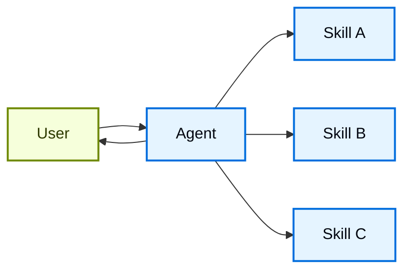

# Skills

In the **skills** architecture, specialized capabilities are packaged as invocable "skills" that augment an [agent's](../../Core%20components/Agents.md) behavior. Skills are primarily prompt-driven specializations that an agent can invoke on-demand.
For built-in skill support, see [Deep Agents](https://docs.langchain.com/oss/python/deepagents/skills.md).

> [!TIP]
>
> This pattern is conceptually identical to [Agent Skills](https://agentskills.io/) and [llms.txt](https://llmstxt.org/) (introduced by Jeremy Howard), which uses tool calling for progressive disclosure of documentation. The skills pattern applies progressive disclosure to specialized prompts and domain knowledge rather than just documentation pages.
>
> For ready-to-use skills that improve your agent's performance on LangChain ecosystem tasks, see the [LangChain Skills](https://github.com/langchain-ai/langchain-skills) repository.



## Key characteristics

* Prompt-driven specialization: Skills are primarily defined by specialized prompts
* Progressive disclosure: Skills become available based on context or user needs
* Team distribution: Different teams can develop and maintain skills independently
* Lightweight composition: Skills are simpler than full sub-agents
* Reference awareness: Skills can reference scripts, templates, and other resources

## When to use

Use the skills pattern when you want a single [agent](../../Core%20components/Agents.md) with many possible specializations, you don't need to enforce specific constraints between skills, or different teams need to develop capabilities independently. Common examples include coding assistants (skills for different languages or tasks), knowledge bases (skills for different domains), and creative assistants (skills for different formats).

## Basic implementation

```python
from langchain.tools import tool
from langchain.agents import create_agent

@tool
def load_skill(skill_name: str) -> str:
    """Load a specialized skill prompt.

    Available skills:
    - write_sql: SQL query writing expert
    - review_legal_doc: Legal document reviewer

    Returns the skill's prompt and context.
    """
    # Load skill content from file/database
    ...

agent = create_agent(
    model="gpt-6.1-sol",
    tools=[load_skill],
    system_prompt=(
        "You are a helpful assistant. "
        "You have access to two skills: "
        "write_sql and review_legal_doc. "
        "Use load_skill to access them."
    ),
)
```

For a complete implementation, see the tutorial below.

> [card] [Tutorial: Build a SQL assistant with on-demand skills](../../Learn/Tutorials/Multi-agent/Build%20a%20SQL%20assistant%20with%20on-demand%20skills.md)
>
> Learn how to implement skills with progressive disclosure, where the agent loads specialized prompts and schemas on-demand rather than upfront.

## Extending the pattern

When writing custom implementations, you can extend the basic skills pattern in several ways:

* **Dynamic tool registration**: Combine progressive disclosure with state management to register new [tools](../../Core%20components/Tools.md) as skills load. For example, loading a "database\_admin" skill could both add specialized context and register database-specific tools (backup, restore, migrate). This uses the same tool-and-state mechanisms used across multi-agent patterns—tools updating state to dynamically change agent capabilities.

* **Hierarchical skills**: Skills can define other skills in a tree structure, creating nested specializations. For instance, loading a "data\_science" skill might make available sub-skills like "pandas\_expert", "visualization", and "statistical\_analysis". Each sub-skill can be loaded independently as needed, allowing for fine-grained progressive disclosure of domain knowledge. This hierarchical approach helps manage large knowledge bases by organizing capabilities into logical groupings that can be discovered and loaded on-demand.

* **Reference awareness**: While each skill only has one prompt, this prompt can reference the location of other assets and provide information on when the agent should use those assets.
  When those assets become relevant, the agent will know that those files exist and read them into memory as needed to complete tasks.
  This also follows the progressive disclosure pattern and limits the information in the context window.

***

[Connect these docs](https://docs.langchain.com/use-these-docs.md) to your agent of choice via MCP for real-time answers.

[Edit this page on GitHub](https://github.com/langchain-ai/docs/edit/main/src/oss/langchain/multi-agent/skills.mdx) or [file an issue](https://github.com/langchain-ai/docs/issues/new/choose).
