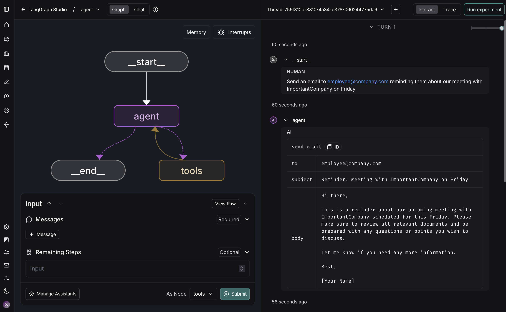

# LangSmith Studio

When building agents with LangChain locally, it's helpful to visualize what's happening inside your agent, interact with it in real-time, and debug issues as they occur. **LangSmith Studio** is a free visual interface for developing and testing your LangChain agents from your local machine.

Studio connects to your locally running agent to show you each step your agent takes: the prompts sent to the model, tool calls and their results, and the final output. You can test different inputs, inspect intermediate states, and iterate on your agent's behavior without additional code or deployment.

This pages describes how to set up Studio with your local LangChain agent.

## Prerequisites

Before you begin, ensure you have the following:

* **A LangSmith account**: Sign up (for free) or log in at [smith.langchain.com](https://smith.langchain.com?utm_source=docs\&utm_medium=cta\&utm_campaign=langsmith-signup\&utm_content=snippets-oss-studio-py).
* **A LangSmith API key**: Follow the [Create an API key](https://docs.langchain.com/langsmith/create-account-api-key.md) guide.
* If you don't want data [traced](https://docs.langchain.com/langsmith/observability-concepts.md#traces) to LangSmith, set `LANGSMITH_TRACING=false` in your agent's `.env` file. With tracing disabled, no data leaves your local server.

## Set up local Agent server

### 1. Install the LangGraph CLI

The [LangGraph CLI](https://docs.langchain.com/langsmith/cli.md) provides a local development server (also called [Agent Server](https://docs.langchain.com/langsmith/agent-server.md)) that connects your agent to Studio.

```bash pip
# Python >= 3.11 is required.
pip install -U "langgraph-cli[inmem]"
```

```bash uv
# Python >= 3.11 is required.
uv add "langgraph-cli[inmem]"
```

### 2. Prepare your agent

If you already have a LangChain agent, you can use it directly. This example uses a simple email agent:

```python title="agent.py"
from langchain.agents import create_agent

def send_email(to: str, subject: str, body: str):
    """Send an email"""
    email = {
        "to": to,
        "subject": subject,
        "body": body
    }
    # ... email sending logic

    return f"Email sent to {to}"

agent = create_agent(
    "gpt-6.1-sol",
    tools=[send_email],
    system_prompt="You are an email assistant. Always use the send_email tool.",
)
```

### 3. Environment variables

> [!NOTE]
>
> In an [agent-based workspace](https://docs.langchain.com/langsmith/agent-registry.md), [create an agent](https://docs.langchain.com/langsmith/create-an-agent.md) once before sending traces. Use [agent addressing](https://docs.langchain.com/langsmith/log-traces-to-agent.md) to select its identifier and environment. If an integration requires `project_name`, use the selected environment's [`tracer_session_name`](https://docs.langchain.com/langsmith/create-an-agent#use-an-environment-project) as a compatibility value.

Studio requires a LangSmith API key to connect your local agent. Create a `.env` file in the root of your project and add your API key from [LangSmith](https://smith.langchain.com/settings).

> [!WARNING]
>
> Ensure your `.env` file is not committed to version control, such as Git.

```bash .env
LANGSMITH_API_KEY=lsv2...
LANGSMITH_AGENT_ID="<your-agent-id>"
LANGSMITH_AGENT_ENVIRONMENT="local"
```

### 4. Create a LangGraph config file

The LangGraph CLI uses a configuration file to locate your agent and manage dependencies. Create a `langgraph.json` file in your app's directory:

```json title="langgraph.json"
{
  "dependencies": ["."],
  "graphs": {
    "agent": "./src/agent.py:agent"
  },
  "env": ".env"
}
```

The [`create_agent`](https://reference.langchain.com/python/langchain/agents/factory/create_agent) function automatically returns a compiled LangGraph graph, which is what the `graphs` key expects in the configuration file.

> [!NOTE]
>
> For detailed explanations of each key in the JSON object of the configuration file, refer to the [LangGraph configuration file reference](https://docs.langchain.com/langsmith/cli.md#configuration-file).

At this point, the project structure will look like this:

```bash
my-app/
├── src
│   └── agent.py
├── .env
└── langgraph.json
```

### 5. Install dependencies

Install your project dependencies from the root directory:

```shell pip
pip install langchain langchain-openai
```

```shell uv
uv add langchain langchain-openai
```

### 6. View your agent in Studio

Start the development server to connect your agent to Studio:

```shell
langgraph dev
```

> [!WARNING]
>
> Safari blocks `localhost` connections to Studio. To work around this, run the above command with `--tunnel` to access Studio via a secure tunnel.

Once the server is running, your agent is accessible both via API at `http://127.0.0.1:2024` and through the Studio UI at `https://smith.langchain.com/studio/?baseUrl=http://127.0.0.1:2024`:



With Studio connected to your local agent, you can iterate quickly on your agent's behavior. Run a test input, inspect the full execution trace including prompts, tool arguments, return values, and token/latency metrics. When something goes wrong, Studio captures exceptions with the surrounding state to help you understand what happened.

The development server supports hot-reloading—make changes to prompts or tool signatures in your code, and Studio reflects them immediately. Re-run conversation threads from any step to test your changes without starting over. This workflow scales from simple single-tool agents to complex multi-node graphs.

For more information on how to run Studio, refer to the following guides in the [LangSmith docs](https://docs.langchain.com/langsmith/observability.md):

* [Run agent](https://docs.langchain.com/langsmith/use-studio.md#run-application)
* [Manage assistants](https://docs.langchain.com/langsmith/use-studio.md#manage-assistants)
* [Manage threads](https://docs.langchain.com/langsmith/use-studio.md#manage-threads)
* [Iterate on prompts](https://docs.langchain.com/langsmith/observability-studio.md)
* [Debug LangSmith traces](https://docs.langchain.com/langsmith/observability-studio.md#debug-langsmith-traces)
* [Add node to dataset](https://docs.langchain.com/langsmith/observability-studio.md#add-node-to-dataset)

## Video guide

[Studio](https://www.youtube.com/embed/Mi1gSlHwZLM?si=zA47TNuTC5aH0ahd)

> [!TIP]
>
> For more information about deployed agents, see [Deployment](../Production/Deployment.md).

***

[Connect these docs](https://docs.langchain.com/use-these-docs.md) to your agent of choice via MCP for real-time answers.

[Edit this page on GitHub](https://github.com/langchain-ai/docs/edit/main/src/oss/langchain/studio.mdx) or [file an issue](https://github.com/langchain-ai/docs/issues/new/choose).
