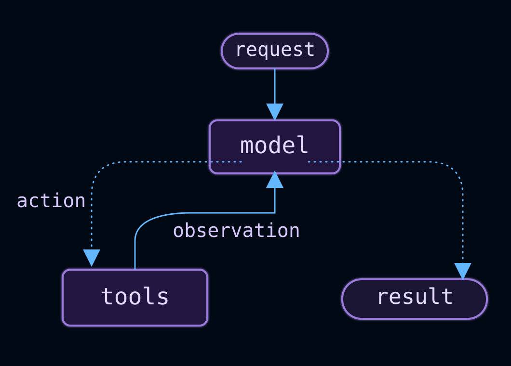
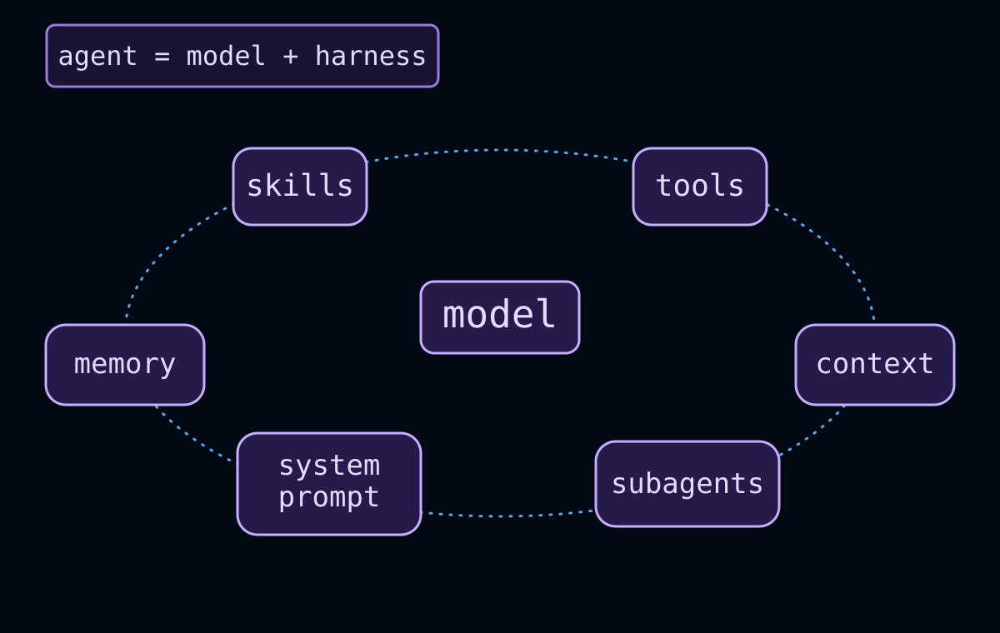
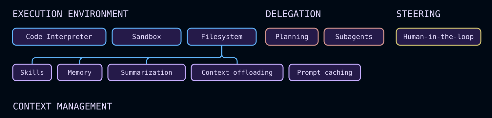

# Agents

> Build a LangChain agent: a model calling tools in a loop until a task is complete, shaped by a harness of prompt, tools, and middleware.

An agent is a model calling tools in a loop until a given task is complete.



A harness is everything around that loop: the prompt, the tools, and any middleware that shapes the model's behavior.

> [!NOTE]
>
> **Agent = Model + Harness**
>
> The job of a harness: get the model the right context at the right time for the given task.

[`create_agent`](https://reference.langchain.com/python/langchain/agents/factory/create_agent) is a highly configurable harness. At its simplest, you can create one with:

```python Google
from langchain.agents import create_agent

agent = create_agent(model="google_genai:gemini-4-hydrogen", tools=tools)
```

```python OpenAI
from langchain.agents import create_agent

agent = create_agent(model="openai:gpt-6.1-sol", tools=tools)
```

```python Anthropic
from langchain.agents import create_agent

agent = create_agent(model="anthropic:claude-sonnet-5", tools=tools)
```

```python OpenRouter
from langchain.agents import create_agent

agent = create_agent(model="openrouter:z-ai/glm-5.2", tools=tools)
```

```python Fireworks
from langchain.agents import create_agent

agent = create_agent(model="fireworks:accounts/fireworks/models/glm-5p2", tools=tools)
```

```python Baseten
from langchain.agents import create_agent

agent = create_agent(model="baseten:zai-org/GLM-5.2", tools=tools)
```

```python Ollama
from langchain.agents import create_agent

agent = create_agent(model="ollama:north-mini-code-1.0", tools=tools)
```

Building on that, you can configure the basics directly with the `model=`, `tools=`, and `system_prompt=` parameters. For more advanced capabilities, extend the harness with [middleware](#configure-the-harness).

> [!TIP]
>
> [Managed Deep Agents](https://docs.langchain.com/langsmith/python/managed-deep-agents-overview.md) builds on `create_agent` and comes with commonly useful capabilities already assembled, such as planning, file system tools, subagents, and memory. For maximum flexibility while using the same Deep Agents harness, use [Deep Agents](https://docs.langchain.com/oss/python/deepagents/overview.md) and host agents yourself, or run a custom [Agent Server](https://docs.langchain.com/langsmith/deployment.md). Use `create_agent` when you need to configure a smaller harness yourself.

## Core components



### Model

Pass a model identifier string (`"provider:model"`) or an initialized model instance to select the model for your agent. See [Models](Models.md) for parameters, provider setup, and dynamic model selection.

```python Google
from langchain.agents import create_agent

agent = create_agent(model="google_genai:gemini-4-hydrogen", tools=tools)
```

```python OpenAI
from langchain.agents import create_agent

agent = create_agent(model="openai:gpt-6.1-sol", tools=tools)
```

```python Anthropic
from langchain.agents import create_agent

agent = create_agent(model="anthropic:claude-sonnet-5", tools=tools)
```

```python OpenRouter
from langchain.agents import create_agent

agent = create_agent(model="openrouter:z-ai/glm-5.2", tools=tools)
```

```python Fireworks
from langchain.agents import create_agent

agent = create_agent(model="fireworks:accounts/fireworks/models/glm-5p2", tools=tools)
```

```python Baseten
from langchain.agents import create_agent

agent = create_agent(model="baseten:zai-org/GLM-5.2", tools=tools)
```

```python Ollama
from langchain.agents import create_agent

agent = create_agent(model="ollama:north-mini-code-1.0", tools=tools)
```

### Tools

To provide the agent with tools, pass any Python callable, LangChain tool, or tool dict. See [Tools](Tools.md) for tool definition, context access, and dynamic tool selection.

```python Google
from langchain.agents import create_agent
from langchain.tools import tool


@tool
def search(query: str) -> str:
    """Search for information."""
    return f"Results for: {query}"


agent = create_agent(model="google_genai:gemini-4-hydrogen", tools=[search])
```

```python OpenAI
from langchain.agents import create_agent
from langchain.tools import tool


@tool
def search(query: str) -> str:
    """Search for information."""
    return f"Results for: {query}"


agent = create_agent(model="openai:gpt-6.1-sol", tools=[search])
```

```python Anthropic
from langchain.agents import create_agent
from langchain.tools import tool


@tool
def search(query: str) -> str:
    """Search for information."""
    return f"Results for: {query}"


agent = create_agent(model="anthropic:claude-sonnet-5", tools=[search])
```

```python OpenRouter
from langchain.agents import create_agent
from langchain.tools import tool


@tool
def search(query: str) -> str:
    """Search for information."""
    return f"Results for: {query}"


agent = create_agent(model="openrouter:z-ai/glm-5.2", tools=[search])
```

```python Fireworks
from langchain.agents import create_agent
from langchain.tools import tool


@tool
def search(query: str) -> str:
    """Search for information."""
    return f"Results for: {query}"


agent = create_agent(model="fireworks:accounts/fireworks/models/glm-5p2", tools=[search])
```

```python Baseten
from langchain.agents import create_agent
from langchain.tools import tool


@tool
def search(query: str) -> str:
    """Search for information."""
    return f"Results for: {query}"


agent = create_agent(model="baseten:zai-org/GLM-5.2", tools=[search])
```

```python Ollama
from langchain.agents import create_agent
from langchain.tools import tool


@tool
def search(query: str) -> str:
    """Search for information."""
    return f"Results for: {query}"


agent = create_agent(model="ollama:north-mini-code-1.0", tools=[search])
```

### System prompt

Shape how the agent approaches tasks. The system prompt parameter accepts a string or `SystemMessage`. For dynamic prompts at runtime, use [middleware](https://docs.langchain.com/oss/python/langchain/middleware.md).

```python Google
agent = create_agent(
    model="google_genai:gemini-4-hydrogen",
    tools=tools,
    system_prompt="You are a helpful assistant. Be concise and accurate.",
)
```

```python OpenAI
agent = create_agent(
    model="openai:gpt-6.1-sol",
    tools=tools,
    system_prompt="You are a helpful assistant. Be concise and accurate.",
)
```

```python Anthropic
agent = create_agent(
    model="anthropic:claude-sonnet-5",
    tools=tools,
    system_prompt="You are a helpful assistant. Be concise and accurate.",
)
```

```python OpenRouter
agent = create_agent(
    model="openrouter:z-ai/glm-5.2",
    tools=tools,
    system_prompt="You are a helpful assistant. Be concise and accurate.",
)
```

```python Fireworks
agent = create_agent(
    model="fireworks:accounts/fireworks/models/glm-5p2",
    tools=tools,
    system_prompt="You are a helpful assistant. Be concise and accurate.",
)
```

```python Baseten
agent = create_agent(
    model="baseten:zai-org/GLM-5.2",
    tools=tools,
    system_prompt="You are a helpful assistant. Be concise and accurate.",
)
```

```python Ollama
agent = create_agent(
    model="ollama:north-mini-code-1.0",
    tools=tools,
    system_prompt="You are a helpful assistant. Be concise and accurate.",
)
```

### Structured output

Return a validated schema from the agent using `response_format=`. See [Structured output](Structured%20output.md) for strategies and examples.

```python Google
from pydantic import BaseModel
from langchain.agents import create_agent


class Answer(BaseModel):
    summary: str
    confidence: float


agent = create_agent(model="google_genai:gemini-4-hydrogen", tools=tools, response_format=Answer)
result = agent.invoke({"messages": [{"role": "user", "content": "Summarize AI trends"}]})
result["structured_response"]  # Answer(summary=..., confidence=...)
```

```python OpenAI
from pydantic import BaseModel
from langchain.agents import create_agent


class Answer(BaseModel):
    summary: str
    confidence: float


agent = create_agent(model="openai:gpt-6.1-sol", tools=tools, response_format=Answer)
result = agent.invoke({"messages": [{"role": "user", "content": "Summarize AI trends"}]})
result["structured_response"]  # Answer(summary=..., confidence=...)
```

```python Anthropic
from pydantic import BaseModel
from langchain.agents import create_agent


class Answer(BaseModel):
    summary: str
    confidence: float


agent = create_agent(model="anthropic:claude-sonnet-5", tools=tools, response_format=Answer)
result = agent.invoke({"messages": [{"role": "user", "content": "Summarize AI trends"}]})
result["structured_response"]  # Answer(summary=..., confidence=...)
```

```python OpenRouter
from pydantic import BaseModel
from langchain.agents import create_agent


class Answer(BaseModel):
    summary: str
    confidence: float


agent = create_agent(model="openrouter:z-ai/glm-5.2", tools=tools, response_format=Answer)
result = agent.invoke({"messages": [{"role": "user", "content": "Summarize AI trends"}]})
result["structured_response"]  # Answer(summary=..., confidence=...)
```

```python Fireworks
from pydantic import BaseModel
from langchain.agents import create_agent


class Answer(BaseModel):
    summary: str
    confidence: float


agent = create_agent(model="fireworks:accounts/fireworks/models/glm-5p2", tools=tools, response_format=Answer)
result = agent.invoke({"messages": [{"role": "user", "content": "Summarize AI trends"}]})
result["structured_response"]  # Answer(summary=..., confidence=...)
```

```python Baseten
from pydantic import BaseModel
from langchain.agents import create_agent


class Answer(BaseModel):
    summary: str
    confidence: float


agent = create_agent(model="baseten:zai-org/GLM-5.2", tools=tools, response_format=Answer)
result = agent.invoke({"messages": [{"role": "user", "content": "Summarize AI trends"}]})
result["structured_response"]  # Answer(summary=..., confidence=...)
```

```python Ollama
from pydantic import BaseModel
from langchain.agents import create_agent


class Answer(BaseModel):
    summary: str
    confidence: float


agent = create_agent(model="ollama:north-mini-code-1.0", tools=tools, response_format=Answer)
result = agent.invoke({"messages": [{"role": "user", "content": "Summarize AI trends"}]})
result["structured_response"]  # Answer(summary=..., confidence=...)
```

### Agent state

Every agent manages its execution context through [`AgentState`](https://reference.langchain.com/python/langchain/agents/middleware/types/AgentState), a typed dictionary that holds the current conversation history and any custom fields your tools and middleware need.

The built-in field is:

| Field | Type | Description |
| - | - | - |
| `messages` | `list[BaseMessage]` | The full conversation history for the current thread. Append-only: new messages are added, never replaced. |

`AgentState` is also the type signature for every node-style middleware hook (`before_model`, `after_model`, and similar). Hooks receive the current state and can return a dict of updates to merge back into it.

To add custom fields (for example, a `user_id` or a counter), subclass `AgentState` and pass the subclass to `create_agent` via `state_schema=`:

```python Google
from langchain.agents import AgentState, create_agent


class MyState(AgentState):
    user_id: str
    call_count: int


agent = create_agent(
    model="google_genai:gemini-4-hydrogen",
    tools=[],
    state_schema=MyState,  # [!code highlight]
)
```

```python OpenAI
from langchain.agents import AgentState, create_agent


class MyState(AgentState):
    user_id: str
    call_count: int


agent = create_agent(
    model="openai:gpt-6.1-sol",
    tools=[],
    state_schema=MyState,  # [!code highlight]
)
```

```python Anthropic
from langchain.agents import AgentState, create_agent


class MyState(AgentState):
    user_id: str
    call_count: int


agent = create_agent(
    model="anthropic:claude-sonnet-5",
    tools=[],
    state_schema=MyState,  # [!code highlight]
)
```

```python OpenRouter
from langchain.agents import AgentState, create_agent


class MyState(AgentState):
    user_id: str
    call_count: int


agent = create_agent(
    model="openrouter:z-ai/glm-5.2",
    tools=[],
    state_schema=MyState,  # [!code highlight]
)
```

```python Fireworks
from langchain.agents import AgentState, create_agent


class MyState(AgentState):
    user_id: str
    call_count: int


agent = create_agent(
    model="fireworks:accounts/fireworks/models/glm-5p2",
    tools=[],
    state_schema=MyState,  # [!code highlight]
)
```

```python Baseten
from langchain.agents import AgentState, create_agent


class MyState(AgentState):
    user_id: str
    call_count: int


agent = create_agent(
    model="baseten:zai-org/GLM-5.2",
    tools=[],
    state_schema=MyState,  # [!code highlight]
)
```

```python Ollama
from langchain.agents import AgentState, create_agent


class MyState(AgentState):
    user_id: str
    call_count: int


agent = create_agent(
    model="ollama:north-mini-code-1.0",
    tools=[],
    state_schema=MyState,  # [!code highlight]
)
```

For full details, examples, and middleware-level state schemas, see [Short-term memory](Short-term%20memory.md#customizing-agent-memory) and [Custom middleware](../Middleware/Custom%20middleware.md#state-updates).

## Invocation

> [!TIP]
>
> Trace each step of this loop, debug tool calls, and evaluate agent outputs with [LangSmith](https://smith.langchain.com?utm_source=docs\&utm_medium=cta\&utm_campaign=langsmith-signup\&utm_content=oss-langchain-agents). Follow the [tracing quickstart](https://docs.langchain.com/langsmith/trace-with-langchain.md) to get set up. We recommend you also set up [LangSmith Engine](https://docs.langchain.com/langsmith/engine.md) which monitors your traces, detects issues, and proposes fixes.

You can invoke an agent with a message. Behind the scenes that passes an update to the agent's [`State`](https://docs.langchain.com/oss/python/langgraph/graph-api#state). All agents include a [sequence of messages](https://docs.langchain.com/oss/python/langgraph/graph-api-state.md#messagesstate) in their state; to invoke the agent, pass a new message along with a `thread_id` so the agent can persist and resume conversation history:

```python Google
from langchain.agents import create_agent
from langchain_core.utils.uuid import uuid7
from langgraph.checkpoint.memory import InMemorySaver

agent = create_agent(
    model="google_genai:gemini-4-hydrogen",
    tools=[],
    checkpointer=InMemorySaver(),
)

config = {"configurable": {"thread_id": str(uuid7())}}

result = agent.invoke(
    {"messages": [{"role": "user", "content": "What's the weather in San Francisco?"}]},
    config=config,
)

# A follow-up turn on the same conversation: reuse the same thread_id to keep history
result = agent.invoke(
    {"messages": [{"role": "user", "content": "What about tomorrow?"}]},
    config=config,
)
```

```python OpenAI
from langchain.agents import create_agent
from langchain_core.utils.uuid import uuid7
from langgraph.checkpoint.memory import InMemorySaver

agent = create_agent(
    model="openai:gpt-6.1-sol",
    tools=[],
    checkpointer=InMemorySaver(),
)

config = {"configurable": {"thread_id": str(uuid7())}}

result = agent.invoke(
    {"messages": [{"role": "user", "content": "What's the weather in San Francisco?"}]},
    config=config,
)

# A follow-up turn on the same conversation: reuse the same thread_id to keep history
result = agent.invoke(
    {"messages": [{"role": "user", "content": "What about tomorrow?"}]},
    config=config,
)
```

```python Anthropic
from langchain.agents import create_agent
from langchain_core.utils.uuid import uuid7
from langgraph.checkpoint.memory import InMemorySaver

agent = create_agent(
    model="anthropic:claude-sonnet-5",
    tools=[],
    checkpointer=InMemorySaver(),
)

config = {"configurable": {"thread_id": str(uuid7())}}

result = agent.invoke(
    {"messages": [{"role": "user", "content": "What's the weather in San Francisco?"}]},
    config=config,
)

# A follow-up turn on the same conversation: reuse the same thread_id to keep history
result = agent.invoke(
    {"messages": [{"role": "user", "content": "What about tomorrow?"}]},
    config=config,
)
```

```python OpenRouter
from langchain.agents import create_agent
from langchain_core.utils.uuid import uuid7
from langgraph.checkpoint.memory import InMemorySaver

agent = create_agent(
    model="openrouter:z-ai/glm-5.2",
    tools=[],
    checkpointer=InMemorySaver(),
)

config = {"configurable": {"thread_id": str(uuid7())}}

result = agent.invoke(
    {"messages": [{"role": "user", "content": "What's the weather in San Francisco?"}]},
    config=config,
)

# A follow-up turn on the same conversation: reuse the same thread_id to keep history
result = agent.invoke(
    {"messages": [{"role": "user", "content": "What about tomorrow?"}]},
    config=config,
)
```

```python Fireworks
from langchain.agents import create_agent
from langchain_core.utils.uuid import uuid7
from langgraph.checkpoint.memory import InMemorySaver

agent = create_agent(
    model="fireworks:accounts/fireworks/models/glm-5p2",
    tools=[],
    checkpointer=InMemorySaver(),
)

config = {"configurable": {"thread_id": str(uuid7())}}

result = agent.invoke(
    {"messages": [{"role": "user", "content": "What's the weather in San Francisco?"}]},
    config=config,
)

# A follow-up turn on the same conversation: reuse the same thread_id to keep history
result = agent.invoke(
    {"messages": [{"role": "user", "content": "What about tomorrow?"}]},
    config=config,
)
```

```python Baseten
from langchain.agents import create_agent
from langchain_core.utils.uuid import uuid7
from langgraph.checkpoint.memory import InMemorySaver

agent = create_agent(
    model="baseten:zai-org/GLM-5.2",
    tools=[],
    checkpointer=InMemorySaver(),
)

config = {"configurable": {"thread_id": str(uuid7())}}

result = agent.invoke(
    {"messages": [{"role": "user", "content": "What's the weather in San Francisco?"}]},
    config=config,
)

# A follow-up turn on the same conversation: reuse the same thread_id to keep history
result = agent.invoke(
    {"messages": [{"role": "user", "content": "What about tomorrow?"}]},
    config=config,
)
```

```python Ollama
from langchain.agents import create_agent
from langchain_core.utils.uuid import uuid7
from langgraph.checkpoint.memory import InMemorySaver

agent = create_agent(
    model="ollama:north-mini-code-1.0",
    tools=[],
    checkpointer=InMemorySaver(),
)

config = {"configurable": {"thread_id": str(uuid7())}}

result = agent.invoke(
    {"messages": [{"role": "user", "content": "What's the weather in San Francisco?"}]},
    config=config,
)

# A follow-up turn on the same conversation: reuse the same thread_id to keep history
result = agent.invoke(
    {"messages": [{"role": "user", "content": "What about tomorrow?"}]},
    config=config,
)
```

> [card] [View example trace](https://smith.langchain.com/public/1835d2f3-8da5-4e27-95d7-fb2c7d726ad5/r)
>
> Open a public LangSmith run for this example.

> [!NOTE]
>
> Persisting conversation history with `thread_id` requires the agent to be configured with a [checkpointer](../Advanced%20usage/Long-term%20memory.md). When deployed on [LangSmith](https://docs.langchain.com/langsmith/deployment.md), a checkpointer is provisioned automatically. Locally, pass one explicitly, for example `create_agent(..., checkpointer=InMemorySaver())`.

If you also need to pass per-run configuration (such as a user ID, API keys, or feature flags) to tools and middleware, pass it as `context` alongside `config`. Define the shape of that data with `context_schema` and access it through `runtime.context`:

```python Google
from dataclasses import dataclass

from langchain.agents import create_agent
from langchain_core.utils.uuid import uuid7
from langgraph.checkpoint.memory import InMemorySaver


@dataclass
class Context:
    user_id: str


agent = create_agent(
    model="google_genai:gemini-4-hydrogen",
    tools=[],
    context_schema=Context,
    checkpointer=InMemorySaver(),
)

result = agent.invoke(
    {"messages": [{"role": "user", "content": "What's the weather in San Francisco?"}]},
    config={"configurable": {"thread_id": str(uuid7())}},
    context=Context(user_id="user-123"),
)
```

```python OpenAI
from dataclasses import dataclass

from langchain.agents import create_agent
from langchain_core.utils.uuid import uuid7
from langgraph.checkpoint.memory import InMemorySaver


@dataclass
class Context:
    user_id: str


agent = create_agent(
    model="openai:gpt-6.1-sol",
    tools=[],
    context_schema=Context,
    checkpointer=InMemorySaver(),
)

result = agent.invoke(
    {"messages": [{"role": "user", "content": "What's the weather in San Francisco?"}]},
    config={"configurable": {"thread_id": str(uuid7())}},
    context=Context(user_id="user-123"),
)
```

```python Anthropic
from dataclasses import dataclass

from langchain.agents import create_agent
from langchain_core.utils.uuid import uuid7
from langgraph.checkpoint.memory import InMemorySaver


@dataclass
class Context:
    user_id: str


agent = create_agent(
    model="anthropic:claude-sonnet-5",
    tools=[],
    context_schema=Context,
    checkpointer=InMemorySaver(),
)

result = agent.invoke(
    {"messages": [{"role": "user", "content": "What's the weather in San Francisco?"}]},
    config={"configurable": {"thread_id": str(uuid7())}},
    context=Context(user_id="user-123"),
)
```

```python OpenRouter
from dataclasses import dataclass

from langchain.agents import create_agent
from langchain_core.utils.uuid import uuid7
from langgraph.checkpoint.memory import InMemorySaver


@dataclass
class Context:
    user_id: str


agent = create_agent(
    model="openrouter:z-ai/glm-5.2",
    tools=[],
    context_schema=Context,
    checkpointer=InMemorySaver(),
)

result = agent.invoke(
    {"messages": [{"role": "user", "content": "What's the weather in San Francisco?"}]},
    config={"configurable": {"thread_id": str(uuid7())}},
    context=Context(user_id="user-123"),
)
```

```python Fireworks
from dataclasses import dataclass

from langchain.agents import create_agent
from langchain_core.utils.uuid import uuid7
from langgraph.checkpoint.memory import InMemorySaver


@dataclass
class Context:
    user_id: str


agent = create_agent(
    model="fireworks:accounts/fireworks/models/glm-5p2",
    tools=[],
    context_schema=Context,
    checkpointer=InMemorySaver(),
)

result = agent.invoke(
    {"messages": [{"role": "user", "content": "What's the weather in San Francisco?"}]},
    config={"configurable": {"thread_id": str(uuid7())}},
    context=Context(user_id="user-123"),
)
```

```python Baseten
from dataclasses import dataclass

from langchain.agents import create_agent
from langchain_core.utils.uuid import uuid7
from langgraph.checkpoint.memory import InMemorySaver


@dataclass
class Context:
    user_id: str


agent = create_agent(
    model="baseten:zai-org/GLM-5.2",
    tools=[],
    context_schema=Context,
    checkpointer=InMemorySaver(),
)

result = agent.invoke(
    {"messages": [{"role": "user", "content": "What's the weather in San Francisco?"}]},
    config={"configurable": {"thread_id": str(uuid7())}},
    context=Context(user_id="user-123"),
)
```

```python Ollama
from dataclasses import dataclass

from langchain.agents import create_agent
from langchain_core.utils.uuid import uuid7
from langgraph.checkpoint.memory import InMemorySaver


@dataclass
class Context:
    user_id: str


agent = create_agent(
    model="ollama:north-mini-code-1.0",
    tools=[],
    context_schema=Context,
    checkpointer=InMemorySaver(),
)

result = agent.invoke(
    {"messages": [{"role": "user", "content": "What's the weather in San Francisco?"}]},
    config={"configurable": {"thread_id": str(uuid7())}},
    context=Context(user_id="user-123"),
)
```

> [card] [View example trace](https://smith.langchain.com/public/79519c6b-9286-45f0-b5c6-9afaa5ef22f8/r)
>
> Open a public LangSmith run for this example.

`thread_id` scopes the *conversation* (message history, checkpoints), while `context` carries *per-run* data your tools and middleware read at invocation time. Both are commonly passed together. See [tool context](Tools.md#context) and [Runtime](../Advanced%20usage/Runtime.md) for more.

## Streaming

`invoke` returns the final response at the end of a run. If an agent executes multiple tool calls, users often need progress updates before completion. Use streaming to surface intermediate messages and tool activity as they happen.

```python
from langchain.messages import AIMessage, HumanMessage


stream = agent.stream_events(
    {"messages": [{"role": "user", "content": "Search for AI news and summarize the findings"}]},
    version="v3",
)
for snapshot in stream.values:
    # Each snapshot contains the full state at that point
    latest_message = snapshot["messages"][-1]
    if latest_message.content:
        if isinstance(latest_message, HumanMessage):
            print(f"User: {latest_message.content}")
        elif isinstance(latest_message, AIMessage):
            print(f"Agent: {latest_message.content}")
    elif latest_message.tool_calls:
        print(f"Calling tools: {[tc['name'] for tc in latest_message.tool_calls]}")
```

> [card] [View example trace](https://smith.langchain.com/public/25a56e3b-08d0-4fcd-934e-a16c0a99d629/r)
>
> Open a public LangSmith run for this example.

> [!TIP]
>
> For streaming modes, event types, and UI patterns, see [Streaming](Streaming.md).

## Configure the harness

`create_agent` is highly extensible. Middleware is the primitive for customization: each piece handles one concern, hooks into the agent loop at the right moment, and composes freely with any other. Take exactly what your use case needs and skip the rest.

Common patterns are prebuilt as first-class middleware. You can build anything else as [custom middleware](../Middleware/Custom%20middleware.md).



As agents take on complex work, they need support across a few key areas. The middleware ecosystem provides:

> [card] [Execution environment](#execution-environment)
>
> Tools, filesystem, sandboxes, and code execution

> [card] [Context management](#context-management)
>
> Summarization, memory, skills, and prompt caching

> [card] [Planning and delegation](#planning-and-delegation)
>
> Todo lists and subagents for parallel, isolated work

> [card] [Fault tolerance](#fault-tolerance)
>
> Retries, fallbacks, and call limits

> [card] [Guardrails](#guardrails)
>
> PII detection and content controls

> [card] [Steering](#steering)
>
> Human-in-the-loop approval before high-impact actions

> [!TIP]
>
> `create_deep_agent` pre-assembles this stack for long-running coding and research tasks (filesystem, summarization, subagents, and prompt caching included by default). See [Deep Agents](https://docs.langchain.com/oss/python/deepagents/harness.md) for the full prebuilt harness.

### Execution environment

Agents are especially useful when they can take action rather than just generate text. The execution environment gives the agent a workspace: tools it can call, a filesystem for reading and writing files across turns, and code execution for running scripts or shell commands.

```python Google
from langchain.agents import create_agent
from deepagents.backends import StateBackend
from deepagents.middleware import FilesystemMiddleware

agent = create_agent(
    model="google_genai:gemini-4-hydrogen",
    tools=[search],
    middleware=[FilesystemMiddleware(backend=StateBackend())],
)
```

```python OpenAI
from langchain.agents import create_agent
from deepagents.backends import StateBackend
from deepagents.middleware import FilesystemMiddleware

agent = create_agent(
    model="openai:gpt-6.1-sol",
    tools=[search],
    middleware=[FilesystemMiddleware(backend=StateBackend())],
)
```

```python Anthropic
from langchain.agents import create_agent
from deepagents.backends import StateBackend
from deepagents.middleware import FilesystemMiddleware

agent = create_agent(
    model="anthropic:claude-sonnet-5",
    tools=[search],
    middleware=[FilesystemMiddleware(backend=StateBackend())],
)
```

```python OpenRouter
from langchain.agents import create_agent
from deepagents.backends import StateBackend
from deepagents.middleware import FilesystemMiddleware

agent = create_agent(
    model="openrouter:z-ai/glm-5.2",
    tools=[search],
    middleware=[FilesystemMiddleware(backend=StateBackend())],
)
```

```python Fireworks
from langchain.agents import create_agent
from deepagents.backends import StateBackend
from deepagents.middleware import FilesystemMiddleware

agent = create_agent(
    model="fireworks:accounts/fireworks/models/glm-5p2",
    tools=[search],
    middleware=[FilesystemMiddleware(backend=StateBackend())],
)
```

```python Baseten
from langchain.agents import create_agent
from deepagents.backends import StateBackend
from deepagents.middleware import FilesystemMiddleware

agent = create_agent(
    model="baseten:zai-org/GLM-5.2",
    tools=[search],
    middleware=[FilesystemMiddleware(backend=StateBackend())],
)
```

```python Ollama
from langchain.agents import create_agent
from deepagents.backends import StateBackend
from deepagents.middleware import FilesystemMiddleware

agent = create_agent(
    model="ollama:north-mini-code-1.0",
    tools=[search],
    middleware=[FilesystemMiddleware(backend=StateBackend())],
)
```

See [`FilesystemMiddleware`](https://reference.langchain.com/python/deepagents/middleware/filesystem/FilesystemMiddleware), [Sandboxes](https://docs.langchain.com/oss/python/deepagents/sandboxes.md), [Interpreters](https://docs.langchain.com/oss/python/deepagents/interpreters.md).

> [!NOTE]
>
> This example imports from the `deepagents` package. Install it with:
>
> ```bash pip
> pip install deepagents
> ```
>
> ```bash uv
> uv add deepagents
> ```

### Context management

Every model call has a fixed context window. As an agent runs, that window fills with accumulating history, tool results, and intermediate steps. Summarization compresses history before overflow hits; memory loads persistent instructions at startup so knowledge carries across sessions; skills surface domain knowledge on demand rather than loading everything upfront.

```python Google
from deepagents.backends import StateBackend
from deepagents.middleware import FilesystemMiddleware, MemoryMiddleware, SkillsMiddleware, SummarizationMiddleware

backend = StateBackend()
model = "google_genai:gemini-4-hydrogen"

agent = create_agent(
    model=model,
    tools=[search],
    middleware=[
        FilesystemMiddleware(backend=backend),
        SummarizationMiddleware(model=model, backend=backend),
        MemoryMiddleware(backend=backend, sources=["./AGENTS.md"]),
        SkillsMiddleware(backend=backend, sources=["./skills/"]),
    ],
)
```

```python OpenAI
from deepagents.backends import StateBackend
from deepagents.middleware import FilesystemMiddleware, MemoryMiddleware, SkillsMiddleware, SummarizationMiddleware

backend = StateBackend()
model = "openai:gpt-6.1-sol"

agent = create_agent(
    model=model,
    tools=[search],
    middleware=[
        FilesystemMiddleware(backend=backend),
        SummarizationMiddleware(model=model, backend=backend),
        MemoryMiddleware(backend=backend, sources=["./AGENTS.md"]),
        SkillsMiddleware(backend=backend, sources=["./skills/"]),
    ],
)
```

```python Anthropic
from deepagents.backends import StateBackend
from deepagents.middleware import FilesystemMiddleware, MemoryMiddleware, SkillsMiddleware, SummarizationMiddleware

backend = StateBackend()
model = "anthropic:claude-sonnet-5"

agent = create_agent(
    model=model,
    tools=[search],
    middleware=[
        FilesystemMiddleware(backend=backend),
        SummarizationMiddleware(model=model, backend=backend),
        MemoryMiddleware(backend=backend, sources=["./AGENTS.md"]),
        SkillsMiddleware(backend=backend, sources=["./skills/"]),
    ],
)
```

```python OpenRouter
from deepagents.backends import StateBackend
from deepagents.middleware import FilesystemMiddleware, MemoryMiddleware, SkillsMiddleware, SummarizationMiddleware

backend = StateBackend()
model = "openrouter:z-ai/glm-5.2"

agent = create_agent(
    model=model,
    tools=[search],
    middleware=[
        FilesystemMiddleware(backend=backend),
        SummarizationMiddleware(model=model, backend=backend),
        MemoryMiddleware(backend=backend, sources=["./AGENTS.md"]),
        SkillsMiddleware(backend=backend, sources=["./skills/"]),
    ],
)
```

```python Fireworks
from deepagents.backends import StateBackend
from deepagents.middleware import FilesystemMiddleware, MemoryMiddleware, SkillsMiddleware, SummarizationMiddleware

backend = StateBackend()
model = "fireworks:accounts/fireworks/models/glm-5p2"

agent = create_agent(
    model=model,
    tools=[search],
    middleware=[
        FilesystemMiddleware(backend=backend),
        SummarizationMiddleware(model=model, backend=backend),
        MemoryMiddleware(backend=backend, sources=["./AGENTS.md"]),
        SkillsMiddleware(backend=backend, sources=["./skills/"]),
    ],
)
```

```python Baseten
from deepagents.backends import StateBackend
from deepagents.middleware import FilesystemMiddleware, MemoryMiddleware, SkillsMiddleware, SummarizationMiddleware

backend = StateBackend()
model = "baseten:zai-org/GLM-5.2"

agent = create_agent(
    model=model,
    tools=[search],
    middleware=[
        FilesystemMiddleware(backend=backend),
        SummarizationMiddleware(model=model, backend=backend),
        MemoryMiddleware(backend=backend, sources=["./AGENTS.md"]),
        SkillsMiddleware(backend=backend, sources=["./skills/"]),
    ],
)
```

```python Ollama
from deepagents.backends import StateBackend
from deepagents.middleware import FilesystemMiddleware, MemoryMiddleware, SkillsMiddleware, SummarizationMiddleware

backend = StateBackend()
model = "ollama:north-mini-code-1.0"

agent = create_agent(
    model=model,
    tools=[search],
    middleware=[
        FilesystemMiddleware(backend=backend),
        SummarizationMiddleware(model=model, backend=backend),
        MemoryMiddleware(backend=backend, sources=["./AGENTS.md"]),
        SkillsMiddleware(backend=backend, sources=["./skills/"]),
    ],
)
```

See [`SummarizationMiddleware`](https://reference.langchain.com/python/langchain/agents/middleware/summarization/SummarizationMiddleware), [`MemoryMiddleware`](https://reference.langchain.com/python/deepagents/middleware/memory/MemoryMiddleware), [Skills](../Advanced%20usage/Multi-agent/Skills.md), [Context engineering](https://docs.langchain.com/oss/python/deepagents/context-engineering.md).

> [!NOTE]
>
> This example imports from the `deepagents` package. Install it with:
>
> ```bash pip
> pip install deepagents
> ```
>
> ```bash uv
> uv add deepagents
> ```

### Planning and delegation

Complex tasks often exceed what one context window can handle. Delegation lets the main agent break work into pieces, hand them to subagents that each run in their own isolated context, and stay focused on coordination rather than execution. Work can run in parallel; the main agent's context stays clean.

```python Google
from deepagents.backends import StateBackend
from deepagents.middleware import FilesystemMiddleware
from deepagents.middleware.subagents import SubAgentMiddleware
from langchain.agents import create_agent
from langchain.agents.middleware import TodoListMiddleware
from langchain.tools import tool


@tool
def search(query: str) -> str:
    """Search for a query and return a short summary."""
    return f"Search results for: {query}"


backend = StateBackend()

agent = create_agent(
    model="google_genai:gemini-4-hydrogen",
    tools=[search],
    middleware=[
        FilesystemMiddleware(backend=backend),
        TodoListMiddleware(),
        SubAgentMiddleware(
            backend=backend,
            subagents=[
                {
                    "name": "researcher",
                    "description": "Searches and returns a structured summary.",
                    "system_prompt": "Use the search tool to research the question and summarize key points.",
                    "tools": [search],
                    "model": "anthropic:claude-sonnet-4-6",
                    "middleware": [],
                }
            ],
        ),
    ],
)
```

```python OpenAI
from deepagents.backends import StateBackend
from deepagents.middleware import FilesystemMiddleware
from deepagents.middleware.subagents import SubAgentMiddleware
from langchain.agents import create_agent
from langchain.agents.middleware import TodoListMiddleware
from langchain.tools import tool


@tool
def search(query: str) -> str:
    """Search for a query and return a short summary."""
    return f"Search results for: {query}"


backend = StateBackend()

agent = create_agent(
    model="openai:gpt-6.1-sol",
    tools=[search],
    middleware=[
        FilesystemMiddleware(backend=backend),
        TodoListMiddleware(),
        SubAgentMiddleware(
            backend=backend,
            subagents=[
                {
                    "name": "researcher",
                    "description": "Searches and returns a structured summary.",
                    "system_prompt": "Use the search tool to research the question and summarize key points.",
                    "tools": [search],
                    "model": "anthropic:claude-sonnet-4-6",
                    "middleware": [],
                }
            ],
        ),
    ],
)
```

```python Anthropic
from deepagents.backends import StateBackend
from deepagents.middleware import FilesystemMiddleware
from deepagents.middleware.subagents import SubAgentMiddleware
from langchain.agents import create_agent
from langchain.agents.middleware import TodoListMiddleware
from langchain.tools import tool


@tool
def search(query: str) -> str:
    """Search for a query and return a short summary."""
    return f"Search results for: {query}"


backend = StateBackend()

agent = create_agent(
    model="anthropic:claude-sonnet-5",
    tools=[search],
    middleware=[
        FilesystemMiddleware(backend=backend),
        TodoListMiddleware(),
        SubAgentMiddleware(
            backend=backend,
            subagents=[
                {
                    "name": "researcher",
                    "description": "Searches and returns a structured summary.",
                    "system_prompt": "Use the search tool to research the question and summarize key points.",
                    "tools": [search],
                    "model": "anthropic:claude-sonnet-4-6",
                    "middleware": [],
                }
            ],
        ),
    ],
)
```

```python OpenRouter
from deepagents.backends import StateBackend
from deepagents.middleware import FilesystemMiddleware
from deepagents.middleware.subagents import SubAgentMiddleware
from langchain.agents import create_agent
from langchain.agents.middleware import TodoListMiddleware
from langchain.tools import tool


@tool
def search(query: str) -> str:
    """Search for a query and return a short summary."""
    return f"Search results for: {query}"


backend = StateBackend()

agent = create_agent(
    model="openrouter:z-ai/glm-5.2",
    tools=[search],
    middleware=[
        FilesystemMiddleware(backend=backend),
        TodoListMiddleware(),
        SubAgentMiddleware(
            backend=backend,
            subagents=[
                {
                    "name": "researcher",
                    "description": "Searches and returns a structured summary.",
                    "system_prompt": "Use the search tool to research the question and summarize key points.",
                    "tools": [search],
                    "model": "anthropic:claude-sonnet-4-6",
                    "middleware": [],
                }
            ],
        ),
    ],
)
```

```python Fireworks
from deepagents.backends import StateBackend
from deepagents.middleware import FilesystemMiddleware
from deepagents.middleware.subagents import SubAgentMiddleware
from langchain.agents import create_agent
from langchain.agents.middleware import TodoListMiddleware
from langchain.tools import tool


@tool
def search(query: str) -> str:
    """Search for a query and return a short summary."""
    return f"Search results for: {query}"


backend = StateBackend()

agent = create_agent(
    model="fireworks:accounts/fireworks/models/glm-5p2",
    tools=[search],
    middleware=[
        FilesystemMiddleware(backend=backend),
        TodoListMiddleware(),
        SubAgentMiddleware(
            backend=backend,
            subagents=[
                {
                    "name": "researcher",
                    "description": "Searches and returns a structured summary.",
                    "system_prompt": "Use the search tool to research the question and summarize key points.",
                    "tools": [search],
                    "model": "anthropic:claude-sonnet-4-6",
                    "middleware": [],
                }
            ],
        ),
    ],
)
```

```python Baseten
from deepagents.backends import StateBackend
from deepagents.middleware import FilesystemMiddleware
from deepagents.middleware.subagents import SubAgentMiddleware
from langchain.agents import create_agent
from langchain.agents.middleware import TodoListMiddleware
from langchain.tools import tool


@tool
def search(query: str) -> str:
    """Search for a query and return a short summary."""
    return f"Search results for: {query}"


backend = StateBackend()

agent = create_agent(
    model="baseten:zai-org/GLM-5.2",
    tools=[search],
    middleware=[
        FilesystemMiddleware(backend=backend),
        TodoListMiddleware(),
        SubAgentMiddleware(
            backend=backend,
            subagents=[
                {
                    "name": "researcher",
                    "description": "Searches and returns a structured summary.",
                    "system_prompt": "Use the search tool to research the question and summarize key points.",
                    "tools": [search],
                    "model": "anthropic:claude-sonnet-4-6",
                    "middleware": [],
                }
            ],
        ),
    ],
)
```

```python Ollama
from deepagents.backends import StateBackend
from deepagents.middleware import FilesystemMiddleware
from deepagents.middleware.subagents import SubAgentMiddleware
from langchain.agents import create_agent
from langchain.agents.middleware import TodoListMiddleware
from langchain.tools import tool


@tool
def search(query: str) -> str:
    """Search for a query and return a short summary."""
    return f"Search results for: {query}"


backend = StateBackend()

agent = create_agent(
    model="ollama:north-mini-code-1.0",
    tools=[search],
    middleware=[
        FilesystemMiddleware(backend=backend),
        TodoListMiddleware(),
        SubAgentMiddleware(
            backend=backend,
            subagents=[
                {
                    "name": "researcher",
                    "description": "Searches and returns a structured summary.",
                    "system_prompt": "Use the search tool to research the question and summarize key points.",
                    "tools": [search],
                    "model": "anthropic:claude-sonnet-4-6",
                    "middleware": [],
                }
            ],
        ),
    ],
)
```

See [Subagents](../Advanced%20usage/Multi-agent/Subagents.md).

> [!NOTE]
>
> This example imports from the `deepagents` package. Install it with:
>
> ```bash pip
> pip install deepagents
> ```
>
> ```bash uv
> uv add deepagents
> ```

### Name your agent

Optionally use an identifier for the agent. This is especially useful when embedding the agent as a subgraph in [multi-agent](../Advanced%20usage/Multi-agent/Multi-agent.md) systems.

```python Google
agent = create_agent(model="google_genai:gemini-4-hydrogen", tools=tools, name="research_assistant")
```

```python OpenAI
agent = create_agent(model="openai:gpt-6.1-sol", tools=tools, name="research_assistant")
```

```python Anthropic
agent = create_agent(model="anthropic:claude-sonnet-5", tools=tools, name="research_assistant")
```

```python OpenRouter
agent = create_agent(model="openrouter:z-ai/glm-5.2", tools=tools, name="research_assistant")
```

```python Fireworks
agent = create_agent(model="fireworks:accounts/fireworks/models/glm-5p2", tools=tools, name="research_assistant")
```

```python Baseten
agent = create_agent(model="baseten:zai-org/GLM-5.2", tools=tools, name="research_assistant")
```

```python Ollama
agent = create_agent(model="ollama:north-mini-code-1.0", tools=tools, name="research_assistant")
```

### Fault tolerance

Agents in production encounter failures that rarely appear in development: rate limits, model timeouts, transient API errors. Fault tolerance middleware handles these at the infrastructure level so your tools and business logic don't need try/catch around every call.

```python Google
from langchain.agents import create_agent
from langchain.agents.middleware import ModelRetryMiddleware, ToolRetryMiddleware
from langchain.tools import tool


@tool
def search(query: str) -> str:
    """Search for a query and return a short summary."""
    return f"Search results for: {query}"


agent = create_agent(
    model="google_genai:gemini-4-hydrogen",
    tools=[search],
    middleware=[
        ModelRetryMiddleware(max_retries=3),
        ToolRetryMiddleware(max_retries=2),
    ],
)
```

```python OpenAI
from langchain.agents import create_agent
from langchain.agents.middleware import ModelRetryMiddleware, ToolRetryMiddleware
from langchain.tools import tool


@tool
def search(query: str) -> str:
    """Search for a query and return a short summary."""
    return f"Search results for: {query}"


agent = create_agent(
    model="openai:gpt-6.1-sol",
    tools=[search],
    middleware=[
        ModelRetryMiddleware(max_retries=3),
        ToolRetryMiddleware(max_retries=2),
    ],
)
```

```python Anthropic
from langchain.agents import create_agent
from langchain.agents.middleware import ModelRetryMiddleware, ToolRetryMiddleware
from langchain.tools import tool


@tool
def search(query: str) -> str:
    """Search for a query and return a short summary."""
    return f"Search results for: {query}"


agent = create_agent(
    model="anthropic:claude-sonnet-5",
    tools=[search],
    middleware=[
        ModelRetryMiddleware(max_retries=3),
        ToolRetryMiddleware(max_retries=2),
    ],
)
```

```python OpenRouter
from langchain.agents import create_agent
from langchain.agents.middleware import ModelRetryMiddleware, ToolRetryMiddleware
from langchain.tools import tool


@tool
def search(query: str) -> str:
    """Search for a query and return a short summary."""
    return f"Search results for: {query}"


agent = create_agent(
    model="openrouter:z-ai/glm-5.2",
    tools=[search],
    middleware=[
        ModelRetryMiddleware(max_retries=3),
        ToolRetryMiddleware(max_retries=2),
    ],
)
```

```python Fireworks
from langchain.agents import create_agent
from langchain.agents.middleware import ModelRetryMiddleware, ToolRetryMiddleware
from langchain.tools import tool


@tool
def search(query: str) -> str:
    """Search for a query and return a short summary."""
    return f"Search results for: {query}"


agent = create_agent(
    model="fireworks:accounts/fireworks/models/glm-5p2",
    tools=[search],
    middleware=[
        ModelRetryMiddleware(max_retries=3),
        ToolRetryMiddleware(max_retries=2),
    ],
)
```

```python Baseten
from langchain.agents import create_agent
from langchain.agents.middleware import ModelRetryMiddleware, ToolRetryMiddleware
from langchain.tools import tool


@tool
def search(query: str) -> str:
    """Search for a query and return a short summary."""
    return f"Search results for: {query}"


agent = create_agent(
    model="baseten:zai-org/GLM-5.2",
    tools=[search],
    middleware=[
        ModelRetryMiddleware(max_retries=3),
        ToolRetryMiddleware(max_retries=2),
    ],
)
```

```python Ollama
from langchain.agents import create_agent
from langchain.agents.middleware import ModelRetryMiddleware, ToolRetryMiddleware
from langchain.tools import tool


@tool
def search(query: str) -> str:
    """Search for a query and return a short summary."""
    return f"Search results for: {query}"


agent = create_agent(
    model="ollama:north-mini-code-1.0",
    tools=[search],
    middleware=[
        ModelRetryMiddleware(max_retries=3),
        ToolRetryMiddleware(max_retries=2),
    ],
)
```

See [`ModelRetryMiddleware`](https://reference.langchain.com/python/langchain/agents/middleware/model_retry/ModelRetryMiddleware), [`ToolRetryMiddleware`](https://reference.langchain.com/python/langchain/agents/middleware/tool_retry/ToolRetryMiddleware), [Prebuilt middleware](../Middleware/Prebuilt%20middleware.md).

### Guardrails

Some policies can't live in a prompt—they need to be enforced deterministically regardless of what the model does. Guardrails intercept data as it flows through the agent loop, applying compliance rules or content policies before tool results reach the model's context.

```python Google
from langchain.agents import create_agent
from langchain.agents.middleware import PIIMiddleware
from langchain.tools import tool


@tool
def search(query: str) -> str:
    """Search for a query and return a short summary."""
    return f"Search results for: {query}"


agent = create_agent(
    model="google_genai:gemini-4-hydrogen",
    tools=[search],
    middleware=[PIIMiddleware("email")],
)
```

```python OpenAI
from langchain.agents import create_agent
from langchain.agents.middleware import PIIMiddleware
from langchain.tools import tool


@tool
def search(query: str) -> str:
    """Search for a query and return a short summary."""
    return f"Search results for: {query}"


agent = create_agent(
    model="openai:gpt-6.1-sol",
    tools=[search],
    middleware=[PIIMiddleware("email")],
)
```

```python Anthropic
from langchain.agents import create_agent
from langchain.agents.middleware import PIIMiddleware
from langchain.tools import tool


@tool
def search(query: str) -> str:
    """Search for a query and return a short summary."""
    return f"Search results for: {query}"


agent = create_agent(
    model="anthropic:claude-sonnet-5",
    tools=[search],
    middleware=[PIIMiddleware("email")],
)
```

```python OpenRouter
from langchain.agents import create_agent
from langchain.agents.middleware import PIIMiddleware
from langchain.tools import tool


@tool
def search(query: str) -> str:
    """Search for a query and return a short summary."""
    return f"Search results for: {query}"


agent = create_agent(
    model="openrouter:z-ai/glm-5.2",
    tools=[search],
    middleware=[PIIMiddleware("email")],
)
```

```python Fireworks
from langchain.agents import create_agent
from langchain.agents.middleware import PIIMiddleware
from langchain.tools import tool


@tool
def search(query: str) -> str:
    """Search for a query and return a short summary."""
    return f"Search results for: {query}"


agent = create_agent(
    model="fireworks:accounts/fireworks/models/glm-5p2",
    tools=[search],
    middleware=[PIIMiddleware("email")],
)
```

```python Baseten
from langchain.agents import create_agent
from langchain.agents.middleware import PIIMiddleware
from langchain.tools import tool


@tool
def search(query: str) -> str:
    """Search for a query and return a short summary."""
    return f"Search results for: {query}"


agent = create_agent(
    model="baseten:zai-org/GLM-5.2",
    tools=[search],
    middleware=[PIIMiddleware("email")],
)
```

```python Ollama
from langchain.agents import create_agent
from langchain.agents.middleware import PIIMiddleware
from langchain.tools import tool


@tool
def search(query: str) -> str:
    """Search for a query and return a short summary."""
    return f"Search results for: {query}"


agent = create_agent(
    model="ollama:north-mini-code-1.0",
    tools=[search],
    middleware=[PIIMiddleware("email")],
)
```

See [`PIIMiddleware`](https://reference.langchain.com/python/langchain/agents/middleware/pii/PIIMiddleware), [Prebuilt middleware](../Middleware/Prebuilt%20middleware.md).

### Steering

Full autonomy isn't always appropriate. Steering lets you place humans at specific decision points—before destructive writes, expensive API calls, or anything requiring judgment—without restructuring your agent. The agent pauses and waits; a human approves, edits, or rejects; execution continues.

```python Google
from langchain.agents import create_agent
from langchain.agents.middleware import HumanInTheLoopMiddleware
from langchain.tools import tool


@tool
def search(query: str) -> str:
    """Search for a query and return a short summary."""
    return f"Search results for: {query}"


agent = create_agent(
    model="google_genai:gemini-4-hydrogen",
    tools=[search],
    middleware=[HumanInTheLoopMiddleware(interrupt_on={"write_file": True})],
)
```

```python OpenAI
from langchain.agents import create_agent
from langchain.agents.middleware import HumanInTheLoopMiddleware
from langchain.tools import tool


@tool
def search(query: str) -> str:
    """Search for a query and return a short summary."""
    return f"Search results for: {query}"


agent = create_agent(
    model="openai:gpt-6.1-sol",
    tools=[search],
    middleware=[HumanInTheLoopMiddleware(interrupt_on={"write_file": True})],
)
```

```python Anthropic
from langchain.agents import create_agent
from langchain.agents.middleware import HumanInTheLoopMiddleware
from langchain.tools import tool


@tool
def search(query: str) -> str:
    """Search for a query and return a short summary."""
    return f"Search results for: {query}"


agent = create_agent(
    model="anthropic:claude-sonnet-5",
    tools=[search],
    middleware=[HumanInTheLoopMiddleware(interrupt_on={"write_file": True})],
)
```

```python OpenRouter
from langchain.agents import create_agent
from langchain.agents.middleware import HumanInTheLoopMiddleware
from langchain.tools import tool


@tool
def search(query: str) -> str:
    """Search for a query and return a short summary."""
    return f"Search results for: {query}"


agent = create_agent(
    model="openrouter:z-ai/glm-5.2",
    tools=[search],
    middleware=[HumanInTheLoopMiddleware(interrupt_on={"write_file": True})],
)
```

```python Fireworks
from langchain.agents import create_agent
from langchain.agents.middleware import HumanInTheLoopMiddleware
from langchain.tools import tool


@tool
def search(query: str) -> str:
    """Search for a query and return a short summary."""
    return f"Search results for: {query}"


agent = create_agent(
    model="fireworks:accounts/fireworks/models/glm-5p2",
    tools=[search],
    middleware=[HumanInTheLoopMiddleware(interrupt_on={"write_file": True})],
)
```

```python Baseten
from langchain.agents import create_agent
from langchain.agents.middleware import HumanInTheLoopMiddleware
from langchain.tools import tool


@tool
def search(query: str) -> str:
    """Search for a query and return a short summary."""
    return f"Search results for: {query}"


agent = create_agent(
    model="baseten:zai-org/GLM-5.2",
    tools=[search],
    middleware=[HumanInTheLoopMiddleware(interrupt_on={"write_file": True})],
)
```

```python Ollama
from langchain.agents import create_agent
from langchain.agents.middleware import HumanInTheLoopMiddleware
from langchain.tools import tool


@tool
def search(query: str) -> str:
    """Search for a query and return a short summary."""
    return f"Search results for: {query}"


agent = create_agent(
    model="ollama:north-mini-code-1.0",
    tools=[search],
    middleware=[HumanInTheLoopMiddleware(interrupt_on={"write_file": True})],
)
```

See [`HumanInTheLoopMiddleware`](https://reference.langchain.com/python/langchain/agents/middleware/human_in_the_loop/HumanInTheLoopMiddleware), [Human-in-the-loop](../Advanced%20usage/Human-in-the-loop.md).

### Middleware resources

> [card] [Middleware overview](../Middleware/Middleware%20overview.md)
>
> How the middleware stack works and when hooks fire

> [card] [Prebuilt middleware](../Middleware/Prebuilt%20middleware.md)
>
> Full reference with configuration examples

> [card] [Custom middleware](../Middleware/Custom%20middleware.md)
>
> Write your own hooks for business logic, PII scrubbing, and more

***

[Connect these docs](https://docs.langchain.com/use-these-docs.md) to your agent of choice via MCP for real-time answers.

[Edit this page on GitHub](https://github.com/langchain-ai/docs/edit/main/src/oss/langchain/agents.mdx) or [file an issue](https://github.com/langchain-ai/docs/issues/new/choose).
