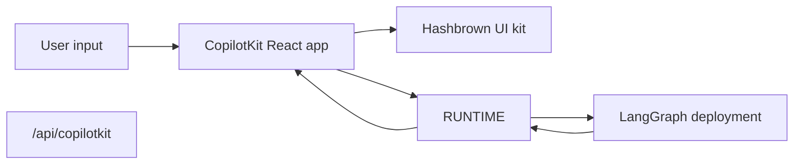

# CopilotKit

> Use CopilotKit with LangGraph, Deep Agents, and React with custom endpoints, the Python AG-UI bridge, structured generative UI, and messaging-platform channels

[CopilotKit](https://www.copilotkit.ai/) provides a full React chat runtime and pairs especially well with LangGraph when you want the agent to return **structured UI payloads** instead of only plain text. The frontend talks to a CopilotKit runtime URL and parses assistant messages into dynamic React components.

In this pattern, your LangGraph deployment serves the graph API and an AG-UI FastAPI bridge. A small Node CopilotKit runtime sits in front of that bridge and is what the React client calls.

On the server, the [copilotkit](https://pypi.org/project/copilotkit/) package provides [`CopilotKitMiddleware`](https://docs.copilotkit.ai) so a LangGraph graph, a LangChain agent, or a [Deep Agent](https://docs.langchain.com/oss/python/deepagents/overview.md) can speak the [Agent UI (AG-UI)](https://docs.ag-ui.com/) wire protocol, stream tool and message events to a chat UI, and read or write the shared **CopilotKit** slice of state. TypeScript setups usually mount the CopilotKit runtime next to the graph API. Python setups mount an AG-UI FastAPI bridge on the deployment and run the CopilotKit runtime in Node in front of it.

This approach is useful when you want:

* a ready-made chat runtime instead of wiring `stream.messages` yourself
* a custom server endpoint that can add provider-specific behavior next to your deployed graph
* structured generative UI rendered from a constrained component registry

[CopilotKit for LangGraph](https://docs.copilotkit.ai/langgraph) also documents [generative UI](https://docs.copilotkit.ai/langgraph/generative-ui), [human in the loop](https://docs.copilotkit.ai/langgraph/human-in-the-loop) (HITL), and [shared state](https://docs.copilotkit.ai/langgraph/shared-state) on top of the same middleware and clients.

> [!NOTE]
>
> For CopilotKit-specific APIs, UI patterns, and runtime configuration, see the
> [CopilotKit docs](https://docs.copilotkit.ai/langgraph). For a Deep Agent walkthrough, see
> [Deep Agents and CopilotKit](https://docs.copilotkit.ai/langgraph/deep-agents) in the CopilotKit docs.

## How it works

At a high level, CopilotKit sits between your React app and the LangGraph deployment.

The frontend sends conversation state to a Node CopilotKit runtime. That runtime calls the AG-UI FastAPI bridge on your LangGraph deployment, and the response comes back with both assistant messages and any structured UI payloads your component registry can render.

1. **Deploy the graph as usual** using LangSmith or using a LangGraph development server.
2. **Extend the deployment with an HTTP app** that mounts the AG-UI FastAPI bridge next to the graph API.
3. **Run a Node CopilotKit runtime** that points an `HttpAgent` at that bridge, then wrap the frontend in `CopilotKit` against the runtime URL.
4. **Register dynamic UI components** and parse assistant responses into those components at render time.



On Python, the CopilotKit runtime is a separate Node process. The LangGraph deployment hosts the graph API and the AG-UI FastAPI bridge only. See [Add the CopilotKit runtime](#add-the-copilotkit-runtime).

## What you get on the Python server

The [copilotkit](https://pypi.org/project/copilotkit/) and related packages bridge a LangGraph deployment and CopilotKit clients.

| Component | Role |
| - | - |
| `CopilotKitMiddleware` | Merges CopilotKit and AG-UI state and requests into your agent, including frontend [tool calls](../../Core%20components/Agents.md#tools) and context. Add it to the `middleware` list for [create\_agent](https://reference.langchain.com/python/langchain/agents/factory/create_agent) or [create\_deep\_agent](https://reference.langchain.com/python/deepagents/graph/create_deep_agent). |
| `CopilotKitState` (subclass) | [Custom state](../../Core%20components/Short-term%20memory.md): extend `CopilotKitState` so the CopilotKit key is part of graph state. |
| `LangGraphAGUIAgent` | Bundles a compiled graph with a name and description for the runtime. |
| `add_langgraph_fastapi_endpoint` (from [ag-ui-langgraph](https://pypi.org/project/ag-ui-langgraph/)) | Wires a **FastAPI** AG-UI bridge on the same [LangGraph](https://docs.langchain.com/oss/python/langgraph/overview.md) process as your graph. Mount it with a [custom `http` app in `langgraph.json`](#extend-the-langgraph-deployment-with-a-custom-endpoint). The React client still needs a separate Node [CopilotKit runtime](#add-the-copilotkit-runtime) that calls this bridge over AG-UI. |

`CopilotKitMiddleware` is the same middleware for [create\_deep\_agent](https://reference.langchain.com/python/deepagents/graph/create_deep_agent) and for a graph from [create\_agent](https://reference.langchain.com/python/langchain/agents/factory/create_agent) when you add it to the `middleware` list. For a `create_agent` graph with `CopilotKitState` and a FastAPI bridge, follow the [Python `main.py` example](#extend-the-langgraph-deployment-with-a-custom-endpoint) below. Structured generative UI (for example `useAgentContext` and an `output_schema` from the client) needs extra middleware that maps Copilot state to a [structured output](../../Core%20components/Agents.md#structured-output) strategy, as in the expandable `src/middleware.py` example in the same section.

Mounting `app` on the `http` key in `langgraph.json` follows the usual [LangGraph or LangSmith deployment](https://docs.langchain.com/oss/python/langgraph/deploy.md): one process serves the graph API and the AG-UI FastAPI bridge. The CopilotKit React client talks to the Node runtime, which calls that bridge.

## Installation

For the backend endpoint:

```bash
uv add copilotkit ag-ui-langgraph fastapi uvicorn
```

The middleware package sits alongside the Deep Agents stack. Install it with your [chat model](https://docs.langchain.com/oss/python/integrations/chat.md) package (this example uses OpenAI):

```python pip
pip install -U deepagents copilotkit langchain-openai
```

```python uv
uv add deepagents copilotkit langchain-openai
```

The CopilotKit runtime that the frontend calls is a Node package, so the Python setup also needs a small Node server. The pins below are a known-good pair. If you upgrade `@copilotkit/runtime`, install the `@ag-ui/client` version that release lists as a dependency so the `HttpAgent` type matches:

```bash
bun add @copilotkit/runtime@1.73.3 @ag-ui/client@0.0.59
```

For the frontend app:

```bash
bun add @copilotkit/react-core @copilotkit/react-ui @hashbrownai/core @hashbrownai/react
```

## Use CopilotKit with a Deep Agent

Add `CopilotKitMiddleware` to the `middleware` list you pass to [create\_deep\_agent](https://reference.langchain.com/python/deepagents/graph/create_deep_agent). The middleware lets CopilotKit route frontend tool calls and align chat state with your graph. Keep any other [middleware you configure](https://docs.langchain.com/oss/python/deepagents/customization.md#middleware) in the same list.

The compiled graph is then ready to plug into a CopilotKit- or AG-UI–aware process (for example, the [FastAPI pattern below](#extend-the-langgraph-deployment-with-a-custom-endpoint)) or a guide such as [Deep Agents and CopilotKit](https://docs.copilotkit.ai/langgraph/deep-agents) in the CopilotKit documentation. Do not pass a checkpointer on the exported agent if you list it under `graphs` in `langgraph.json`. The [FastAPI example below](#extend-the-langgraph-deployment-with-a-custom-endpoint) attaches a checkpointer only on the AG-UI route copy.

```python
from deepagents import create_deep_agent
from copilotkit import CopilotKitMiddleware


def get_weather(location: str) -> str:
    """Return a simple weather string for a location."""
    return f"The weather in {location} is sunny."


agent = create_deep_agent(
    model="openai:gpt-6.1-sol",
    tools=[get_weather],
    middleware=[CopilotKitMiddleware()],  # AG-UI, frontend tools, and context
    system_prompt="You are a helpful research assistant.",
)
```

## Extend the LangGraph deployment with a custom endpoint

The key idea is that the LangGraph deployment does not only serve graphs. It can also load an HTTP app, which lets you mount extra routes next to the deployment itself.

In `langgraph.json`, point `http.app` at your custom app entrypoint:

```json
{
  "dependencies": ["."],
  "graphs": {
    "copilotkit_shadify": "./main.py:agent"
  },
  "http": {
    "app": "./main.py:app"
  }
}
```

In Python, create a `FastAPI` app and expose the LangGraph agent through CopilotKit's AG-UI bridge:

```python main.py
from typing import Any, TypedDict

from ag_ui_langgraph import add_langgraph_fastapi_endpoint
from copilotkit import CopilotKitMiddleware, CopilotKitState, LangGraphAGUIAgent
from fastapi import FastAPI
from langchain.agents import create_agent
from langgraph.checkpoint.memory import MemorySaver

from src.middleware import apply_structured_output_schema, normalize_context


class AgentState(CopilotKitState):
    pass


class AgentContext(TypedDict, total=False):
    output_schema: dict[str, Any]


agent = create_agent(
    model="openai:gpt-6.1-sol",
    middleware=[
        normalize_context,
        CopilotKitMiddleware(),
        apply_structured_output_schema,
    ],
    context_schema=AgentContext,
    state_schema=AgentState,
    system_prompt=(
        "You are a helpful UI assistant. Build visual responses using the "
        "available components."
    ),
)

app = FastAPI()

add_langgraph_fastapi_endpoint(
    app=app,
    agent=LangGraphAGUIAgent(
        name="copilotkit_shadify",
        description="A UI assistant that returns structured component payloads.",
        # The AG-UI bridge reads graph state, so this route needs a checkpointer.
        graph=agent.copy(update={"checkpointer": MemorySaver()}),
    ),
    path="/",
)
```

The AG-UI bridge reads the graph's state on every run, so the graph behind the FastAPI route needs a checkpointer. Keep the checkpointer off `agent` itself: `agent` is also listed under `graphs`, and `langgraph dev` refuses to load a listed graph that brings its own checkpointer, because LangGraph API handles persistence for listed graphs. The copy with `MemorySaver` serves only the FastAPI route. Its threads live in process memory, so they do not survive a restart, are not shared across replicas, and do not appear in the deployment's threads API. For production traffic on this route, pass a durable [checkpointer](https://docs.langchain.com/oss/python/langgraph/persistence.md) instead.

This custom app is the important extension point: it mounts the AG-UI FastAPI bridge without replacing the underlying LangGraph deployment. The Node CopilotKit runtime stays separate; see [Add the CopilotKit runtime](#add-the-copilotkit-runtime).

In Python, the equivalent work happens in middleware: normalize the CopilotKit context and forward the `output_schema` from `useAgentContext(...)` into the model's structured output configuration. The schema that Hashbrown generates has no top-level `title`, and the OpenAI integration requires one to name the structured output schema, so the middleware fills in a `title` and `description` when they are missing.

```python expandable src/middleware.py
import json
from collections.abc import Mapping

from langchain.agents.middleware import before_agent, wrap_model_call
from langchain.agents.structured_output import ProviderStrategy


@wrap_model_call
async def apply_structured_output_schema(request, handler):
    schema = None
    runtime = getattr(request, "runtime", None)
    runtime_context = getattr(runtime, "context", None)

    if isinstance(runtime_context, Mapping):
        schema = runtime_context.get("output_schema")

    if schema is None and isinstance(getattr(request, "state", None), dict):
        copilot_context = request.state.get("copilotkit", {}).get("context")
        if isinstance(copilot_context, list):
            for item in copilot_context:
                if isinstance(item, dict) and item.get("description") == "output_schema":
                    schema = item.get("value")
                    break

    if isinstance(schema, str):
        try:
            schema = json.loads(schema)
        except json.JSONDecodeError:
            schema = None

    if isinstance(schema, dict):
        # OpenAI uses the top-level title as the structured output name.
        schema = {
            **schema,
            "title": schema.get("title") or "CopilotKitStructuredOutput",
            "description": schema.get("description")
            or "Structured response schema for the CopilotKit preview.",
        }
        request = request.override(
            response_format=ProviderStrategy(schema=schema, strict=True),
        )

    return await handler(request)


@before_agent
def normalize_context(state, runtime):
    copilotkit_state = state.get("copilotkit", {})
    context = copilotkit_state.get("context")

    if isinstance(context, list):
        normalized = [
            item.model_dump() if hasattr(item, "model_dump") else item
            for item in context
        ]
        return {"copilotkit": {**copilotkit_state, "context": normalized}}

    return None
```

The result is a clean separation of concerns:

* LangGraph still owns graph execution and persistence
* CopilotKit owns the chat-facing runtime contract
* your custom endpoint glues them together inside one deployment

### Add the CopilotKit runtime

The FastAPI route speaks the AG-UI protocol, not the CopilotKit runtime protocol, so the frontend cannot call it directly: pointing `runtimeUrl` at the FastAPI route fails with `runtime_info_fetch_failed`. Run a [CopilotKit runtime](https://docs.copilotkit.ai/langgraph) in a small Node server and point an `HttpAgent` at the FastAPI route. The Python graph and middleware still define tool behavior and agent logic.

```ts server.ts
import { createServer } from "node:http";

import { HttpAgent } from "@ag-ui/client";
import { CopilotRuntime } from "@copilotkit/runtime/v2";
import { createCopilotNodeListener } from "@copilotkit/runtime/v2/node";

// The FastAPI route is mounted at the root of the LangGraph deployment.
const agentUrl = process.env.LANGGRAPH_DEPLOYMENT_URL || "http://127.0.0.1:2024";

const runtime = new CopilotRuntime({
  agents: {
    default: new HttpAgent({ url: agentUrl }),
  },
});

createServer(
  createCopilotNodeListener({
    runtime,
    basePath: "/api/copilotkit",
    cors: true,
  }),
).listen(4000);
```

Start the runtime next to the LangGraph deployment:

```bash
bun server.ts
```

The runtime serves `/api/copilotkit` on port 4000. Point the frontend at it, either by setting `VITE_RUNTIME_URL=http://localhost:4000/api/copilotkit` or by proxying `/api/copilotkit` to port 4000 from your dev server.

This runtime is the basic in-app integration. [Channels](#channels) does not use the FastAPI route: it connects to the graph through the deployment's graph API with `LangGraphAgent`.

## Structure the frontend app

On the frontend, wrap your app in `CopilotKit` and point it at the custom runtime URL:

```tsx
import { CopilotKit } from "@copilotkit/react-core";
import { CopilotChat, useAgentContext } from "@copilotkit/react-core/v2";
import { s } from "@hashbrownai/core";

import { useChatKit } from "@/components/chat/chat-kit";
import { chatTheme } from "@/lib/chat-theme";

export function App() {
  return (
    <CopilotKit runtimeUrl={import.meta.env.VITE_RUNTIME_URL ?? "/api/copilotkit"}>
      <Page />
    </CopilotKit>
  );
}

function Page() {
  const chatKit = useChatKit();

  useAgentContext({
    description: "output_schema",
    value: s.toJsonSchema(chatKit.schema),
  });

  return <CopilotChat {...chatTheme} />;
}
```

There are two important pieces here:

* `runtimeUrl="/api/copilotkit"` sends the chat to your custom backend route rather than directly to the raw LangGraph API
* `useAgentContext(...)` sends the UI schema to the agent so the model knows what structured output format it should produce

## Register the dynamic components

The component registry lives in `useChatKit()`. This is where you define the set of components the agent is allowed to emit, such as cards, rows, columns, charts, code blocks, and buttons.

```tsx
import { s } from "@hashbrownai/core";
import { exposeComponent, exposeMarkdown, useUiKit } from "@hashbrownai/react";

import { Button } from "@/components/ui/button";
import { Card } from "@/components/ui/card";
import { CodeBlock } from "@/components/ui/code-block";
import { Row, Column } from "@/components/ui/layout";
import { SimpleChart } from "@/components/ui/simple-chart";

export function useChatKit() {
  return useUiKit({
    components: [
      exposeMarkdown(),
      exposeComponent(Card, {
        name: "card",
        description: "Card to wrap generative UI content.",
        children: "any",
      }),
      exposeComponent(Row, {
        name: "row",
        props: {
          gap: s.string("Tailwind gap size") as never,
        },
        children: "any",
      }),
      exposeComponent(Column, {
        name: "column",
        children: "any",
      }),
      exposeComponent(SimpleChart, {
        name: "chart",
        props: {
          labels: s.array("Category labels", s.string("A label")),
          values: s.array("Numeric values", s.number("A value")),
        },
        children: false,
      }),
      exposeComponent(CodeBlock, {
        name: "code_block",
        props: {
          code: s.streaming.string("The code to display"),
          language: s.string("Programming language") as never,
        },
        children: false,
      }),
      exposeComponent(Button, {
        name: "button",
        children: "text",
      }),
    ],
  });
}
```

This registry becomes the contract between the agent and the UI. The model is not generating arbitrary JSX. It is generating structured data that must validate against the components and props you exposed.

## Render assistant messages as dynamic UI

Once the assistant response arrives, the custom message renderer decides how to display it. In this example:

* assistant messages are parsed as structured JSON against the UI kit schema
* valid structured output is rendered as real React components
* user messages are rendered as ordinary chat bubbles

```tsx
import type { AssistantMessage } from "@ag-ui/core";
import type { RenderMessageProps } from "@copilotkit/react-ui";
import { useJsonParser } from "@hashbrownai/react";
import { memo } from "react";

import { useChatKit } from "@/components/chat/chat-kit";
import { Squircle } from "@/components/squircle";

const AssistantMessageRenderer = memo(function AssistantMessageRenderer({
  message,
}: {
  message: AssistantMessage;
}) {
  const kit = useChatKit();
  const { value } = useJsonParser(message.content ?? "", kit.schema);

  if (!value) return null;

  return (
    <div className="group/msg mt-2 flex w-full justify-start">
      <div className="magic-text-output w-full px-1 py-1">{kit.render(value)}</div>
    </div>
  );
});

export function CustomMessageRenderer({ message }: RenderMessageProps) {
  if (message.role === "assistant") {
    return <AssistantMessageRenderer message={message} />;
  }

  return (
    <div className="flex w-full justify-end">
      <Squircle className="w-full max-w-[64ch] px-4 py-3">
        <pre>{typeof message.content === "string" ? message.content : JSON.stringify(message.content, null, 2)}</pre>
      </Squircle>
    </div>
  );
}
```

This renderer pattern is what makes the integration feel native:

* CopilotKit handles chat state and transport
* the custom renderer decides how assistant payloads become UI
* [Hashbrown](https://hashbrown.dev/) turns validated structured data into concrete React elements

## Channels

The same agent that powers your in-app copilot can also run as a bot in Slack and other messaging platforms. [CopilotKit Channels](https://docs.copilotkit.ai/channels) connects your LangChain agent to a messaging platform through a managed CopilotKit Intelligence connection: Intelligence holds the platform credentials and message delivery, while your process runs the agent.

> [!NOTE]
>
> Channels require `@copilotkit/channels` 0.6.1 and `@copilotkit/runtime` 1.65.0, installed together as a tested pair, and Node.js 22 or later on a long-running host. The LangChain deployment the channel connects to can be Python or TypeScript.

> [!NOTE]
>
> This page shows how Channels fit together with a LangChain agent. For the full Slack walkthrough with a LangGraph backend, see [Connect and run your agent in Slack](https://docs.copilotkit.ai/slack/langgraph-typescript/connect). For other agent backends and platform coverage, see the [Channels overview](https://docs.copilotkit.ai/channels).

### How it fits together

CopilotKit Intelligence owns the platform connection (Slack, Microsoft Teams, and more) and its credentials. Your long-running Channels listener owns the agent, tools, and application logic. Each turn follows the same path:

1. A person messages your app in Slack.
2. Intelligence receives the platform event using the credentials configured for the Channel.
3. A persistent Intelligence gateway connection delivers the turn to your Channels listener.
4. The listener runs your LangChain agent over [AG-UI](https://docs.ag-ui.com/) and renders the reply.
5. Intelligence sends the result back as native Slack Block Kit.

Platform credentials never enter the agent process. Create a managed Channel in [CopilotKit Intelligence](https://docs.copilotkit.ai/slack/intelligence) and connect Slack: Intelligence stores the Slack credentials and gives you a **Channel code** (`CHANNEL_CODE`) and a project-scoped **Intelligence API key** (`INTELLIGENCE_API_KEY`) for the listener.

### Install

Install the tested SDK pair, then the TypeScript tooling:

```bash npm
npm install --save-exact @copilotkit/channels@0.6.1 @copilotkit/runtime@1.65.0
npm install -D tsx typescript @types/node
```

```bash pnpm
pnpm add --save-exact @copilotkit/channels@0.6.1 @copilotkit/runtime@1.65.0
pnpm add -D tsx typescript @types/node
```

```bash yarn
yarn add --exact @copilotkit/channels@0.6.1 @copilotkit/runtime@1.65.0
yarn add -D tsx typescript @types/node
```

Use a NodeNext TypeScript configuration:

```json icon="settings" title="tsconfig.json"
{
  "compilerOptions": {
    "target": "ES2022",
    "module": "NodeNext",
    "moduleResolution": "NodeNext",
    "strict": true,
    "skipLibCheck": true,
    "noEmit": true,
    "types": ["node"]
  },
  "include": ["*.ts", "*.tsx"]
}
```

### Connect your LangChain agent

Return a fresh agent for each conversation, keyed by thread, so no state leaks across Slack threads. LangSmith Agent Server speaks the LangGraph API, so use `LangGraphAgent` from `@copilotkit/runtime/langgraph`, not `HttpAgent`. Point it at the [deployment you already run](#extend-the-langgraph-deployment-with-a-custom-endpoint):

```ts icon="robot" title="agent.ts"
import { LangGraphAgent } from "@copilotkit/runtime/langgraph";

// A fresh agent per conversation, keyed by thread.
export function makeAgent(threadId: string) {
  const agent = new LangGraphAgent({
    deploymentUrl: process.env.LANGGRAPH_DEPLOYMENT_URL!,
    graphId: "copilotkit_shadify", // the graph you deployed above
  });
  agent.threadId = threadId;
  return agent;
}
```

### Run the Channel listener

Declare the Channel with the `Code` from Intelligence and forward each message to the agent. Creating the Node listener is what connects the Channel. Register process teardown before you create the listener so a Ctrl-C during the connect window still stops the Channel cleanly.

```ts icon="server" title="channel.ts"
import { createServer } from "node:http";

import { createChannel } from "@copilotkit/channels";
import { CopilotKitIntelligence, CopilotRuntime } from "@copilotkit/runtime/v2";
import { createCopilotNodeListener } from "@copilotkit/runtime/v2/node";

import { makeAgent } from "./agent.js";

function required(name: string): string {
  const value = process.env[name];
  if (!value) throw new Error(`Missing required environment variable: ${name}`);
  return value;
}

// `name` must match the Channel Code shown in CopilotKit Intelligence.
const channel = createChannel({
  name: required("CHANNEL_CODE"),
  identifyUser: "platform",
  agent: makeAgent,
});

// Each incoming message starts a turn; runAgent streams the reply back.
channel.onMessage(async ({ thread, message }) => {
  await thread.runAgent({
    prompt: message.contentParts?.length
      ? [
          ...(message.text ? [{ type: "text" as const, text: message.text }] : []),
          ...message.contentParts,
        ]
      : message.text,
    context: [{ description: "Originating platform", value: message.platform }],
  });
});

const intelligence = new CopilotKitIntelligence({
  apiKey: required("INTELLIGENCE_API_KEY"),
});

const runtime = new CopilotRuntime({
  agents: {},
  intelligence,
  channels: [channel],
});

// Wire teardown before the listener exists, because creating it starts the
// Channel. A Ctrl-C during the connect window then still tears it down.
let teardown: (() => Promise<void>) | undefined;
const shutdown = async () => {
  await teardown?.();
};
process.once("SIGINT", shutdown);
process.once("SIGTERM", shutdown);

const listener = createCopilotNodeListener({
  runtime,
  basePath: "/api/copilotkit",
});
const channels = listener.channels;
const server = createServer(listener);
teardown = async () => {
  await channels.stop();
  if (server.listening) server.close();
};

// Creating the listener starts the Channel; there is no `channel.start()`.
// `ready()` is optional; inspect `status()` before reporting the Channel online.
await channels.ready({ timeoutMs: 30_000 });
if (channels.status().overall !== "online") {
  throw new Error("Slack Channel is not online");
}

const port = Number(process.env.PORT ?? 3000);
server.listen(port, () => {
  console.log(`Slack Channel online; listening on :${port}`);
});
```

Set the runtime secrets, then start the process:

```bash .env
INTELLIGENCE_API_KEY=<project-api-key>
CHANNEL_CODE=support-slack
LANGGRAPH_DEPLOYMENT_URL=http://127.0.0.1:2024
PORT=3000
```

```bash Terminal
node --env-file=.env --import tsx channel.ts
```

The Channel moves from **Waiting for runtime** to **Online** in Intelligence once the process connects.

### Other platforms

Managed Slack is generally available. Managed Teams is a controlled integration target. The Channels SDK also ships direct adapters for Teams, Discord, Telegram, and WhatsApp. See the [Channels overview](https://docs.copilotkit.ai/slack) for the current platform list and per-platform setup.

## Resources

* [Deep Agents and CopilotKit](https://docs.copilotkit.ai/langgraph/deep-agents) in the CopilotKit documentation — end-to-end Next.js, dev server, and **Deep Agent** path
* [CopilotKit: LangGraph features](https://docs.copilotkit.ai/langgraph) — generative UI, HITL, shared state
* [LangGraph deployment](https://docs.langchain.com/oss/python/langgraph/deploy.md) — production and dev server

## Best practices

* **Keep the custom endpoint thin:** use it to adapt CopilotKit to your graph deployment, not to duplicate business logic already inside the graph
* **Send the schema explicitly:** `useAgentContext` should describe the UI contract every time the page mounts
* **Register a constrained component set:** expose only the components and props you actually want the model to use
* **Treat rendering as a parsing step:** parse assistant content against your schema before rendering it
* **Keep user messages plain:** only assistant messages need the structured renderer; user messages can stay normal chat bubbles

***

[Connect these docs](https://docs.langchain.com/use-these-docs.md) to your agent of choice via MCP for real-time answers.

[Edit this page on GitHub](https://github.com/langchain-ai/docs/edit/main/src/oss/langchain/frontend/integrations/copilotkit.mdx) or [file an issue](https://github.com/langchain-ai/docs/issues/new/choose).
