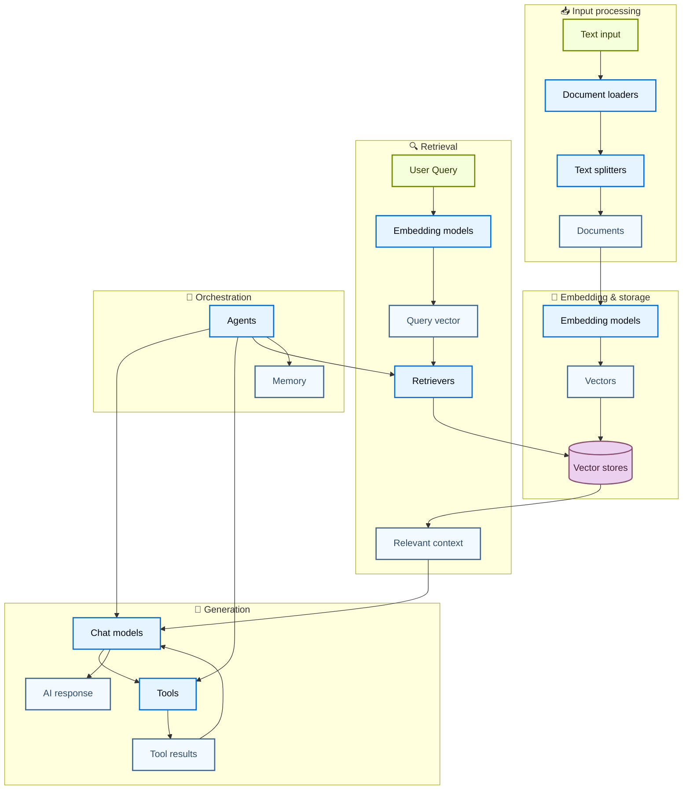
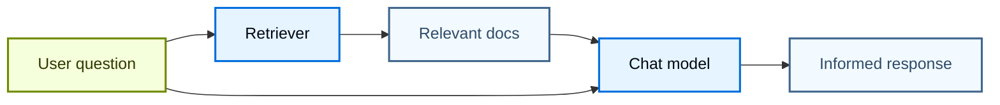
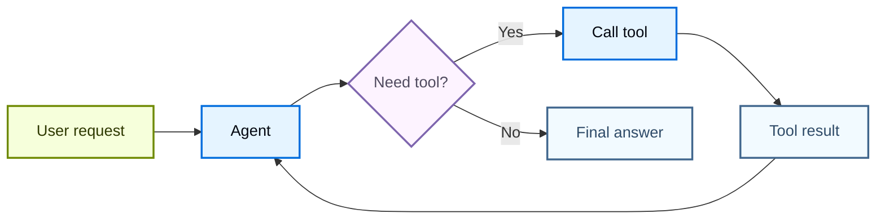
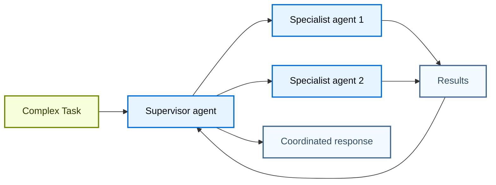

# Component architecture

LangChain's power comes from how its components work together to create sophisticated AI applications. This page provides diagrams showcasing the relationships between different components.

## Core component ecosystem

The diagram below shows how LangChain's major components connect to form complete AI applications:

### How components connect

Each component layer builds on the previous ones:

1. **Input processing** – Transform raw data into structured documents
2. **Embedding & storage** – Convert text into searchable vector representations
3. **Retrieval** – Find relevant information based on user queries
4. **Generation** – Use AI models to create responses, optionally with tools
5. **Orchestration** – Coordinate everything through agents and memory systems

## Component categories

LangChain organizes components into these main categories:

| Category | Purpose | Key Components | Use Cases |
| - | - | - | - |
| **[Models](../../Core%20components/Models.md)** | AI reasoning and generation | Chat models, LLMs, Embedding models | Text generation, reasoning, semantic understanding |
| **[Tools](../../Core%20components/Tools.md)** | External capabilities | APIs, databases, etc. | Web search, data access, computations |
| **[Agents](../../Core%20components/Agents.md)** | Orchestration and reasoning | ReAct agents, tool calling agents | Nondeterministic workflows, decision making |
| **[Memory](../../Core%20components/Short-term%20memory.md)** | Context preservation | Message history, custom state | Conversations, stateful interactions |
| **[Retrievers](https://docs.langchain.com/oss/python/integrations/retrievers.md)** | Information access | Vector retrievers, web retrievers | RAG, knowledge base search |
| **[Document processing](https://docs.langchain.com/oss/python/integrations/document_loaders.md)** | Data ingestion | Loaders, splitters, transformers | PDF processing, web scraping |
| **[Vector Stores](https://docs.langchain.com/oss/python/integrations/vectorstores.md)** | Semantic search | Chroma, Pinecone, FAISS | Similarity search, embeddings storage |

## Common patterns

### RAG (Retrieval-Augmented generation)

### Agent with tools

### Multi-agent system

## Learn more

* [Creating agents](../../Core%20components/Agents.md)
* [Working with tools](../../Core%20components/Tools.md)
* [Browse integrations](https://docs.langchain.com/oss/python/integrations/providers/overview.md)

***

[Connect these docs](https://docs.langchain.com/use-these-docs.md) to your agent of choice via MCP for real-time answers.

[Edit this page on GitHub](https://github.com/langchain-ai/docs/edit/main/src/oss/langchain/component-architecture.mdx) or [file an issue](https://github.com/langchain-ai/docs/issues/new/choose).
