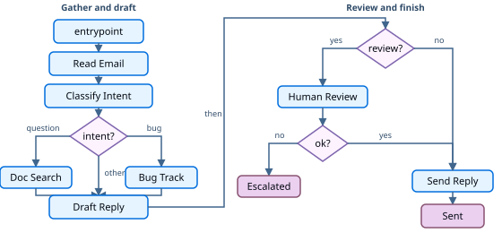

# Thinking in the Functional API

> Learn how to design agents with the LangGraph Functional API using entrypoints, tasks, and ordinary control flow.

When you build an agent with the [Functional API](Functional%20API%20overview.md), you break the process into discrete units of work called **tasks**. You compose those tasks inside an **entrypoint** using ordinary language control flow (`if`/`else`, loops, and function calls). Values pass between tasks as return values, not through a shared graph state schema.

This walkthrough builds a customer support email agent with the Functional API. For the same scenario with the Graph API, see [Thinking in the Graph API](../../Build%20with%20the%20Graph%20API/Thinking%20in%20the%20Graph%20API.md). To choose between the APIs, see [Choosing between Graph and Functional APIs](../../Get%20started/Choosing%20between%20Graph%20and%20Functional%20APIs.md).

## Start with the process you want to automate

Imagine that you need to build an AI agent that handles customer support emails. Your product team has given you these requirements:

```txt
The agent should:

- Read incoming customer emails
- Classify them by urgency and topic
- Search relevant documentation to answer questions
- Draft appropriate responses
- Escalate complex issues to human agents

Example scenarios to handle:

1. Simple product question: "How do I reset my password?"
2. Bug report: "The export feature crashes when I select PDF format"
3. Urgent billing issue: "I was charged twice for my subscription!"
4. Feature request: "Can you add dark mode to the mobile app?"
5. Complex technical issue: "Our API integration fails intermittently with 504 errors"
```

To implement an agent with the Functional API, follow these five steps. Steps 1 and 2 are planning. Steps 3 through 5 turn that plan into types, tasks, and an entrypoint you can run.

## Step 1: Map out your workflow as discrete steps

Start by identifying the distinct steps in your process. Each step becomes a **task** (a function that does one specific thing). Then sketch how the entrypoint calls those tasks and branches. Do this before writing code.



That sketch mirrors the entrypoint: sequential calls and `if`/`else` on the left, then human review on the right. The Graph API would encode the same paths as nodes and edges.

Now that the components are identified, clarify what each step needs to do:

* `Read Email`: Extract and parse the email content
* `Classify Intent`: Use an LLM to categorize urgency and topic
* `Doc Search`: Query your knowledge base for relevant information
* `Bug Track`: Create or update an issue in a tracking system
* `Draft Reply`: Generate an appropriate response
* `Human Review`: Escalate to a human agent for approval or handling
* `Send Reply`: Dispatch the email response

> [!TIP]
>
> Some steps always run in sequence (`Read Email` then `Classify Intent`). Others are conditional (`Doc Search` for questions and feature requests, `Bug Track` only for bugs). Encode those branches with ordinary control flow in the entrypoint.

## Step 2: Identify what each step needs to do

For each step from Step 1, decide what kind of work it is and what inputs it needs. Use the categories below, then expand the email-agent examples for concrete fields and retry choices.

> [card] [LLM steps](#llm-steps)
>
> Use when you need to understand, analyze, generate text, or make reasoning decisions

> [card] [Data steps](#data-steps)
>
> Use when you need to retrieve information from external sources

> [card] [Action steps](#action-steps)
>
> Use when you need to perform external actions

> [card] [User input steps](#user-input-steps)
>
> Use when you need human intervention

### LLM steps

When a step needs to understand, analyze, generate text, or make reasoning decisions:

> [accordion] Classify intent
>
> * Static context (prompt): Classification categories, urgency definitions, response format
> * Dynamic context (arguments): Email content, sender information
> * Desired outcome: Structured classification that drives later branches

> [accordion] Draft reply
>
> * Static context (prompt): Tone guidelines, company policies, response templates
> * Dynamic context (arguments): Classification results, search results
> * Desired outcome: Professional email response ready for review

### Data steps

When a step needs to retrieve information from external sources:

> [accordion] Document search
>
> * Parameters: Query built from intent and topic
> * Retry strategy: Yes, with exponential backoff for transient failures
> * Caching: Could cache common queries to reduce API calls

### Action steps

When a step needs to perform an external action:

> [accordion] Send reply
>
> * When to execute: After approval (human or automated)
> * Retry strategy: Yes, with exponential backoff for network issues
> * Should not cache: Each send is a unique action

> [accordion] Bug track
>
> * When to execute: Always when intent is "bug"
> * Retry strategy: Yes, critical to not lose bug reports
> * Returns: Ticket ID to include in the response

### User input steps

When a step needs human intervention:

> [accordion] Human review
>
> * Context for decision: Original email, draft response, urgency, classification
> * Expected input format: Approval boolean plus optional edited response
> * When triggered: High urgency, complex issues, or quality concerns

## Step 3: Decide what data to pass between tasks

In the Functional API, there is no shared graph state schema. Each task takes arguments and returns a value. The entrypoint holds intermediate results in local variables and passes them to the next task.

Ask yourself these questions about each piece of data:

> [card] Share it across tasks
>
> Does a later task need this value? If yes, **return** it from the task that creates it, store it in an entrypoint local variable, then **pass** it as an argument to the task that needs it.

> [card] Keep it inside one task
>
> Is it only used to format a prompt or make a call inside one task? If yes, keep it local to that task. Do not return it.

For the email agent, the entrypoint needs to carry:

* The original email and sender info (inputs to the workflow)
* Classification results (needed by later branches and the draft step)
* Search results (expensive to re-fetch)
* The draft response (needed through review and send)

> [!TIP]
>
> Store and pass raw data, not formatted prompt text. Format prompts inside the task that calls the model. That keeps tasks reusable and makes checkpoints easier to inspect.

Define types for the values tasks exchange. These are ordinary TypedDicts or TypeScript types, not a Graph API state schema. Add them to your file now; the tasks and entrypoint in the next steps use them.

```python
from typing import Literal, TypedDict


class EmailClassification(TypedDict):
    intent: Literal["question", "bug", "billing", "feature", "complex"]
    urgency: Literal["low", "medium", "high", "critical"]
    topic: str
    summary: str


class EmailInput(TypedDict):
    email_content: str
    sender_email: str
```

## Step 4: Build your tasks

Turn each Step 1 unit of work into a task. Tasks checkpoint independently, can retry on failure, and return values the entrypoint can await.

A [`@task`](https://reference.langchain.com/python/langgraph/func/task) is a Python function that does one unit of work and returns a result. Call it from an entrypoint and resolve it with `.result()` (or `await` in an async entrypoint).

### Handle errors appropriately

Before you fill in task bodies, consider how each task can fail. Attach retries on the task for transient errors. Use `interrupt()` in the entrypoint for human input. Use this table as a guide:

| Error type | Who fixes it | Strategy | When to use |
| - | - | - | - |
| Transient errors (network issues, rate limits) | System (automatic) | Retry policy on the task | Temporary failures that usually resolve on retry |
| LLM-recoverable errors (tool failures, parsing issues) | LLM | Return the error and branch or retry in the entrypoint | The model can adjust with more context |
| User-fixable errors (missing information, unclear instructions) | Human | Pause with `interrupt()` | Need user input to proceed |
| Unexpected errors | Developer | Fail the run | Bugs that need a code fix |

### Implementing the email agent tasks

Add one task per step from Step 1 (except human review, which uses `interrupt()` in the entrypoint in Step 5). The stubs below show the function signatures, return shapes, and retry policies for the email agent. Replace the placeholder bodies with your real LLM calls and API integrations. Put these tasks in the same file as the types from Step 3.

`read_email` is a passthrough here. Keeping it as its own task still gives you a checkpoint before classification and a place to add real MIME parsing later.

```python
from langgraph.func import task
from langgraph.types import RetryPolicy


@task
def read_email(email_content: str, sender_email: str) -> dict:
    """Parse and normalize the incoming email."""
    return {
        "email_content": email_content,
        "sender_email": sender_email,
    }


@task
def classify_intent(email_content: str, sender_email: str) -> EmailClassification:
    """Classify intent and urgency with an LLM."""
    # Placeholder: replace with a real LLM call.
    # This heuristic matches the try-out sample so interrupt() runs.
    lowered = email_content.lower()
    if "charged" in lowered or "billing" in lowered:
        return {
            "intent": "billing",
            "urgency": "high",
            "topic": "billing",
            "summary": "Customer reports a billing problem",
        }
    if "crash" in lowered or "bug" in lowered:
        return {
            "intent": "bug",
            "urgency": "medium",
            "topic": "product bug",
            "summary": "Customer reports a bug",
        }
    return {
        "intent": "question",
        "urgency": "low",
        "topic": "general",
        "summary": "Customer question",
    }


@task(retry_policy=RetryPolicy(max_attempts=3))
def search_documentation(topic: str, summary: str) -> list[str]:
    """Query the knowledge base for relevant chunks."""
    return [f"Docs related to {topic}"]


@task(retry_policy=RetryPolicy(max_attempts=3))
def create_bug_ticket(
    email_content: str, sender_email: str, summary: str
) -> str:
    """Create a ticket and return its ID."""
    return "TICKET-123"


@task
def draft_response(
    email_content: str,
    classification: EmailClassification,
    context: list[str],
) -> str:
    """Draft a reply from the email, classification, and gathered context."""
    return f"Thanks for your email about {classification['topic']}."


@task
def send_reply(draft: str, sender_email: str) -> None:
    """Send the approved reply."""
    return None
```

You now have callable tasks. Next, compose them in an entrypoint.

## Step 5: Compose the entrypoint

The entrypoint is the workflow. Add it below the tasks. It calls those tasks in order, branches with `if`/`else` (the control flow from Step 1), and pauses for humans with `interrupt()`. Provide a [checkpointer](../../Capabilities/Persistence.md) when you need durable execution and human-in-the-loop.

```python
from langgraph.checkpoint.memory import InMemorySaver
from langgraph.func import entrypoint
from langgraph.types import interrupt

checkpointer = InMemorySaver()


@entrypoint(checkpointer=checkpointer)
def email_agent(inputs: EmailInput) -> dict:
    parsed = read_email(inputs["email_content"], inputs["sender_email"]).result()
    classification = classify_intent(
        parsed["email_content"], parsed["sender_email"]
    ).result()

    context: list[str] = []
    if classification["intent"] in ("question", "feature"):
        context = search_documentation(
            classification["topic"], classification["summary"]
        ).result()
    elif classification["intent"] == "bug":
        ticket_id = create_bug_ticket(
            parsed["email_content"],
            parsed["sender_email"],
            classification["summary"],
        ).result()
        context = [f"Ticket created: {ticket_id}"]

    draft = draft_response(
        parsed["email_content"], classification, context
    ).result()

    # Pause for human review on billing, urgent, or complex issues
    if (
        classification["intent"] in ("billing", "complex")
        or classification["urgency"] in ("high", "critical")
    ):
        human_decision = interrupt(
            {
                "email_content": parsed["email_content"],
                "draft_response": draft,
                "classification": classification,
            }
        )
        if not human_decision.get("approved"):
            return {"status": "escalated", "draft": draft}
        draft = human_decision.get("edited_response", draft)

    send_reply(draft, parsed["sender_email"]).result()
    return {"status": "sent", "draft": draft, "classification": classification}
```

### Try out your agent

After the entrypoint is defined, invoke it with a sample email. With the placeholder classifier above, this urgent billing message is treated as high urgency, so the run hits `interrupt()` and you can practice resume. Use the same `thread_id` for the first invoke and the resume invoke.

```python
from langgraph.types import Command

config = {"configurable": {"thread_id": "customer_123"}}

result = email_agent.invoke(
    {
        "email_content": "I was charged twice for my subscription! This is urgent!",
        "sender_email": "customer@example.com",
    },
    config,
)
# The workflow pauses at interrupt() when urgency is high

# Resume with the human decision
email_agent.invoke(
    Command(
        resume={
            "approved": True,
            "edited_response": "We sincerely apologize for the double charge. I've initiated an immediate refund...",
        }
    ),
    config,
)
```

The workflow pauses at `interrupt()`, saves completed task results to the checkpointer, and waits. When you resume with `Command(resume=...)`, completed tasks reload from the checkpoint instead of re-running. The `thread_id` keeps this conversation's state together.

## Summary and next steps

### Key insights

Building this email agent shows the Functional API way of thinking:

> [card] [Break into discrete tasks](#step-1-map-out-your-workflow-as-discrete-steps)
>
> Each task does one thing well. Task boundaries are where results checkpoint, so failures and resumes redo less work.

> [card] [Pass values, do not share graph state](#step-3-decide-what-data-to-pass-between-tasks)
>
> Return raw data from tasks and pass it as arguments. Keep prompt formatting inside the task that needs it.

> [card] [Entrypoints own control flow](#step-5-compose-the-entrypoint)
>
> Use `if`/`else`, loops, and calls. You do not declare edges or conditional edge maps.

> [card] [Errors are part of the flow](#handle-errors-appropriately)
>
> Transient failures get task retry policies, user-fixable problems pause with `interrupt()`, and unexpected errors fail the run.

> [card] [Human input is first-class](../../Capabilities/Interrupts.md)
>
> `interrupt()` pauses execution, saves completed task results, and resumes when you provide input.

> [card] [Composition stays in code](#step-5-compose-the-entrypoint)
>
> The workflow reads like a normal function. That fits existing procedural code and fast iteration.

### Task granularity trade-offs

Most applications can use the breakdown above. Read this section when you are deciding whether to merge or split tasks.

LangGraph checkpoints at **task** boundaries inside an entrypoint. When a run resumes after an interrupt or failure, completed task results load from the checkpoint. Work that lived in the entrypoint body outside a task may run again.

Why this breakdown fits the email agent:

* **Isolation of external services:** Doc search and bug tracking are separate tasks so retries and failures stay scoped to those API calls.
* **Visibility:** Classification is its own task, so you can inspect the structured result before branching.
* **Different failure modes:** LLM calls, database lookups, and email sends get different retry policies.
* **Testing:** Smaller tasks are easier to unit test and reuse.

Merging `read_email` and `classify_intent` into one task is valid. You lose a checkpoint between them and repeat both on failure. For most agents, the observability benefit of separate tasks is worth it.

### Where to go from here

This walkthrough introduces Functional API design. Extend it with:

> [card] [Build checklist](Build%20checklist%20for%20the%20Functional%20API.md)
>
> Decision guide for workflows, tasks, streaming, interrupts, and memory

> [card] [Thinking in the Graph API](../../Build%20with%20the%20Graph%20API/Thinking%20in%20the%20Graph%20API.md)
>
> The same email agent with nodes, edges, and shared state

> [card] [Compose workflows](Compose%20Functional%20API%20workflows.md)
>
> Parallel tasks, calling graphs, and nesting entrypoints

> [card] [Configure tasks](Configure%20Functional%20API%20tasks.md)
>
> Retries, timeouts, caching, and resume after errors

> [card] [Human-in-the-loop](Add%20human-in-the-loop%20with%20the%20Functional%20API.md)
>
> Interrupt patterns for approval and tool review

> [card] [Add memory](Add%20memory%20with%20the%20Functional%20API.md)
>
> Short-term checkpointers and long-term stores
