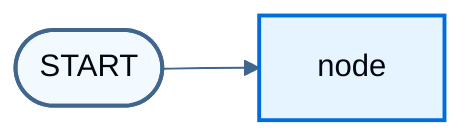

# Define and update state

> Define graph state schemas, reducers, messages, and private state in the LangGraph Graph API.

[State](Graph%20API%20overview.md#state) is the shared schema that nodes read and write. [Reducers](Graph%20API%20overview.md#reducers) control how each update merges into the current value. This page covers:

1. How to use state to define a graph's [schema](Graph%20API%20overview.md#schema)
2. How to use reducers to control how state updates are processed

## Define state

[State](Graph%20API%20overview.md#state) in LangGraph can be a `TypedDict`, `Pydantic` model, or dataclass. The examples below use `TypedDict`. Prefer that form for most graphs; see [Use Pydantic models for graph state](#use-pydantic-models-for-graph-state) when you need runtime validation on inputs.

By default, a graph uses the same schema for input and output, and the state determines that schema. See [Define input and output schemas](#define-input-and-output-schemas) for distinct input and output schemas.

Start with a [messages](Graph%20API%20overview.md#working-with-messages-in-graph-state) field. That shape fits many LLM applications. For more detail, see [Working with messages in graph state](Graph%20API%20overview.md#working-with-messages-in-graph-state).

```python
from langchain.messages import AnyMessage
from typing_extensions import TypedDict


class State(TypedDict):
    messages: list[AnyMessage]
    extra_field: int
```

This state tracks a list of [message](https://docs.langchain.com/oss/python/langchain/messages.md) objects and an extra integer field. There is no reducer yet, so a node that updates `messages` must return the full list.

## Update state

Build a graph with a single [node](Graph%20API%20overview.md#nodes). The node is a Python function that reads graph state and returns updates. The first argument is always the state:

```python
from langchain.messages import AIMessage


def node(state: State):
    messages = state["messages"]
    new_message = AIMessage("Hello!")
    return {"messages": messages + [new_message], "extra_field": 10}
```

This node appends a message by concatenating in the return value (no reducer yet) and sets `extra_field`.

> [!WARNING]
>
> Nodes should return updates to the state directly, instead of mutating the state.

Define a simple graph with this node. Use [`StateGraph`](Graph%20API%20overview.md#stategraph) for a graph that operates on this state, then [`add_node`](Graph%20API%20overview.md#nodes) to populate the graph:

```python
from langgraph.graph import StateGraph

builder = StateGraph(State)
builder.add_node(node)
builder.set_entry_point("node")
graph = builder.compile()
```

LangGraph provides built-in utilities for visualizing a graph. See [Visualize your graph](Visualize%20your%20graph.md) for detail.

```python
from IPython.display import Image, display

display(Image(graph.get_graph().draw_mermaid_png()))
```



This graph executes a single node. Invoke it:

```python
from langchain.messages import HumanMessage

result = graph.invoke({"messages": [HumanMessage("Hi")]})
result
```

```
{'messages': [HumanMessage(content='Hi'), AIMessage(content='Hello!')], 'extra_field': 10}
```

Note that:

* Invocation started by updating a single key of the state.
* The invocation result includes the entire state.

Inspect [message](https://docs.langchain.com/oss/python/langchain/messages.md) content with pretty-print:

```python
for message in result["messages"]:
    message.pretty_print()
```

```
================================ Human Message ================================

Hi
================================== Ai Message ==================================

Hello!
```

## Process state updates with reducers

Each key in the state can have its own [reducer](Graph%20API%20overview.md#reducers) function, which controls how updates from nodes are applied. If no reducer is specified, updates to that key replace the previous value.

For `TypedDict` state schemas, define reducers by annotating the field with a reducer function.

In the earlier example, the node updated `"messages"` by returning the full concatenated list. Add a reducer so updates are appended automatically:

```python
from typing_extensions import Annotated


def add(left, right):
    """Can also import `add` from the `operator` built-in."""
    return left + right


class State(TypedDict):
    messages: Annotated[list[AnyMessage], add]  # [!code highlight]
    extra_field: int
```

The node can then return only the new message:

```python
def node(state: State):
    new_message = AIMessage("Hello!")
    return {"messages": [new_message], "extra_field": 10}  # [!code highlight]
```

```python
from langgraph.graph import START

graph = StateGraph(State).add_node(node).add_edge(START, "node").compile()

result = graph.invoke({"messages": [HumanMessage("Hi")]})

for message in result["messages"]:
    message.pretty_print()
```

```
================================ Human Message ================================

Hi
================================== Ai Message ==================================

Hello!
```

### MessagesState

In practice, lists of messages need more than plain concatenation:

* Update an existing message in the state by ID.
* Accept shorthand [message formats](Graph%20API%20overview.md#serialization), such as `{"role": "user", "content": "..."}`.

LangGraph includes a built-in reducer [`add_messages`](https://reference.langchain.com/python/langgraph/graph/message/add_messages) that handles these cases:

```python
from langgraph.graph.message import add_messages


class State(TypedDict):
    messages: Annotated[list[AnyMessage], add_messages]  # [!code highlight]
    extra_field: int


def node(state: State):
    new_message = AIMessage("Hello!")
    return {"messages": [new_message], "extra_field": 10}


graph = StateGraph(State).add_node(node).set_entry_point("node").compile()
```

```python
input_message = {"role": "user", "content": "Hi"}  # [!code highlight]

result = graph.invoke({"messages": [input_message]})

for message in result["messages"]:
    message.pretty_print()
```

```
================================ Human Message ================================

Hi
================================== Ai Message ==================================

Hello!
```

This shape fits applications that use [chat models](https://docs.langchain.com/oss/python/langchain/models.md). For convenience, subclass the prebuilt `MessagesState`:

```python
from langgraph.graph import MessagesState


class State(MessagesState):
    extra_field: int
```

## Resetting a reducer field

A common source of confusion with reducers is that with a merging reducer, returning an empty value does not clear the field. The reducer merges the right argument into the left one, so an empty update is merged in and previously accumulated values are kept.

This pattern matters for error buffers or retry counters that must be cleared between retry attempts:

```python
from operator import add
from typing import Annotated

from typing_extensions import TypedDict


class State(TypedDict):
    errors: Annotated[list[str], add]


# node A returns {"errors": ["bad sql"]}
# node B returns {"errors": []}
# state["errors"] is still ["bad sql"]; the empty list is merged in, not cleared
```

To clear the field while keeping a merging reducer, wrap the update with [`Overwrite`](https://reference.langchain.com/python/langgraph/types/):

```python
from operator import add
from typing import Annotated

from langgraph.types import Overwrite
from typing_extensions import TypedDict


class State(TypedDict):
    errors: Annotated[list[str], add]


def clear_errors(state: State):
    # Bypass the merging reducer and clear the field
    return {"errors": Overwrite([])}
```

For more information, see [Bypass reducers with Overwrite](#bypass-reducers-with-overwrite).

## Bypass reducers with `Overwrite`

In some cases, you may want to bypass a reducer and directly overwrite a state value. When a node returns a value wrapped with `Overwrite`, the reducer is bypassed and the channel is set directly to that value.

This is useful when you want to reset or replace accumulated state rather than merge it with existing values.

LangGraph provides the [`Overwrite`](https://reference.langchain.com/python/langgraph/types/) type for this purpose.

```python
import operator

from langgraph.graph import END, START, StateGraph
from langgraph.types import Overwrite
from typing_extensions import Annotated, TypedDict


class State(TypedDict):
    messages: Annotated[list, operator.add]


def add_message(state: State):
    return {"messages": ["first message"]}


def replace_messages(state: State):
    # Bypass the reducer and replace the entire messages list
    return {"messages": Overwrite(["replacement message"])}


builder = StateGraph(State)
builder.add_node("add_message", add_message)
builder.add_node("replace_messages", replace_messages)
builder.add_edge(START, "add_message")
builder.add_edge("add_message", "replace_messages")
builder.add_edge("replace_messages", END)

graph = builder.compile()

result = graph.invoke({"messages": ["initial"]})
print(result["messages"])
```

```
['replacement message']
```

You can also use JSON format with the special key `"__overwrite__"`:

```python
def replace_messages(state: State):
    return {"messages": {"__overwrite__": ["replacement message"]}}
```

> [!WARNING]
>
> When nodes execute in parallel, only one node can use `Overwrite` on the same state key in a given super-step. If multiple nodes attempt to overwrite the same key in the same super-step, an `InvalidUpdateError` will be raised.

## Define input and output schemas

By default, `StateGraph` operates with a single schema, and all nodes communicate using that schema. You can also define distinct input and output schemas.

When distinct schemas are specified, an internal schema is still used for communication between nodes. The input schema validates the provided input. The output schema filters the internal data so `invoke` returns only the fields in the output schema.

Define distinct input and output schemas:

```python
from langgraph.graph import END, START, StateGraph
from typing_extensions import TypedDict


# Define the schema for the input
class InputState(TypedDict):
    question: str


# Define the schema for the output
class OutputState(TypedDict):
    answer: str


# Define the overall schema, combining both input and output
class OverallState(InputState, OutputState):
    pass


# Define the node that processes the input and generates an answer
def answer_node(state: InputState):
    # Example answer and an extra key
    return {"answer": "bye", "question": state["question"]}


# Build the graph with input and output schemas specified
builder = StateGraph(OverallState, input_schema=InputState, output_schema=OutputState)
builder.add_node(answer_node)  # Add the answer node
builder.add_edge(START, "answer_node")  # Define the starting edge
builder.add_edge("answer_node", END)  # Define the ending edge
graph = builder.compile()  # Compile the graph

# Invoke the graph with an input and print the result
print(graph.invoke({"question": "hi"}))
```

```
{'answer': 'bye'}
```

Notice that the output of invoke only includes the output schema.

## Pass private state between nodes

Nodes sometimes need intermediate data that should not appear in the graph's main input or output schema. Keep that data private so only the nodes that need it can read it.

The following sequential graph has three nodes. Private data passes between the first two steps. The third step only sees the public overall state.

```python
from langgraph.graph import END, START, StateGraph
from typing_extensions import TypedDict


# The overall state of the graph (this is the public state shared across nodes)
class OverallState(TypedDict):
    a: str


# Output from node_1 contains private data that is not part of the overall state
class Node1Output(TypedDict):
    private_data: str


# The private data is only shared between node_1 and node_2
def node_1(state: OverallState) -> Node1Output:
    output = {"private_data": "set by node_1"}
    print(f"Entered node `node_1`:\n\tInput: {state}.\n\tReturned: {output}")
    return output


# Node 2 input only requests the private data available after node_1
class Node2Input(TypedDict):
    private_data: str


def node_2(state: Node2Input) -> OverallState:
    output = {"a": "set by node_2"}
    print(f"Entered node `node_2`:\n\tInput: {state}.\n\tReturned: {output}")
    return output


# Node 3 only has access to the overall state (no access to private data from node_1)
def node_3(state: OverallState) -> OverallState:
    output = {"a": "set by node_3"}
    print(f"Entered node `node_3`:\n\tInput: {state}.\n\tReturned: {output}")
    return output


# Connect nodes in a sequence
# node_2 accepts private data from node_1, whereas
# node_3 does not see the private data.
builder = StateGraph(OverallState).add_sequence([node_1, node_2, node_3])
builder.add_edge(START, "node_1")
graph = builder.compile()

# Invoke the graph with the initial state
response = graph.invoke(
    {
        "a": "set at start",
    }
)

print()
print(f"Output of graph invocation: {response}")
```

```
Entered node `node_1`:
    Input: {'a': 'set at start'}.
    Returned: {'private_data': 'set by node_1'}
Entered node `node_2`:
    Input: {'private_data': 'set by node_1'}.
    Returned: {'a': 'set by node_2'}
Entered node `node_3`:
    Input: {'a': 'set by node_2'}.
    Returned: {'a': 'set by node_3'}

Output of graph invocation: {'a': 'set by node_3'}
```

## Private channels and streaming

Input, output, and private schemas constrain what each node reads and what `invoke` returns. They do **not** hide channels from [streaming](../Capabilities/Streaming.md).

Values streaming emits **all** state channels by default, including private ones. That applies to the values projection from [event streaming](../Capabilities/Event%20streaming.md) (`stream.values` on `stream_events` / `streamEvents` with `version="v3"`), and to `graph.stream` with `stream_mode="values"` / `streamMode: "values"`. Values streaming uses the full state, not the output schema. A private channel can be missing from `invoke` output but visible in the stream.

This example uses distinct input, output, overall, and private schemas. `invoke` returns only the output schema:

```python
from typing import TypedDict

from langgraph.graph import END, START, StateGraph


class InputState(TypedDict):
    user_input: str


class OutputState(TypedDict):
    graph_output: str


class OverallState(TypedDict):
    foo: str
    user_input: str
    graph_output: str


class PrivateState(TypedDict):
    bar: str


def node_1(state: InputState) -> OverallState:
    # Write to OverallState
    return {"foo": state["user_input"] + " name"}


def node_2(state: OverallState) -> PrivateState:
    # Read from OverallState, write to PrivateState
    return {"bar": state["foo"] + " is"}


def node_3(state: PrivateState) -> OutputState:
    # Read from PrivateState, write to OutputState
    return {"graph_output": state["bar"] + " Lance"}


builder = StateGraph(OverallState, input_schema=InputState, output_schema=OutputState)
builder.add_node("node_1", node_1)
builder.add_node("node_2", node_2)
builder.add_node("node_3", node_3)
builder.add_edge(START, "node_1")
builder.add_edge("node_1", "node_2")
builder.add_edge("node_2", "node_3")
builder.add_edge("node_3", END)

graph = builder.compile()
graph.invoke({"user_input": "My"})
# {'graph_output': 'My name is Lance'}
```

> [card] [View example trace](https://smith.langchain.com/public/370fbbfd-be69-4403-8123-716a0c2c9be6/r)
>
> Open a public LangSmith run for this example.

Streaming with the values projection still includes the private `bar` channel:

```python
stream = graph.stream_events({"user_input": "My"}, version="v3")
for snapshot in stream.values:
    print(snapshot)
# {'user_input': 'My'}
# {'foo': 'My name', 'user_input': 'My'}
# {'foo': 'My name', 'user_input': 'My', 'bar': 'My name is'}        # <-- private channel
# {'foo': 'My name', 'user_input': 'My', 'graph_output': 'My name is Lance', 'bar': 'My name is'}
```

> [card] [View example trace](https://smith.langchain.com/public/7d0325bb-3a2a-425f-a551-a636b297d0fb/r)
>
> Open a public LangSmith run for this example.

To restrict streamed values to specific channels (for example, only the output schema), pass `output_keys` to `graph.stream`:

```python
for snapshot in graph.stream(
    {"user_input": "My"},
    stream_mode="values",
    output_keys=["graph_output"],  # [!code highlight]
):
    print(snapshot)
# {'graph_output': 'My name is Lance'}
```

If you only need the channels a node produced in each step (not the full accumulated state), use `stream_mode="updates"` instead. See [Streaming](../Capabilities/Streaming.md).

## Use pydantic models for graph state

A [StateGraph](https://reference.langchain.com/python/langgraph/graph/state/StateGraph) accepts a [`state_schema`](https://reference.langchain.com/python/langchain/middleware/#langchain.agents.middleware.AgentMiddleware.state_schema) argument that specifies the shape of the state nodes can access and update.

Most examples on this page use a Python-native `TypedDict` or [`dataclass`](https://docs.python.org/3/library/dataclasses.html) for `state_schema`. [`state_schema`](https://reference.langchain.com/python/langchain/middleware/#langchain.agents.middleware.AgentMiddleware.state_schema) can be any [type](https://docs.python.org/3/library/stdtypes.html#type-objects).

Use a [Pydantic BaseModel](https://docs.pydantic.dev/latest/api/base_model/) for [`state_schema`](https://reference.langchain.com/python/langchain/middleware/#langchain.agents.middleware.AgentMiddleware.state_schema) when you need runtime validation on **inputs**.

> [!NOTE]
>
> **Known Limitations**
>
> * The output of the graph is **not** an instance of a Pydantic model.
> * Runtime validation only occurs on inputs to the first node in the graph, not on subsequent nodes or outputs.
> * The validation error trace from Pydantic does not show which node the error arises in.
> * Pydantic's recursive validation can be slow. For performance-sensitive applications, prefer a `dataclass`.

```python
from langgraph.graph import END, START, StateGraph
from pydantic import BaseModel


# The overall state of the graph (this is the public state shared across nodes)
class OverallState(BaseModel):
    a: str


def node(state: OverallState):
    return {"a": "goodbye"}


# Build the state graph
builder = StateGraph(OverallState)
builder.add_node(node)  # node_1 is the first node
builder.add_edge(START, "node")  # Start the graph with node_1
builder.add_edge("node", END)  # End the graph after node_1
graph = builder.compile()

# Test the graph with a valid input
graph.invoke({"a": "hello"})
```

Invoke the graph with an **invalid** input

```python
try:
    graph.invoke({"a": 123})  # Should be a string
except Exception as e:
    print("An exception was raised because `a` is an integer rather than a string.")
    print(e)
```

```
An exception was raised because `a` is an integer rather than a string.
1 validation error for OverallState
a
  Input should be a valid string [type=string_type, input_value=123, input_type=int]
    For further information visit https://errors.pydantic.dev/2.9/v/string_type
```

See below for additional features of Pydantic model state:

> [accordion] Serialization Behavior
>
> When using Pydantic models as state schemas, serialization matters especially when:
>
> * Passing Pydantic objects as inputs
> * Receiving outputs from the graph
> * Working with nested Pydantic models
>
> The following example shows these behaviors:
>
> ```python theme={"theme":{"light":"catppuccin-latte","dark":"catppuccin-mocha"}}
> from langgraph.graph import END, START, StateGraph
> from pydantic import BaseModel
>
>
> class NestedModel(BaseModel):
>     value: str
>
>
> class ComplexState(BaseModel):
>     text: str
>     count: int
>     nested: NestedModel
>
>
> def process_node(state: ComplexState):
>     # Node receives a validated Pydantic object
>     print(f"Input state type: {type(state)}")
>     print(f"Nested type: {type(state.nested)}")
>     # Return a dictionary update
>     return {"text": state.text + " processed", "count": state.count + 1}
>
>
> # Build the graph
> builder = StateGraph(ComplexState)
> builder.add_node("process", process_node)
> builder.add_edge(START, "process")
> builder.add_edge("process", END)
> graph = builder.compile()
>
> # Create a Pydantic instance for input
> input_state = ComplexState(text="hello", count=0, nested=NestedModel(value="test"))
> print(f"Input object type: {type(input_state)}")
>
> # Invoke graph with a Pydantic instance
> result = graph.invoke(input_state)
> print(f"Output type: {type(result)}")
> print(f"Output content: {result}")
>
> # Convert back to Pydantic model if needed
> output_model = ComplexState(**result)
> print(f"Converted back to Pydantic: {type(output_model)}")
> ```

> [accordion] Runtime Type Coercion
>
> Pydantic performs runtime type coercion for certain data types. That can help, but it can also produce unexpected values if you do not account for it.
>
> ```python theme={"theme":{"light":"catppuccin-latte","dark":"catppuccin-mocha"}}
> from langgraph.graph import END, START, StateGraph
> from pydantic import BaseModel
>
>
> class CoercionExample(BaseModel):
>     # Pydantic will coerce string numbers to integers
>     number: int
>     # Pydantic will parse string booleans to bool
>     flag: bool
>
>
> def inspect_node(state: CoercionExample):
>     print(f"number: {state.number} (type: {type(state.number)})")
>     print(f"flag: {state.flag} (type: {type(state.flag)})")
>     return {}
>
>
> builder = StateGraph(CoercionExample)
> builder.add_node("inspect", inspect_node)
> builder.add_edge(START, "inspect")
> builder.add_edge("inspect", END)
> graph = builder.compile()
>
> # Demonstrate coercion with string inputs that will be converted
> result = graph.invoke({"number": "42", "flag": "true"})
>
> # This would fail with a validation error
> try:
>     graph.invoke({"number": "not-a-number", "flag": "true"})
> except Exception as e:
>     print(f"\nExpected validation error: {e}")
> ```

> [accordion] Working with Message Models
>
> When working with LangChain message types in a state schema, serialization matters. Use `AnyMessage` (rather than `BaseMessage`) for proper serialization and deserialization when message objects travel over the wire.
>
> ```python theme={"theme":{"light":"catppuccin-latte","dark":"catppuccin-mocha"}}
> from typing import List
>
> from langchain.messages import AIMessage, AnyMessage, HumanMessage
> from langgraph.graph import END, START, StateGraph
> from pydantic import BaseModel
>
>
> class ChatState(BaseModel):
>     messages: List[AnyMessage]
>     context: str
>
>
> def add_message(state: ChatState):
>     return {"messages": state.messages + [AIMessage(content="Hello there!")]}
>
>
> builder = StateGraph(ChatState)
> builder.add_node("add_message", add_message)
> builder.add_edge(START, "add_message")
> builder.add_edge("add_message", END)
> graph = builder.compile()
>
> # Create input with a message
> initial_state = ChatState(
>     messages=[HumanMessage(content="Hi")], context="Customer support chat"
> )
>
> result = graph.invoke(initial_state)
> print(f"Output: {result}")
>
> # Convert back to Pydantic model to see message types
> output_model = ChatState(**result)
> for i, msg in enumerate(output_model.messages):
>     print(f"Message {i}: {type(msg).__name__} - {msg.content}")
> ```

## See also

* [Graph API overview](Graph%20API%20overview.md#state)
* [Working with messages in graph state](Graph%20API%20overview.md#working-with-messages-in-graph-state)
* [Event streaming](../Capabilities/Event%20streaming.md)
* [Streaming](../Capabilities/Streaming.md)
* [Use the Graph API](Build%20checklist%20for%20the%20Graph%20API.md)
