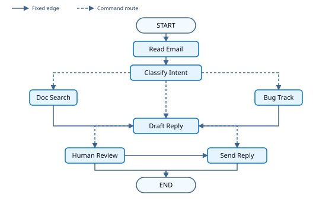

# Thinking in the Graph API

> Learn how to design agents with the LangGraph Graph API using nodes, edges, and shared state.

When you build an agent with the [Graph API](Graph%20API%20overview.md), you break the process into discrete steps called **nodes**. Then you describe the decisions and transitions from each node. Finally, you connect nodes through a shared **state** that each node can read from and write to.

This walkthrough builds a customer support email agent with the Graph API. For the same scenario with the Functional API, see [Thinking in the Functional API](../Advanced/Build%20with%20the%20Functional%20API/Thinking%20in%20the%20Functional%20API.md). To choose between the APIs, see [Choosing between Graph and Functional APIs](../Get%20started/Choosing%20between%20Graph%20and%20Functional%20APIs.md).

## Start with the process you want to automate

Imagine that you need to build an AI agent that handles customer support emails. Your product team has given you these requirements:

```txt
The agent should:

- Read incoming customer emails
- Classify them by urgency and topic
- Search relevant documentation to answer questions
- Draft appropriate responses
- Escalate complex issues to human agents

Example scenarios to handle:

1. Simple product question: "How do I reset my password?"
2. Bug report: "The export feature crashes when I select PDF format"
3. Urgent billing issue: "I was charged twice for my subscription!"
4. Feature request: "Can you add dark mode to the mobile app?"
5. Complex technical issue: "Our API integration fails intermittently with 504 errors"
```

To implement an agent with the Graph API, this guide shows you five steps. Steps 1 and 2 are planning. Steps 3 through 5 turn that plan into state, nodes, and a compiled graph you can run.

## Step 1: Map out your workflow as discrete steps

Start by identifying the distinct steps in your process. Each step becomes a **node** (a function that does one specific thing). Then sketch how these steps connect. Do this before writing code.



Solid arrows are fixed edges: you declare them when you build the graph because the next node is known before a run. Dashed arrows are routes chosen at runtime inside a node with [`Command`](https://reference.langchain.com/python/langgraph/types/Command).

Now that the components are identified, clarify what each node needs to do:

* `Read Email`: Extract and parse the email content
* `Classify Intent`: Use an LLM to categorize urgency and topic, then route to search, bug tracking, or draft
* `Doc Search`: Query your knowledge base for relevant information
* `Bug Track`: Create or update an issue in a tracking system
* `Draft Reply`: Generate an appropriate response, then route to human review or send
* `Human Review`: Escalate to a human agent for approval or handling
* `Send Reply`: Dispatch the email response

> [!TIP]
>
> Some nodes always continue on a fixed edge (`Read Email` to `Classify Intent`). Others choose the next node with `Command` (`Classify Intent`, `Draft Reply`, `Human Review`).

## Step 2: Identify what each step needs to do

For each node from Step 1, decide what kind of work it is and what context it needs. Use the categories below, then expand the email-agent examples for concrete fields and retry choices.

> [card] [LLM steps](#llm-steps)
>
> Use when you need to understand, analyze, generate text, or make reasoning decisions

> [card] [Data steps](#data-steps)
>
> Use when you need to retrieve information from external sources

> [card] [Action steps](#action-steps)
>
> Use when you need to perform external actions

> [card] [User input steps](#user-input-steps)
>
> Use when you need human intervention

### LLM steps

When a step needs to understand, analyze, generate text, or make reasoning decisions:

> [accordion] Classify intent
>
> * Static context (prompt): Classification categories, urgency definitions, response format
> * Dynamic context (from state): Email content, sender information
> * Desired outcome: Structured classification that determines routing

> [accordion] Draft reply
>
> * Static context (prompt): Tone guidelines, company policies, response templates
> * Dynamic context (from state): Classification results, search results
> * Desired outcome: Professional email response ready for review

### Data steps

When a step needs to retrieve information from external sources:

> [accordion] Document search
>
> * Parameters: Query built from intent and topic
> * Retry strategy: Yes, with exponential backoff for transient failures
> * Caching: Could cache common queries to reduce API calls

### Action steps

When a step needs to perform an external action:

> [accordion] Send reply
>
> * When to execute: After approval (human or automated)
> * Retry strategy: Yes, with exponential backoff for network issues
> * Should not cache: Each send is a unique action

> [accordion] Bug track
>
> * When to execute: Always when intent is "bug"
> * Retry strategy: Yes, critical to not lose bug reports
> * Returns: Ticket ID to include in the response

### User input steps

When a step needs human intervention:

> [accordion] Human review
>
> * Context for decision: Original email, draft response, urgency, classification
> * Expected input format: Approval boolean plus optional edited response
> * When triggered: High urgency, billing, or complex issues
> * On rejection: End the run without sending (human handles the email outside the graph)

## Step 3: Design your state

State is the shared [memory](https://docs.langchain.com/oss/python/concepts/memory.md) accessible to all nodes in your agent. Think of it as the notebook your agent uses to keep track of everything it learns and decides as it works through the process.

### What belongs in state?

Ask yourself these questions about each piece of data:

> [card] Include in state
>
> Does it need to persist across steps? If yes, it goes in state.

> [card] Do not store
>
> Can you derive it from other data? If yes, compute it when needed instead of storing it in state.

For the email agent, track:

* The original email and sender info (cannot reconstruct these later)
* Classification results (needed by later nodes)
* Search results or ticket context (expensive to re-fetch)
* The draft response (needs to persist through review)
* Execution metadata (for debugging and recovery)

### Keep state raw, format prompts on demand

> [!TIP]
>
> Store raw data in state, not formatted prompt text. Format prompts inside nodes when you need them.

That separation means:

* Different nodes can format the same data differently
* You can change prompt templates without changing the state schema
* Debugging shows the data each node received, not a baked-in prompt string

Define the state now. The nodes in the next steps use these fields.

```python
from typing import Literal, TypedDict


class EmailClassification(TypedDict):
    intent: Literal["question", "bug", "billing", "feature", "complex"]
    urgency: Literal["low", "medium", "high", "critical"]
    topic: str
    summary: str


class EmailAgentState(TypedDict):
    email_content: str
    sender_email: str
    email_id: str
    classification: EmailClassification | None
    search_results: list[str] | None  # Docs or ticket context
    draft_response: str | None
```

## Step 4: Build your nodes

A node is a Python function that takes the current state and returns updates to it. When the node also chooses the next step, return a [`Command`](https://reference.langchain.com/python/langgraph/types/Command).

### Handle errors appropriately

Before you fill in node bodies, consider how each node can fail. Attach retries on nodes that call external APIs. Use `interrupt()` for human input. Use this table as a guide:

| Error type | Who fixes it | Strategy | When to use |
| - | - | - | - |
| Transient errors (network issues, rate limits) | System (automatic) | Retry policy on the node | Temporary failures that usually resolve on retry |
| LLM-recoverable errors (tool failures, parsing issues) | LLM | Store the error in state and route back | The model can adjust with more context |
| User-fixable errors (missing information, unclear instructions) | Human | Pause with `interrupt()` | Need user input to proceed |
| Recoverable failure after retries | Developer | `error_handler` (Python) / `errorHandler` (TypeScript) | Run a compensation branch after retry exhaustion |
| Unexpected errors | Developer | Fail the run | Bugs that need a code fix |

For retry policies, timeouts, compensation handlers, LLM-recoverable loops, when to let errors bubble up, and graph-wide defaults, see [Fault tolerance](../Capabilities/Fault%20tolerance.md#recovery-strategies).

For this example, attach a retry policy when you add a node that can hit transient failures:

```python
from langgraph.types import RetryPolicy

workflow.add_node(
    "search_documentation",
    search_documentation,
    retry_policy=RetryPolicy(max_attempts=3),
)
```

### Implementing the email agent nodes

Turn each unit of work into a node. Each node reads the shared state, does one piece of work, and returns updates. When the next step depends on the result, return a `Command` with both the update and the destination. Human review is still a node: it calls `interrupt()` inside the function, not a separate graph primitive.

The stubs below show the signatures, state updates, and routing for the email agent. Replace the placeholder bodies with your real LLM calls and API integrations. Put these nodes in the same file as the state from Step 3.

`read_email` is a passthrough in this walkthrough. Keeping it as its own node still gives you a checkpoint before classification and a place to add real MIME parsing later.

```python
from typing import Literal

from langgraph.graph import END
from langgraph.types import Command, interrupt


def read_email(state: EmailAgentState) -> dict:
    """Parse and normalize the incoming email."""
    return {}


def classify_intent(
    state: EmailAgentState,
) -> Command[Literal["search_documentation", "bug_tracking", "draft_response"]]:
    """Classify intent and urgency, then route to gather context or draft."""
    # Placeholder: replace with a real LLM call.
    # This heuristic matches the try-out sample so interrupt() runs.
    lowered = state["email_content"].lower()
    if "charged" in lowered or "billing" in lowered:
        classification: EmailClassification = {
            "intent": "billing",
            "urgency": "high",
            "topic": "billing",
            "summary": "Customer reports a billing problem",
        }
    elif "crash" in lowered or "bug" in lowered:
        classification = {
            "intent": "bug",
            "urgency": "medium",
            "topic": "product bug",
            "summary": "Customer reports a bug",
        }
    else:
        classification = {
            "intent": "question",
            "urgency": "low",
            "topic": "general",
            "summary": "Customer question",
        }

    if classification["intent"] in ("question", "feature"):
        goto = "search_documentation"
    elif classification["intent"] == "bug":
        goto = "bug_tracking"
    else:
        goto = "draft_response"

    return Command(update={"classification": classification}, goto=goto)


def search_documentation(
    state: EmailAgentState,
) -> Command[Literal["draft_response"]]:
    """Search knowledge base for relevant information."""
    classification = state.get("classification") or {}
    topic = classification.get("topic", "general")
    return Command(
        update={"search_results": [f"Docs related to {topic}"]},
        goto="draft_response",
    )


def bug_tracking(state: EmailAgentState) -> Command[Literal["draft_response"]]:
    """Create or update a bug tracking ticket."""
    ticket_id = "BUG-12345"
    return Command(
        update={"search_results": [f"Bug ticket {ticket_id} created"]},
        goto="draft_response",
    )


def draft_response(
    state: EmailAgentState,
) -> Command[Literal["human_review", "send_reply"]]:
    """Draft a reply, then route to review or send."""
    classification = state.get("classification") or {}
    context = state.get("search_results") or []
    draft = f"Thanks for your email about {classification.get('topic', 'your request')}."
    if context:
        draft += f" Context: {context[0]}"

    needs_review = (
        classification.get("intent") in ("billing", "complex")
        or classification.get("urgency") in ("high", "critical")
    )
    goto = "human_review" if needs_review else "send_reply"
    return Command(update={"draft_response": draft}, goto=goto)


def human_review(
    state: EmailAgentState,
) -> Command[Literal["send_reply", END]]:
    """Pause for human review, then send or end."""
    classification = state.get("classification") or {}

    # Nodes re-run from the start on resume. Keep work before interrupt() idempotent.
    human_decision = interrupt(
        {
            "email_id": state.get("email_id", ""),
            "original_email": state.get("email_content", ""),
            "draft_response": state.get("draft_response", ""),
            "urgency": classification.get("urgency"),
            "intent": classification.get("intent"),
            "action": "Please review and approve/edit this response",
        }
    )

    if human_decision.get("approved"):
        return Command(
            update={
                "draft_response": human_decision.get(
                    "edited_response", state.get("draft_response", "")
                )
            },
            goto="send_reply",
        )
    # Rejection: human handles the email outside the graph
    return Command(update={}, goto=END)


def send_reply(state: EmailAgentState) -> dict:
    """Send the email response."""
    return {}
```

You now have node functions. Next, wire them into a compiled graph.

## Step 5: Wire it together

Connect the nodes into a graph. Because routing lives inside `Command` nodes, you only need a few fixed edges. Compile with a [checkpointer](../Capabilities/Persistence.md), which is required for `interrupt()` to pause and resume.

```python
from langgraph.checkpoint.memory import InMemorySaver
from langgraph.graph import END, START, StateGraph
from langgraph.types import RetryPolicy

workflow = StateGraph(EmailAgentState)

workflow.add_node("read_email", read_email)
workflow.add_node("classify_intent", classify_intent)
workflow.add_node(
    "search_documentation",
    search_documentation,
    retry_policy=RetryPolicy(max_attempts=3),
)
workflow.add_node(
    "bug_tracking",
    bug_tracking,
    retry_policy=RetryPolicy(max_attempts=3),
)
workflow.add_node("draft_response", draft_response)
workflow.add_node("human_review", human_review)
workflow.add_node("send_reply", send_reply)

workflow.add_edge(START, "read_email")
workflow.add_edge("read_email", "classify_intent")
workflow.add_edge("send_reply", END)

checkpointer = InMemorySaver()
app = workflow.compile(checkpointer=checkpointer)
```

Python nodes that return `Command[Literal[...]]` declare their destinations in the type hint. LangGraph uses that to know the valid edges.

### Try out your agent

After the graph is compiled, invoke it with a sample email. With the placeholder classifier above, this urgent billing message is treated as high urgency, so the run drafts a reply, hits `interrupt()`, and you can practice resume. Use the same `thread_id` for the first invoke and the resume invoke.

```python
from langgraph.types import Command

config = {"configurable": {"thread_id": "customer_123"}}

result = app.invoke(
    {
        "email_content": "I was charged twice for my subscription! This is urgent!",
        "sender_email": "customer@example.com",
        "email_id": "email_123",
    },
    config,
)
# The graph pauses at human_review when urgency is high

app.invoke(
    Command(
        resume={
            "approved": True,
            "edited_response": "We sincerely apologize for the double charge. I've initiated an immediate refund...",
        }
    ),
    config,
)
```

The graph pauses at `interrupt()`, saves state to the checkpointer, and waits. When you resume with `Command(resume=...)`, the `human_review` node re-runs from the start, `interrupt()` returns your resume value, and the graph continues. The `thread_id` keeps this conversation's state together.

## Summary and next steps

### Key insights

Building this email agent shows the Graph API way of thinking:

> [card] [Break into discrete steps](#step-1-map-out-your-workflow-as-discrete-steps)
>
> Each node does one thing well. Node boundaries are where the graph checkpoints, so failures and resumes redo less work.

> [card] [State is shared memory](#step-3-design-your-state)
>
> Store raw data, not formatted text. Different nodes can use the same information in different ways.

> [card] [Nodes are functions](#step-4-build-your-nodes)
>
> They take state, do work, and return updates. When they route, they return both the update and the next destination with `Command`.

> [card] [Errors are part of the flow](#handle-errors-appropriately)
>
> Transient failures get node retry policies, user-fixable problems pause with `interrupt()`, and unexpected errors fail the run.

> [card] [Human input is first-class](../Capabilities/Interrupts.md)
>
> `interrupt()` pauses execution and saves state. On resume, the node re-runs from the start, so keep work before `interrupt()` idempotent.

> [card] [Graph structure stays minimal](#step-5-wire-it-together)
>
> You declare essential edges. Nodes that need dynamic routing return `Command`, which keeps control flow explicit and traceable.

### Node granularity trade-offs

Most applications can use the breakdown above. Read this section when you are deciding whether to merge or split nodes.

LangGraph checkpoints at **node** boundaries. When a run resumes after an interrupt or failure, it restarts from the beginning of the node where execution stopped. Smaller nodes mean more frequent checkpoints and less work to repeat.

Why this breakdown fits the email agent:

* **Isolation of external services:** Doc Search and Bug Track are separate nodes so retries stay scoped to those API calls.
* **Visibility:** Classification is its own node, so you can inspect the structured result before the next action.
* **Different failure modes:** LLM calls, lookups, and email sends get different retry policies.
* **Testing:** Smaller nodes are easier to unit test and reuse.

Merging `Read Email` and `Classify Intent` into one node is valid. You lose a checkpoint between them and repeat both on failure. For most agents, the observability benefit of separate nodes is worth it.

Caching search results is an application-level choice inside your node functions. LangGraph does not prescribe a cache API for that. More nodes do not necessarily mean slower runs: by default, checkpoints write in the background ([async durability mode](../Capabilities/Checkpointers.md#durability-modes)).

### Where to go from here

This walkthrough introduces Graph API design. Extend it with the how-tos and related guides:

> [card] [Build checklist](Build%20checklist%20for%20the%20Graph%20API.md)
>
> Decision guide for state, control flow, Send, Command, and nodes

> [card] [Define and update state](Define%20and%20update%20state.md)
>
> Schemas, reducers, messages, and private channels

> [card] [Control flow](Build%20sequences%2C%20branches%2C%20and%20loops.md)
>
> Sequences, branches, loops, and recursion limits

> [card] [Send and Command](Use%20Send%20and%20Command.md)
>
> Map-reduce fan-out and update-and-route in one step

> [card] [Configure nodes](Configure%20nodes.md)
>
> Retries, timeouts, runtime context, and caching

> [card] [Thinking in the Functional API](../Advanced/Build%20with%20the%20Functional%20API/Thinking%20in%20the%20Functional%20API.md)
>
> The same email agent with entrypoints and tasks

> [card] [Human-in-the-loop patterns](../Capabilities/Interrupts.md)
>
> Tool approval, batch approval, and other interrupt patterns

> [card] [Add memory](../Capabilities/Memory.md)
>
> Short-term checkpointers and long-term stores

> [card] [Fault tolerance](../Capabilities/Fault%20tolerance.md)
>
> Retries, timeouts, error handlers, and graph defaults

> [card] [Subgraphs](../Capabilities/Subgraphs.md)
>
> Nested graphs for complex multi-step operations

> [card] [Streaming](../Capabilities/Streaming.md)
>
> Real-time progress updates for users
